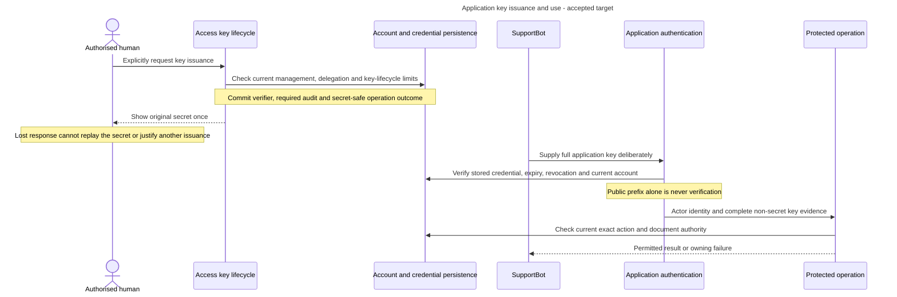

# Application accounts and keys

Alice connects SupportBot to Production. Giving the bot her browser cookie or CLI token would make it act as Alice. Instead, the bot has a separate project-bound application account and its own incoming Inframeld credential.

## Choose a focused reading task

- For exact key format, request fields and delivery variants, read [Application key contracts](application-key-contracts.md).

## Identity, permissions and issuance

An application key identifies its account. The account's current permissions determine what a valid key may do. Issuance is not a permanent permission ceiling copied onto that key. Removing a grant or suspending/deleting the account takes effect under current checks even while the key bytes stay unchanged.

Human and application principals share the local membership and grant model, but applications receive only eligible use permissions. They cannot acquire human-only delegation, incoming-credential administration, group management or budget-policy administration. Application HTTP/MCP clients use Inframeld keys, with no implicit Hydra client-credentials grant. Saved provider secrets serve a different outbound purpose.

## Issue a key, then use its current account authority

**Accepted target, not an implemented authenticator.** Issuance and use are separate operations. The logical participants below do not establish new class or endpoint names.

The successful arrows require their preceding checks to pass. A rejection has no credential-family fallback. The account remains SupportBot during key rotation, with its current grants and memberships. The optional CLI connection journey reviews the existing account, document groups and exact grants, then uses ordinary authorized creation/assignment and explicit show-once issuance. Setup issues no key automatically. Any paid live test needs separate approval and acts as the application. It cannot export the human's Hydra credential or widen scope.

[The authentication architecture](#application-key-authentication-architecture) explains the verifier/service/authorizer split. [Key contracts](application-key-contracts.md) own exact format, response variants and rejection/availability outcomes.

### Supply an existing application key deliberately

Alice can paste a `rag-ci` key into a hidden terminal prompt to test that application's access. Requests then act only as `rag-ci`, not Alice or a union of their permissions. Browser login remains the human path. Incoming application keys, human OAuth tokens and outgoing provider keys are distinct credentials.

Application mode must be explicit. Conflicting human/application choices are usage errors. Accepting an existing key neither issues another key nor creates an account, grants authority, changes selected human state or revokes another credential. The application remains bound to its one project and current permissions. Target/project flags cannot expand that scope, and a failed application key cannot fall back to a saved human login or Hydra verification.

Before accepting/transmitting a raw key, resolve the registered target and show its exact canonical API destination, not only its label. The person or automation supplying the opaque key asserts it belongs there: local inspection of a prefix or raw-key file cannot prove the issuing server. A wrong selected server may receive the key before verification fails. Never try other targets, follow an unapproved credential-bearing redirect or promise offline wrong-server detection. Preserve verified remote HTTPS and the separate managed-local exception.

Interactive input disables echo before reading and restores terminal state on success, failure and cancellation. Allow user-initiated paste without accessing the clipboard automatically. Do not echo any part of the secret, including in validation errors. Hidden input does not protect against clipboard history, terminal interception or a compromised host.

Unattended input uses an explicit protected file or stdin, with exactly one selected credential source. A qualified external secret-store integration may supply input. No vendor integration is selected here. Only the file path appears in arguments. Do not suggest a literal secret argument, shell substitution into argv, `echo SECRET` or a token environment variable. Do not opportunistically consume a piped document/question as a key. If another payload needs stdin, select a different credential source or fail before dispatch. Missing/unreadable/malformed input or a required interactive secret under `--no-input` fails without a prompt, browser, credential search or identity fallback.

Verification uses an ordinary specified non-model authentication check and reports only authorized safe identity/project information. It does not query a Pipeline, test provider credentials, spend money or establish permission for every later action. A timeout remains unconfirmed. Concrete verification endpoint, flags, application-context defaults and handling of human account selectors remain contracts. Never borrow a human account's saved project for application execution.

Input is not consent to persist. Keep the key out of settings, repository files, shell profiles, `.env`, logs, JSON, HTTP traces, crash reports and history. Any offered secure-store save requires explicit approval and destination/application binding. Failure has no plaintext fallback. Application alias/save/select/forget/rotation details remain engineering work, not implicitly inherited human refresh semantics. Cancellation retains no hidden retry secret and restores the terminal. Reads, requests and retries remain bounded. Factory reset removes CLI-managed credential state, not user-owned external secret files or remote installations.

Qualified tests must demonstrate hidden entry and echo restoration, no clipboard access, redaction, conflicting/missing input rejection, headless behavior, wrong destination/audience, expired/revoked keys, unavailable verification, no human fallback, no model call and no retained canceled/failed input. Key issuance/show-once delivery and the existing two-usable-key limit remain separate workflows. Importing a key cannot recover a lost secret or silently revoke another key.

  

## SupportBot's lifecycle

SupportBot's account holds its permissions. Its key proves that a request comes from that account. Keeping these separate means replacing a key does not create a new identity or a new set of permissions.

### Alice creates SupportBot

With Create application accounts on Support, Alice can create SupportBot in that project. It starts with no action permissions, document access, or key. It does not copy Alice's access.

Alice receives explicit **can use and grant** assignments for Issue application keys, Revoke application keys, and Delete application account on SupportBot. These belong to Alice, not the bot. They can be transferred or removed like other grants and give her no authority over other applications.

Authorized people then give SupportBot the actions and group memberships it needs. An application belongs to one project and cannot move between projects under this design. Humans may belong to several projects.

### Alice creates a key after SupportBot gains HR access

Someone holding a valid SupportBot key can use SupportBot's full current permissions, subject to the key's intended use and restrictions. Creating one therefore requires an authorized human who passes **both** checks:

1. They have Issue application keys on SupportBot.
2. They may grant every permission SupportBot currently holds, on each exact resource, and manage every document group it belongs to.

Being able to use those actions or read those documents is insufficient. Suppose Alice can issue SupportBot keys but cannot grant HRPrivate access. Once another authorized person adds SupportBot to HRPrivate, Alice can no longer create or replace its keys. Someone who passes both checks must do that.

Creating a key does not change the application's permissions. The backend checks the issuer and the application again when saving the key, alongside any competing permission changes. Yesterday's approval cannot authorize a replacement today.

### Existing keys follow the account's current permissions

Adding SupportBot to HRPrivate gives **every existing valid SupportBot key** that access. This includes a key still held by an earlier issuer who could not personally grant HR access. Removing a permission removes it for all the account's keys.

Keys do not keep a snapshot of old permissions or inherit their creator's personal permissions. V1 deliberately has one permission set per application. Use separate accounts, such as SupportBot and HRBot, when different users or integrations need different access. Multiple keys support replacement and individual revocation, not different permission sets.

### Alice and Bob both use the bot

When either person uses the customer application, Inframeld sees SupportBot. Sending `userId: Alice`, a group name, or an MCP argument cannot turn its request into Alice's request. Unsupported claims to act for another user are rejected.

A **canary-affinity key** keeps related requests on the same release version during a trial rollout. It helps route a request, but proves nothing about the human using the bot. Choose bot permissions that are safe for everyone who can invoke the integration. Hiding a button in its UI does not enforce each employee's personal Inframeld access.

Future user delegation would require a verified identity and a credential tied to the correct application and API. Checks would include who issued it, its intended recipient, expiry, token type, and scope. The request could use only permissions held by **both** the application and the user. An arbitrary signed token, another client's ID token, or a forwarded human session would not suffice. The protocol and revocation behavior remain undecided.

### A key leaks or needs replacement

Incoming keys are opaque secrets, meaning the key itself contains no readable permission claims. They must be generated with enough randomness to resist guessing. Inframeld stores only a cryptographic hash or verifier and safe metadata, never the plaintext key. The secret is shown once. If the creation response is lost, retrying cannot retrieve it. See [credential retry outcomes](#secrets).

A key is accepted only while unexpired and unrevoked, for its intended installation, audience, and supported adapter. Here, **audience** means the service or API the credential is intended for. The account must also retain the necessary current permissions.

A human with Issue or Revoke permission may see safe key IDs, prefixes, creation and expiry dates, and status. They may not see secrets or hashes. Viewing this metadata does not require the extra authority to grant all the application's permissions. Creating a key does.

An application may have **at most two usable keys** across supported audiences. Unexpired, non-revoked keys count toward this limit. Retained records of expired or revoked keys do not. Normal replacement has three steps:

1. Issue a second key.
2. Update and test the integration with it.
3. Explicitly revoke the old key.

Different authorized people may perform these steps. There is no separate Rotate permission, automatic revocation of the old key, or silent removal of a key to free a slot. [The accepted key contract](application-key-contracts.md#application-key-contract) sets the operator-configurable 90-day default and 365-day maximum.

**Revoke application keys is independent of Issue.** Bob can revoke a leaked HRBot key without reading HR documents or being able to grant HRBot's permissions. He may revoke the last usable key immediately. That blocks authentication through the key without deleting the account, its grants, or its human administrators. Neither Issue nor Revoke includes the other.

Replacing a key preserves the principal, its canary routing identity, and ownership of requests tracked for safe retries. Revoking a key cannot recall work already sent elsewhere.

### Retiring SupportBot does not delete its work

Delete application account is a separate human permission on that application. It permanently retires SupportBot, revokes every key, and removes its project membership, group memberships, action permissions, and the human administration grants over it. Key creation and permission changes must not race with deletion and leave the account usable. No replacement key administrator is needed for an account being deleted.

Documents, versions, cases and other project-owned work produced by SupportBot remain with the project. The human-provisioned Pipelines and Deployments it used remain too. Deleting the account gives Alice no additional permission to read or erase them. Historical attribution follows the usual retention and erasure rules. Creating another account named SupportBot cannot reactivate the old identity or its keys.

## Application-key authentication architecture

Alice gives SupportBot its own application key. When the bot queries Production, checking its credential, admitting its current account and authorizing the requested operation have distinct responsibilities.

**Status:** [ADR-0074](../../../../docs/adr/ADR-0074-separate-application-key-verification-from-local-admission.md) accepts a focused verifier coordinated by an application authentication service. This is target architecture. Application-key authentication and its production qualification remain unfinished.

 

### Separate credential verification from local admission

The verifier checks the complete credential against the stored verifier and required credential bindings/lifecycle state. It returns only the verified `ApplicationKeyId` and the associated application `PrincipalId`, derived from the verified stored binding. This minimal internal result contains no secret, verifier digest, account state or grants.

The authentication service uses that principal ID to load the current application account through a focused reader, applies current local admission checks and then constructs `AccessContextDTO` with the actor and `ApplicationKeyAuthenticationDTO` for the verified key ID. The [intermediate result](credential-and-recovery-records.md#application-key-verification-result) and the final authentication context have different jobs. Operation authorizers retain current action and protected-input checks, including before replay.

The service receives the verifier through an injected application-owned contract. Infrastructure performs credential I/O. These are components inside the existing backend, and neither the verifier nor the context supplies cached grants. Competing credentials fail before verification. Failed verification never falls back to another credential family.

This split follows the responsibility separation in [implemented human authentication](credential-dispatch.md#implemented-human-authentication), while preserving each path's own lifecycle. It keeps credential failure handling and account policy independently testable. It requires an explicit contract between them, unlike the combined authenticator considered in ADR-0074.

### Existing authorizers check current key state

SupportBot's key can pass verification and then be revoked before a protected operation reaches authorization. The earlier verification result cannot authorize that operation.

Existing Access authorizers own the fresh key-state check for incoming protected requests and replays. They use the key ID in `AccessContextDTO` to obtain current stored key facts and check its actor binding, expiry and revocation alongside current account and permission facts. The consuming application service calls its ordinary Access authorization capability. It does not need a separate mandatory credential-guard call.

For writes, these checks participate in the operation's transaction and applicable coordination rules before protected work or replay. The verifier still establishes ownership of the submitted secret during authentication. Later key-state checks use the non-secret evidence and do not retain or forward that secret. Keep fact loading in infrastructure and interpretation/decisions in Access's application/domain components, following the [credential query and policy boundary](eligibility-and-current-authority.md#credential-query-and-policy-boundaries).

This is accepted ownership for the future application-key path. The current human OAuth generation flag does not prove key validity, and the inspected authorizers' synthetic application-key fixtures do not implement this fresh key-state check. Exact lifecycle checkpoints and concurrency mechanisms remain to specify.

### Contracts still needed before implementation

Agree exact verification inputs, expiry/revocation checkpoint and concurrency mechanics, and the credential lifecycle of already-admitted background work before implementing the affected paths. The component split, minimal two-ID result, rejection/availability contract and existing-authorizer ownership are settled, while those details remain open. Existing [public authentication outcomes](../../../../docs/development/error-handling.md#authentication-contract) remain authoritative. The accepted [key format, verifier algorithm and lifetime](application-key-contracts.md#application-key-contract), current-account authority, two-usable-key limit and show-once delivery remain unchanged.

## Recover secret operations safely

Creating an Inframeld key and saving a customer's provider key have different recovery paths. The first creates a secret the user must receive. The second receives a secret the user already has.

### Inframeld-issued API and service keys are shown once

Generate incoming API and service keys from at least **32 cryptographically random bytes**. Store only their hash, safe prefix, permitted scope, owner, expiry and revocation state, and safe metadata.

Return plaintext once on successful creation. **Never store it in an idempotency response cache.** Use the [shared keyed request fingerprint](../../inframeld-application-contracts/references/idempotency-and-replay.md) and safe outcome metadata. A timeout or nonzero CLI exit does not prove issuance failed or authorize another key.

For example, an administrator creates a CI credential using idempotency key `create-ci-7`. Inframeld creates credential K, but the connection drops before the administrator receives K’s plaintext.

Retrying `create-ci-7` returns K’s identifier and **`secretAvailable: false`**. It neither creates another credential nor recovers the original secret.

The administrator revokes K, then requests a new key with a new idempotency key. The retry deliberately returns a safe description of the first creation, not a copy of its secret-bearing response. [The application-key lifecycle](application-key-contracts.md#typed-response-alternatives) records `secretAvailable: true` only for first delivery. Incoming keys remain bound to the server-derived installation/project and current account, not a caller-submitted permission set.

Invitation issuance likewise generates a 32-random-byte protected token, stores only verification material and safe metadata, and delivers plaintext once. The [HTTP draft](grant-contracts.md#http-operation-matrix) specifies first-delivery/replay fields and the separate activation reservation bound to verified Kratos authority/subject before local admission. Original activation resolves consumption before any new-write checks. Lost-response recovery cannot mint a second invitation or recover cached plaintext. [Invitation activation](admission-and-invitations.md#invitations) instead recovers the original consumed intent and assignments under its verified-recipient admission boundary.

## Authorization failure scenarios

| Situation | Required outcome |
| --- | --- |
| Run simultaneous departures, group deletion, key creation, or first publication. | They cannot bypass handover, leave a reference to a deleted group, create a third usable key, or publish an unintended release. |

| Situation | Required outcome |
| --- | --- |
| Key issuance succeeds but its secret-bearing response is lost. | Recover the same key metadata with `secretAvailable: false`. Do not emit another key or cached plaintext. |
| Two key issuers see one usable key and race. | Coordinated commit admits at most one further usable key. No silent revocation to free a slot. |
| Project erasure is admitted while uploads/key issuance/publication race. | Coordinated project block fences new effects. Shutdown precedes data erasure. Original eligible initiator's content-free status can survive membership removal. |

## Pending decisions for dependent implementation

Before choosing an unresolved implementation contract, load only the entry whose trigger applies:

- [PD-ACCESS-01: Check application-key currentness at the right boundary](decision-key-currentness.md). Before defining the application-key verifier/authenticator contracts or implementing key-aware authorizers and protected replay.
- [PD-ACCESS-02: Keep durable work and credential lifetime explicit](decision-admitted-work-authority.md). Before admitting, executing or resuming durable work that must interpret credential expiry, rotation, revocation or replacement.

## Status and sources

The prefix, credential dispatch, complete key format/lifetimes and account-authority rules are accepted design. Application-key verification and remaining lifecycle/runtime qualification are unfinished. Authorization fixtures simulating key IDs do not establish provisioning or an authenticator.

MCP retains the accepted preconfigured, header-capable two-tool profile without implied OAuth discovery or verified user delegation.

- [Application authority](#applications), [key recognition](application-key-contracts.md#application-key-contract), [full verification/lifetimes](application-key-contracts.md#application-key-contract), [key input](#cli-application-key-input) and [credential dispatch](credential-dispatch.md#credential-dispatch).
- [Secret retry contract](../../inframeld-application-contracts/references/jobs-and-recovery.md), [Access key lifecycle](application-key-contracts.md#typed-response-alternatives), [identity records](identity-and-grant-records.md#access) and [MCP authentication](../../inframeld-application-contracts/references/mcp-transport.md#authentication).
- [ADR-0017](../../../../docs/adr/ADR-0017-let-valid-application-keys-use-current-account-permissions.md) explains current permissions. [ADR-0018](../../../../docs/adr/ADR-0018-use-opaque-expiring-and-revocable-application-credentials.md) explains opaque, expiring, revocable credentials.
