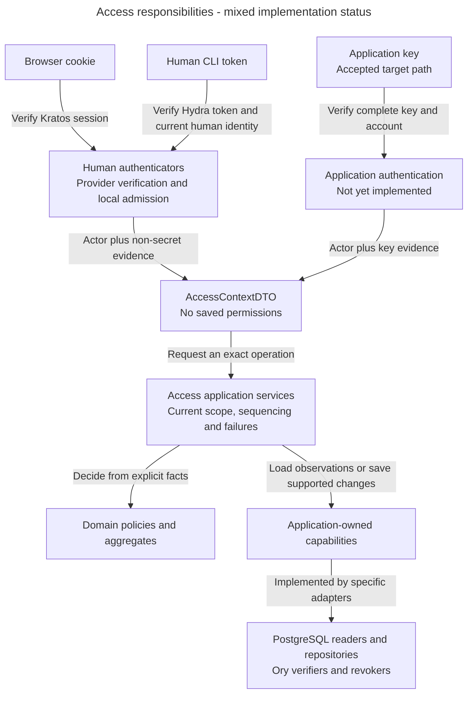
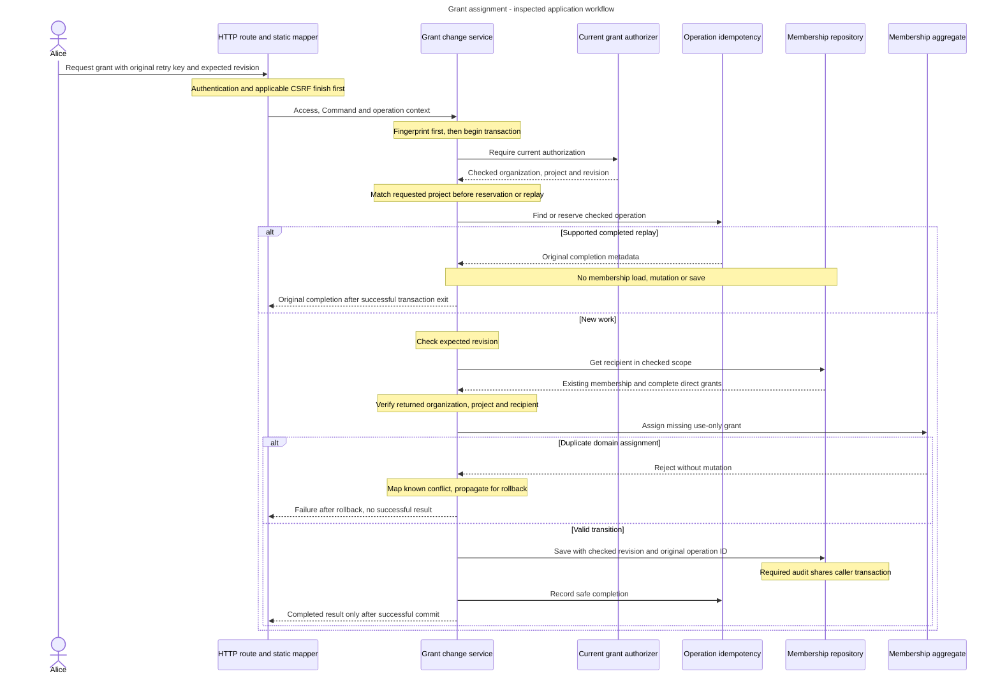

# Access architecture: identify the caller, then check authority

Alice grants Bob permission to create access groups on Support. Before changing anything, Inframeld must establish Alice's identity, check her current authority and protect Bob's existing assignments. A successful login alone cannot answer all three questions.

## Contents

- [What Access owns](#what-access-owns)
- [Main parts and boundaries](#main-parts-and-boundaries)
- [Follow the implemented grant operation](#follow-the-implemented-grant-operation)
- [Data and execution](#data-and-execution)
- [What exists today](#what-exists-today)
- [Decisions still needed and sources](#decisions-still-needed-and-sources)

## What Access owns

Access owns local principals, membership, action grants, document audiences, credential eligibility and recovery blocks. A principal is a stable local identity, such as Alice or SupportBot. Kratos verifies human identity and sessions. Hydra handles human CLI OAuth credentials. Access resolves those observations to the existing local account and checks product rules.

OAuth is the browser-assisted protocol that lets the CLI obtain tokens without collecting Alice's password. CSRF protection stops another site from abusing automatically sent cookies to submit a protected change as Alice.

Browser and human CLI paths identify Alice. An Inframeld application key identifies SupportBot, even when Alice issued it. Outgoing provider secrets serve a different purpose and do not authenticate an incoming caller.

## Main parts and boundaries

**Accepted responsibility view.** The human paths, consent and focused grant/recovery foundations have inspected code. Application-key authentication and the full production recovery chain remain unfinished.

Arrows show workflow responsibilities, not source import direction. Infrastructure classes explicitly implement application protocols. Business rules do not import HTTP, SQLAlchemy or Ory SDK types. Provider calls stay outside SQL transactions. A protocol describes a capability and its caller obligations without choosing the technology.

The implemented human services are `HumanSessionAuthenticationService` and `HumanAccessTokenAuthenticationService`. `HumanOAuthConsentService` checks a fresh Hydra request and browser identity, independently of local product admission. Consent approval carries a checked credential binding. Inspection and denial initialise no credential state. The [CLI workflow](human-cli-login.md) explains the capture/verify/reread ordering and its limits.

Current operation checks use focused authorizers and policies. `PrincipalAccessEvaluationService` interprets authentication evidence against current facts. `ActionAuthorizationService` and `ProjectGrantAuthorizationService` coordinate their specific decisions. Neither a typed ID nor an `AccessContextDTO` proves current authority.

## Follow the implemented grant operation

For this operation, Alice needs use-and-grant authority for the exact action on Support. Bob receives permission to use that action, without permission to delegate it. The expected revision detects changes since Alice reviewed the state. The fingerprint is a keyed summary of the requested meaning, so the same retry key cannot be reused for another request.

An aggregate owns a cohesive set of state and valid transitions. Here `ProjectMembership` owns one recipient's complete direct-grant collection. Its repository loads that existing aggregate and persists supported additions without committing. The application service coordinates the complete request.

**Inspected workflow.** This sequence summarises `ProjectGrantChangeService.assign_use_only`. It is separate from a hypothetical generic command framework.

The successful returns require transaction exit to succeed. Rejections, incompatible outcomes, save/completion failures and cancellation propagate for rollback. A commit communication failure follows the original-key recovery contract. It does not authorise fresh work with a new key.

Idempotency means recognising a repeated operation and its original meaning. Current authorization still runs before replay. The expected revision is checked for new work, while a valid replay returns the original result without changing membership again. Loading and saving stay outside the narrow duplicate-error catch.

## Data and execution

`ProjectMembershipRepository` is an application port. Its PostgreSQL adapter keeps exact loaded instances and value snapshots within one caller transaction, saves attributed use-only additions and advances the project-wide revision once. It never provisions membership, authorizes, commits or retries. Discard its state after transaction end or a failed save.

`IdentityRecovery` owns one cleanup checklist. Its repository and local completion service record trusted outcomes and release only that original eligible obligation. Independent blocks and permanent CLI credential invalidation remain separate. A confirmed provider outcome is not sufficient evidence for every production completion condition.

Bootstrap constructs transaction-bound collaborators with one clean request-local session. Authentication readers use independent short sessions after provider verification. The consent metadata initializer is a bounded ordering exception and closes before browser provider I/O.

## What exists today

Inspected examples are [the grant service](../../../../apps/backend/src/inframeld_backend/access/application/services/project_grant_change_service.py), [membership aggregate](../../../../apps/backend/src/inframeld_backend/access/domain/entities/project_membership.py), [repository contract](../../../../apps/backend/src/inframeld_backend/access/application/protocols/project_membership_repository.py), [PostgreSQL adapter](../../../../apps/backend/src/inframeld_backend/access/infrastructure/repositories/postgres_project_membership_repository.py) and [bootstrap composition](../../../../apps/backend/src/inframeld_backend/bootstrap/project_grant_composition.py).

Also inspect [human consent](../../../../apps/backend/src/inframeld_backend/access/application/services/human_oauth_consent_service.py), [recovery aggregate](../../../../apps/backend/src/inframeld_backend/access/domain/entities/identity_recovery.py) and [local completion](../../../../apps/backend/src/inframeld_backend/access/application/services/identity_recovery_completion_service.py) before describing their behaviour. These paths establish source presence, not checks personally rerun.

The [Principal summary](../../../../docs/development/data-model.md#implemented-principal-model) and [evidence records](../../../../docs/development/data-model.md#authentication-evidence-records) describe the implemented [Access context](../../../../apps/backend/src/inframeld_backend/access/application/dtos/access_context_dto.py). [ADR-0073](../../../../docs/adr/ADR-0073-carry-explicit-authentication-evidence-in-access-contexts.md) requires actor identity plus complete non-secret authentication evidence. The context retains no current account-state or permission snapshot, so each operation still checks current authority.

Application-key lifecycle, the account UI, complete CLI delivery and safe production recovery orchestration retain their recorded qualification gaps. Use [browser sessions](browser-sessions.md), [CLI login](human-cli-login.md), [application keys](application-keys.md) and [recovery](recovery.md) for their own views. The [Coding Standards service example](../../inframeld-coding-standards/references/services-and-use-cases.md) contains contextual code.

## Decisions still needed and sources

[ADR-0074](../../../../docs/adr/ADR-0074-separate-application-key-verification-from-local-admission.md) accepts a focused application-key verifier coordinated by an application authentication service. The verifier returns only the verified `ApplicationKeyId` and associated `PrincipalId`. The service loads the current application account, applies local admission and constructs the context.

The [logical result](../../../../docs/development/data-model.md#application-key-verification-result) carries no secret, account state or grants. Operation authorization remains separate. Existing Access authorizers obtain fresh key-state facts by key ID and check the current actor binding, expiry and revocation before protected work or replay, with the owning transaction/coordination for writes. This accepted responsibility is not an implemented application-key check.

Rejected credentials return no verified result. Recognized verification-dependency availability failures raise `DependencyUnavailableError`, while unexpected failures and cancellation propagate. The [owning guide](../../../../docs/development/access-control.md#application-key-verification-outcomes) defines their service/HTTP translation and retains exact input, temporal lifecycle/coordination and already-admitted job credential details still to resolve. The [current-key authorization section](../../../../docs/development/access-control.md#application-key-current-authorization) records the settled existing-authorizer ownership. This accepted boundary does not establish an implemented authenticator or change the key/evidence contract.

[Access control](../../../../docs/development/access-control.md), [Access contracts](../../../../docs/development/access-contracts.md), [Access records](../../../../docs/development/data-model.md#access) and [the service guide](../../../../docs/development/application-structure.md#service-writing-guide) own the rules. The [architecture decision index](../../../../docs/adr/README.md) owns accepted choices and supersession.

## Pending decisions for dependent implementation

The ordinary behavior above remains owned by its current sources. Before choosing an unresolved implementation contract, load only the matching entry:

- [PD-ACCESS-01: Check application-key currentness at the right boundary](decision-key-currentness.md). Before defining the application-key verifier/authenticator contracts or implementing key-aware authorizers and protected replay.
- [PD-ACCESS-02: Keep durable work and credential lifetime explicit](decision-admitted-work-authority.md). Before admitting, executing or resuming durable work that must interpret credential expiry, rotation, revocation or replacement.
- [PD-ACCESS-03: Prove recovery cleanup before releasing product access](decision-recovery-production-completion.md). Before wiring production recovery admission/completion callbacks, cleanup orchestration, issuance coordination or block release.
- [PD-ACCESS-04: Coordinate first account admission with identity recovery](decision-recovery-first-admission.md). Before implementing first local admission, invitation activation/provisioning or recovery completion that can race with admission.
- [PD-ACCESS-05: Implement and qualify the selected provider-secret lifecycle](decision-provider-secret-lifecycle.md). When implementing protected provider-credential management, storage or deployment-key integration, and before claiming the complete secret boundary is qualified.
- [PD-ACCESS-06: Authorize setup details before a Deployment exists](decision-setup-read-authority.md). Before defining defaults/setup read contracts or implementing HTTP/MCP/CLI prepublication status resolution.
