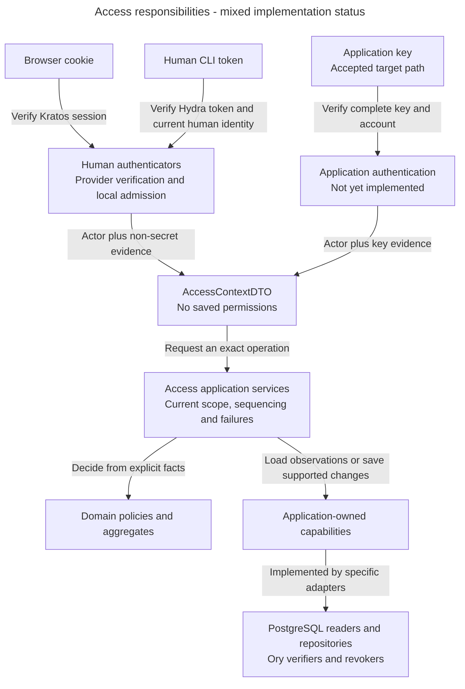
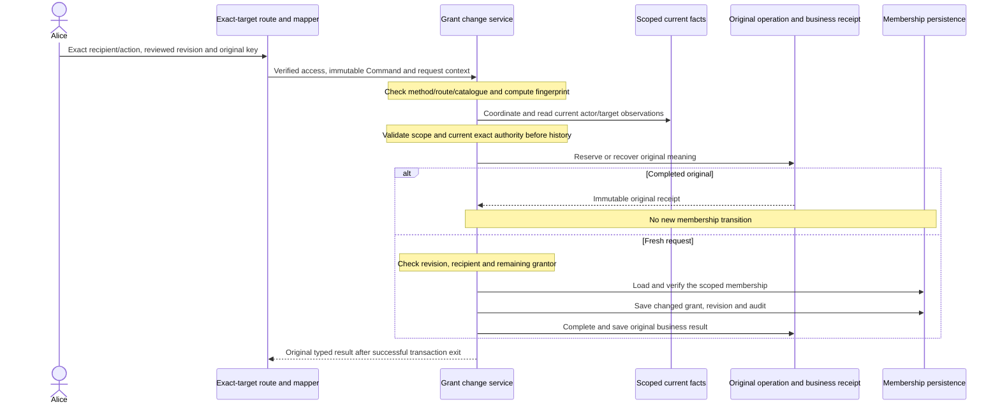

# Access architecture: identify the caller, then check authority

Alice grants Bob permission to create access groups on Support. Before changing anything, Inframeld must establish Alice's identity, check her current authority and protect Bob's existing assignments. A successful login alone cannot answer all three questions.

## What Access owns

Access owns local principals, membership, action grants, document audiences, credential eligibility and recovery blocks. A principal is a stable local identity, such as Alice or SupportBot. Kratos verifies human identity and sessions. Hydra handles human CLI OAuth credentials. Access resolves those observations to the existing local account and checks product rules.

OAuth is the browser-assisted protocol that lets the CLI obtain tokens without collecting Alice's password. CSRF protection stops another site from abusing automatically sent cookies to submit a protected change as Alice.

Browser and human CLI paths identify Alice. An Inframeld application key identifies SupportBot, even when Alice issued it. Outgoing provider secrets serve a different purpose and do not authenticate an incoming caller.

## Main parts and boundaries

**Accepted responsibility view.** The human paths, consent and focused grant/recovery foundations have inspected code. Empty application-account creation and authorized account/key metadata reads are implemented. Group creation, member/manager administration, exact inspection and unused-group deletion are implemented. Application-key verification, local admission, current PostgreSQL authorization and HTTP/MCP components are implemented, while full feature qualification and public key lifecycle delivery remain unfinished. Protected host continuation is implemented separately from product authentication. Native callbacks, the dedicated cleanup worker and proof-backed completion are implemented.

Arrows show workflow responsibilities, not source import direction. The diagram's application-key branch describes the persisted authentication workflow. Its verifier, local admission, independent current-key reads and transaction-bound Project action facts are implemented as described in [the application-key architecture](application-keys.md#application-key-authentication-architecture). This does not establish complete client/platform qualification or delivery of public issuance and mounted MCP. Infrastructure classes explicitly implement application protocols. Business rules do not import HTTP, SQLAlchemy or Ory SDK types. Provider calls stay outside SQL transactions. A protocol describes a capability and its caller obligations without choosing the technology.

The implemented human services are `HumanSessionAuthenticationService` and `HumanAccessTokenAuthenticationService`. `HumanOAuthConsentService` checks a fresh Hydra request and browser identity, independently of local product admission. Consent approval carries a checked credential binding. Inspection and denial initialise no credential state. The [CLI workflow](human-cli-login.md) explains the capture/verify/reread ordering and its limits.

`HumanOAuthClientProvisioner` is the separate host-authorized installation capability for Hydra's fixed CLI registration. Its SDK adapter reconciles foreign provider state without an application transaction, account creation or grant mutation. Bootstrap owns the short-lived client and command lifecycle. API startup does not mutate registration. See [client provisioning](human-cli-login.md#cli-client-registration) and [provider lifetimes](human-cli-credential-lifecycle.md#provider-lifetime-configuration).

`IdentityRecoveryCleanupResumeService` implements the protected host-maintenance capability. Its thin Access CLI maps stdin and results. Bootstrap owns database resources, and the service coordinates current recovery facts and atomic receipt/run persistence. Host access supplies authority, without a product session or a synthetic principal. [Maintenance](host-maintenance.md#recovery-cleanup-continuation) owns its exact contract.

Current operation checks use focused authorizers and policies. `PrincipalAccessEvaluationService` interprets authentication evidence against current facts. `ActionAuthorizationService` coordinates ordinary action checks. Each grant service composes its current facts with the existing principal, visibility and exact-grant policies. Neither a typed ID nor an `AccessContextDTO` proves current authority.

## Repair one stranded Access responsibility

Alice is an eligible Support member, but SupportKnowledge has no eligible manager. [Private host maintenance](host-maintenance.md#access-owned-authority-repair) can establish her membership and management of that exact group. The same consumer can repair one use-and-grant action on an Organization, Project, group, application account or Model Connection. Host execution supplies authority and the verified ordinary identity binds the recipient.

[StrandedAuthorityMaintenanceCli](../../../../apps/backend/src/inframeld_backend/access/cli/stranded_authority_maintenance_cli.py) verifies recipient proof before opening the application service's SQL session. Bootstrap owns the [private dispatch and resource composition](../../../../apps/backend/src/inframeld_backend/bootstrap/stranded_authority_repair_composition.py). [StrandedAuthorityRepairService](../../../../apps/backend/src/inframeld_backend/access/application/services/stranded_authority_repair_service.py) coordinates current recipient eligibility, exact target, reviewed revision and original-result replay. The [PostgreSQL facts reader](../../../../apps/backend/src/inframeld_backend/access/infrastructure/readers/postgres_stranded_authority_repair_facts_reader.py) owns identity/Organization/Project ordering and refreshed stranded-state observations. The [writer](../../../../apps/backend/src/inframeld_backend/access/infrastructure/writers/postgres_stranded_authority_repair_writer.py) saves only the checked assignment, revision, audit and original in that transaction.

The database foundation and private installed-command path are locally qualified, including real Ory verification for Model Connections. The metadata-only proof example retains its scope while broader operator proof acquisition remains unfinished. Pipeline, Deployment, Collection, Source and profile owners still supply their target integration and tests through the [repair ownership boundary](host-maintenance.md#maintenance-resource-integration).

## Authorize selected Document evidence

The locally qualified [document-access foundation](query-and-document-authorization.md#document-access-foundation) owns source readability, not Query authority or a public resource workflow. [DocumentAccessService](../../../../apps/backend/src/inframeld_backend/access/application/services/document_access_service.py) implements [DocumentAccessAuthorizer](../../../../apps/backend/src/inframeld_backend/access/application/protocols/document_access_authorizer.py), composing existing credential, principal and Project checks with the pure [DocumentReadPolicy](../../../../apps/backend/src/inframeld_backend/access/domain/policies/document_read_policy.py). It returns a readable subset or requires the complete evidence bundle.

[PostgresDocumentAccessFactsReader](../../../../apps/backend/src/inframeld_backend/access/infrastructure/readers/postgres_document_access_facts_reader.py) implements [DocumentAccessFactsReader](../../../../apps/backend/src/inframeld_backend/access/application/protocols/document_access_facts_reader.py) on the caller's active READ COMMITTED transaction. Organization/Project/key coordination precedes refreshed actor, membership, audience-group, credential and recovery observations. Application keys require an explicitly injected trusted adapter profile. The reader opens no independent transaction, commits nothing and calls no provider.

Trusted receiving producers supply [selected version observations](../../../../apps/backend/src/inframeld_backend/access/application/dtos/selected_document_source_dto.py) and [complete current Document observations](../../../../apps/backend/src/inframeld_backend/access/application/dtos/current_document_access_dto.py). Knowledge still owns their real lifecycle/audience joins and writer coordination. Receivers refresh those observations after waits at every protected boundary, independently authorize the operation and close the short transaction before network work. These DTOs and returned source pairs are not cached decisions. Real Document, retrieval, model-dispatch and retained-evidence integrations keep their own product tests.

## Read Project members from current facts

Alice created Support and wants to inspect its stored memberships. The registered `GET /v1/projects/{project_id}/members` route calls [ProjectMembersService](../../../../apps/backend/src/inframeld_backend/access/application/services/project_members_service.py). The service requires a currently eligible human, current Project membership and permission to use `manage-project-members`. Delegation authority is not required. Human cookie and Hydra bearer authentication retain their ordinary current-credential checks.

The [PostgreSQL facts reader](../../../../apps/backend/src/inframeld_backend/access/infrastructure/readers/postgres_project_members_facts_reader.py) observes caller eligibility facts, Project state/revision, membership, the exact action assignment and a bounded member page in one statement. It scopes stored rows before position and limit, retaining the authorization header even for an empty continuation. The service interprets the same facts before returning member data. This is a focused read capability, not another grant writer or authorization framework.

The read returns stored human/application relationships, including inactive members, in principal-ID order. It exposes only stable principal IDs, display names and kinds, plus the Project ID, current Access revision and continuation. Its [endpoint-owned cursor](../../../../apps/backend/src/inframeld_backend/access/application/value_objects/project_members_cursor.py) binds the installation, Organization, Project and order position. The unsigned encoding carries no authority, expiry or snapshot guarantee. Each page obtains fresh facts and authorization. [The membership workflow](memberships-groups-and-handover.md#read-stored-project-members) owns the contract and failures.

The [read guide](../../../../apps/docs/src/app/guides/list-project-members/page.mdx) assumes an existing accepted human credential. [Human qualification #319](https://github.com/matejpalenik/inframeld/issues/319) remains unready until supported setup and the relevant procedures exist.

## Change Project membership without restoring authority

Alice adds the already-admitted Bob through `PUT /v1/projects/{project_id}/members/{principal_id}` and later removes him through `DELETE` at the same path. The registered [router](../../../../apps/backend/src/inframeld_backend/access/http/routes/project_membership_routes.py) maps bounded JSON for PUT and a required scalar revision query for bodyless DELETE into [ProjectMembershipChangeService](../../../../apps/backend/src/inframeld_backend/access/application/services/project_membership_change_service.py). Both operations require current human eligibility, Project membership and use of `manage-project-members`. Adding Bob creates only membership. It grants no action or group access.

The [facts reader](../../../../apps/backend/src/inframeld_backend/access/infrastructure/readers/postgres_project_membership_change_facts_reader.py) locks the Organization and then the Project before loading actor and membership state. The service checks Alice’s current permission before recovering a receipt. Only a new removal of an existing member with the reviewed revision needs to load other people’s grants and group relationships. The [departure policy](../../../../apps/backend/src/inframeld_backend/access/domain/policies/project_departure_policy.py) decides whether those relationships leave an eligible replacement. A manager must also be an ordinary member of that group. Group management can substitute for that group’s document actions only.

The [writer](../../../../apps/backend/src/inframeld_backend/access/infrastructure/writers/postgres_project_membership_change_writer.py) saves membership effects, the Project Access revision, audit and the original business receipt in the same transaction. Departure removes the recipient's Project, group and application-account grants, manager assignments before group memberships, then Project membership. Grants that Alice merely assigned to others survive. Admission, credentials, other Projects and Project-owned content survive too. Rejoining restores none of the removed relationships.

Current authorization runs before replay. The original receipt remains independent of the removable membership row, so replay reports the original status, change flag and revision without applying the old change again. [The workflow](memberships-groups-and-handover.md#change-project-membership) owns the exact contract and [lifecycle persistence](access-lifecycle-persistence.md#project-membership-original-results) owns receipt storage. Public grant mutation remains separate work. Group administration now has its own focused services. The [task guide](../../../../apps/docs/src/app/guides/manage-project-members/page.mdx) does not supply their unfinished setup procedures or establish human qualification.

## Create and inspect Project-bound application identities

Access implements the empty-account [creation and safe inspection workflow](application-keys.md#implemented-application-account-creation). `ApplicationAccountCreationService` coordinates current human creation authority, original-operation recovery and atomic persistence. Its PostgreSQL writer saves a shared principal and same-ID extension, required Project membership, three fixed creator assignments, audit and immutable original result in one transaction. Bootstrap supplies the clean shared session through `application_account_composition.py`.

`ApplicationAccountReadService` interprets current scoped observations before disclosing one account or a bounded safe key page. Its facts reader uses one statement for caller/account authority and metadata, preserving the header on empty key continuations. The shared eligibility evaluator remains the owner of credential/recovery interpretation. Account visibility requires an exact human administration action. Key metadata separately needs Issue or Revoke. Neither service implements key issuance, incoming-key authentication, revocation, retirement or a Project-wide account directory.

## Administer and retire one access group

`AccessGroupCreationService`, `AccessGroupRelationshipService`, `AccessGroupReadService` and `AccessGroupDeletionService` own focused group operations. Bootstrap supplies request-local sessions and the existing idempotency and transaction collaborators. They reuse the current Project actor projection and admitted-human candidate predicates rather than adding another authorization engine.

Writes take Organization-shared then Project-exclusive coordination before observing current actors, recipients and reviewed revisions. The relationship policy keeps management inside ordinary membership, and the existing departure policy protects an eligible remaining human. Exact metadata and manager-only pages use a short compatible read turn.

The PostgreSQL writers save Name bindings, relationships, revision, audit and immutable original results together. Deletion also publishes authentic synchronous completion through the existing retained binding/observation records. The [group workflow](memberships-groups-and-handover.md#inspect-and-administer-access-groups) owns visibility and the [closed recovery contract](../../inframeld-application-contracts/references/operation-recovery-contracts.md#access-group-deletion-recovery) owns post-deletion initiator status. Saved future-upload default references are implemented by the [upload-default contract](upload-default-contracts.md#persistence-and-admission-boundaries). Actual future Document, source and active-upload references remain with their producers.

## Saved future-upload audiences

The [upload-default service](../../../../apps/backend/src/inframeld_backend/access/application/services/project_upload_default_service.py) owns authoritative GET and revision-checked PUT, complete current old/new-group management, original-result recovery and atomic replacement. Its PostgreSQL facts reader also implements the narrow `ProjectUploadAudienceReader` projection for upload admission. That observation neither requires administration GET permission nor grants Add documents. The [contract](upload-default-contracts.md) owns public fields, currentness, no-op and replay behavior. Knowledge #41 retains actual consumption and Document audience writes, #264 the administration journey and #349 starter provisioning.

## Admit and observe one Project deletion

Alice may delete a Project without permission to read its private documents. The current candidate’s [ProjectDeletionService](../../../../apps/backend/src/inframeld_backend/access/application/services/project_deletion_service.py) owns current human Delete authority, exact original replay and atomic admission. [Its composition](../../../../apps/backend/src/inframeld_backend/bootstrap/project_deletion_composition.py) supplies the shared transaction, guarded facts, immutable result reader and admission writer. The transaction saves a real block and durable obligation before returning `202`.

[ProjectDeletionJobHandler](../../../../apps/backend/src/inframeld_backend/access/application/services/project_deletion_job_handler.py) delegates the exact local child to [ProjectDeletionShutdownService](../../../../apps/backend/src/inframeld_backend/access/application/services/project_deletion_shutdown_service.py). Authentic retained backing and the current job fence authorize local effects after later membership changes. The writer saves application/key shutdown and its parent checkpoint together, without claiming physical completion. [Lifecycle persistence](access-lifecycle-persistence.md#project-deletion-admission-and-shutdown) owns that sequence.

The registered HTTP route exposes only the original admission result. Known-ID status and the closed saved-identity lookup disclose the same content-free retained projection to the currently eligible original initiator. They restore neither membership nor mutation authority. The registered admission and retained-status interfaces are declared in native OpenAPI and represented by the selected Python, TypeScript and Rust clients. Current-head platform CI and human acceptance remain separate delivery requirements. Physical cleanup, later Knowledge/Indexing/Pipeline/Release effect fencing and CLI delivery keep their receiving owners.

## Follow the implemented grant operation

For this operation, Alice needs use-and-grant authority for the exact action on Support. Bob receives permission to use that action, without permission to delegate it. The expected revision detects changes since Alice reviewed the state. The fingerprint is a keyed summary of the requested meaning, so the same retry key cannot be reused for another request.

An aggregate owns a cohesive set of state and valid transitions. Here `ProjectMembership` owns one recipient's complete direct-grant collection. Its repository loads that existing aggregate and persists supported additions without committing. The application service coordinates the complete request.

**Inspected workflow.** `ProjectGrantChangeService.set_action_grant` and `remove_action_grant` delegate to one exact Project workflow. The concrete Organization, group and application-account services retain explicit scope and policy rather than sharing a generic grant executor.

An unchanged authorized request records its no-change receipt without advancing the revision or adding a change audit. Required writes share one transaction. A return inside the context waits for commit. Rejection, persistence failure and cancellation roll back. Uncertain output retains the original request identity and never becomes permission for an automatic fresh write.

The Organization service takes Organization-exclusive coordination. Project-scoped grant services take Organization-shared then Project-exclusive coordination. Group managers can authorize ordinary same-group document-grant operations and same-write replay. Generic retained metadata lookup in every family still requires exact current eligible-human use-and-grant. The [grant workflow](grant-administration.md#exact-grant-management-and-bounded-reads) owns that distinction.

## Data and execution

`ProjectMembershipRepository` is an application port. Its PostgreSQL adapter keeps exact loaded instances and value snapshots within one caller transaction, persists supported aggregate transitions and advances the Project-wide revision for a real change. Its original addition-only method remains separate from exact set/remove persistence. It never provisions membership, authorizes, commits or retries. Discard its state after transaction end or a failed save.

`IdentityRecovery` owns one cleanup checklist. Its repository and local completion service record trusted outcomes and release only that original eligible obligation. Independent blocks and permanent CLI credential invalidation remain separate. A confirmed provider outcome is not sufficient evidence for every production completion condition.

Bootstrap constructs transaction-bound collaborators with one clean request-local session. Authentication readers use independent short sessions after provider verification. The consent metadata initializer is a bounded ordering exception and closes before browser provider I/O.

## What exists today

Inspected examples are [the grant service](../../../../apps/backend/src/inframeld_backend/access/application/services/project_grant_change_service.py), [membership aggregate](../../../../apps/backend/src/inframeld_backend/access/domain/entities/project_membership.py), [repository contract](../../../../apps/backend/src/inframeld_backend/access/application/protocols/project_membership_repository.py), [PostgreSQL adapter](../../../../apps/backend/src/inframeld_backend/access/infrastructure/repositories/postgres_project_membership_repository.py) and [bootstrap composition](../../../../apps/backend/src/inframeld_backend/bootstrap/project_grant_composition.py).

Also inspect [human consent](../../../../apps/backend/src/inframeld_backend/access/application/services/human_oauth_consent_service.py), [recovery aggregate](../../../../apps/backend/src/inframeld_backend/access/domain/entities/identity_recovery.py) and [local completion](../../../../apps/backend/src/inframeld_backend/access/application/services/identity_recovery_completion_service.py) before describing their behaviour. These paths establish source presence, not checks personally rerun.

The [Principal summary](implemented-access-models.md#implemented-principal-model) and [evidence records](credential-and-recovery-records.md#authentication-evidence-records) describe the implemented [Access context](../../../../apps/backend/src/inframeld_backend/access/application/dtos/access_context_dto.py). [ADR-0073](../../../../docs/adr/ADR-0073-carry-explicit-authentication-evidence-in-access-contexts.md) requires actor identity plus complete non-secret authentication evidence. The context retains no current account-state or permission snapshot, so each operation still checks current authority.

Application-key lifecycle, the account UI, complete CLI delivery and safe production recovery orchestration retain their recorded qualification gaps. Use [browser sessions](browser-sessions.md), [CLI login](human-cli-login.md), [application keys](application-keys.md) and [recovery](recovery.md) for their own views. The [Python Standards service example](../../inframeld-python-standards/references/services-and-use-cases.md) contains contextual code.

## Decisions still needed and sources

[ADR-0074](../../../../docs/adr/ADR-0074-separate-application-key-verification-from-local-admission.md) accepts a focused application-key verifier coordinated by an application authentication service. The inspected [PostgresApplicationKeyVerifier](../../../../apps/backend/src/inframeld_backend/access/infrastructure/verifiers/postgres_application_key_verifier.py) and [ApplicationAuthenticationService](../../../../apps/backend/src/inframeld_backend/access/application/services/application_authentication_service.py) define that split. The verifier returns only the verified `ApplicationKeyId` and associated `PrincipalId`. The service requests the current application account, applies local admission and constructs the context. The local-admission `read` and current-key `read_current` on [PostgresApplicationAuthenticationFactsReader](../../../../apps/backend/src/inframeld_backend/access/infrastructure/readers/postgres_application_authentication_facts_reader.py) are implemented. The current-key read requires READ COMMITTED isolation and uses Organization, Project and key shared locks, then observes database UTC and scalar non-secret key bindings.

The [logical result](credential-and-recovery-records.md#application-key-verification-result) carries no secret, account state or grants. Operation authorization remains separate. [PostgresProjectActionFactsReader](../../../../apps/backend/src/inframeld_backend/access/infrastructure/readers/postgres_project_action_facts_reader.py) supplies current key-state and exact-grant facts to existing Access authorizers on the calling operation's session. It retains coordinated locks in that transaction and observes database UTC after waits. The authorizer checks actor binding, expiry and revocation before protected work or replay. [The current-key section](application-keys.md#application-key-current-authorization) explains explicit trusted-profile injection and the unchanged human credential boundary.

Rejected credentials return no verified result. Recognized verification-dependency availability failures raise `DependencyUnavailableError`, while unexpected failures and cancellation propagate. The [owning guide](application-key-contracts.md#verification-results-and-unresolved-currentness) defines their service/HTTP translation. The accepted [key ordering](decision-key-currentness.md#approved-resolution) and [durable-job authority](decision-admitted-work-authority.md#approved-resolution) contracts resolve the temporal details and remain unchanged. These backend components, registered routes and generated clients do not establish merged delivery, mounted MCP, public issuance or complete TypeScript, platform, public-example and full-feature qualification.

[Access control](authorization.md), [Access contracts](actions-and-initial-grants.md), [Access records](identity-and-grant-records.md#access) and [the service guide](../../inframeld-python-standards/references/services-and-use-cases.md#service-writing-guide) own the rules. The [architecture decision index](../../../../docs/adr/README.md) owns accepted choices and supersession.

### Shared Access eligibility and focused lifecycle behavior

Alice's recovery block affects authentication, action use and delegation. Adding a separate boolean argument to every operation would spread one rule across the backend. [ADR-0064](../../../../docs/adr/ADR-0064-centralize-principal-eligibility-and-keep-access-aggregates-focused.md) instead gives common product eligibility one domain-policy owner and a cohesive input. Human authentication, project action authorization and the supported grant command now use this structure. The focused recovery aggregate, repository and completion service implement local checklist transitions, persistence and per-flow release. Native callback delivery and the dedicated provider-cleanup worker now connect those pieces. Protected host continuation uses the separate [maintenance capability](host-maintenance.md#recovery-cleanup-continuation).

| Component | Current responsibility or planned lifecycle work |
| --- | --- |
| `Principal` | Preserve local account identity and observed kind/status. Add lifecycle methods with the suspension/restoration workflows that require them. |
| `PrincipalAccessPolicyInput` | Carry the observed Principal, pending-recovery fact and evaluated credential currentness together. It is a frozen, slotted domain policy input for one attempt. |
| `PrincipalAccessPolicy` | Own the pure common active-account check and compose it with no-pending-recovery for product use. It performs no I/O. |
| Authentication, action and delegation policies | Compose common eligibility, then apply their own caller-kind and operation-specific rules. Visibility remains a distinct decision. |
| Application DTOs and operation-specific policy inputs | Facts DTOs report stored observations. Application services build the cohesive principal input for operation policies. A DTO remains data, not a domain aggregate. |
| Access authorization operations | Coordinate exact-scope facts, visibility and authority checks. Action authorization returns the checked organization and project. Grant authorization also returns the current project access revision needed by the caller's transaction. Its result grants no future authority. |
| PostgreSQL facts readers | Load the required values and convert them at the boundary. Prefer a single facts projection rather than executing another reader inside a reader. |
| `IdentityRecovery` | Protect the original flow's independent provider outcomes and local release transition. The application must first check current eligibility and competing obligations. |
| `IdentityRecoveryRepository` | Load and save an existing checklist within one caller-owned transaction. Preserve original admission metadata and reject conflicting changed saves. |

`ProjectActionFactsDTO` carries the stored `principal`, while `ProjectGrantChangeFactsDTO` carries the stored `actor`. Both also report `has_pending_recovery` and neutral `HumanCredentialFactsDTO` through the existing `oauth_credential_facts` field. Browser and human OAuth evidence require these current observations. After loading these observations, the owning service calls `PrincipalAccessEvaluationService.evaluate()` to interpret the authentication evidence and construct `PrincipalAccessPolicyInput`. Operation policies compose that input with membership and exact-grant facts. Readers do not evaluate eligibility, and policies do not import application DTOs or ORM types. [Credential query and policy boundaries](eligibility-and-current-authority.md#credential-query-and-policy-boundaries) explain the full chain.

Keep public capabilities specific. `ActionAuthorizer` remains the entry point for ordinary action checks. [`ProjectGrantChangeService`](../../../../apps/backend/src/inframeld_backend/access/application/services/project_grant_change_service.py) reads `ProjectActionGrantManagementFactsDTO`, evaluates current credentials and applies existing policies before reservation or replay. The concrete Organization, group and application-account services do the same for their exact targets. Their transaction-bound authorization scope is not a reusable certificate or a universal authorization engine.

The application operation owns the grant transaction under [ADR-0065](../../../../docs/adr/ADR-0065-application-services-own-write-transactions.md) and supplies its session to transaction-bound adapters. Bootstrap owns opening and closing that request-local session. Lower-level admission and persistence helpers remain caller-transaction bound. Lock acquisition and updates may require several statements. Facts used together should come from a coherent projection where practical, with recovery expressed alongside current membership and grant existence. Shared SQL-expression construction may be factored without performing I/O. Missing installation metadata must remain distinguishable from an absent block.

The [shared Project-actor query](../../../../apps/backend/src/inframeld_backend/access/infrastructure/readers/project_actor_queries.py) retains its seven-field projection, and [its mapper](../../../../apps/backend/src/inframeld_backend/access/infrastructure/mappers/postgres_project_actor_mapper.py) retains existing keyword inputs. The neutral facts type changes the interpretation for both human evidence families, not the original scope or transaction ownership. The narrow credential-state/raw-four path remains separate from [complete authentication/link state](../../../../apps/backend/src/inframeld_backend/access/application/dtos/human_authentication_state_dto.py).

The grant facts reader takes the shared organization lock before the exclusive project lock. Linked recovery admission takes the conflicting exclusive organization lock. Both adapters bound their database work and leave commit or rollback to the caller. [Access](eligibility-and-current-authority.md#shared-principal-eligibility) owns their current five-second deadlines and failure behavior. Provider calls stay outside these transactions.

The shared input, composed policies, authorization boundaries and linked-recovery coordination are implemented. [Recovery authorization tests](../../../../apps/backend/tests/integration/access/test_recovery_authorization_postgres.py) check current-state replay and concurrent writes in PostgreSQL. The recovery aggregate protects cleanup-state transitions and its repository persists them. The completion service now checks current local release facts. The dedicated cleanup worker now supplies provider checkpoints and proof-backed completion.

[ADR-0082](../../../../docs/adr/ADR-0082-coordinate-first-admission-and-recovery-by-identity.md) accepts an additional [identity-coordination boundary](identity-admission-coordination.md) for first admission, recovery admission/completion and credential-state initialization. It precedes required organization/project locks and works before any account or version row exists. Access owns this specific coordination, while the application transaction owns its lifetime. The diagram in that workflow covers first admission and recovery together. The shared coordinator and recovery admission/completion/initialization adapters implement this ordering. First admission remains future work. Ordinary project-grant operations retain their current coordination.

[Access behavior](eligibility-and-current-authority.md#shared-principal-eligibility) owns failure ordering and recovery exceptions. [Attempt-local inputs](credential-and-recovery-records.md#principal-eligibility-inputs) own the record distinction. Database authorization evidence is separate from the implemented provider-cleanup workflow and the remaining account-UI/CLI lifecycle qualification.

The [recovery repository](../../../../apps/backend/src/inframeld_backend/access/application/protocols/identity_recovery_repository.py) follows the same specific-repository boundary as membership persistence. It loads an already admitted `IdentityRecovery` by trusted installation/provider and original flow. The [PostgreSQL adapter](../../../../apps/backend/src/inframeld_backend/access/infrastructure/repositories/postgres_identity_recovery_repository.py) tracks exact instances and private value snapshots on one active transaction. It saves only provider outcomes and release time, conditional on the original admission and loaded values still matching. A changed stored value raises `ConflictError`, requiring rollback and a new repository/load before another decision. Unchanged saves perform no writes or freshness check. The adapter adds no explicit coordination locks, commits, provider calls or automatic retries. Original operation ID, event kind and admission time remain infrastructure metadata, outside the domain entity. [Recovery records](credential-and-recovery-records.md#identity-cleanup-records) describe the mapping and [PostgreSQL tests](../../../../apps/backend/tests/integration/access/test_identity_recovery_repository_postgres.py) exercise its behavior.

[`IdentityRecoveryCompletionService`](../../../../apps/backend/src/inframeld_backend/access/application/services/identity_recovery_completion_service.py) implements `IdentityRecoveryCleanupRecorder` through direct `TransactionManager`, completion-facts and repository dependencies. Its configured installation/provider scope is server-owned. Within its transaction it checks the original event, validates the loaded aggregate, applies supplied provider outcomes and uses `IdentityRecoveryReleasePolicy` before saving. The policy requires both confirmations and either an active human or no local account. It reuses `PrincipalAccessPolicy.is_account_active()` without pretending a recovery block is absent for ordinary product access. Each flow releases only itself under [ADR-0069](../../../../docs/adr/ADR-0069-release-completed-recovery-obligations-independently.md).

The [completion facts reader](../../../../apps/backend/src/inframeld_backend/access/infrastructure/readers/postgres_identity_recovery_completion_facts_reader.py) uses the same session and locks the linked organization before reading current account/admission/other-flow facts in a typed projection. Its five-second deadline includes lock waits. Returned other-pending metadata is observational, not authority. Missing admission conflicts instead of provisioning an obligation. An already released repeat skips mutation/save, while an unreleased repeat can recheck local eligibility. [The Access walkthrough](recovery-completion.md#recovery-completion-workflow) owns the complete local sequence and qualification limits. Private callback delivery, provider execution and proof-backed release are implemented. The worker delegates each original completion to a fresh operation-local session and repository. [ADR-0085](../../../../docs/adr/ADR-0085-bind-password-settings-evidence-to-original-recoveries.md) resolves their design: private adapters authenticate and map native evidence, Access application workflows own receipt/association/job transactions, and the worker performs the two provider steps outside SQL with fenced checkpoints. [Delivery records](credential-and-recovery-records.md#recovery-delivery-records) are supporting persistence, not a new domain or generic workflow framework. The existing aggregate keeps each original checklist. Bulk Hydra calls are implemented separately.

### Follow the implemented human-session request

Alice can call the same session route from her browser or CLI. The browser supplies a Kratos cookie. The CLI supplies a human access token in `Authorization: Bearer ...`. The route should return the same local `principalId`, but each credential needs its own verification steps.

| Stage | Component or port | Responsibility |
| --- | --- | --- |
| Credential selection | `HumanSessionDependency` | Receives a session or Project-grant request and selects the cookie or human bearer service. |
| Browser verification | `HumanSessionAuthenticationService` and `KratosBrowserSessionVerifier`, implementing `BrowserSessionVerifier` | Verify the browser session through the Kratos public API. |
| Human bearer verification | `HumanAccessTokenAuthenticationService`, `HydraAccessTokenVerifier` implementing `HumanAccessTokenVerifier`, and `KratosHumanIdentityVerifier` implementing `HumanIdentityVerifier` | Introspect the access token through the Hydra private API, then check the current identity through the Kratos private API. |
| Browser local facts | `PostgresHumanCredentialStateReader`, implementing `HumanCredentialStateReader` | Read the captured and current authentication state from PostgreSQL in independent short sessions, including the linked principal. |
| Human bearer local facts | `PostgresHumanIdentityLinkReader`, implementing `HumanIdentityLinkReader` | Read PostgreSQL in an independent short session and return the principal’s ID, Organization, kind and status. |
| Shared eligibility | `HumanAuthenticationPolicy.may_authenticate` | Both authentication services apply the local human eligibility policy. |
| Returned context | `AccessContextDTO` | Both services return `PrincipalId` and the exact authentication evidence. |

These collaborators run inside one backend. Provider API endpoints are external, and PostgreSQL is the application database. The captured-browser/current-facts and linked-human consent components are implemented. Full suspension/restoration, provider deletion and cleanup jobs remain separate unfinished work. The services call their adapters in the order below. The table does not describe separate business services.

1. `HumanSessionDependency` reads the original headers and cookie. It rejects repeated or malformed Authorization, a Kratos cookie combined with Authorization, and unsupported credential families before provider verification. A missing credential returns 401 even when providers are not configured. An `ifm_app_` key never reaches Hydra through these human routes.
2. On the cookie path, `HumanSessionAuthenticationService` discovers the identity through `KratosBrowserSessionVerifier`, reads captured installation/version and complete local-link state, then freshly verifies the same cookie and exact identity. A final local read must preserve that binding and eligible principal. Both provider verifications share the original provider deadline within the unchanged total budget.
3. On the bearer path, `HumanAccessTokenAuthenticationService` first calls `HydraAccessTokenVerifier`. Private introspection checks token kind, validity and the configured issuer/client/audience/scope. It then calls `KratosHumanIdentityVerifier` to check that the same human identity is currently eligible. Both adapters bound their SDK calls and return application-owned identity values.
4. Cookie authentication uses `PostgresHumanCredentialStateReader.read_authentication_state()` for its initial and final coherent observations. Bearer authentication retains `PostgresHumanIdentityLinkReader` and the narrow credential-state read. Each local read uses an independent short session. No session remains open across provider verification.
5. The selected service applies `HumanAuthenticationPolicy.may_authenticate`. A verified identity still needs an existing active local human. The result is `AccessContextDTO` containing that account's ID and the exact browser-session or OAuth evidence established by authentication. It contains no cached status or permission snapshot.
6. The session route converts the ID to the existing `CurrentSessionResponse`: `{"principalId": "<uuid>"}`. A business route instead uses that identity to check its current permissions. The project-grant route performs those checks and its change, audit and idempotency work in a short transaction.

Cookie-authenticated writes also pass `CSRFProtectionDependency` after authentication and before the route runs. They need both the CSRF marker and a trusted Origin. Human bearer writes do not require those browser headers. Every new request repeats its required provider and local checks, including a request to replay a previously saved result.

Malformed or competing credentials return 400. Missing/rejected/expired credentials return 401. Missing local admission or an ineligible local principal returns 403. Required verification that cannot be confirmed returns 503. A supplied credential whose provider is not configured also returns 503. [Access](credential-dispatch.md#implemented-human-authentication) explains the cases, test coverage and current limits, while [HTTP errors](../../../../docs/development/error-handling.md#authentication-contract) owns exact problem and challenge values.

Authentication establishes the caller. A later `ActionAuthorizationService.require_authorization` reads current visibility, membership, account and exact-grant facts. It checks `ProjectVisibilityPolicy`, converts the reader DTO into `ActionAuthorizationPolicyInput`, then checks `ActionAuthorizationPolicy`. Hidden targets stay 404 and visible targets without authority stay 403. Its PostgreSQL reader uses the caller's transaction, unlike the independently scoped authentication reader.

## Decision references for dependent implementation

[PD-ACCESS-03 is resolved](decision-recovery-production-completion.md). Use the accepted [private handoff](private-recovery-handoff.md), [completion workflow](recovery-completion.md) and [host continuation](host-maintenance.md#recovery-cleanup-continuation) for their inspected implementations and qualification limits. First-setup proof acquisition, future resource repair integrations and account restoration retain their separate work. The entries below distinguish accepted policies from choices still pending.

Apply the accepted entries below when their scope matches. Discuss only choices still explicitly marked pending:

- [PD-ACCESS-01 (accepted): Check application-key currentness at the right boundary](decision-key-currentness.md). Before defining the application-key verifier/authenticator contracts or implementing key-aware authorizers and protected replay.
- [PD-ACCESS-02 (accepted): Keep durable work and credential lifetime explicit](decision-admitted-work-authority.md). Before admitting, executing or resuming durable work that must interpret credential expiry, rotation, revocation or replacement.
- [PD-ACCESS-05 (accepted): Implement and qualify the selected provider-secret lifecycle](decision-provider-secret-lifecycle.md). When implementing protected provider-credential management, storage or deployment-key integration, and before claiming the complete secret boundary is qualified.
- [PD-ACCESS-06 (accepted): Authorize setup details before a Deployment exists](decision-setup-read-authority.md). Before defining defaults/setup read contracts or implementing HTTP/MCP/CLI prepublication status resolution.

### Private recovery entry point

`IdentityRecoveryNotificationHandler` exposes admission, settings association and password-saved evidence. Its service owns association decisions and coordinates existing domain transitions. A scoped facts reader reports observations after coordination, while the evidence writer persists checked associations, receipts and the supplied initial budget. The application budget value derives operational limits from the stored receipt time. It grants no authority to dispatch cleanup. [The private process](private-recovery-handoff.md#implemented-private-delivery) shares backend code and database configuration, not the public router or browser-authentication composition. A receipt and cleanup handoff are supporting records, not new aggregate roots.
