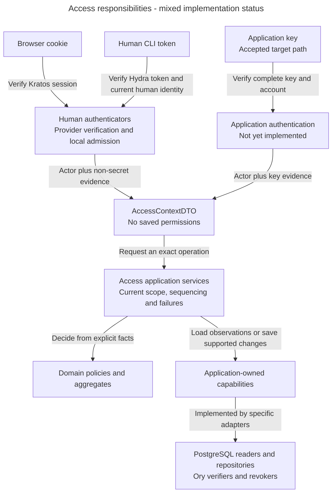
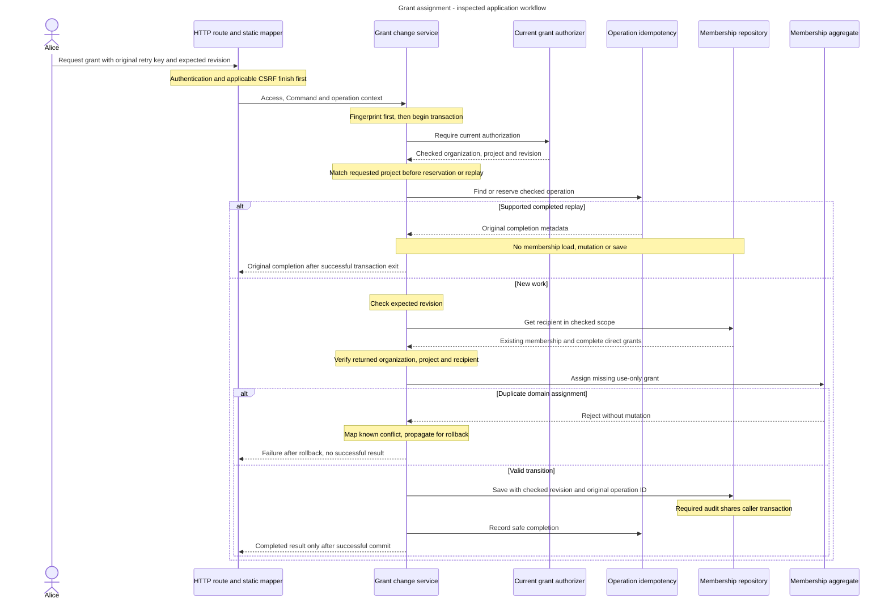
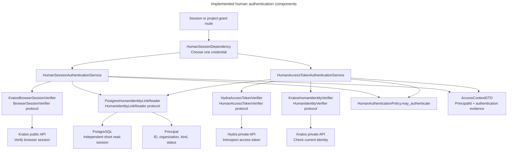

# Access architecture: identify the caller, then check authority

Alice grants Bob permission to create access groups on Support. Before changing anything, Inframeld must establish Alice's identity, check her current authority and protect Bob's existing assignments. A successful login alone cannot answer all three questions.

## What Access owns

Access owns local principals, membership, action grants, document audiences, credential eligibility and recovery blocks. A principal is a stable local identity, such as Alice or SupportBot. Kratos verifies human identity and sessions. Hydra handles human CLI OAuth credentials. Access resolves those observations to the existing local account and checks product rules.

OAuth is the browser-assisted protocol that lets the CLI obtain tokens without collecting Alice's password. CSRF protection stops another site from abusing automatically sent cookies to submit a protected change as Alice.

Browser and human CLI paths identify Alice. An Inframeld application key identifies SupportBot, even when Alice issued it. Outgoing provider secrets serve a different purpose and do not authenticate an incoming caller.

## Main parts and boundaries

**Accepted responsibility view.** The human paths, consent and focused grant/recovery foundations have inspected code. Application-key authentication remains unfinished. Protected host continuation is implemented separately from product authentication. Native callbacks, the dedicated cleanup worker and proof-backed completion are implemented.

Arrows show workflow responsibilities, not source import direction. Infrastructure classes explicitly implement application protocols. Business rules do not import HTTP, SQLAlchemy or Ory SDK types. Provider calls stay outside SQL transactions. A protocol describes a capability and its caller obligations without choosing the technology.

The implemented human services are `HumanSessionAuthenticationService` and `HumanAccessTokenAuthenticationService`. `HumanOAuthConsentService` checks a fresh Hydra request and browser identity, independently of local product admission. Consent approval carries a checked credential binding. Inspection and denial initialise no credential state. The [CLI workflow](human-cli-login.md) explains the capture/verify/reread ordering and its limits.

`HumanOAuthClientProvisioner` is the separate host-authorized installation capability for Hydra's fixed CLI registration. Its SDK adapter reconciles foreign provider state without an application transaction, account creation or grant mutation. Bootstrap owns the short-lived client and command lifecycle. API startup does not mutate registration. See [client provisioning](human-cli-login.md#cli-client-registration) and [provider lifetimes](human-cli-credential-lifecycle.md#provider-lifetime-configuration).

`IdentityRecoveryCleanupResumeService` implements the protected host-maintenance capability. Its thin Access CLI maps stdin and results. Bootstrap owns database resources, and the service coordinates current recovery facts and atomic receipt/run persistence. Host access supplies authority, without a product session or a synthetic principal. [Maintenance](host-maintenance.md#recovery-cleanup-continuation) owns its exact contract.

Current operation checks use focused authorizers and policies. `PrincipalAccessEvaluationService` interprets authentication evidence against current facts. `ActionAuthorizationService` and `ProjectGrantAuthorizationService` coordinate their specific decisions. Neither a typed ID nor an `AccessContextDTO` proves current authority.

## Follow the implemented grant operation

For this operation, Alice needs use-and-grant authority for the exact action on Support. Bob receives permission to use that action, without permission to delegate it. The expected revision detects changes since Alice reviewed the state. The fingerprint is a keyed summary of the requested meaning, so the same retry key cannot be reused for another request.

An aggregate owns a cohesive set of state and valid transitions. Here `ProjectMembership` owns one recipient's complete direct-grant collection. Its repository loads that existing aggregate and persists supported additions without committing. The application service coordinates the complete request.

**Inspected workflow.** This sequence summarises `ProjectGrantChangeService.assign_use_only`. It is separate from a hypothetical generic command framework.

The successful returns require transaction exit to succeed. Rejections, incompatible outcomes, save/completion failures and cancellation propagate for rollback. A commit communication failure follows the original-key recovery contract. It does not authorise fresh work with a new key.

Idempotency means recognising a repeated operation and its original meaning. Current authorization still runs before replay. The expected revision is checked for new work, while a valid replay returns the original result without changing membership again. Loading and saving stay outside the narrow duplicate-error catch.

## Data and execution

`ProjectMembershipRepository` is an application port. Its PostgreSQL adapter keeps exact loaded instances and value snapshots within one caller transaction, saves attributed use-only additions and advances the project-wide revision once. It never provisions membership, authorizes, commits or retries. Discard its state after transaction end or a failed save.

`IdentityRecovery` owns one cleanup checklist. Its repository and local completion service record trusted outcomes and release only that original eligible obligation. Independent blocks and permanent CLI credential invalidation remain separate. A confirmed provider outcome is not sufficient evidence for every production completion condition.

Bootstrap constructs transaction-bound collaborators with one clean request-local session. Authentication readers use independent short sessions after provider verification. The consent metadata initializer is a bounded ordering exception and closes before browser provider I/O.

## What exists today

Inspected examples are [the grant service](../../../../apps/backend/src/inframeld_backend/access/application/services/project_grant_change_service.py), [membership aggregate](../../../../apps/backend/src/inframeld_backend/access/domain/entities/project_membership.py), [repository contract](../../../../apps/backend/src/inframeld_backend/access/application/protocols/project_membership_repository.py), [PostgreSQL adapter](../../../../apps/backend/src/inframeld_backend/access/infrastructure/repositories/postgres_project_membership_repository.py) and [bootstrap composition](../../../../apps/backend/src/inframeld_backend/bootstrap/project_grant_composition.py).

Also inspect [human consent](../../../../apps/backend/src/inframeld_backend/access/application/services/human_oauth_consent_service.py), [recovery aggregate](../../../../apps/backend/src/inframeld_backend/access/domain/entities/identity_recovery.py) and [local completion](../../../../apps/backend/src/inframeld_backend/access/application/services/identity_recovery_completion_service.py) before describing their behaviour. These paths establish source presence, not checks personally rerun.

The [Principal summary](implemented-access-models.md#implemented-principal-model) and [evidence records](credential-and-recovery-records.md#authentication-evidence-records) describe the implemented [Access context](../../../../apps/backend/src/inframeld_backend/access/application/dtos/access_context_dto.py). [ADR-0073](../../../../docs/adr/ADR-0073-carry-explicit-authentication-evidence-in-access-contexts.md) requires actor identity plus complete non-secret authentication evidence. The context retains no current account-state or permission snapshot, so each operation still checks current authority.

Application-key lifecycle, the account UI, complete CLI delivery and safe production recovery orchestration retain their recorded qualification gaps. Use [browser sessions](browser-sessions.md), [CLI login](human-cli-login.md), [application keys](application-keys.md) and [recovery](recovery.md) for their own views. The [Python Standards service example](../../inframeld-python-standards/references/services-and-use-cases.md) contains contextual code.

## Decisions still needed and sources

[ADR-0074](../../../../docs/adr/ADR-0074-separate-application-key-verification-from-local-admission.md) accepts a focused application-key verifier coordinated by an application authentication service. The verifier returns only the verified `ApplicationKeyId` and associated `PrincipalId`. The service loads the current application account, applies local admission and constructs the context.

The [logical result](credential-and-recovery-records.md#application-key-verification-result) carries no secret, account state or grants. Operation authorization remains separate. Existing Access authorizers obtain fresh key-state facts by key ID and check the current actor binding, expiry and revocation before protected work or replay, with the owning transaction/coordination for writes. This accepted responsibility is not an implemented application-key check.

Rejected credentials return no verified result. Recognized verification-dependency availability failures raise `DependencyUnavailableError`, while unexpected failures and cancellation propagate. The [owning guide](application-key-contracts.md#verification-results-and-unresolved-currentness) defines their service/HTTP translation. The accepted [key ordering](decision-key-currentness.md#approved-resolution) and [durable-job authority](decision-admitted-work-authority.md#approved-resolution) contracts resolve the temporal details, with implementation still pending. The [current-key authorization section](application-keys.md#application-key-current-authorization) records the settled existing-authorizer ownership. This accepted boundary does not establish an implemented authenticator or change the key/evidence contract.

[Access control](authorization.md), [Access contracts](actions-and-initial-grants.md), [Access records](identity-and-grant-records.md#access) and [the service guide](../../inframeld-python-standards/references/services-and-use-cases.md#service-writing-guide) own the rules. The [architecture decision index](../../../../docs/adr/README.md) owns accepted choices and supersession.

### Shared Access eligibility and focused lifecycle behavior

Alice's recovery block affects authentication, action use and delegation. Adding a separate boolean argument to every operation would spread one rule across the backend. [ADR-0064](../../../../docs/adr/ADR-0064-centralize-principal-eligibility-and-keep-access-aggregates-focused.md) instead gives common product eligibility one domain-policy owner and a cohesive input. Human authentication, project action authorization and the supported grant command now use this structure. The focused recovery aggregate, repository and completion service implement local checklist transitions, persistence and per-flow release. Native callback delivery and the dedicated provider-cleanup worker now connect those pieces. Protected host continuation uses the separate [maintenance capability](host-maintenance.md#recovery-cleanup-continuation).

| Component | Current responsibility or planned lifecycle work |
| --- | --- |
| `Principal` | Preserve local account identity and observed kind/status. Add lifecycle methods with the suspension/restoration workflows that require them. |
| `PrincipalAccessPolicyInput` | Carry the observed Principal, pending-recovery fact and evaluated credential currentness together. It is a frozen, slotted domain policy input for one attempt. |
| `PrincipalAccessPolicy` | Own the pure common active-account check and compose it with no-pending-recovery for product use. It performs no I/O. |
| Authentication, action and delegation policies | Compose common eligibility, then apply their own caller-kind and operation-specific rules. Visibility remains a distinct decision. |
| Application DTOs and operation-specific policy inputs | Facts DTOs report stored observations. Application services build the cohesive principal input for operation policies. A DTO remains data, not a domain aggregate. |
| Access authorization operations | Coordinate exact-scope facts, visibility and authority checks. Action authorization returns the checked organization and project. Grant authorization also returns the current project access revision needed by the caller's transaction. Its result grants no future authority. |
| PostgreSQL facts readers | Load the required values and convert them at the boundary. Prefer a single facts projection rather than executing another reader inside a reader. |
| `IdentityRecovery` | Protect the original flow's independent provider outcomes and local release transition. The application must first check current eligibility and competing obligations. |
| `IdentityRecoveryRepository` | Load and save an existing checklist within one caller-owned transaction. Preserve original admission metadata and reject conflicting changed saves. |

`ProjectActionFactsDTO` carries the stored `principal`, while `ProjectGrantChangeFactsDTO` carries the stored `actor`. Both also report `has_pending_recovery` and optional `HumanOAuthCredentialFactsDTO`. After loading these observations, each authorizer calls `PrincipalAccessEvaluationService.evaluate()` to interpret the authentication evidence and construct `PrincipalAccessPolicyInput`. Operation policies compose that input with membership and exact-grant facts. Readers do not evaluate eligibility, and policies do not import application DTOs or ORM types. [Credential query and policy boundaries](eligibility-and-current-authority.md#credential-query-and-policy-boundaries) explain the full chain.

Keep public authorization capabilities specific. `ActionAuthorizer` remains the entry point for ordinary action checks. [`ProjectGrantChangeService`](../../../../apps/backend/src/inframeld_backend/access/application/services/project_grant_change_service.py) calls `ProjectGrantAuthorizer`, implemented by [`ProjectGrantAuthorizationService`](../../../../apps/backend/src/inframeld_backend/access/application/services/project_grant_authorization_service.py), before reserving work or returning a replay. The authorization result supplies the current organization and revision for that transaction. Access services may compose specialized reader protocols. This does not call for a universal authorization service or generic policy engine.

The application operation owns the grant transaction under [ADR-0065](../../../../docs/adr/ADR-0065-application-services-own-write-transactions.md) and supplies its session to transaction-bound adapters. Bootstrap owns opening and closing that request-local session. Lower-level admission and persistence helpers remain caller-transaction bound. Lock acquisition and updates may require several statements. Facts used together should come from a coherent projection where practical, with recovery expressed alongside current membership and grant existence. Shared SQL-expression construction may be factored without performing I/O. Missing installation metadata must remain distinguishable from an absent block.

The grant facts reader takes the shared organization lock before the exclusive project lock. Linked recovery admission takes the conflicting exclusive organization lock. Both adapters bound their database work and leave commit or rollback to the caller. [Access](eligibility-and-current-authority.md#shared-principal-eligibility) owns their current five-second deadlines and failure behavior. Provider calls stay outside these transactions.

The shared input, composed policies, authorization boundaries and linked-recovery coordination are implemented. [Recovery authorization tests](../../../../apps/backend/tests/integration/access/test_recovery_authorization_postgres.py) check current-state replay and concurrent writes in PostgreSQL. The recovery aggregate protects cleanup-state transitions and its repository persists them. The completion service now checks current local release facts. The dedicated cleanup worker now supplies provider checkpoints and proof-backed completion.

[ADR-0082](../../../../docs/adr/ADR-0082-coordinate-first-admission-and-recovery-by-identity.md) accepts an additional [identity-coordination boundary](identity-admission-coordination.md) for first admission, recovery admission/completion and credential-state initialization. It precedes required organization/project locks and works before any account or version row exists. Access owns this specific coordination, while the application transaction owns its lifetime. The diagram in that workflow covers first admission and recovery together. The shared coordinator and recovery admission/completion/initialization adapters implement this ordering. First admission remains future work. Ordinary project-grant operations retain their current coordination.

[Access behavior](eligibility-and-current-authority.md#shared-principal-eligibility) owns failure ordering and recovery exceptions. [Attempt-local inputs](credential-and-recovery-records.md#principal-eligibility-inputs) own the record distinction. Database authorization evidence is separate from the implemented provider-cleanup workflow and the remaining account-UI/CLI lifecycle qualification.

The [recovery repository](../../../../apps/backend/src/inframeld_backend/access/application/protocols/identity_recovery_repository.py) follows the same specific-repository boundary as membership persistence. It loads an already admitted `IdentityRecovery` by trusted installation/provider and original flow. The [PostgreSQL adapter](../../../../apps/backend/src/inframeld_backend/access/infrastructure/repositories/postgres_identity_recovery_repository.py) tracks exact instances and private value snapshots on one active transaction. It saves only provider outcomes and release time, conditional on the original admission and loaded values still matching. A changed stored value raises `ConflictError`, requiring rollback and a new repository/load before another decision. Unchanged saves perform no writes or freshness check. The adapter adds no explicit coordination locks, commits, provider calls or automatic retries. Original operation ID, event kind and admission time remain infrastructure metadata, outside the domain entity. [Recovery records](credential-and-recovery-records.md#identity-cleanup-records) describe the mapping and [PostgreSQL tests](../../../../apps/backend/tests/integration/access/test_identity_recovery_repository_postgres.py) exercise its behavior.

[`IdentityRecoveryCompletionService`](../../../../apps/backend/src/inframeld_backend/access/application/services/identity_recovery_completion_service.py) implements `IdentityRecoveryCleanupRecorder` through direct `TransactionManager`, completion-facts and repository dependencies. Its configured installation/provider scope is server-owned. Within its transaction it checks the original event, validates the loaded aggregate, applies supplied provider outcomes and uses `IdentityRecoveryReleasePolicy` before saving. The policy requires both confirmations and either an active human or no local account. It reuses `PrincipalAccessPolicy.is_account_active()` without pretending a recovery block is absent for ordinary product access. Each flow releases only itself under [ADR-0069](../../../../docs/adr/ADR-0069-release-completed-recovery-obligations-independently.md).

The [completion facts reader](../../../../apps/backend/src/inframeld_backend/access/infrastructure/readers/postgres_identity_recovery_completion_facts_reader.py) uses the same session and locks the linked organization before reading current account/admission/other-flow facts in a typed projection. Its five-second deadline includes lock waits. Returned other-pending metadata is observational, not authority. Missing admission conflicts instead of provisioning an obligation. An already released repeat skips mutation/save, while an unreleased repeat can recheck local eligibility. [The Access walkthrough](recovery-completion.md#recovery-completion-workflow) owns the complete local sequence and qualification limits. Private callback delivery, provider execution and proof-backed release are implemented. The worker delegates each original completion to a fresh operation-local session and repository. [ADR-0085](../../../../docs/adr/ADR-0085-bind-password-settings-evidence-to-original-recoveries.md) resolves their design: private adapters authenticate and map native evidence, Access application workflows own receipt/association/job transactions, and the worker performs the two provider steps outside SQL with fenced checkpoints. [Delivery records](credential-and-recovery-records.md#recovery-delivery-records) are supporting persistence, not a new domain or generic workflow framework. The existing aggregate keeps each original checklist. Bulk Hydra calls are implemented separately.

### Follow the implemented human-session request

Alice can call the same session route from her browser or CLI. The browser supplies a Kratos cookie. The CLI supplies a human access token in `Authorization: Bearer ...`. The route should return the same local `principalId`, but each credential needs its own verification steps.

Arrows show calls or returned data inside one backend. The API boxes represent external provider endpoints, and PostgreSQL is the application database. The services call their adapters in the order below. The diagram does not describe separate business services.

1. `HumanSessionDependency` reads the original headers and cookie. It rejects repeated or malformed Authorization, a Kratos cookie combined with Authorization, and unsupported credential families before provider verification. A missing credential returns 401 even when providers are not configured. An `ifm_app_` key never reaches Hydra through these human routes.
2. On the cookie path, `HumanSessionAuthenticationService` calls `KratosBrowserSessionVerifier`. The adapter runs the synchronous SDK call in a worker thread, checks the session and identity state, and returns the verified authority/subject pair.
3. On the bearer path, `HumanAccessTokenAuthenticationService` first calls `HydraAccessTokenVerifier`. Private introspection checks token kind, validity and the configured issuer/client/audience/scope. It then calls `KratosHumanIdentityVerifier` to check that the same human identity is currently eligible. Both adapters bound their SDK calls and return application-owned identity values.
4. After the required provider checks finish, `PostgresHumanIdentityLinkReader` opens a short independent session. It finds the exact identity pair, constructs a `Principal` and closes the session. Concurrent requests share the reader, but each lookup gets its own `AsyncSession`. Provider waits never hold that read session open.
5. The selected service applies `HumanAuthenticationPolicy.may_authenticate`. A verified identity still needs an existing active local human. The result is `AccessContextDTO` containing that account's ID and the exact browser-session or OAuth evidence established by authentication. It contains no cached status or permission snapshot.
6. The session route converts the ID to the existing `CurrentSessionResponse`: `{"principalId": "<uuid>"}`. A business route instead uses that identity to check its current permissions. The project-grant route performs those checks and its change, audit and idempotency work in a short transaction.

Cookie-authenticated writes also pass `CSRFProtectionDependency` after authentication and before the route runs. They need both the CSRF marker and a trusted Origin. Human bearer writes do not require those browser headers. Every new request repeats its required provider and local checks, including a request to replay a previously saved result.

Malformed or competing credentials return 400. Missing/rejected/expired credentials return 401. Missing local admission or an ineligible local principal returns 403. Required verification that cannot be confirmed returns 503. A supplied credential whose provider is not configured also returns 503. [Access](credential-dispatch.md#implemented-human-authentication) explains the cases, test coverage and current limits, while [HTTP errors](../../../../docs/development/error-handling.md#authentication-contract) owns exact problem and challenge values.

Authentication establishes the caller. A later `ActionAuthorizationService.require_authorization` reads current visibility, membership, account and exact-grant facts. It checks `ProjectVisibilityPolicy`, converts the reader DTO into `ActionAuthorizationPolicyInput`, then checks `ActionAuthorizationPolicy`. Hidden targets stay 404 and visible targets without authority stay 403. Its PostgreSQL reader uses the caller's transaction, unlike the independently scoped authentication reader.

## Decision references for dependent implementation

[PD-ACCESS-03 is resolved](decision-recovery-production-completion.md). Use the accepted [private handoff](private-recovery-handoff.md), [completion workflow](recovery-completion.md) and [host continuation](host-maintenance.md#recovery-cleanup-continuation) for their inspected implementations and qualification limits. Bootstrap, stranded-authority repair and account restoration remain separate work. The entries below distinguish accepted policies from choices still pending.

Apply the accepted entries below when their scope matches. Discuss only choices still explicitly marked pending:

- [PD-ACCESS-01 (accepted): Check application-key currentness at the right boundary](decision-key-currentness.md). Before defining the application-key verifier/authenticator contracts or implementing key-aware authorizers and protected replay.
- [PD-ACCESS-02 (accepted): Keep durable work and credential lifetime explicit](decision-admitted-work-authority.md). Before admitting, executing or resuming durable work that must interpret credential expiry, rotation, revocation or replacement.
- [PD-ACCESS-05 (accepted): Implement and qualify the selected provider-secret lifecycle](decision-provider-secret-lifecycle.md). When implementing protected provider-credential management, storage or deployment-key integration, and before claiming the complete secret boundary is qualified.
- [PD-ACCESS-06: Authorize setup details before a Deployment exists](decision-setup-read-authority.md). Before defining defaults/setup read contracts or implementing HTTP/MCP/CLI prepublication status resolution.

### Private recovery entry point

`IdentityRecoveryNotificationHandler` exposes admission, settings association and password-saved evidence. Its service owns association decisions and coordinates existing domain transitions. A scoped facts reader reports observations after coordination, while the evidence writer persists checked associations, receipts and the supplied initial budget. The application budget value derives operational limits from the stored receipt time. It grants no authority to dispatch cleanup. [The private process](private-recovery-handoff.md#implemented-private-delivery) shares backend code and database configuration, not the public router or browser-authentication composition. A receipt and cleanup handoff are supporting records, not new aggregate roots.
