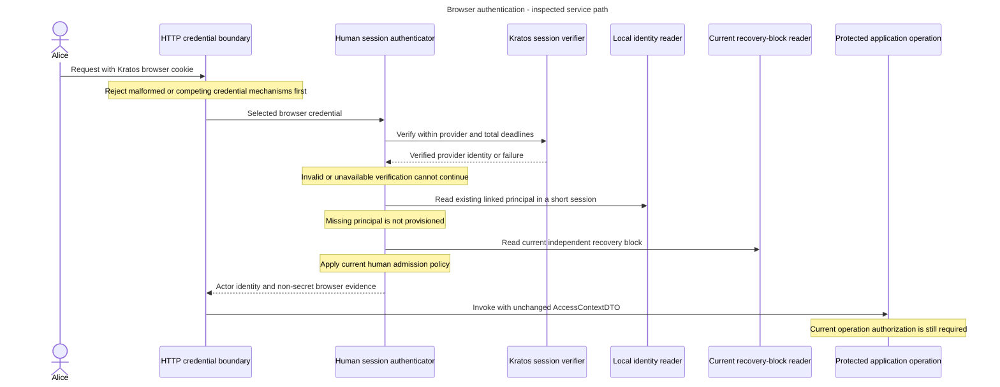

# Browser sessions and authentication evidence

Alice opens a product page after signing in. The backend must establish who she is, then decide whether this request is allowed. Her earlier login is not a saved certificate of current project permissions.

## Choose a focused reading task

- For credential selection and implemented verification, read [Credential dispatch](credential-dispatch.md).
- For session fields and authentication deadlines, read [Session contracts](session-contracts.md).

## Concepts and owners

Kratos owns human identity and browser sessions. An Access authenticator verifies provider evidence and resolves the existing local human principal. Authorization separately reads current state for the requested operation. A browser page, a CLI token and an application key do not create three independent permission systems.

Browsers send session cookies automatically. Cross-site request forgery (CSRF) protection prevents another site from abusing that behavior to submit a protected change as Alice. A valid cookie alone does not replace that check.

`AccessContextDTO` carries actor identity and exactly one complete browser-session, human OAuth or application-key authentication-evidence record. The current inspected browser evidence retains the verified provider identity without retaining the cookie. The accepted [restoration extension](#restoration-evidence-cutover) additionally requires a captured version binding, with implementation still unfinished. Evidence records do not verify themselves and contain no permission or account-status snapshot.

## Follow a request

**Inspected implementation.** This sequence and the diagram below describe the existing identity-only browser path. The accepted restoration extension follows in [its separate sequence](#restoration-evidence-cutover) and is not yet implemented.

1. Parse the credential mechanism. Reject competing cookie/Authorization mechanisms and duplicate or malformed headers before provider calls. Unsupported families receive the selected session-contract outcome, not fallback verification.
2. Verify the Kratos browser session under finite provider and total deadlines. Preserve cookie CSRF protection for protected writes. Bearer authentication has a separate verifier even though both routes may identify Alice.
3. After provider verification, open an independent short database session to read the trusted identity link and local eligibility. Do not create a person from an email or treat an unknown identity as admitted.
4. Return complete non-secret authentication evidence. Services pass this context unchanged. Current operation authorization remains separate and uses the caller's transaction when required.
5. Interpret evidence against the stored principal kind and current credential observations before work or replay. A stored kind/evidence mismatch is an internal contract error, not an opportunity to reinterpret the caller.

Keep observation separate from decision. Credential-query helpers construct SQL expressions, and readers return typed observations. The shared application evaluator interprets evidence, while domain policies decide whether the credential is current. Shared persistence mappers convert values only.

Every producer of an eligibility input must supply current credential facts explicitly rather than inheriting a permissive default. A missing observation must not silently become permission.

## Browser authentication as a sequence

**Inspected human path.** This diagram shows the responsibilities in `HumanSessionAuthenticationService`. Credential selection and applicable CSRF follow the HTTP boundary's existing ordering. They must finish before protected application work.

Only a valid provider identity and eligible existing principal reach the later steps. Rejections terminate the path. The local reads are separate short sessions, not one database transaction around Kratos. [The source service](../../../../apps/backend/src/inframeld_backend/access/application/services/human_session_authentication_service.py) and its capability contracts own the exact method/error ordering. The [module architecture](architecture.md) shows where this path fits with CLI and application authentication.

## Capture browser evidence across restoration

**Accepted contract under [ADR-0127](../../../../docs/adr/ADR-0127-fence-human-authentication-evidence-at-restoration.md), not delivered implementation.** Alice's verified browser request can pause while she is suspended and deliberately restored. Identity alone cannot distinguish that earlier evidence from evidence checked after the cutover. The existing version store supplies the local ordering, not a permission snapshot.

1. If necessary, discover the provider identity from the supplied cookie. This is not the final verification for the returned context.
2. Read the current installation/identity/version binding in a short local operation that ends before provider I/O.
3. Freshly verify the same cookie and exact identity after capture. Never attach today's version to an earlier verification result. Discovery and final verification share one absolute provider deadline, five seconds by default, inside the unchanged ten-second total including local reads.
4. Return complete non-secret bound browser evidence only after final verification and current local admission/eligibility checks. Retain no cookie in that evidence.
5. Before protected disclosure, original-result replay or mutation, current authorization checks that exact binding against current identity/version facts as well as account state, independent recovery blocks and the operation's permissions. An earlier captured version cannot regain authority after restoration.

Required missing/unavailable state fails closed. No SQL transaction spans provider verification, and no verification retry, new per-call allowance or positive authentication cache follows. [Currentness ownership](eligibility-and-current-authority.md#accepted-browser-currentness) and [record requirements](credential-and-recovery-records.md#restoration-version-transition) own the shared checks and atomic transition.

**Explicitly accepted limit:** a fresh request after cutover may authenticate a Kratos session created late by earlier login work if Kratos currently verifies that session as active, unexpired and for the same identity. This is not proof of its causal generation, password persistence or legitimate-person review. It does not invalidate every old cookie or pending login. Required original cleanup and deliberate security review still apply, and already authorized external effects cannot be recalled. The current identity-only DTO and diagram above do not implement this fence. Provider and human qualification remain unfinished.

## Failures and changed state

An invalid or unavailable provider check denies the operation. There is no positive permission snapshot in the context that can bypass suspension, recovery or grant removal.

Never hold an `AsyncSession` across requests or wait for provider I/O inside a SQL transaction. The explicitly named consent state initializer has a separate bounded metadata transaction which must close before browser verification.

Ordinary human-only product operations return 403 for a verified application caller. Identity-specific session checks use 401 for unsupported credential families. Keep these distinctions separate from malformed-request errors and project visibility ordering. Native OpenAPI describes cookie-or-bearer alternatives, implemented authentication problems and challenges. Follow the API's selected precedence instead of inventing a different error order.

## Implementation status and limits

The supporting [account UI](../../../../apps/web/README.md) renders native password/code login, explicit browser logout and checked consent for an existing human. Registration, admission, recovery/settings, configured MFA/SSO and the complete CLI lifecycle remain outside that increment. Unsupported required provider interactions stop rather than being omitted. All eleven native navigation cases passed in the pinned private HTTPS/Chromium profile, including password/code Allow/Cancel callbacks and strict revoked-cookie `401` refusal. This qualifies the covered browser decision/revocation navigation. OS browsers, packaged ingress and combined Rust recipient-proof acquisition remain unqualified. No token exchange or proof consumption is established. Controlled expired-session `401` tests establish UI handling, not natural session expiry. Full #82/#160 and complete human operator acceptance [#298](https://github.com/matejpalenik/inframeld/issues/298) remain unfinished.

The current human HTTP boundary implements cookie and human Hydra bearer selection on `GET /v1/session` and the supported project-grant write. Both services have deployment-configurable provider/total budgets with five/ten-second defaults. This does not establish the unfinished CLI request limit or application-key authenticator.

The backend README owns execution commands. PostgreSQL scenarios use real application behavior with `Mock*Verifier` provider doubles. Separate real Hydra/Kratos scenarios exercise provider SDKs and current identity checks.

`pnpm test:integration` runs the integration directory in one generic private-network test container with all three provider flags enabled and no published ports. Cleanup removes the project-scoped test containers/networks while preserving named PostgreSQL volumes. These are descriptions of the existing harness, not checks rerun by reading this reference.

The initial migration creates the 14-table Access foundation. Table and selected relational-constraint tests do not qualify every authorization workflow or document-evidence filter. Application-key fixtures simulate safe key IDs without provisioning credentials. Account UI, complete CLI lifecycle and production recovery completion retain their own qualification.

## What the available tests can establish

The [bearer service tests](../../../../apps/backend/tests/unit/access/application/services/test_human_access_token_authentication_service.py) exercise ordered checks, current eligibility, bounded deadlines and rejection of late results. [PostgreSQL bearer sessions](../../../../apps/backend/tests/integration/access/test_human_bearer_session_postgres.py) and [grant writes](../../../../apps/backend/tests/integration/access/test_human_bearer_grant_http_postgres.py) use real local services and databases with explicit provider doubles. They do not qualify the whole browser-to-CLI flow.

[Real Hydra sessions](../../../../apps/backend/tests/integration/access/test_human_hydra_session.py) exercise opaque tokens and both provider boundaries. [Kratos browser](../../../../apps/backend/tests/integration/kratos/test_kratos_browser_flow.py), [recovery](../../../../apps/backend/tests/integration/kratos/test_kratos_recovery_boundary.py) and [OIDC](../../../../apps/backend/tests/integration/kratos/test_kratos_oidc_browser_flow.py) scenarios cover their own provider behavior. Matching email alone does not link an account. The private test helper approves Hydra challenges through administration APIs. It is not a production account UI or CLI login client.

The current Kratos SDK returns UUID identity/session values. Verifiers validate and convert them at the provider boundary. The v26.2.0 settings-hook observation includes its current session, while the recovery hook still does not supply a recovery session. A pre-save session does not prove password persistence or native cleanup. These version-bound observations require requalification when the provider changes.

Deployment Hydra/client provisioning, complete account UI, CLI storage/refresh/logout, application-key authentication and production recovery qualification remain separate unfinished work. Use [testing](../../../../docs/development/guides/testing.md) for procedures. This migration reports source inspection, not a rerun of provider tests.

## Sources and rationale

- [Implemented human authentication](credential-dispatch.md#implemented-human-authentication) and [credential dispatch](credential-dispatch.md#credential-dispatch) own outcomes and evidence.
- [Authentication flow](architecture.md#authentication-flow), [context evidence](credential-and-recovery-records.md#access-context-evidence) and [credential boundaries](eligibility-and-current-authority.md#credential-query-and-policy-boundaries) own responsibilities.
- [Evidence records](credential-and-recovery-records.md#authentication-evidence-records), [Principal model](implemented-access-models.md#implemented-principal-model) and [ADR-0073](../../../../docs/adr/ADR-0073-carry-explicit-authentication-evidence-in-access-contexts.md) explain the contract.
- [Backend integration instructions](../../../../docs/development/guides/testing.md#integration-tests) and [initial migration](../../../../apps/backend/migrations/versions/0001_initial.py) identify existing foundations.
