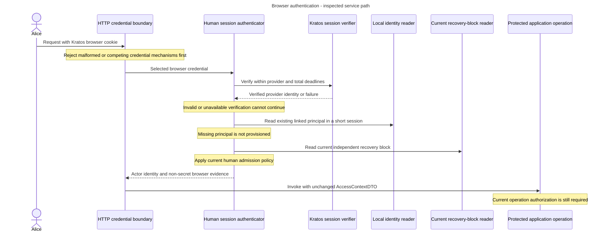

# Browser sessions and authentication evidence

Alice opens a product page after signing in. The backend must establish who she is, then decide whether this request is allowed. Her earlier login is not a saved certificate of current project permissions.

## Concepts and owners

Kratos owns human identity and browser sessions. An Access authenticator verifies provider evidence and resolves the existing local human principal. Authorization separately reads current state for the requested operation. A browser page, a CLI token and an application key do not create three independent permission systems.

Browsers send session cookies automatically. Cross-site request forgery (CSRF) protection prevents another site from abusing that behavior to submit a protected change as Alice. A valid cookie alone does not replace that check.

`AccessContextDTO` carries actor identity and exactly one complete browser-session, human OAuth or application-key authentication-evidence record. Browser evidence retains the verified provider identity without retaining the cookie. Evidence records do not verify themselves and contain no permission or account-status snapshot.

## Follow a request

1. Parse the credential mechanism. Reject competing cookie/Authorization mechanisms and duplicate or malformed headers before provider calls. Unsupported families receive the selected session-contract outcome, not fallback verification.
2. Verify the Kratos browser session under finite provider and total deadlines. Preserve cookie CSRF protection for protected writes. Bearer authentication has a separate verifier even though both routes may identify Alice.
3. After provider verification, open an independent short database session to read the trusted identity link and local eligibility. Do not create a person from an email or treat an unknown identity as admitted.
4. Return complete non-secret authentication evidence. Services pass this context unchanged. Current operation authorization remains separate and uses the caller's transaction when required.
5. Interpret evidence against the stored principal kind and current credential observations before work or replay. A stored kind/evidence mismatch is an internal contract error, not an opportunity to reinterpret the caller.

Keep observation separate from decision. Credential-query helpers construct SQL expressions, and readers return typed observations. The shared application evaluator interprets evidence, while domain policies decide whether the credential is current. Shared persistence mappers convert values only.

Every producer of an eligibility input must supply current credential facts explicitly rather than inheriting a permissive default. A missing observation must not silently become permission.

## Browser authentication as a sequence

**Inspected human path.** This diagram shows the responsibilities in `HumanSessionAuthenticationService`. Credential selection and applicable CSRF follow the HTTP boundary's existing ordering. They must finish before protected application work.

Only a valid provider identity and eligible existing principal reach the later steps. Rejections terminate the path. The local reads are separate short sessions, not one database transaction around Kratos. [The source service](../../../../apps/backend/src/inframeld_backend/access/application/services/human_session_authentication_service.py) and its capability contracts own the exact method/error ordering. The [module architecture](architecture.md) shows where this path fits with CLI and application authentication.

## Failures and changed state

An invalid or unavailable provider check denies the operation. There is no positive permission snapshot in the context that can bypass suspension, recovery or grant removal.

Never hold an `AsyncSession` across requests or wait for provider I/O inside a SQL transaction. The explicitly named consent state initializer has a separate bounded metadata transaction which must close before browser verification.

Ordinary human-only product operations return 403 for a verified application caller. Identity-specific session checks use 401 for unsupported credential families. Keep these distinctions separate from malformed-request errors and project visibility ordering. Native OpenAPI describes cookie-or-bearer alternatives, implemented authentication problems and challenges. Follow the API's selected precedence instead of inventing a different error order.

## Implementation status and limits

The current human HTTP boundary implements cookie and human Hydra bearer selection on `GET /v1/session` and the supported project-grant write. Both services have deployment-configurable provider/total budgets with five/ten-second defaults. This does not establish the unfinished CLI request limit or application-key authenticator.

The backend README owns execution commands. PostgreSQL scenarios use real application behavior with `Mock*Verifier` provider doubles. Separate real Hydra/Kratos scenarios exercise provider SDKs and current identity checks.

`pnpm test:integration` runs the integration directory in one generic private-network test container with all three provider flags enabled and no published ports. Cleanup removes the project-scoped test containers/networks while preserving named PostgreSQL volumes. These are descriptions of the existing harness, not checks rerun by reading this reference.

The initial migration creates the 14-table Access foundation. Table and selected relational-constraint tests do not qualify every authorization workflow or document-evidence filter. Application-key fixtures simulate safe key IDs without provisioning credentials. Account UI, complete CLI lifecycle and production recovery completion retain their own qualification.

## Sources and rationale

- [Implemented human authentication](../../../../docs/development/access-control.md#implemented-human-authentication) and [credential dispatch](../../../../docs/development/access-control.md#credential-dispatch) own outcomes and evidence.
- [Authentication flow](../../../../docs/development/application-structure.md#authentication-flow), [context evidence](../../../../docs/development/application-structure.md#access-context-evidence) and [credential boundaries](../../../../docs/development/application-structure.md#credential-query-and-policy-boundaries) own responsibilities.
- [Evidence records](../../../../docs/development/data-model.md#authentication-evidence-records), [Principal model](../../../../docs/development/data-model.md#implemented-principal-model) and [ADR-0073](../../../../docs/adr/ADR-0073-carry-explicit-authentication-evidence-in-access-contexts.md) explain the contract.
- [Backend integration instructions](../../../../apps/backend/README.md#integration-tests) and [initial migration](../../../../apps/backend/migrations/versions/0001_initial.py) identify existing foundations.
