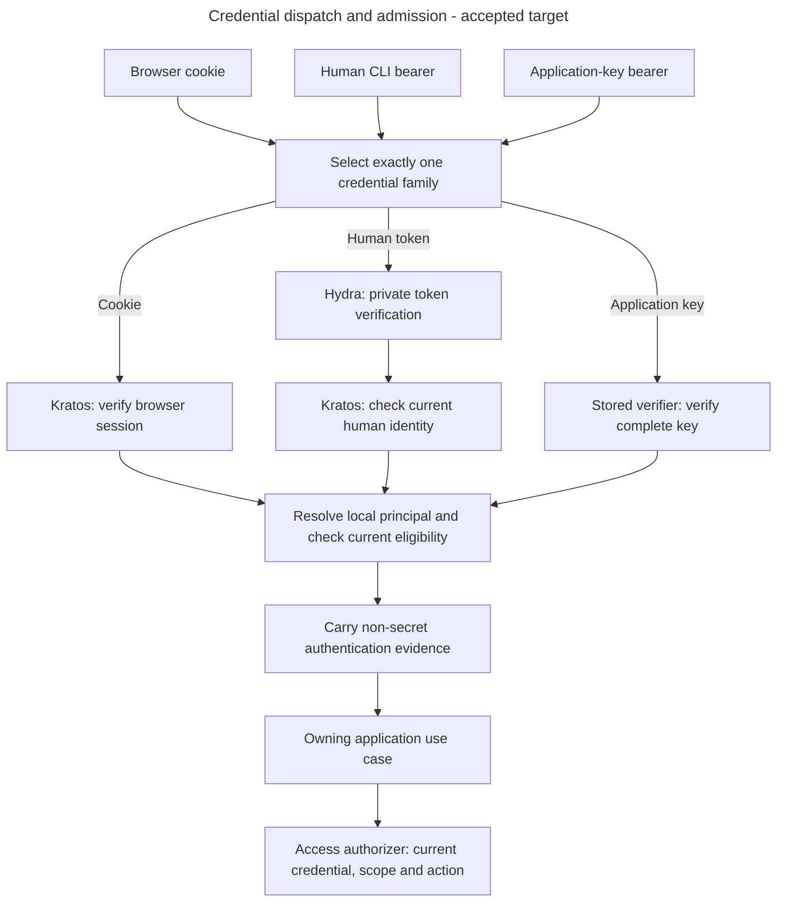

# Choose one incoming credential

Alice opens the account UI while SupportBot calls the API with a key. The HTTP boundary must choose one credential family before contacting a provider. Failure never authorizes trying another family.

 

## Signing in and checking permissions

Humans sign in through **Ory Kratos**, which manages their identity, sign-in methods and browser sessions. **Ory Hydra** provides the accepted first-party human CLI OAuth/OIDC flow and token lifecycle under [ADR-0053](../../../../docs/adr/ADR-0053-use-kratos-and-hydra-for-human-cli-authentication.md). Applications use keys issued by Inframeld, not the human's cookies or CLI tokens. All paths resolve a local principal before the same current Inframeld permission checks.

The diagram shows which components call each other. The boxes inside the backend are parts of one application, not separate deployed services. Background workers use the same permission rules.

**Kratos answers “who is this person?” Hydra issues the CLI's protocol credentials.** Inframeld decides whether that person may join the installation, belongs to a project, is suspended, or may perform an action. Both products' administrative APIs stay private. Kratos, Hydra and Inframeld use separate databases/roles even when sharing one PostgreSQL server. The diagram shows the accepted request paths, not proof that every adapter exists.

**Access owns the permission rules.** An application use case, such as answering a question, asks Access for permission as it carries out the work. An adapter translates between application concepts and an external system. For example, the Kratos adapter checks a session, and the vector adapter turns the permitted document selection into search filters. HTTP endpoints, MCP tools, and workers use the same Access rules. Indexing, pipeline configuration, and model-provider integration keep their own responsibilities.

The verified caller travels in an application-owned **access context**. The current implementation carries the actor’s `PrincipalId` and complete non-secret authentication evidence under [ADR-0073](../../../../docs/adr/ADR-0073-carry-explicit-authentication-evidence-in-access-contexts.md). It retains no account-state or permission snapshot. Typed operation inputs separately identify the project or resource. It is not a raw Kratos response, database object, or permission list supplied by a client. V1 integrations act as their application account. Acting on behalf of a separately verified person is a future feature.

### Select one credential before verification

Alice's human CLI and SupportBot both send `Authorization: Bearer <credential>`. The backend chooses one verifier from the request's credential family, then verifies the complete credential. It never tries another family after a failure. Browser callers retain their Kratos cookie rather than converting it to a bearer token.

| Request input | Sole verification path | Required outcome |
| --- | --- | --- |
| Kratos session cookie only | Existing Kratos session verifier, then current local human admission/state | Preserve browser behavior and cookie-write CSRF. |
| One Bearer value starting with `ifm_app_` | Inframeld application-key verifier only | Check the complete key, restrictions and current account/project state. A fabricated prefix supplies no identity. |
| One other Bearer value | Private Hydra access-token introspection, current Kratos identity eligibility, then current local human admission/state | Check trusted issuer/client/API audience/scope and token kind. A non-prefixed value is not automatically valid. |
| Kratos session cookie together with Authorization | No verifier | Reject competing mechanisms before provider I/O, even if they might identify the same human. Unrelated cookies do not compete. |
| Repeated Authorization headers or malformed authentication-header syntax | No verifier | Reject the request rather than choosing a header or combining values. |
| No supported credential | No verifier | Return the generic missing-authentication outcome. |

The table describes the full accepted dispatch contract. The current human-session and project-grant routes support cookies and human bearers. They reject `ifm_app_` values with 401 before contacting Hydra. Application-key verification and the separate application-session route remain to be implemented.

Credentials travel in the supported cookie or Authorization header, not URL parameters or request bodies. Apply the standard case-insensitive authentication-scheme parsing for Bearer. Invalid or unsupported credentials, malformed requests and provider uncertainty follow the [authentication error table](../../../../docs/development/error-handling.md#authentication-contract). Invalid application-key content stays on the application path and never reaches Hydra.

Every human bearer request repeats private introspection, current Kratos eligibility and the short local lookup. There is no positive authentication cache across requests. Cookie verification remains current too. Neither an earlier successful request nor `AccessContextDTO` freezes status or permissions. The context carries actor identity and required authentication evidence, never current status or permissions. The implemented local recovery block makes a human temporarily ineligible. [Credential versions](human-cli-credential-lifecycle.md#human-credential-versions) keep stale CLI credentials invalid after release. Complete production recovery orchestration remains unfinished.

Cookie-authenticated writes retain the existing CSRF marker and trusted Origin check. Bearer-authenticated writes use their bearer path without requiring a browser Origin or invoking cookie-only CSRF. Protected operations still check current principal-kind eligibility, membership, exact-target action and source access. External verification precedes independent short authentication reads, without a database transaction held across provider waits.

| Accepted operation contract | Allowed credential | Successful response |
| --- | --- | --- |
| Existing `GET /v1/session`, operation ID `getCurrentSession` | Kratos cookie or verified human Hydra bearer | Preserve the existing `principalId` field. |
| New `GET /v1/application-session`, operation ID `getCurrentApplicationSession` | Valid Inframeld application key for the HTTP audience/adapter | Only `principalId` and the account's bound `projectId`. |

The human-session operation does not accept application keys. A key there is an unsupported credential family and returns 401. The separate application check verifies expiry, revocation, installation/audience bindings, active application state and an active bound project. It makes no model call and returns no permission snapshot or assurance that a later operation will be authorized. A timeout remains unconfirmed. Human bearer support is implemented on the existing session and project-grant routes. The application-check endpoint remains accepted design. [API contracts](session-contracts.md#session-contracts) owns their transport handoff.

The CLI stores tokens in the qualified OS credential store with target/account isolation. Refresh rotates tokens under a per-target/account lock and replaces the stored pair coherently. A lost refresh response requires explicit login unless qualified standard behavior proves recovery is safe. It does not permit blind replay or disabled rotation. Ordinary product commands do not open a browser unexpectedly. The credential lifecycle below defines the deployment-configurable defaults, including the seven-day rolling refresh window and no separately selected absolute session-age cap.

Logout revokes the selected CLI credentials and removes that local account entry's credentials, not every browser session or application key. If revocation cannot be confirmed, report a nonzero partial outcome. Recovery/suspension must explicitly coordinate current Inframeld state, Kratos sessions and Hydra grants. Neither product is assumed to revoke the other's credentials. Keep compromised access blocked while cleanup is unconfirmed. The lifecycle and qualification sections below specify ordering and required evidence.

Ory supplies the [login/consent APIs](https://www.ory.com/docs/oauth2-oidc/custom-login-consent/flow), [private introspection](https://www.ory.com/docs/hydra/guides/oauth2-token-introspection) and [refresh mechanism](https://www.ory.com/docs/oauth2-oidc/refresh-token-grant). Identity mapping, product admission, bootstrap and cross-product cleanup are explicit Inframeld integration responsibilities, not guarantees provided by choosing the libraries.

On 2026-09-29, repository inspection found the cookie/CSRF dependency and Kratos services in `compose.dev.yaml` and `compose.test.yaml`, not a Hydra service or human OAuth bearer adapter. This is a source-state observation, not a check of any deployed installation. Runtime tests for pinned releases, subject mapping, token-kind confusion, disabled identities, refresh races, recovery, private administration and managed-local transport remain required before release.

### Implemented human-session boundary

Alice can ask `GET /v1/session` who she is using either her Kratos browser cookie or a human bearer token. Both paths must find the same active local account. A successful provider login alone is not enough: if Alice has no local identity link, the API returns 403 rather than creating an account for her.

[`HumanSessionDependency`](../../../../apps/backend/src/inframeld_backend/access/http/dependencies/human_session_dependency.py) first chooses one credential path. It rejects malformed or repeated Authorization headers and a session cookie combined with Authorization before any provider call. It never retries a failed credential through another path.

| Component | Question it answers | Where verification happens |
| --- | --- | --- |
| `KratosBrowserSessionVerifier` | Is this browser cookie a current, valid session? | Kratos public API, through `HumanSessionAuthenticationService`. |
| `HydraAccessTokenVerifier` | Is this an active, unexpired access token for the configured issuer, CLI client, API audience and scope? | Hydra private introspection, through `HumanAccessTokenAuthenticationService`. |
| `KratosHumanIdentityVerifier` | Does the token's human identity still exist and remain active? | Kratos private identity API, after Hydra verification. |

**Introspection** means asking Hydra to check a token and return its verified metadata. The backend uses the configured private endpoint. A token cannot choose its own verification destination. The [application flow](architecture.md#authentication-flow) shows the services and adapters in execution order.

After the required provider checks succeed, `PostgresHumanIdentityLinkReader` opens a short independent database session. It looks up the exact Kratos authority/subject pair and returns the [Principal](implemented-access-models.md#implemented-principal-model), including its current kind and status. The cookie service reads recovery blocks through `PostgresIdentityRecoveryBlockReader`. The bearer service reads a coherent version/block observation through `PostgresHumanCredentialStateReader` and rejects an invalid binding before local eligibility. Both reads stay within the authentication deadline.

The service carries that Principal and recovery restriction together in `PrincipalAccessPolicyInput`. `HumanAuthenticationPolicy` composes the [shared eligibility rule](eligibility-and-current-authority.md#shared-principal-eligibility) and requires a human principal. Successful authentication returns `AccessContextDTO` with `PrincipalId` and complete browser-session or human OAuth evidence for later checks. Permissions are checked by the requested operation, not stored in the authentication result. [ADR-0073](../../../../docs/adr/ADR-0073-carry-explicit-authentication-evidence-in-access-contexts.md) makes that evidence required. Both authorizers use the shared application evaluator to match it to the principal kind returned by their facts readers before work or replay. Application-key evidence is currently exercised by simulated authorization callers, not a production key authenticator. The [record definitions](credential-and-recovery-records.md#authentication-evidence-records) distinguish all three variants.

| Condition | Current HTTP result |
| --- | --- |
| No supported credential, even when providers are not configured | Generic 401 `http_error` with a Bearer challenge telling the caller authentication is required. |
| Rejected/expired cookie or human bearer, or an application key on these human-only credential paths | Generic 401 `http_error`. Rejected bearers carry `error="invalid_token"`. |
| Malformed/repeated Authorization or a Kratos cookie combined with Authorization | 400 `invalid_authentication_request`. An attempted Bearer scheme carries `error="invalid_request"`. |
| Verified identity with no local link, suspended/retired human, non-human principal, or pending recovery block | 403 `access_denied`. |
| Required verification unavailable, malformed or timed out, provider configuration missing, or authoritative recovery metadata unavailable | 503 `dependency_unavailable`. A previous success cannot substitute for the failed check. |
| Required provider checks succeed and the linked local human is active with no pending recovery block | 200 with the existing `principalId` field. |

`WWW-Authenticate` carries the Bearer challenge. Missing authentication uses `Bearer realm="inframeld"` without a token-error attribute. The values are server-owned constants, so the response never echoes the supplied credential. The [authentication error contract](../../../../docs/development/error-handling.md#authentication-contract) owns the exact problems, headers and failure rules.

For writes, Alice still needs permission to perform the action. The implemented [`POST /v1/projects/{project_id}/grants`](../../../../apps/backend/src/inframeld_backend/access/http/routes/project_grant_routes.py) checks her current project membership and authority to delegate the exact action. Authentication and cookie CSRF finish before the route opens its short grant-change transaction. A transaction saves the grant, access revision, audit event and idempotency record together, or rolls them back together if the change fails. Even a replay of a saved successful request checks current authority again.

Browsers can attach Alice's session cookie automatically, so a write also needs protection against requests initiated by another website. Cookie-authenticated writes require `X-Inframeld-CSRF: 1` and an `Origin` matching a configured trusted browser origin. [`CSRFProtectionDependency`](../../../../apps/backend/src/inframeld_backend/access/http/dependencies/csrf_protection_dependency.py) rejects missing or untrusted values with 403. An empty trusted-origin list denies cookie writes. The CLI explicitly supplies its bearer credential, so bearer-authenticated writes do not require those browser headers. Kratos separately protects its own browser account flows.

For example, Alice may successfully grant Bob an action, then lose her authority to grant it. Her token can still authenticate, but both a new grant request and replay of the old request now return 403. Neither request creates another grant, audit event or idempotency reservation, or changes the project access revision. Local suspension similarly stops the next request even while a provider token remains active.

Bootstrap creates shared services and owns the configured Kratos public, Kratos admin and Hydra admin clients. Each authentication lookup gets its own short database session after provider verification. Authorization readers use the caller's transaction. [Resource ownership](architecture.md#authentication-flow) describes construction and cleanup. Both cookie and bearer services enforce [configurable authentication budgets](session-contracts.md#session-checks), including the local lookup.
