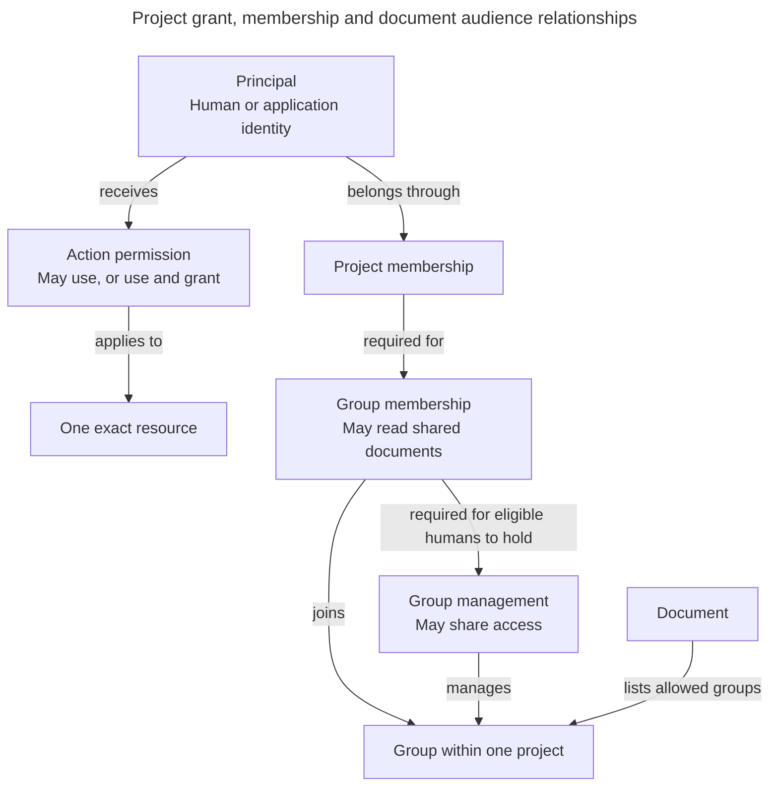
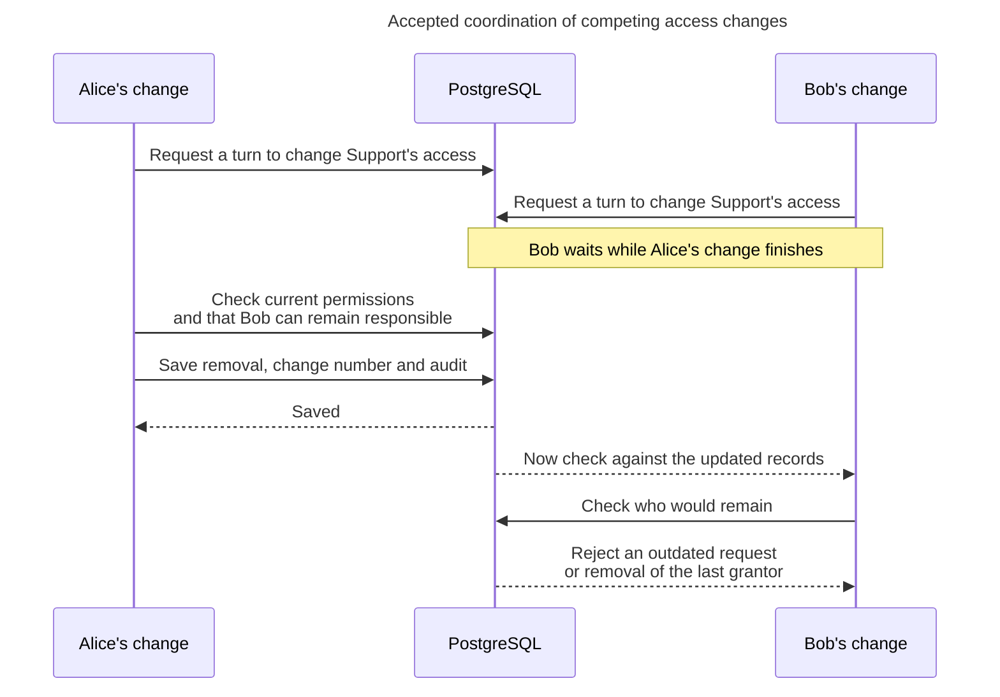

# Administer an exact action grant

Alice gives Bob use-only permission on Support. A grant names one recipient, action and exact target. The write checks current authority, recognizes a retry, applies its revision guard and saves the change with audit.

> **Status:** accepted behavior is stated separately from proposed representations and qualification work. Existing Python types, generated OpenAPI and migrations own implemented shapes. Pending decisions are not accepted by this reference.

## Choose a focused reading task

- For exact target-specific HTTP fields, read [Grant contracts](grant-contracts.md).
- For shared nested target variants, read [Grant target contract](grant-target-contract.md).

## Storing access and handling simultaneous changes

The database keeps identity, membership, permissions, and history separate because they change for different reasons. Replacing a key should not recreate permissions. Rejoining a project should not restore removed access. An old audit entry should never authorize a new request.

### Separate records explain separate responsibilities

The arrows below show relationships between records, not calls between services. The diagram groups similar concepts for readability. It does not propose one generic grants table or a generic resource registry.

The `application_accounts` record extends a principal with its one owning project. It shares the principal ID and the same permission model. Creation saves the principal, account, project membership, creator grants, and audit together.

Every manager record needs a membership in that same group and project. Appointment, demotion, and removal must preserve this relationship. The [14-table Access foundation](access-persistence.md#proposed-access-foundation-table-map) is created by the initial migration. It has a foreign key from each manager assignment to the matching group membership, plus human-only and same-project checks. PostgreSQL integration tests prove that a manager without matching membership or a non-human manager is rejected. The migration does not implement appointment, handover, or recovery workflows.

### One current assignment per permission

There is one current grant per **recipient + action + exact target**. Its `can_grant` field is `false` for use-only, not an explicit denial, or `true` for use-and-grant. Applications cannot hold `true`. Another authorized person changes this same assignment rather than creating a duplicate.

Code defines the supported actions, targets, eligible recipient types, and fixed rules such as Edit including View. Unknown actions are denied. Included View access needs no extra grant row or configurable role language.

Grant tables are divided by target type, not by action: organization, project, group, application, and later real Pipelines and Deployments. Database relationships check the target and project, rather than trusting an unchecked `resource_type + resource_id` pair. Later domain tables arrive with their features, not as placeholders.

For example, these are three different relationships:

| Relationship | What it means |
| --- | --- |
| Alice may issue SupportBot keys. | Alice has an administration grant over the application. |
| SupportBot may query Production. | The bot has an action grant on a Deployment. |
| SupportBot belongs to SupportKnowledge. | The bot has group membership for document access. |

### Keep current access separate from history

Revoking a grant deletes its current row. Downgrading changes its level. Giving it back later creates a fresh assignment, rather than reviving an inactive row or reading permission from history. Suspension is different because the assignments remain while account status prevents their use.

Each change and its audit event are saved in the **same transaction**, meaning either both succeed or neither does. Audit records who changed what, using limited, safe before-and-after values. They exclude secrets, key verifiers, sessions, document text, and whole permission snapshots. Operator and initial-setup events identify their real actor rather than inventing a human account. Audit history has its own access and erasure rules.

The first implemented grant command assigns use-only `create-access-groups` permission to an eligible human project member. Its application service now owns the short transaction through `TransactionManager`, with current checks delegated to `ProjectGrantAuthorizer`. [The implemented request chain](../../inframeld-coding-standards/references/services-and-use-cases.md#grant-command-flow) shows the flat Command, static HTTP mapper and shared operational collaborators under [ADR-0065](../../../../docs/adr/ADR-0065-application-services-own-write-transactions.md). It checks the actor's authority and the expected project access revision, then saves the grant, new revision, audit event, and [idempotency reservation](../../inframeld-application-contracts/references/idempotency-and-replay.md#requests) together. A retry checks current authority and returns the original completed operation if the caller is still allowed. Shared idempotency validates the [workflow outcome](../../inframeld-application-contracts/references/idempotency-and-replay.md#workflow-outcomes), including its required synchronous expiry, before the grant service returns. A new key with an old revision is rejected. The [PostgreSQL tests](../../../../apps/backend/tests/integration/access/test_project_grant_change_postgres.py) cover these outcomes. Other grant-change workflows and audit retention still need implementation.

Database constraints reject duplicate and cross-project records. A Support grant cannot name a Finance Deployment, and SupportBot cannot join another project. They also block deletion of a parent record while live relationships depend on it. Application logic checks who may make the change, arranges required handover, and removes dependencies deliberately. Automatic deletion of related database rows cannot replace those steps.

### Alice and Bob both try to leave

Suppose Alice and Bob are the only people who can grant Manage releases on Production. If their removal requests run independently, each could see the other still present and both could leave. Support would then have nobody able to grant that permission.

The backend prevents this by making access changes within a project **take turns**. It checks the current state when each change gets its turn, not only when the request first arrives.

A **revision** is the change number for an organization or project. Where a request must include its expected revision, the backend compares that number with the current one before saving. An old form cannot overwrite newer decisions, even if a permission was removed and regranted with the same recipient, action, and target. A revision detects outdated requests. It is not a saved permission set that can authorize future work. Retries follow the [idempotency and conflict rules](../../inframeld-application-contracts/references/idempotency-and-replay.md#revisions), not an unconditional overwrite.

This protection applies whenever access or its dependencies change: initial setup, permissions, member removal, recovery, key creation or revocation, group references, and deletion. For example, two people creating keys at once must not exceed the two-key limit. The backend checks the issuer's full current authority and counts usable keys in the same turn. Likewise, a group cannot be deleted while another change adds a reference to it.

### How the database gives each change its turn

A database **lock** makes conflicting changes wait. The accepted design calls for this order:

| Change | Locks to take |
| --- | --- |
| Project access change | First a shared lock on the organization row, then an exclusive lock on the project row. Shared organization locks allow different projects to change at once. The exclusive project lock makes changes in that project take turns. |
| Installation permission or account-status change | An exclusive organization-row lock. This makes a suspension and affected project administration wait for each other. |
| Change involving multiple projects | Take the organization lock first, then project locks in stable ID order. Limit waiting time and handle transaction failures. |

While holding the required locks, the backend checks current permissions and whether the accounts and resources still allow the change. It checks the expected revision where required, applies the change, increments the revision, and saves the audit event in one short transaction. Every path listed above must follow compatible locking rules, including recovery and deletion.

Ordinary permission reads do not take these exclusive administration locks. **Never keep an access-change transaction open while waiting for an upload, a user, Kratos, or a model call.** Checks before sending work or returning protected content still happen where needed, outside this transaction.

Finer locks for individual resources and serializable transactions, an alternative way to coordinate database work, were considered and deferred. Start with queries limited to the relevant project, useful existing primary and unique indexes, and document checks performed in batches. Measure query plans and waiting between changes before adding caches or finer locks. The design alone promises no particular capacity. [ADR-0022](../../../../docs/adr/ADR-0022-coordinate-access-writes-by-project-with-scope-revisions.md) records the choice.

## Exact grant management and bounded reads

Preserve the implemented `POST /v1/projects/{project_id}/grants`, `assignProjectUseOnlyGrant`, `ProjectUseOnlyGrantRequest` and `ProjectUseOnlyGrantResponse`. Its supported action remains `create-access-groups` and its result remains `canGrant: false`. Full administration uses separately named operations rather than changing that published use-only contract.

Full assignment, downgrade and removal identify the exact target, recipient and fixed action, and carry the expected access revision. Assignment/downgrade explicitly state `canGrant` as a boolean. An application recipient may receive only an eligible use-only assignment. Every management operation requires an eligible human with current can-use-and-grant for that exact action/target, or the existing group-manager authority for document-action assignments on that group, and retains scope, last-administrator and current-state checks. Reject unsupported action/target/recipient combinations rather than storing an unusable grant.

List assignments for one exact target and required `actionId`, with current can-use-and-grant for that action or the existing current group-manager authority for document-action assignments on that group. Use the [existing bounded pagination contract](../../inframeld-application-contracts/references/pagination.md): default 25, maximum 100, stable recipient-ID order and current authority on every page. Do not broaden this into a project-wide administrator inventory. Mutation results describe the original committed change and access revision. Use a fresh authorized read to learn the current assignment. The [full-administration draft](grant-contracts.md#http-operation-matrix) specifies routes, operation IDs and request/result models for final review.

## Application operation inputs, results and failures

The following are semantic application contracts, not new published DTO/class names or final JSON field spellings. Inputs use application-owned typed IDs and verified caller context. Each operation checks current authority itself. A review by a client does not authorize a later save.

| Operation family and owner | Required input | Result and failure behavior |
| --- | --- | --- |
| Resource creation , owning domain with Access initialization | Verified human caller, exact parent Project/Organization, typed definition and original operation identity | Resource ID plus committed initial assignments/outcome. Deny application callers. Reject unavailable names/invalid dependencies. Original replay cannot recreate grants. |
| Configuration/membership update , resource owner | Verified caller, exact resource ID, supported change, reviewed expected revision and original operation | New committed revision or original outcome. Stale state conflicts. Wrong action/kind denies. Immutable meaning is never overwritten. |
| Grant administration , Access | Verified human, recipient ID/kind, fixed action/exact target, level and expected access revision | Exact committed assignment/removal and revision. Deny unsupported combinations, missing delegation or stranded ordinary handover. Reads reveal only assignments the caller may administer. |
| Case/import audience change , Evaluation with Access | Verified human, Pipeline ID, explicit case selections or future-import setting, authoritative old/proposed group IDs and expected revisions | Saved audience/revision, audit and bounded outcome. Deny missing Pipeline action or any old/new group management. Stale selection conflicts. [Evaluation](../../inframeld-evaluation/references/case-audiences.md#case-audiences) owns the full contract. |
| Case import , Evaluation | Verified caller, Pipeline ID, protected content/identity/provenance, reviewed destination audience/revision and verified optional source mappings | Protected cases/revisions, reused/changed/unresolved outcomes. Changed content is unreviewed. An application uses the saved human-approved audience and cannot override it. |
| Invitation issue/revoke/activate , Access with Ory boundary | Exact intended assignments, verified issuer/recipient identity as appropriate, bounded secret/lifetime, expected state and original operation | Safe invitation/activation outcome. Issuance delivers its secret once. Expired/revoked/used/stale/ineligible intent cannot assign. Recover original activation after response loss. |
| Identity recovery cleanup , Access with identity adapters | Authenticated server-side, flow-bound evidence. Stable subject/principal. Original operation. Independent provider outcome evidence | Temporary product block and durable Kratos/Hydra obligations. Uncertain cleanup stays blocked. Completed duplicates initiate no new cleanup. An unfinished bulk attempt may revoke newer CLI credentials. An older flow cannot release a newer obligation. |
| Project deletion/status , Access and owning cleanup workflows | Verified human, exact Project, original operation and reviewed state | Immediate block and durable shutdown/erasure. Narrow content-free original-operation status can survive membership removal. No private content in status. |
| Host bootstrap/stranded repair , Access maintenance boundary | Protected versioned host input, verified installation and Ory identity, exact expected responsibility/revision, operator/reason and original operation | Narrow assignment plus audit/revision or conflict. No ordinary product bearer authority or global administrative bypass. |

Identity/credential failures, permission denial, hidden-resource 404, stale state and retry conflicts retain the [existing problem contract](../../../../docs/development/error-handling.md#authentication-contract). Do not relabel provider unavailability as invalid credentials or lost permission as empty data. Secret-bearing operations retain [show-once recovery](application-keys.md#secrets). Paid work uses ordinary admission and uncertain-dispatch rules, not blind retries.
