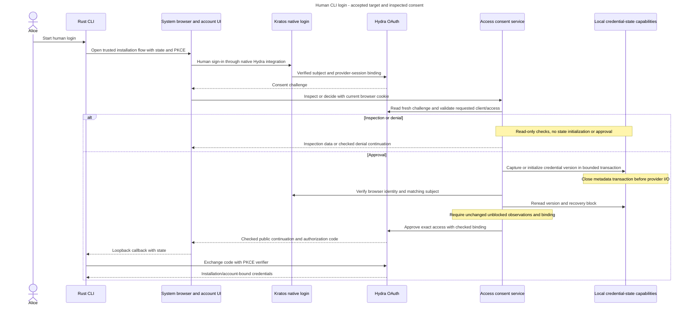

# Approve a human CLI access request

Alice signs in through Kratos and sees a CLI consent request. Consent approves supported installation access. It grants neither local admission nor Project permissions, and remembered approval cannot bypass current recovery checks.

Alice wants to use the CLI as the same person she uses in the browser. She signs in through the system browser, so the CLI does not collect her password or export her browser cookie. The chosen identity is bound to the selected installation and account.

## Follow login and consent

1. Resolve the trusted installation and official client before opening the browser. Native Kratos login supplies the verified Hydra subject and provider-session binding. Inframeld must not implement another password verifier or competing login-approval service.
2. The cookie-only Access consent API freshly reads Hydra's challenge. Check `inframeld-cli`, supported scopes and the exact configured API audience before browser verification or local-state initialization. Unsupported access returns the selected early 403, even with an invalid supplied cookie. HTTP credential selection and POST CSRF still take precedence.
3. Inspection and denial use read-only checks and never initialize credential versions. Approval has an explicit capture, browser-verify and state-reread path. It returns a required binding only when both observations were unblocked and unchanged.
4. Check the current Kratos browser identity and exact provider subject. Consent can precede local admission and must neither provision an account nor create grants. Return only a checked continuation to the configured public Hydra authorization endpoint.
5. Hydra finishes the protocol. The CLI uses secure, installation/account-bound credential storage and coordinated refresh. Each product request privately verifies active token semantics, audience, client and required API scope, then checks current Kratos identity eligibility and the same existing local human before authorization.

Provider I/O stays outside SQL transactions, with finite deadlines and no automatic approval retry. A timed-out approval may still finish at Hydra.

The narrowly scoped credential-state initializer may commit metadata before browser verification but must close its transaction before provider I/O.

## Login and approval across the boundary

**Accepted end-to-end target with inspected backend consent.** The sequence groups protocol details for readability. The complete CLI/account-UI path remains unfinished, and the checks below do not establish a universal issuance fence.

The grouped read-only branch includes browser/subject and recovery checks before display or denial. It does not approve a login. The credential exchange is conditional on successful approval or checked permitted continuation. Consent supplies no local account, project grant or recovery-block release authority. [The inspected service](../../../../apps/backend/src/inframeld_backend/access/application/services/human_oauth_consent_service.py) retains the exact early-validation, capture and reread ordering.

## Remembering approval is not remembering authority

Remembered login establishes who authenticated. Remembered consent records that Alice approved this client and access. New explicit remembered approvals default to one configurable hour.

A remembered approval still receives current checks. Automatic continuation must not extend its original lifetime or use client-wide automatic consent as a substitute for Alice's approval.

Refresh credentials renew a CLI login under their own lifetime/revocation rules. They do not create new product grants. Incoming human API credentials do not become application credentials or accepted MCP OAuth credentials.

### Alice approves this installation's CLI access

Alice runs `inframeld login`. Hydra sends her browser to Kratos, which authenticates her and approves the login using its native Hydra integration. Inframeld then checks whether this exact CLI request may proceed. [ADR-0071](../../../../docs/adr/ADR-0071-use-native-kratos-login-and-checked-hydra-consent.md) records this split.

The [consent service](../../../../apps/backend/src/inframeld_backend/access/application/services/human_oauth_consent_service.py) reads the challenge through Hydra's private SDK, checks Alice's current Kratos cookie, matches the provider subject and checks current recovery state. [Credential versioning](human-cli-credential-lifecycle.md#human-credential-versions) additionally captures state before browser verification and rechecks it before approval. It accepts only `inframeld-cli`, supported scopes including `inframeld:api`, and the installation's exact API audience. A missing or changed browser session cannot rely on an earlier successful inspection.

The service validates requested access immediately after reading the challenge. Unsupported access returns 403 before checking the supplied cookie or touching local state, for inspection, denial and approval alike. HTTP credential selection and POST CSRF still run first. Supported requests retain current browser and recovery checks. Approval has its own capture/verify/reread path, while inspection and denial never initialize credential versions. [The implementation walkthrough](#human-oauth-consent) names these paths.

OAuth consent does not require or create a local Inframeld account. This lets a verified identity complete login before bootstrap or admission. Product endpoints still require an admitted, eligible local principal. The displayed account is the Kratos subject, and the displayed installation is the configured API URL, not an organization or project ID.

| Convenience | What it remembers |
| --- | --- |
| Kratos/Hydra remembered login | Who Alice authenticated as. Native Kratos derives Hydra's remember settings from its configured browser-session policy. |
| Hydra remembered consent | That Alice approved this client and access. Inframeld defaults new remembered approvals to one hour, configurable by the operator. |
| CLI refresh credentials | Let an already signed-in CLI renew credentials without another browser flow. Consent-screen lifetime does not change token or login lifetimes. |

The account UI may omit another approval prompt only when Hydra reports remembered consent and the current checks still pass. Recognizing the client is insufficient. Client-wide `skip_consent` configuration is rejected by this integration. Automatic continuation sends no new remember duration, even if the browser asks to remember again. Only an explicit new approval records the configured duration.

The [browser API](#human-oauth-consent) exposes inspection and allow/deny operations. Both require the Kratos cookie, not a bearer token or application key. POST also requires the trusted Origin and CSRF header. Responses are non-cacheable and continuations stay on the configured public Hydra authorization endpoint. The small account UI must still render the page and preserve the browser context. No production recovery callback or release operation is wired here.

### Implemented OAuth consent boundary

Native Kratos login and the [cookie-only consent API](#human-oauth-consent) implement the browser handoff under [ADR-0071](../../../../docs/adr/ADR-0071-use-native-kratos-login-and-checked-hydra-consent.md). Verified identities may approve CLI access before local admission, without creating accounts. Every decision rechecks the matching identity and supported client/access. An allow decision captures the identity credential version and recovery state before browser verification, then rereads both. Both observations must be unblocked and retain the same identity, installation and version under [ADR-0072](../../../../docs/adr/ADR-0072-version-human-cli-credentials-across-account-recovery.md). Remembered consent defaults to one configurable hour and does not extend token lifetimes. An approval already underway can still arrive after cleanup. Its captured old generation remains rejected by Inframeld after block release, even if Hydra considers it active. Credential versioning does not itself complete the recovery workflow. The following private callback contract remains separate and unfinished.

After HTTP credential selection and POST CSRF, the service reads Hydra's request and rejects unsupported client, scopes or audience with 403 before browser verification or local-state work. This takes precedence over an invalid supplied cookie. Supported inspection and denial use read-only checks. Supported approval follows capture state, verify browser, reread state and construct a required binding. [The API contract](#human-oauth-consent) owns the exact failure ordering.

### Native login and external consent orchestration

Alice's CLI login gives Kratos the password-verification and Hydra login steps. Inframeld owns the consent decision, through `HumanOAuthConsentHandler` and `HumanOAuthConsentService`. Follow [ADR-0071](../../../../docs/adr/ADR-0071-use-native-kratos-login-and-checked-hydra-consent.md) and the [browser handoff](#human-oauth-consent).

The HTTP dependency extracts one cookie and enforces POST CSRF. A static mapper converts the HTTP input into an inspection Query or decision Command. The service calls its specific `OAuthConsentRequestReader`, current `BrowserSessionVerifier` and `OAuthConsentDecisionWriter`. Inspection/denial use the independent recovery-block reader. Allow decisions additionally use the explicitly named credential-state initializer and reader described in [the versioned flow](eligibility-and-current-authority.md#human-credential-version-flow). A pure `HumanOAuthConsentPolicy` limits client/access. Bootstrap injects SDK adapters using the existing lifespan-owned clients.

The service makes the two paths explicit. `_read_supported_request()` reads Hydra's challenge and rejects unsupported client, scope or audience before any browser or local-state work. `_check_read_only_request()` then verifies the browser and recovery state for inspection or denial. Denial submits Hydra's rejection only after those checks. `_prepare_approval()` captures credential state, verifies the browser, rereads state and returns a required binding for approval. Both observations must remain unblocked and unchanged. There is no flag-driven optional approval result.

Unsupported access returns 403 even if the supplied cookie would fail verification. HTTP credential selection and POST CSRF still run first. Supported approvals still initialize/capture state before browser verification, including when that verification later fails. Inspection and denial never initialize versions.

This is provider orchestration, not a local aggregate mutation. Do not invent a consent entity, open a SQL transaction around provider waits or require local principal admission. The recovery reader owns only a short independent session. Provider calls default to five seconds each within the existing ten-second total budget. Late results cannot establish success, cancellation propagates and no write is automatically retried.

Request/display DTOs carry attempt-local evidence. The later decision rereads current state. The service cannot make its recovery check atomic with a remote approval. Its returned continuation contains private flow state and must remain outside logs. The [provider observations](#native-hydra-consent) explain the remaining recovery coordination requirement.

### Attempt-local OAuth consent records

`OAuthConsentChallenge` carries Hydra's opaque private flow state with a secret-safe representation. `OAuthClientId` identifies the requesting client without authorizing it. The provider request DTO contains the subject, client, supported scopes, requested audiences and remembered-consent indication. The checked display DTO adds the verified identity, installation API URL and operator-configured remember duration. A continuation DTO privately carries the checked Hydra URL.

These records are not entities, local admissions, permission snapshots, credential inventories or new tables. The inspection Query and decision Command remain independent inputs. Unsupported client/access is rejected before browser or local-state work. Supported requests freshly check the browser, exact provider subject and recovery state. Inspection and denial never initialize versions. Approval returns a required binding captured before browser verification and checked against a second state observation. Hydra owns consent persistence and final verifier use. [The consent API](#human-oauth-consent) owns fields and [ADR-0071](../../../../docs/adr/ADR-0071-use-native-kratos-login-and-checked-hydra-consent.md) owns the boundary.

### Browser consent is separate from product admission

Alice's CLI login uses native Kratos authentication followed by [Access's consent operation](#native-hydra-consent). The future account UI uses these implemented operations, with the current Kratos session cookie:

| Operation | Input and result |
| --- | --- |
| `GET /v1/oauth/consent` - `inspectHumanOAuthConsent` | Required `consent_challenge` query value. Return `accountSubject`, `installation`, `clientId`, `requestedScopes`, `requestedAudience`, `approvalRequired` and `rememberConsentSeconds`. GET makes no approval. |
| `POST /v1/oauth/consent` - `decideHumanOAuthConsent` | JSON `consentChallenge`, `decision` (`allow` or `deny`) and optional boolean `remember` (default false). Return `redirectTo` for browser continuation through Hydra. |

The installation value is the configured canonical API URL. The account subject is the checked Kratos identity, not a local principal ID or email-based association. Account UI labels must remain tied to that identity. The server derives requested access from Hydra and remember duration from operator configuration. Extra input fields are rejected. Remember applies to a new allow decision, never denial or automatic extension of a remembered approval.

Both routes declare only `KratosSession` security in native OpenAPI. Missing cookies return 401. Authorization headers and competing/duplicate session credentials return the existing authentication-request 400. POST requires the existing trusted `Origin` plus `X-Inframeld-CSRF: 1` before service I/O. After reading Hydra's challenge, unsupported client, scopes or audience return safe 403 immediately, even when the supplied cookie is also invalid. No browser verification, recovery lookup, version initialization or decision submission follows. For supported requests, invalid sessions return 401 and wrong identity or pending recovery returns 403. Provider-reported unusable challenges map to 404, ordinary request validation to 422 and missing configuration or unavailable/uncertain provider responses to 503. Invalid challenge text uses the existing invalid-input 400. No credential fallback occurs.

Inspection and decision both repeat current provider and recovery checks. A successful inspection neither reserves the flow nor authorizes its later decision. Hydra owns expiry and final one-use verifier enforcement. Both success and handled problem responses have `Cache-Control: no-store` and `Referrer-Policy: no-referrer`. Do not log challenges or continuation URLs. The account UI and reverse proxy must also protect flow query values and use a no-referrer policy on the browser page. Only continuations matching the configured public Hydra authorization endpoint are returned, and the backend never follows them.

Inspection and denial never initialize credential versions. Supported approval deliberately captures state before browser verification, even if that verification later fails. It approves only after rereading unchanged, unblocked state. [The application flow](#human-oauth-consent) explains the two paths and required captured binding.

A timeout is not a confirmed denial or permission to replay approval automatically. The account UI must present failure honestly and support an explicit fresh login. The frontend still owns rendering the consent page and navigation. Its Hydra `urls.consent` destination is that browser page, not this JSON inspection endpoint. Product admission, project permissions and recovery completion remain separate.
