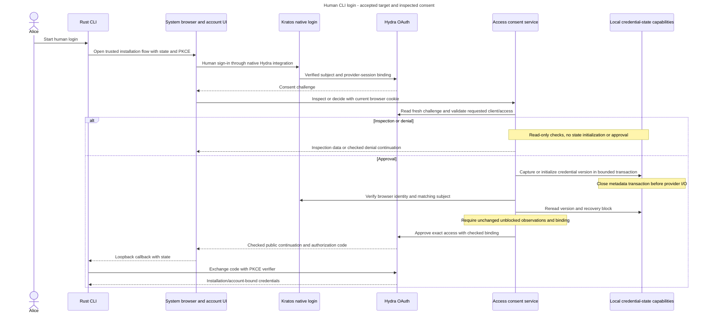

# Human CLI login and consent

Alice wants to use the CLI as the same person she uses in the browser. She signs in through the system browser, so the CLI does not collect her password or export her browser cookie. The chosen identity is bound to the selected installation and account.

## Concepts and owners

Kratos establishes human identity through its native Hydra login integration. Hydra owns OAuth/OIDC flow state, access and refresh credentials, and remembered consent. Access owns the installation's consent checks and later product admission and permissions. The small account UI renders these flows independently of full Studio.

The public CLI client uses Authorization Code with S256 PKCE. The browser login supplies a code that the CLI exchanges for credentials. PKCE binds that exchange to the client instance that started it. Fresh state/nonce and complete issuer/response validation protect the browser round trip.

Use maintained protocol libraries, no embedded client secret, implicit/password grant or custom cookie-to-token issuer. The temporary callback binds to literal `127.0.0.1` and an ephemeral port, not the LAN. Headless device login needs separate release qualification.

## Follow login and consent

1. Resolve the trusted installation and official client before opening the browser. Native Kratos login supplies the verified Hydra subject and provider-session binding. Inframeld must not implement another password verifier or competing login-approval service.
2. The cookie-only Access consent API freshly reads Hydra's challenge. Check `inframeld-cli`, supported scopes and the exact configured API audience before browser verification or local-state initialization. Unsupported access returns the selected early 403, even with an invalid supplied cookie. HTTP credential selection and POST CSRF still take precedence.
3. Inspection and denial use read-only checks and never initialize credential versions. Approval has an explicit capture, browser-verify and state-reread path. It returns a required binding only when both observations were unblocked and unchanged.
4. Check the current Kratos browser identity and exact provider subject. Consent can precede local admission and must neither provision an account nor create grants. Return only a checked continuation to the configured public Hydra authorization endpoint.
5. Hydra finishes the protocol. The CLI uses secure, installation/account-bound credential storage and coordinated refresh. Each product request privately verifies active token semantics, audience, client and required API scope, then checks current Kratos identity eligibility and the same existing local human before authorization.

Provider I/O stays outside SQL transactions, with finite deadlines and no automatic approval retry. A timed-out approval may still finish at Hydra.

The narrowly scoped credential-state initializer may commit metadata before browser verification but must close its transaction before provider I/O.

## Login and approval across the boundary

**Accepted end-to-end target with inspected backend consent.** The sequence groups protocol details for readability. The complete CLI/account-UI path remains unfinished, and the checks below do not establish a universal issuance fence.

The grouped read-only branch includes browser/subject and recovery checks before display or denial. It does not approve a login. The credential exchange is conditional on successful approval or checked permitted continuation. Consent supplies no local account, project grant or recovery-block release authority. [The inspected service](../../../../apps/backend/src/inframeld_backend/access/application/services/human_oauth_consent_service.py) retains the exact early-validation, capture and reread ordering.

## Remembering approval is not remembering authority

Remembered login establishes who authenticated. Remembered consent records that Alice approved this client and access. New explicit remembered approvals default to one configurable hour.

A remembered approval still receives current checks. Automatic continuation must not extend its original lifetime or use client-wide automatic consent as a substitute for Alice's approval.

Refresh credentials renew a CLI login under their own lifetime/revocation rules. They do not create new product grants. Incoming human API credentials do not become application credentials or accepted MCP OAuth credentials.

## Recovery, retries and changed identity

Human CLI credentials carry a server-owned version. Think of it as the generation of Alice's CLI login. A new recovery admission advances it once atomically. Duplicate delivery and block release never reset it.

Approval captures this version, checks it after browser verification and binds the grant to it. Refresh must never upgrade an old grant. Current authorization rechecks the binding before new work or replay.

An old grant can remain active at Hydra while Inframeld rejects its stale version. Existing unversioned CLI logins require fresh sign-in. Missing or changed binding evidence must not fall back to another identity. This permanent invalidation supplements the temporary recovery block and bulk cleanup. It does not prove Hydra-wide revocation or authorize production recovery completion.

Keep ordinary selected-device logout, coordinated refresh, account recovery and local credential cleanup distinct. A changed issuer or verified person cannot silently rebind a saved account. Managed same-machine loopback HTTP has its explicit deployment exception. Other installations require HTTPS. Host bootstrap uses separate host authority, not OAuth consent or a public first-signup privilege.

## Implementation status and limits

The guide records implemented backend cookie/bearer verification and native consent. Read-only inspection is display data, not authority for a later decision. Account pages, complete CLI login lifecycle, deployment-wide provisioning and safely coordinated production recovery remain unfinished.

Provider tests distinguish late approvals, outstanding codes and token responses. A held HTTP request does not pause Hydra internally. Test-only token-hook denials, transport gates and staged records establish bounded observations, not a production hook, credential inventory, universal issuance fence or authority to release a block. Keep historical provider-version observations separate from current qualified results.

Before changing provider pins, read reviewed OSS versions, image digests, immutable SDK revisions, residual vulnerabilities and upgrade qualification. A latest release or passing tests is not vulnerability-free production approval.

## Sources and rationale

- [ADR-0012](../../../../docs/adr/ADR-0012-use-kratos-for-human-authentication.md) records the earlier browser-focused choice. ADR-0053 partially supersedes its Hydra deferral while retaining Kratos identity and Inframeld authorization.
- [Human CLI flow](../../../../docs/development/access-control.md#human-cli-authentication), [registered client](../../../../docs/development/access-control.md#cli-client-registration), [credential lifecycle](../../../../docs/development/access-control.md#cli-credential-lifecycle) and [qualification](../../../../docs/development/access-control.md#cli-authentication-qualification).
- [Native consent](../../../../docs/development/access-control.md#native-hydra-consent), [credential versions](../../../../docs/development/access-control.md#human-credential-versions), [browser API](../../../../docs/development/api-contracts.md#human-oauth-consent) and [implemented chain](../../../../docs/development/application-structure.md#human-oauth-consent).
- [CLI identity records](../../../../docs/development/data-model.md#human-cli-identity), [version records](../../../../docs/development/data-model.md#human-credential-version-records), [ADR-0053](../../../../docs/adr/ADR-0053-use-kratos-and-hydra-for-human-cli-authentication.md), [ADR-0071](../../../../docs/adr/ADR-0071-use-native-kratos-login-and-checked-hydra-consent.md) and [ADR-0072](../../../../docs/adr/ADR-0072-version-human-cli-credentials-across-account-recovery.md).
- [Deployment identity runtime](../../../../docs/development/deployment.md#identity-runtime), [host bootstrap](../../../../docs/development/onboarding.md#host-bootstrap), [HTTP ordering](../../../../docs/development/access-control.md#hydra-issuance-evidence), [provider review](../../../../docs/development/deployment.md#identity-provider-versions) and [upgrade evidence](../../../../docs/development/access-control.md#provider-upgrade-evidence).
