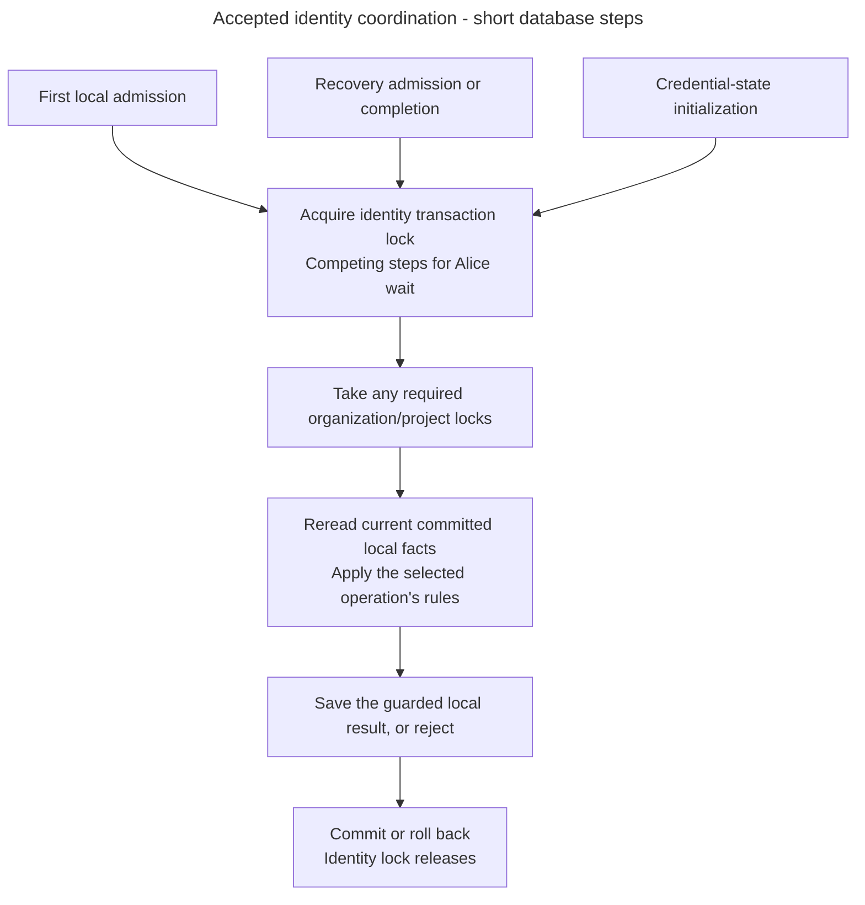

# Coordinate account admission and recovery for one identity

Alice already has a Kratos identity. Bob invites her into Inframeld, and she accepts while password recovery begins. Access must give account creation and recovery a common turn before a local account exists. Otherwise each could act on a picture taken before the other's change.

> **Status:** accepted design under [ADR-0082](../../../../docs/adr/ADR-0082-coordinate-first-admission-and-recovery-by-identity.md), resolving [PD-ACCESS-04](decision-recovery-first-admission.md). The identity lock and participating workflow changes are not implemented yet. Existing organization/project coordination remains implemented at its recorded scope.

## One turn for the verified identity

Access uses an exclusive PostgreSQL transaction-scoped advisory lock. This is a database-managed turn with an application-defined meaning. Identify it using the trusted installation, provider authority and subject, even when no Principal, identity link or credential-version row exists. Email and a proposed local account ID cannot substitute for that identity.

All participants must derive the same stable namespaced lock key across API and worker processes. Do not use a process-randomized hash. A compact key is only a coordination key. All record queries still match the exact installation/provider identity, so a key collision can cause extra waiting but cannot join identities or authorize another account.

| Participant | Local change protected by the identity turn |
| --- | --- |
| First admission, including invitation activation/provisioning | Recheck recovery, link the legitimate principal and commit the guarded local result. |
| Recovery admission | Find any current local link and commit the original obligation, block and one credential-version advancement together. |
| Recovery completion | Read the current optional local account and original obligation before applying release eligibility. |
| Credential-state initialization | Create missing state only when permitted, without resetting existing state, creating an account or granting access. |

The lock is not held from recovery admission until cleanup finishes. Each database operation has its own short transaction. Other participating operations can take their turns between those transactions, while the durable recovery block remains effective.

## Follow the protected database step

1. Establish the trusted installation/provider identity. Completion derives its target from the original stored admission, not an unchecked callback subject. A preliminary read needed to identify the target is not a current eligibility decision.
2. Begin the owning operation's transaction and acquire its identity lock before taking organization/project locks or writing credential state.
3. Acquire any required organization lock, then affected project locks in their existing stable order. An initializer with no organization work needs no invented organization or account.
4. Reread current identity links, recovery and credential facts under the acquired coordination. Do not use an earlier projection or cached ORM state as continuing authority. Run the selected operation's current authorization and eligibility rules.
5. Save only that operation's permitted changes and required audit/replay metadata. Commit or roll back through the existing transaction owner. The identity lock releases when the transaction ends.

Acquire the lock and read decision facts in separate SQL statements using PostgreSQL's Read Committed semantics. A query takes its snapshot when it begins, so combining lock acquisition and facts into one SELECT can retain the picture from before the wait. A transaction snapshot retained across statements also fails the fresh-observation requirement. [PostgreSQL 16 isolation documentation](https://www.postgresql.org/docs/16/transaction-iso.html#XACT-READ-COMMITTED) explains the distinction. Test that a waiting operation sees the preceding turn's committed changes.

Arrows show the shared ordering inside each database operation, not a network sequence or another service. Provider verification and cleanup stay outside these transactions. The diagram covers both first admission and recovery, including the case with no local account.

## Conflicts, retries and competing changes

| Situation | Required behavior |
| --- | --- |
| Recovery commits before valid new invitation activation | Activation sees the pending block and returns safe 409. It creates no account, consumes no invitation and applies no assignments. Alice can explicitly try again after recovery. |
| Activation commits before recovery admission | Recovery rereads the new link and takes the required organization lock before recording its block and version advancement. |
| Two first activations compete for Alice | The later turn rereads the existing link and follows ordinary invitation/replay rules. Preserve uniqueness and never create a second principal for the identity. |
| Completed activation response was lost | Recover the original operation under current recipient eligibility. The identity turn does not authorize new consumption or repeated assignments. |
| Recovery completes before Alice has a local account | Evaluate and finish only that eligible original obligation. Do not provision an account to obtain coordination. |
| Initialization overlaps recovery | Preserve the committed version and recovery history. Missing state with recovery history remains unavailable, never permission to recreate version 1. |
| Lock waiting exhausts the database budget | Propagate the existing unavailable outcome and roll back local effects. Do not consume the invitation, clear a block or retry provider work automatically. |

Include identity-lock waits in the existing bounded database stage rather than giving every lock a fresh budget. Existing recovery adapter deadlines remain five seconds and keep their current scope. They do not cover provider cleanup or final commit. Cancellation and failures propagate to the transaction owner. Uncertain commit communication still requires original-operation recovery.

Ordinary authentication reads do not acquire this lock, and existing project-grant writes continue using their organization/project protocol. First admission must still check the invitation issuer's current authority, exact assignments and recipient eligibility. The lock supplies none of those permissions.

## Implementation boundary and sources

Current recovery admission and completion coordinate linked identities through organization locks. The independent initializer protects version creation through its existing history checks and database constraints. None of these inspected adapters implements the identity turn yet. Add behavioral PostgreSQL coverage for both admission/recovery orderings, simultaneous first activation, initialization, timeout, cancellation and rollback when implementing the accepted design.

- [Invitation workflow](admission-and-invitations.md#invitations), [invitation transport rules](invitation-contracts.md) and [existing Access write coordination](grant-administration.md#how-the-database-gives-each-change-its-turn).
- [Credential and recovery records](credential-and-recovery-records.md), [local completion](recovery-completion.md#recovery-completion-workflow) and [remaining production-evidence questions](decision-recovery-production-completion.md).
- [PostgreSQL 16 advisory locks](https://www.postgresql.org/docs/16/explicit-locking.html#ADVISORY-LOCKS) and [transaction-scoped functions](https://www.postgresql.org/docs/16/functions-admin.html#FUNCTIONS-ADVISORY-LOCKS). PostgreSQL coordinates callers using the same lock. The application must make each participating workflow follow the contract.
