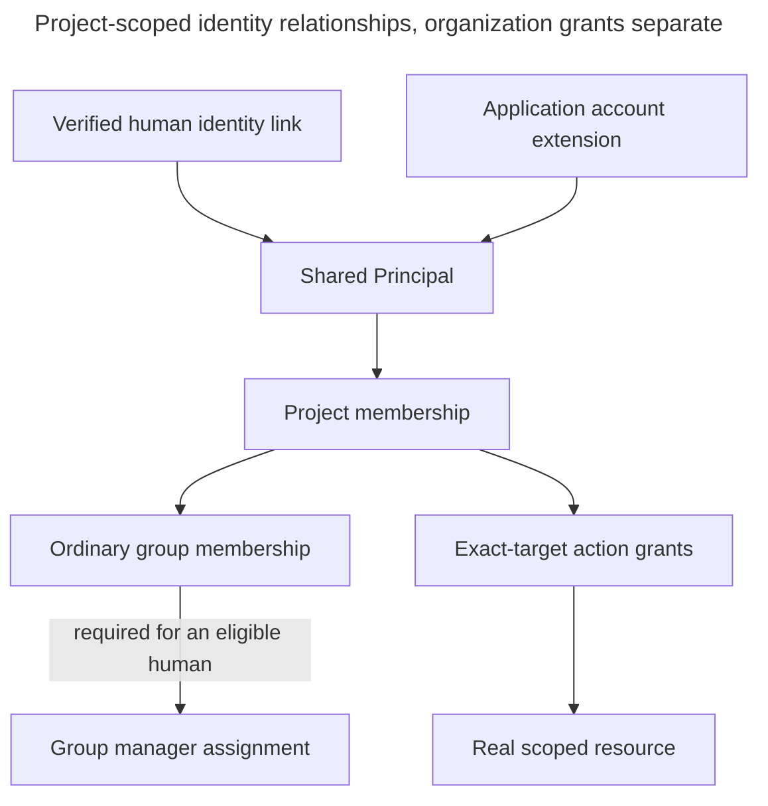

# Identity, membership and grant records

Alice and SupportBot both belong to Support, but only Alice may manage its document group. Both can query Production only when their separate action grants and document access permit it. This reference explains the relationships and what each one means.

**Status:** this is the accepted logical model, including explicitly identified implemented facts. A logical record is not a promise of one table, class or endpoint. Code and migrations own exact implemented representations. Pending decisions keep their stated status.

## Choose the detail you need

- For the current `Principal`, runtime identifiers or `ProjectMembership` aggregate, read [Implemented Access models](implemented-access-models.md).
- For tables, scoped foreign keys, current grants, audit storage or future integration points, read [Access persistence](access-persistence.md).
- For appointment, demotion, departure, suspension or deletion writes, read [Lifecycle persistence](access-lifecycle-persistence.md).
- For current authorization and safe replay, use [Authorization](authorization.md). Loading the other record views is unnecessary for a relationships-only question.

## Access: identity, membership, and grants

Alice and SupportBot have separate identities, called **principals**, in the Support project. Joining Support, joining a document group, managing that group, and receiving an action permission are separate relationships. The [Access guide](authorization.md) explains their behavior. The relationships below preserve those distinctions.

The arrows show references and relationships. They do not automatically grant permissions. An application credential identifies its stable principal and uses that account's current permissions.

Humans and applications share the same model of principals, memberships, and grants. Their authentication records remain separate. [Access](authorization.md) decides which operations each kind of principal may perform.

The first table describes information and relationships, not final SQL names, types, ORM classes, or implemented behavior. A concept does not require its own aggregate, repository, service, or endpoint. Access is part of the [single backend](../../inframeld-application-contracts/references/components-and-services.md).

## Records and their relationships

| Logical record | Information it represents | Boundary to preserve |
| --- | --- | --- |
| **Principal** | Stable local identity, human/application kind, and account status used by Access. | Both kinds use the same membership and action-policy model. The shared model does not make applications eligible for human-only administration. Account kind and status are trusted application facts, not caller-supplied claims. |
| **Identity link** | External authority and subject mapped to a local human principal. | An authority identifies the verified identity source. A subject identifies the account within it. The same external identity must not resolve ambiguously to different local humans. Email, display name, or an upstream group is not the identity key. |
| **Organization** | The installation's ownership and installation-action scope. | V1 provisions one installation organization. Recording the boundary does not add multi-organization administration or enterprise federation. |
| **Project** | Stable project identity and its owning organization. | A resource belongs to its recorded project. Project membership and project-scoped authority do not extend to another project or to installation-level actions. |
| **Project membership** | A relationship between a principal and a project. | Membership is a prerequisite for project operations, not an action grant or document-reading grant. Human membership administration and application-account creation/removal follow their separate [Bound administration, grants, and recovery](memberships-groups-and-handover.md#section-bound-administration-grants-and-recovery) workflows. |
| **Access group** | Stable group identity and its owning project. | It defines a document audience within that project. Documents refer to groups through their stored allowlists. A group is not a bundle of all project operations. |
| **Group membership** | A principal's document access through one project-local group. | It is separate from project membership, group management, and operational action grants. Application group relationships define the application's current document scope, not a per-key copy. |
| **Group manager assignment** | A human's peer-manager authority on one project-local group. | Requires an ordinary membership for the same principal, project, and group. Record both explicitly on appointment. Reads use membership, while administration requires both assignments and current eligibility. Applications cannot be managers. |
| **Action grant** | A principal, one action, its exact scope/target, its grant level, and assignment attribution. | Record grants individually. Human recipients may have can use or can use and grant. Application recipients may have only can use for eligible actions. Neither a valid identity nor general administrator status supplies an absent permission. |

Memberships, grants, and action attribution all refer to the same principal ID. A human's sign-in link or an application's key establishes that ID. Human-specific and application-specific records may differ without creating two permission systems.

An application account belongs to one project. It begins with no document access, action grants, or automatically issued key. It cannot move between projects or inherit its creator's rights. Humans, unlike applications, can be explicitly admitted to several projects.

## What one action grant means

The [fixed Access catalogue](actions-and-initial-grants.md#capability-catalogue) defines supported action/target/principal-kind combinations. The [initial-assignment contract](actions-and-initial-grants.md#initial-assignments) enumerates the seventeen Project and exact-resource human creator grants. No wildcard/creator field replaces current grants and no backfill is implied. Configurable resource creation is human-only in v1. Authorized application operations may create ordinary workflow revisions, Documents, jobs and cases. These logical decisions do not add physical tables or migrate published/database identifiers.

The logical contents of a grant are:

| Information | Meaning |
| --- | --- |
| **Recipient principal** | The human or application receiving authority. |
| **Action** | One supported operation, such as Query or Manage releases. Validate the action against its allowed scope and recipient kind. |
| **Exact target and owning scope** | The installation organization, project, group, or individual resource to which the action applies. A resource grant identifies that resource, not every current/future resource of its kind. |
| **May grant onward** | Whether the recipient has can-use-and-grant authority for this same action and scope. Both grant levels permit use. Can-use-and-grant is not a grant-only third level. |
| **Assignment attribution** | Who assigned the permission and when, with later changes recorded according to the audit/retention design. Attribution does not give the original grantor permanent control. |

For example, Alice's Manage releases grant on Production says nothing about Test, Pipeline Build, reading documents, or a separate View grant. Code must implement only the accepted implications, such as Edit configuration allowing her to view that same configuration. It must not infer extra rights from names or introduce configurable role inheritance.

Keep **one current assignment per recipient, action, and exact target**, enforced by a database unique constraint. If another grantor changes that permission, they update the same assignment through the authorized workflow. Revoking it then cannot leave an unnoticed duplicate grant behind.

Every grant has a required boolean `can_grant`. The row allows use when ordinary eligibility checks pass. `true` also allows granting the same action on the same target. `false` means use-only, not an explicit denial. Applications can hold only `false`. Accepted implications such as Edit including View are evaluated by application policy without extra stored View rows.

Application code owns a fixed action catalogue. Each action defines its target type and eligible recipient kinds. Deny unsupported actions. There is no editable actions table, custom role language, or runtime policy-definition service. New actions need reviewed code and relevant database constraints. Exact identifiers and future actions still belong to their feature decisions.

Store individual memberships and grants as relational records. Do not replace them with one authoritative JSON permissions document per account. A read response can still group permissions for display.

The grantor tells us who assigned a permission, not who must remain present for it to work. If Alice grants Bob Query and later leaves, Bob keeps that grant. Remove Alice's own relationships under the departure rules. Do not revoke Bob's grant merely because Alice originally assigned it.

## Alice and SupportBot use different relationships

This is an illustrative authorized state, not a provisioning template that silently grants rights:

- The installation organization contains **Support**.
- **Alice** is a human principal. **SupportBot** is an application principal owned by Support.
- Both are Support project members.
- Both belong to the **Support documents** group. Alice also has a manager assignment. Her ordinary membership is what passes the group-based reading check.
- **Production** and **Test** are Deployments in Support. Assume neither principal has other grants on Test or membership in an HR-only document group.

| Recipient  | Action          | Target     | Grant level       |
| ---------- | --------------- | ---------- | ----------------- |
| Alice      | Manage releases | Production | Can use and grant |
| Alice      | Query           | Production | Can use and grant |
| SupportBot | Query           | Production | Can use           |

When SupportBot queries Production, key verification identifies its account and checks the key's validity and binding. Access then checks current status, Support membership, Query on **Production**, and document access through SupportBot's groups and the Documents' allowlists. Alice asking through the bot does not give it her permissions.

SupportBot can query Production using permitted evidence but cannot release Production, administer grants, or read an HR-only document. Neither example principal gains release authority on Test from these assignments. Removing SupportBot's Query grant blocks querying Production even though its key and project membership remain valid. Removing its Support-documents membership removes that document access even if Query remains. Replacing its key changes neither relationship.

When Alice creates a Deployment, one transaction records it, its first ready serving version, and her explicit initial grants. Later releases use those ordinary grants. A creator ID cannot override a later removal of her permissions.

## Separate current grants from permission history

A current-grants table answers “what is assigned now?” Revocation deletes that assignment. A downgrade changes its grant level. Do not leave a revoked row in this table behind an inactive flag.

The audit record answers “who changed what, and when?” It records the affected recipient, action, target, and change. Save it in the **same transaction** as the current-state change, so either both are saved or neither is.

Authorization reads current assignments and checks status, membership, scope, and the operation's other rules. It does not rebuild permissions from history. Granting a removed permission again creates a fresh assignment with fresh attribution, rather than reviving an old historical row.

For example, removing SupportBot's Query row blocks Query even while its key and project membership remain valid. **Suspension works differently:** it keeps assignments but prevents their use. Key revocation and account deletion each have their own lifecycle.

Audit history follows [retention, access, and erasure rules](../../inframeld-knowledge/references/deletion-and-retention.md). It must not retain credential secrets or authorize actions from historical actor/resource references. Its exact schema, permitted viewers, indexes, and retention implementation still need design with the owning workflows.

## Sources and status boundaries

The [fixed action catalogue](actions-and-initial-grants.md), [current authorization](authorization.md), [membership workflow](memberships-groups-and-handover.md) and [application-key lifecycle](application-keys.md) own their detailed rules. [ADR-0016](../../../../docs/adr/ADR-0016-use-stable-shared-principals-with-an-application-account-extension.md) records shared identity. [ADR-0020](../../../../docs/adr/ADR-0020-store-current-grants-in-target-specific-relational-tables.md) records grant storage. Follow the implementation and pending qualifications in the focused references rather than inferring completed workflows from this logical model.
