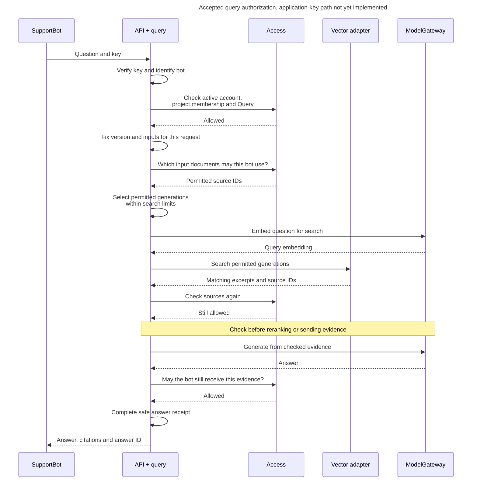

# Authorize a question and its source evidence

SupportBot may ask Production a question without being entitled to every Support document. Query authority selects the operation. Current document audiences limit evidence before retrieval, model calls and disclosure.

  

## Follow a query

SupportBot asks Production, “How do customers request a refund?” Inframeld first checks the bot's identity, project membership, and Query permission. It then needs to keep unauthorized documents out of both the answer and the work that produces it.

A pipeline version names exact document versions and their prepared indexes. A **generation** identifies prepared search data for those inputs. Inframeld selects only the generations whose documents SupportBot may currently use and which have not been deleted. The vector adapter searches within that selection.

The sequence below shows a successful request. A failed permission check stops the affected step. “API + query” combines authentication and query handling for readability. Authentication adapters still verify the key.

Client-supplied group names or search filters never establish permission. The backend checks the sources returned by search before sending their contents to a model, evaluator, caller, or **reranker**, which reorders matching excerpts. Reordering documents is still use of their contents and needs permission.

If no generations are permitted, there is no evidence to search. The backend must not fall back to searching everything. Search also has combined limits on generation count, filter size and conditions, storage partitions called **shards**, and time. Exceeding a limit produces an explicit failure, rather than wider access or an unlimited series of smaller searches. If a required shard fails, the query is unavailable. The [indexing guide](../../inframeld-indexing/references/profiles-and-preparation.md) defines those limits. Correct access filtering does not guarantee that approximate search finds every relevant excerpt or that models return identical answers.

### SupportBot loses access while an answer is being generated

Suppose a manager removes SupportBot from SupportKnowledge after search finishes. The earlier permission check does not entitle the bot to receive the answer. Inframeld checks again before later uses of the evidence and before returning the response.

The same rule applies to old content. A Document's **current** access policy protects all its versions, including old downloads, citations, evaluation evidence, and answer receipts. A saved collection revision does not preserve past permissions. Vector records therefore do not contain a mutable list of permission groups that needs rewriting whenever access changes.

The execution records who acted and the access revision (change number) it observed, to help explain its history. This never authorizes a later read. There is still a gap between checking permission and sending data over the network. Revocation cannot recall content already sent, but rechecks protect subsequent uses. The database must not remain locked while waiting for a model call.

### Receipts, feedback, and MCP follow the same rules

An **AnswerReceipt** records the execution, the principal who requested it, the selected version, and the sources sent to the model for the final answer. This includes sources the answer did not cite. They may still have influenced it. Operation records, receipts, and feedback must not expose those sources to someone who has since lost access.

The separate `feedback:write` permission lets an originating principal submit and read its own current feedback for eligible live answers while it retains access to the evidence. Query permission does not automatically include it. CLI v1 and future Studio reporting require separate project-feedback inspection authority and current evidence access. Reporting alone cannot authorize correcting another principal's rating. Replacing SupportBot's key preserves its identity and feedback ownership. Another application or human login does not inherit that ownership. CLI feedback capability selects the client experience, not new permission identifiers.

The **Model Context Protocol (MCP)** provides another way to call the same application operations. V1 supports preconfigured clients that send an existing application key in authentication headers. That profile does not add delegated human identities, MCP OAuth onboarding or tools for administering keys. Hydra's separate first-party human CLI flow does not change this limit. Even looking up a default Deployment requires project membership and Query permission before setup information is revealed.

See [answer feedback](../../inframeld-pipelines/references/answer-feedback.md), [MCP](../../inframeld-application-contracts/references/mcp-transport.md), and [lost-response recovery](../../inframeld-pipelines/references/answer-execution-and-receipts.md#answers) for their full contracts.

 

## Document operations

Reading a document, changing its contents, and deciding who may read it are separate responsibilities. A document shared with several groups needs protection for all those groups.

### Bob uploads a handbook without reading the existing library

Bob has Add documents on SupportKnowledge. That lets him upload a new handbook for that group even if he is not a member and cannot read its documents. Sharing the new upload with HRPrivate as well requires Add documents on HRPrivate too.

| Operation | Required permission | Result |
| --- | --- | --- |
| **Add documents** | Add on every group selected for the new document. | Creates a Document with that initial audience. |
| **Update documents** | Update on every group in the document's current saved allowlist. | Replaces its contents without changing its identity or audience. Changed content creates a new immutable DocumentVersion. |
| **Delete documents** | Delete on every group in the document's current saved allowlist. | Deletes the Document across all its versions. |

A group manager can grant these actions without making the recipient another manager. Applications may receive use-only permission. None of Add, Update, or Delete includes the others, document reading, audience changes, group management, Build, or Manage releases.

Every document must allow at least one group, and all its groups must belong to its project. An empty saved allowlist denies access. Before saving a change, the backend checks current project membership, account status, credential restrictions, and the required permissions against the **saved** policy. Bob cannot supply an old or smaller group list to avoid those checks.

An upload default, a matching filename, or duplicate content does not grant permission to replace an existing document. Unchanged content follows the existing retry rules instead of creating duplicate versions.

### A permitted query may have no readable evidence

Alice has Query on the selected Pipeline or Deployment and passes its current project/action checks, but none of the selected documents is readable by her. Access returns an empty permitted source set. Indexing performs no Chroma search, and Pipelines returns its ordinary authorized no-evidence outcome. This is not a permission error for the query and must not reveal whether hidden documents exist.

Keep three cases distinct in and its callers:

- Missing Query authority or invalid project/account eligibility denies the operation under the normal non-disclosing error contract.
- A permitted query with zero authorized source versions follows the [Indexing no-evidence path](../../inframeld-indexing/references/retrieval-and-filtering.md#retrieval), without an unrestricted search or a fallback identity.
- Reading a particular protected document or evidence bundle still requires access to every required source. An empty saved document allowlist, or revocation/erasure before disclosure, cannot be converted into a successful empty read or partial disclosure.

 

### Query permission names its Pipeline or Deployment

Alice may query Pipeline `contracts` using its current saved configuration without changing Deployment `contracts-production`. SupportBot may instead have Query on `contracts-production` only, so it uses that Deployment's serving selection and cannot query `contracts` directly. The distinction is the resource targeted by the grant, not an Experiment resource or an Execute experiments permission.

| Requested operation | Required scope and meaning |
| --- | --- |
| Query a Pipeline | Query on that exact Pipeline. Execute its current saved working configuration and any explicit supported per-request overrides |
| Query a Deployment | Query on that exact Deployment. Use its selected ready PipelineVersion and ordinary serving policy |
| Inspect Pipeline query traces | Separate inspection authority on that exact Pipeline, including other callers' direct-query traces within current source access |
| Inspect Deployment query traces | Separate inspection authority on that exact Deployment, including other callers' live-query traces within current source access |

direct Pipeline Query capability accepts these resource scopes. Active humans and applications are eligible when explicitly authorized. Eligibility is not a grant. Query returns the permitted answer to that request, not blanket access to stored diagnostics or teammates' questions. Trace reads check all captured source candidates, not only final citations. Pipeline inspection does not include queries served through Deployments that reference the same Pipeline, and Deployment inspection does not include direct Pipeline queries. Neither grant is project-wide.

Before direct execution, check current Pipeline Query authority, source/model access, compatible ready data and ordinary resource/budget limits. Capture the admitted effective settings and exact inputs once. Later configuration edits do not alter that request. These are execution provenance, not a release build or a separate domain entity. Saving/restoring settings still needs Pipeline Edit configuration. Query does not save overrides, grant Build/Manage releases, or authorize publication. Current permissions and shared-connectivity checks continue at their normal boundaries.

Lists, retained results, trace stages, safe errors and exports enforce current disclosure rules. Knowing a request/snapshot ID or having created a Pipeline never bypasses them. Trace capture and retention remain separately controlled. Evaluation cases/results keep their own Access rules: this decision does not settle every evaluation or non-query job-diagnostic capability or make a query trace grant a general evaluation-history grant.

These are accepted action meanings and target scopes. The [reviewed catalogue](actions-and-initial-grants.md#reviewed-capability-catalogue) now selects `query` and `inspect-query-traces` on each exact resource. It changes no schema. Retain concrete wire schemas/mappings and implementation/qualification of the settled query grants and fixed initialization. Non-query product diagnostic browsing is deferred. Separately authorized domain job/case/result views retain their own contracts. Preserve existing implemented contracts when mapping them. This documentation does not claim Pipeline Query is already implemented. The old `preview-authority` anchor is retained only for existing links.

### Permission scopes at a glance

A permission's **scope** is the exact installation, project, group, or resource it covers. Each action below can be granted separately. Human-only restrictions and the extra checks in this guide still apply. This is the agreed core, not a complete catalogue of every future operation.

| Target | Named actions or authority |
| --- | --- |
| Installation organization | Admit users, Suspend users, Restore users, Create projects. |
| Project | [Seventeen initial creator actions](actions-and-initial-grants.md#initial-project-grants), including Inspect feedback and named resource-creation actions. |
| Individual Pipeline | Query, Inspect query traces, Build, View configuration, Edit configuration, Delete, six Evaluation operations and human case-audience administration. |
| Individual Deployment | Query, Inspect query traces, Manage releases, View configuration, Edit configuration, Delete, own `feedback:write`. |
| Access group | Add documents, Update documents, Delete documents. Manager assignment is separate from these grants. |
| Individual application account | Issue application keys, Revoke application keys, Delete application account. |

The [fixed capability catalogue](actions-and-initial-grants.md#capability-catalogue) records reviewed identifiers, targets and principal eligibility, including Collection, Source, connection and profile actions. Basic visibility follows [section 4](memberships-groups-and-handover.md#sharing), rather than a universal View permission.
