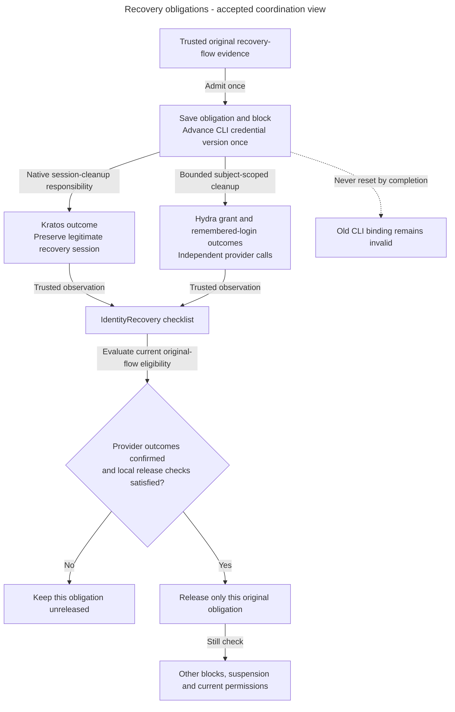

# Release only the completed recovery obligation

Alice has two overlapping recovery flows. Finishing the older flow can release only its own block. A local completion service records confirmed facts under current eligibility and leaves another obligation effective.

Alice recovers a compromised identity. She needs a legitimate recovery session, but the attacker must not keep using old product or CLI access. Access temporarily blocks product work, permanently invalidates the old CLI generation, and tracks the original cleanup checklist. Those three protections have different completion conditions.

## Track cleanup separately from access restoration

**Accepted coordination view.** Checklist persistence/local completion have inspected code. Production callbacks and full provider-cleanup/reconciliation wiring remain unfinished. This flow describes obligations, not a new formal state enumeration.

Arrows show causal obligations and checks. Confirmed cleanup cannot replace current local eligibility, release another recovery or restore removed grants. A pending or uncertain provider outcome remains incomplete. An unfinished or already dispatched bulk call can invalidate newer CLI credentials, while a completed event must initiate no new cleanup. See the [aggregate](../../../../apps/backend/src/inframeld_backend/access/domain/entities/identity_recovery.py) and [local completion service](../../../../apps/backend/src/inframeld_backend/access/application/services/identity_recovery_completion_service.py) for the implemented subset.

### Reconcile the original identity-cleanup obligation

Verified recovery/reset admits one trusted flow-bound cleanup identity and temporary product block under the [Access contract](recovery.md#identity-recovery-cleanup). Suspension likewise commits its immediate local block, revision/audit and original durable cleanup obligation together. These workflows use ordinary durable jobs/reconciliation, not another queue or public state machine.

Record Kratos-session and Hydra-grant outcomes independently. Confirmed success, failure and uncertainty are different evidence. Keep provider waits outside SQL transactions and retries bounded. One provider succeeding never releases the block while another required outcome is unconfirmed. Reconcile the original admitted operation instead of restoring access to retry provider work.

A completed duplicate recovery event returns the original result without initiating another provider call. Under [ADR-0070](../../../../docs/adr/ADR-0070-use-bulk-hydra-revocation-for-identity-recovery.md), an unfinished bulk retry or already-dispatched call may invalidate credentials from a subsequent CLI login. An older operation finishing cannot release a newer pending block. Otherwise active humans automatically resume only after all required cleanup is confirmed and current local eligibility holds. Suspended humans still require separately authorized restoration/security review. No completion recreates removed assignments. The [private recovery handoff draft](private-recovery-handoff.md#recovery-wire) specifies stable original-flow/identity/kind/phase deduplication and durable acknowledgment. Still qualifies hook ordering, trusted completion and bounded reconciliation. These are specification requirements, not implemented cleanup evidence.

[ADR-0069](../../../../docs/adr/ADR-0069-release-completed-recovery-obligations-independently.md) distinguishes finishing one obligation from authorizing product access. Each fully confirmed eligible checklist may release only itself, while other unreleased checklists continue blocking access. This avoids completed flows waiting for each other indefinitely. An identity with no local account may finish cleanup without provisioning one. Suspended and retired local accounts remain ineligible for automatic release.

The implemented [local completion service](recovery-completion.md#recovery-completion-workflow) records trusted provider outcomes in its own short transaction. It requires the original admission, checks binding and current local facts, invokes domain transitions and saves before returning the original operation identity. It calls no provider and retries nothing automatically. A released duplicate returns recorded state without another save. An unreleased repeat can reevaluate eligibility after separate restoration, using existing confirmed outcomes. This is local completion evidence, not implementation of private callback acknowledgment, remote cleanup or durable retry scheduling. Those integration and reconciliation steps remain unfinished.

For the exact bulk calls, HTTP outcomes, late issuance, provider observations and qualification limits, read [Provider cleanup](recovery-provider-cleanup.md). A local checklist cannot establish trusted remote completion. [Human CLI consent](human-cli-consent.md) owns browser/version checks and uncertain approval recovery.

#### Implemented cleanup checklist persistence

After Alice's recovery is admitted, [IdentityRecovery](../../../../apps/backend/src/inframeld_backend/access/domain/entities/identity_recovery.py) keeps the independent Kratos and Hydra results. Confirmation of both providers still leaves the access block until the application explicitly records release. [Its repository](../../../../apps/backend/src/inframeld_backend/access/application/protocols/identity_recovery_repository.py) loads the original checklist and saves its transitions in the caller's transaction, preserving the original admission binding and timestamps.

Concurrent workers cannot overwrite changed stored progress. The PostgreSQL adapter checks the loaded values as part of the update. A conflict requires rollback and a fresh load before the application decides how to proceed. Reloading does not authorize repeating external revocation. Unchanged saves perform no writes and do not refresh the checklist. [The data model](credential-and-recovery-records.md#identity-cleanup-records) owns exact fields and snapshot lifetime.

The repository is now used by the local completion service below. Repository-only tests arrange domain state directly. They do not qualify trusted provider evidence or real cleanup.

#### Record cleanup outcomes and release one original checklist

Alice's Kratos cleanup is confirmed, but Hydra is unavailable. The [completion service](../../../../apps/backend/src/inframeld_backend/access/application/services/identity_recovery_completion_service.py) can record Kratos's result and Hydra's failure or uncertainty while retaining the block. A later trusted Hydra confirmation finishes the same operation. These inputs must come from authenticated, verified evidence. Constructing an event or outcome value does not establish that trust.

`IdentityRecoveryCompletionService.record_cleanup()` accepts the original event and at least one non-pending provider outcome. An omitted provider keeps its existing result. The service owns the transaction, loads current completion facts, checks the original installation/provider/flow/subject/kind binding, then loads the aggregate. It records the outcomes through domain methods, applies `IdentityRecoveryReleasePolicy`, saves and returns only after commit. Missing admission or conflicting evidence returns `ConflictError` without creating an obligation. Domain regression errors use a stable application-owned message and preserve their cause.

The [facts reader](../../../../apps/backend/src/inframeld_backend/access/infrastructure/readers/postgres_identity_recovery_completion_facts_reader.py) verifies installation metadata and takes the existing exclusive organization lock for a linked identity before reading the admission, current local principal and other unreleased flows together. One fixed five-second deadline covers its database work, including lock waits. It excludes the later repository save and final commit. The service and repository share the same request-local session. Provider calls remain outside these transactions. Unlinked identities have no organization to lock, and concurrent first local admission remains separate qualification work.

After both outcomes are confirmed, an active human's checklist may release its own block. An identity without a local account can finish without provisioning one. Suspended and retired accounts remain ineligible for automatic release. Other unreleased checklists keep blocking product access independently, so two fully confirmed flows do not wait for each other to release first. `PrincipalAccessPolicy.is_account_active()` supplies the shared status rule. Product authentication still uses the full common eligibility policy, including every pending recovery block.

An already released duplicate returns its stored cleanup states, timestamp and original operation identity without another save. An unreleased repeat rechecks current local state, including after separate authorized restoration. The result's `has_other_pending_recovery` reports that transaction's observation and grants no permission. Another recovery can be admitted after it commits. Every product request still checks current state.

[Service unit tests](../../../../apps/backend/tests/unit/access/application/services/test_identity_recovery_completion_service.py) and [PostgreSQL tests](../../../../apps/backend/tests/integration/access/test_identity_recovery_completion_postgres.py) cover this local workflow. No production callback or provider-cleanup worker invokes it yet. The test-only Kratos callback probe remains separate. Authenticated callback delivery, trusted native cleanup evidence, issuance coordination and bounded provider reconciliation still need implementation and qualification. The bulk Hydra tests qualify provider calls, not the complete recovery workflow.
