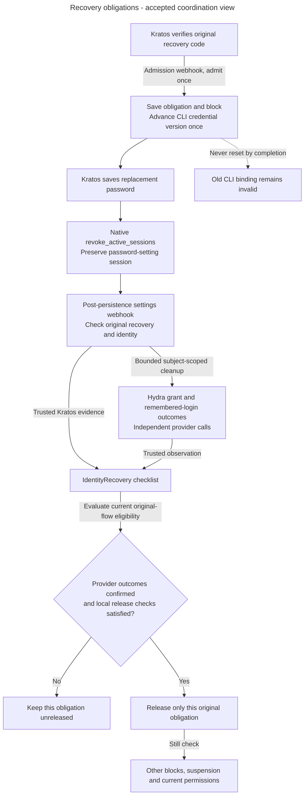

# Release only the completed recovery obligation

Alice has two overlapping recovery flows. Finishing the older flow can release only its own block. A local completion service records confirmed facts under current eligibility and leaves another obligation effective.

Alice recovers a compromised identity. She needs a legitimate recovery session, but the attacker must not keep using old product or CLI access. Access temporarily blocks product work, permanently invalidates the old CLI generation, and tracks the original cleanup checklist. Those three protections have different completion conditions.

## Track cleanup separately from access restoration

**Accepted coordination view.** [ADR-0081](../../../../docs/adr/ADR-0081-use-native-kratos-hooks-for-recovery-evidence.md) selects the native-hook sequence below. Checklist persistence/local completion have inspected code. Production callbacks and full provider-cleanup/reconciliation wiring remain unfinished. This flow describes obligations, not a new formal state enumeration.

Arrows show causal obligations and checks, not one transaction across services. Code acceptance is not password replacement, and the settings callback is not confirmation of Hydra cleanup. [The private handoff](private-recovery-handoff.md#native-hook-evidence) owns the exact evidence meanings. Missing callbacks keep the block, even when the password was already saved.

The accepted [identity-coordination sequence](identity-admission-coordination.md#follow-the-protected-database-step) applies separately to admission and local completion. It covers first account creation too. Its lock releases at the end of each database transaction and never spans the Kratos or Hydra stages in this diagram. This prerequisite remains unimplemented.

Confirmed cleanup cannot replace current local eligibility, release another recovery or restore removed grants. A pending or uncertain provider outcome remains incomplete. An unfinished or already dispatched bulk call can invalidate newer CLI credentials, while a completed event must initiate no new cleanup. See the [aggregate](../../../../apps/backend/src/inframeld_backend/access/domain/entities/identity_recovery.py) and [local completion service](../../../../apps/backend/src/inframeld_backend/access/application/services/identity_recovery_completion_service.py) for the implemented subset.

### Reconcile the original identity-cleanup obligation

Verified recovery/reset admits one trusted flow-bound cleanup identity and temporary product block under the [Access contract](recovery.md#identity-recovery-cleanup). Suspension likewise commits its immediate local block, revision/audit and original durable cleanup obligation together. These workflows use ordinary durable jobs/reconciliation, not another queue or public state machine.

Record Kratos-session and Hydra-grant outcomes independently. Confirmed success, failure and uncertainty are different evidence. Keep provider waits outside SQL transactions and retries bounded. One provider succeeding never releases the block while another required outcome is unconfirmed. Reconcile the original admitted operation instead of restoring access to retry provider work.

A completed duplicate recovery event returns the original result without initiating another provider call. Under [ADR-0070](../../../../docs/adr/ADR-0070-use-bulk-hydra-revocation-for-identity-recovery.md), an unfinished bulk retry or already-dispatched call may invalidate credentials from a subsequent CLI login. An older operation finishing cannot release a newer pending block. Otherwise active humans automatically resume only after all required cleanup is confirmed and current local eligibility holds. Suspended humans still require separately authorized restoration/security review. No completion recreates removed assignments. The [private recovery handoff draft](private-recovery-handoff.md#recovery-wire) specifies stable original-flow/identity/kind/phase deduplication and durable acknowledgment. Still qualifies hook ordering, trusted completion and bounded reconciliation. These are specification requirements, not implemented cleanup evidence.

[ADR-0069](../../../../docs/adr/ADR-0069-release-completed-recovery-obligations-independently.md) distinguishes finishing one obligation from authorizing product access. Each fully confirmed eligible checklist may release only itself, while other unreleased checklists continue blocking access. This avoids completed flows waiting for each other indefinitely. An identity with no local account may finish cleanup without provisioning one. Suspended and retired local accounts remain ineligible for automatic release.

The implemented [local completion service](recovery-completion.md#recovery-completion-workflow) records trusted provider outcomes in its own short transaction. It requires the original admission, checks binding and current local facts, invokes domain transitions and saves before returning the original operation identity. It calls no provider and retries nothing automatically. A released duplicate returns recorded state without another save. An unreleased repeat can reevaluate eligibility after separate restoration, using existing confirmed outcomes. This is local completion evidence, not implementation of private callback acknowledgment, remote cleanup or durable retry scheduling. Those integration and reconciliation steps remain unfinished.

For the exact bulk calls, HTTP outcomes, late issuance, provider observations and qualification limits, read [Provider cleanup](recovery-provider-cleanup.md). A local checklist cannot establish trusted remote completion. [Human CLI consent](human-cli-consent.md) owns browser/version checks and uncertain approval recovery.

### Bound automatic Hydra cleanup

**Accepted policy, production orchestration unimplemented.** [ADR-0083](../../../../docs/adr/ADR-0083-bound-hydra-recovery-cleanup-retries.md) selects a narrow exception to the shared job limit. Alice has saved her replacement password and trusted native Kratos cleanup is confirmed, but Hydra is unavailable. Retry unfinished Hydra cleanup under the original operation rather than starting a fresh recovery.

| Budget or prerequisite | Required behavior |
| --- | --- |
| Eligibility | Trusted Kratos completion for the original recovery must make Hydra cleanup eligible. Code acceptance alone or missing completion evidence cannot start this work. |
| Attempt maximum | Twelve cleanup attempts per run, including its first attempt. The grant and remembered-login steps share that run's budget within the original recovery operation. |
| Elapsed maximum | The initial automatic run has one hour after trusted Kratos completion first makes cleanup eligible. An explicitly authorized operator run has one hour from its recorded authorization. Preserve every run's deadline. |
| Retry pacing | Use progressively longer waits for recoverable failures and uncertain bulk outcomes within both limits. Exact intervals and provider-error mappings remain unfinished. |
| Restart or duplicate callback | Preserve the current run's count and deadline, all earlier budgets and confirmed progress. Neither event authorizes a fresh budget. |
| Exhaustion | Stop new automatic attempts when either limit is reached. Keep the obligation unreleased, preserve outcomes and make it visible for operator attention. |
| Known permanent rejection | [End the current run early](#hydra-cleanup-failure-handling), preserving progress and the block. Do not spend the remaining budget on a known-invalid request. |
| Further operator action | Only a fresh explicit host authorization may grant [another bounded run](#operator-cleanup-continuation). It does not reset earlier history. |

An attempt may perform the still-unconfirmed CLI-grant and remembered-login steps. For example, Alice's first attempt confirms grant revocation but cannot confirm remembered-login deletion. Once that progress is durably recorded, the next attempt performs only the remaining step. A lost acknowledgment remains uncertain and can require repeating an unfinished bulk request under the accepted scope. Do not multiply the budget with separate per-method or SDK retry loops.

Budget exhaustion follows the shared exhausted-budget job outcome. It neither confirms an uncertain provider result nor changes account status, permissions or credential versions. No timer releases the recovery block. Already-dispatched SDK calls may still finish after their caller stops waiting. Preserve existing ownership and trusted-evidence rules rather than inferring cancellation or success. A durably completed recovery initiates no new cleanup on duplicate delivery.

This policy bounds automatic dispatch, not the time a human has to enter a recovery code or replace a password. Missing native completion evidence has its own unresolved reconciliation path under PD-ACCESS-03. The budget and progress need durable orchestration records, but this decision selects no table, columns or runtime settings. Other background jobs retain their existing three-attempt limit.

### Distinguish recoverable failures from permanent rejections

**Accepted policy on 2026-10-25, unimplemented.** Alice's Hydra request times out. The provider may have completed it, so the result stays uncertain. An unfinished bulk request can be retried within the current budget under the accepted scope. A known permanent rejection instead ends that automatic run early and requires operator attention.

| Observation | Run behavior |
| --- | --- |
| Recoverable provider failure | Retry unfinished work with progressively longer waits while time and attempts remain. |
| Uncertain bulk-cleanup outcome | Preserve uncertainty and any confirmed progress. Retry only within the existing safe-repeat scope and run budget. |
| Known permanent rejection | Record the ended run and its safe stop reason. Stop new automatic attempts immediately and keep the recovery block. |

Cleanup state and retryability answer different questions. The current adapter returns confirmed, failed or uncertain cleanup observations. That result alone is not the complete future retry-classification contract. Exact provider-error mappings and the safe observations needed to apply them remain to be specified before implementation. This decision does not authorize blanket retries of programming errors.

Preserve all independent provider observations when a run ends. A permanent rejection does not establish what happened to another uncertain request, and ending a run never supplies missing cleanup confirmation. Existing ownership and late-call rules remain in force.

After fixing the cause, a verified host operator may authorize another bounded run immediately under the policy below. They do not have to wait for the ended run's hour to expire. Keep its used attempts, original deadline, stop reason and confirmed progress in history. A restart or repeated callback cannot revive its unused budget.

### Authorize another cleanup run after operator repair

**Accepted policy, unimplemented.** [ADR-0084](../../../../docs/adr/ADR-0084-authorize-additional-recovery-cleanup-runs-through-host-maintenance.md) lets a verified host operator authorize another bounded run for the same unfinished recovery. Alice's automatic run has stopped. The operator fixes Hydra, reviews the original operation and explicitly authorizes continued cleanup. That new run can try up to twelve times within one hour of its recorded authorization.

There is no lifetime cap on explicit operator authorizations. Each additional run needs fresh approval through [protected host maintenance](host-maintenance.md#recovery-cleanup-continuation). Record that authorization and its budget separately, preserving all earlier counts, deadlines, outcomes and confirmed progress. Keep the original installation/provider/subject and recovery operation unchanged. This creates neither a new recovery flow nor a credential-version advancement.

| Current state or request | Required behavior |
| --- | --- |
| Ended run with eligible unfinished Hydra cleanup | A fresh verified host authorization may admit another bounded run after budget exhaustion or a known permanent rejection. An early-ended run need not wait for its deadline to expire. |
| Repeated delivery of the same operator authorization request | Recover its original result and budget. Do not create another run or extend its deadline. |
| A distinct request while a budget is active | Conflict without starting a parallel run for that recovery operation. |
| Recovery already completed | Return the recorded completion without provider dispatch or another budget. |
| No provider work remains unconfirmed | Do not repeat it. Evaluate local completion only under its existing rules. |
| Trusted Kratos completion evidence is missing | Do not start Hydra cleanup or manufacture that evidence through operator approval. |

Authorizing cleanup grants no product access, account restoration or permissions. Alice stays blocked until required evidence and current release eligibility hold. The same confirmed steps remain skipped across runs. Repeated callbacks, worker replacement and elapsed time cannot authorize continuation.

Checking for an active budget and deduplicating authorization requests require durable coordination. This prevents parallel authorized runs for the same operation. It cannot recall previously dispatched provider calls, which may still finish late under the existing uncertainty and bulk-revocation rules. Exact host command/input shapes, authorization/budget persistence and execution remain future implementation work.

#### Implemented cleanup checklist persistence

After Alice's recovery is admitted, [IdentityRecovery](../../../../apps/backend/src/inframeld_backend/access/domain/entities/identity_recovery.py) keeps the independent Kratos and Hydra results. Confirmation of both providers still leaves the access block until the application explicitly records release. [Its repository](../../../../apps/backend/src/inframeld_backend/access/application/protocols/identity_recovery_repository.py) loads the original checklist and saves its transitions in the caller's transaction, preserving the original admission binding and timestamps.

Concurrent workers cannot overwrite changed stored progress. The PostgreSQL adapter checks the loaded values as part of the update. A conflict requires rollback and a fresh load before the application decides how to proceed. Reloading does not authorize repeating external revocation. Unchanged saves perform no writes and do not refresh the checklist. [The data model](credential-and-recovery-records.md#identity-cleanup-records) owns exact fields and snapshot lifetime.

The repository is now used by the local completion service below. Repository-only tests arrange domain state directly. They do not qualify trusted provider evidence or real cleanup.

#### Record cleanup outcomes and release one original checklist

Alice's Kratos cleanup is confirmed, but Hydra is unavailable. The [completion service](../../../../apps/backend/src/inframeld_backend/access/application/services/identity_recovery_completion_service.py) can record Kratos's result and Hydra's failure or uncertainty while retaining the block. A later trusted Hydra confirmation finishes the same operation. These inputs must come from authenticated, verified evidence. Constructing an event or outcome value does not establish that trust.

`IdentityRecoveryCompletionService.record_cleanup()` accepts the original event and at least one non-pending provider outcome. An omitted provider keeps its existing result. The service owns the transaction, loads current completion facts, checks the original installation/provider/flow/subject/kind binding, then loads the aggregate. It records the outcomes through domain methods, applies `IdentityRecoveryReleasePolicy`, saves and returns only after commit. Missing admission or conflicting evidence returns `ConflictError` without creating an obligation. Domain regression errors use a stable application-owned message and preserve their cause.

The [facts reader](../../../../apps/backend/src/inframeld_backend/access/infrastructure/readers/postgres_identity_recovery_completion_facts_reader.py) verifies installation metadata and takes the existing exclusive organization lock for a linked identity before reading the admission, current local principal and other unreleased flows together. One fixed five-second deadline covers its database work, including lock waits. It excludes the later repository save and final commit. The service and repository share the same request-local session. Provider calls remain outside these transactions. Unlinked identities currently have no organization to lock. ADR-0082 requires the additional identity turn before organization coordination and a fresh account observation. That adapter change and its concurrent first-admission tests remain unfinished.

After both outcomes are confirmed, an active human's checklist may release its own block. An identity without a local account can finish without provisioning one. Suspended and retired accounts remain ineligible for automatic release. Other unreleased checklists keep blocking product access independently, so two fully confirmed flows do not wait for each other to release first. `PrincipalAccessPolicy.is_account_active()` supplies the shared status rule. Product authentication still uses the full common eligibility policy, including every pending recovery block.

An already released duplicate returns its stored cleanup states, timestamp and original operation identity without another save. An unreleased repeat rechecks current local state, including after separate authorized restoration. The result's `has_other_pending_recovery` reports that transaction's observation and grants no permission. Another recovery can be admitted after it commits. Every product request still checks current state.

[Service unit tests](../../../../apps/backend/tests/unit/access/application/services/test_identity_recovery_completion_service.py) and [PostgreSQL tests](../../../../apps/backend/tests/integration/access/test_identity_recovery_completion_postgres.py) cover this local workflow. No production callback or provider-cleanup worker invokes it yet. The test-only Kratos callback probe remains separate. Authenticated callback delivery, trusted native cleanup evidence, issuance coordination and bounded provider reconciliation still need implementation and qualification. The bulk Hydra tests qualify provider calls, not the complete recovery workflow.
