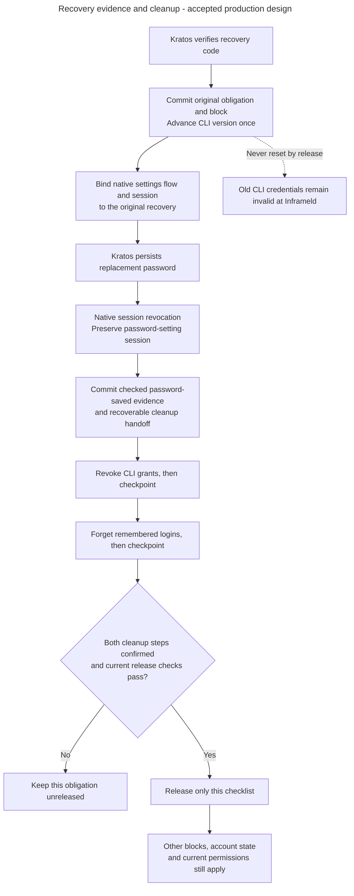

# Release only the completed recovery obligation

Alice saves a replacement password, but Hydra is unavailable. Access keeps her recovery block, saves which cleanup steps remain, and continues the same operation within its budget. Completing one checklist never removes a newer recovery's block.

**Status:** accepted production contract under [ADR-0085](../../../../docs/adr/ADR-0085-bind-password-settings-evidence-to-original-recoveries.md). The aggregate, repository, local completion service and bulk provider adapter exist. Private native callbacks, bounded Hydra execution, proof propagation and proof-backed local release are implemented. Protected host-authorized additional runs are implemented through the maintenance command.

## Reading tasks

- [Completion proof](#completion-proof) distinguishes cleanup from product access.
- [Durable execution](#identity-cleanup) explains checkpoints and worker replacement.
- [Retry budget](#hydra-cleanup-retry-budget) and [failure classification](#hydra-cleanup-failure-handling) specify automatic dispatch.
- [Operator continuation](#operator-cleanup-continuation) links the protected input contract.
- [Implemented local service](#recovery-completion-workflow) describes the existing subset.

 

## Track cleanup separately from access restoration

Arrows show causal obligations, not one transaction across providers. [The private handoff](private-recovery-handoff.md#native-hook-evidence) owns native association and evidence semantics. Short database operations take [the identity turn](identity-admission-coordination.md) before required organization/project locks. No lock or transaction spans provider I/O. First-account activation must adopt that boundary separately.

## What proves completion

Require all four facts before release: trusted password-persistence/native-session-cleanup evidence, durable confirmation of both Hydra bulk steps, the checked original identity binding with intact credential-version state, and current local release eligibility. One successful provider, a webhook acknowledgment, a timeout or a completed password form cannot substitute.

The Hydra aggregate becomes confirmed only after empty 204 acknowledgments for CLI-grant revocation and remembered-login deletion have both been saved. This means those requests succeeded, not that Hydra can never issue another token. A delayed approval or refresh can produce a Hydra-active credential with an older captured version. [Current-version checks](human-cli-credential-lifecycle.md#human-credential-versions) permanently reject it at Inframeld, including after block release. Do not add a global issuance drain, credential inventory, timestamp cutoff or production token hook to establish this guarantee.

[ADR-0069](../../../../docs/adr/ADR-0069-release-completed-recovery-obligations-independently.md) retains per-checklist release. An active human or an identity without local admission can finish its eligible obligation. No account is created. Suspended and retired accounts remain ineligible for automatic release. Confirmed provider work is not repeated merely because account eligibility still prevents release, and completion recreates no grants.

A newer recovery's combined proof may satisfy explicitly linked older checklists through [the approved reconciliation rule](private-recovery-handoff.md#recover-original-evidence). Apply it to each original checklist, never a blanket identity unblock. Unlinked later recoveries stay blocked. A satisfied operation admits no further provider dispatch, although already-dispatched calls can finish late and invalidate newer Alice credentials under [ADR-0070](../../../../docs/adr/ADR-0070-use-bulk-hydra-revocation-for-identity-recovery.md).

 

## Continue the original cleanup durably

Suspension retains its separate transaction saving the immediate local block, revision, audit and original cleanup obligation together. Its deliberate restoration remains distinct from routine recovery.

Access owns one original cleanup job and its fixed two-step progress. It uses the accepted [PostgreSQL-backed worker and ownership checks](../../inframeld-application-contracts/references/jobs-and-recovery.md#admit-work-and-claim-an-attempt), not another queue or workflow engine. [The logical record contract](credential-and-recovery-records.md#recovery-delivery-records) specifies receipts, runs, attempts and retained provenance.

1. Commit the first trusted password-saved receipt, Kratos evidence, job handoff, initial run and first eligibility time together. No evidence means no Hydra run. A duplicate creates no new budget.
2. In a short transaction, claim the original job, consume the next run attempt and save the ownership token and lease. Check original binding, existing progress and remaining time/attempts before admitting work. A crash after this commit consumes the attempt.
3. Outside SQL, revoke CLI grants if unfinished. Save its observed outcome while still the current owner before attempting remembered-login cleanup. Skip a durably confirmed step.
4. If no permanent rejection or exhausted budget prevents it, perform the unfinished remembered-login call and checkpoint it independently. One application attempt can try both fixed steps. There is no twelve-attempt allowance per method or SDK retry loop.
5. On a recoverable failure, save one next-attempt time. Worker replacement retains it, the original deadline, consumed count and checkpoints. A stale ownership token cannot publish progress. A lost response or a remote success not durably checkpointed remains unconfirmed and can require a safe bulk repeat.
6. When both steps are confirmed, invoke existing local completion checks in a short transaction. If release fails or the worker stops after provider confirmation, reload and retry only local completion. A completed callback, a restart or an ineligible account never dispatches cleanup again.

Check ownership and the active run before each dispatch and checkpoint. Ending or satisfying a run prevents fresh admission of provider work. It cannot recall a call already admitted or dispatched. Cancellation propagates, and remote cancellation is never inferred. Keep explicit finite provider deadlines and bound each by remaining run time. Required state unavailable means no release.

This contract does not choose scheduler fairness, queue saturation policy or authority for already-admitted product jobs. Load the neighboring pending decisions only if implementing those separate concerns.

## Hydra cleanup retry budget

[ADR-0083](../../../../docs/adr/ADR-0083-bound-hydra-recovery-cleanup-retries.md) permits **at most twelve attempts per run**, including the first, within **one hour**. The initial run starts at the first durable trusted completion evidence making cleanup eligible. Later runs start at explicit durable host authorization. Use server-owned UTC times. Never use a callback-supplied timestamp, restart or duplicate to extend a budget. Other jobs retain their three-attempt default.

The first attempt is immediately eligible. After unsuccessful attempt number `k` (starting at 1), choose an integer delay uniformly from 1 through `min(600, 15 * 2 ** (k - 1))` seconds. This is positive random jitter around a progressively larger ceiling, capped at ten minutes. Persist the selected next-attempt time once, measured from recording the unsuccessful attempt. Restart never redraws it.

Honor a valid provider `Retry-After` delta-seconds or HTTP date as a lower bound. Retain its parsed safe delay, not the raw header. Ignore malformed/past values. Scheduling cannot move or renew the run deadline. If no further attempt is eligible before it, make no fresh dispatch. Stop when the deadline or twelve attempts is exhausted and retain the block and terminal reason.

There is no timer releasing access and no refund for a claimed attempt lost to a crash. A callback without saved Kratos proof starts no one-hour window. Host continuation cannot manufacture that proof. [Missing evidence](private-recovery-handoff.md#recover-original-evidence) has its own recovery path.

## Classify provider outcomes separately from retryability

The provider adapter returns an application-owned result with the observed `CONFIRMED`, `FAILED` or `UNCERTAIN` state and a separate disposition: `not_needed`, `retryable` or `operator_required`. `PENDING` is not a provider-call result. Only confirmed cleanup permits `not_needed`. Retain a safe category, optional numeric status and parsed retry delay, never SDK exceptions, provider response bodies or secrets.

| Observation | Cleanup outcome | Disposition |
| --- | --- | --- |
| Empty HTTP 204 | Confirmed | Not needed, checkpoint success |
| HTTP 429 | Failed | Retryable |
| HTTP 408, transport failure or timeout | Uncertain | Retryable |
| HTTP 5xx except 501/505 | Uncertain | Retryable |
| Other HTTP 4xx, including 404 | Failed | Operator required |
| HTTP 501/505 | Uncertain | Operator required |
| Malformed, redirected or unexpected response, including nonempty 204 | Uncertain | Operator required |

The mapping applies equally to both bulk methods. A 404 is not evidence of an empty successfully cleaned scope. Do not follow a redirect as cleanup success. A known permanent rejection ends the run early, preserving independent uncertainty and all confirmed progress. After fixing its cause, the host operator may authorize another run immediately without waiting for the previous deadline.

Unexpected programming failures stop the run with a safe `unexpected_error` reason. Do not blanket-catch them into retryable provider outcomes. Cancellation remains cancellation and does not claim either provider success or reversal. SDK automatic retries stay disabled. An uncertain admitted call can still finish late.

## Authorize another bounded run

[ADR-0084](../../../../docs/adr/ADR-0084-authorize-additional-recovery-cleanup-runs-through-host-maintenance.md) permits unlimited explicit host authorizations over the operation's lifetime. Each creates its own twelve-attempt/one-hour budget after the previous run ends. Preserve every earlier authorization, deadline, attempt, stop reason and confirmed step.

[Host maintenance](host-maintenance.md#recovery-cleanup-continuation) owns the exact input, output, deduplication and current-state checks. It requires the original recovery ID and a unique operator request ID, not a reviewed-run ID or Alice's token. A repeated accepted request returns its original authorization. A distinct request conflicts while a run is active. Missing Kratos evidence prevents authorization. Completed recoveries and fully confirmed provider work receive no new run.

The instantiated `IdentityRecoveryCleanupResumeService` owns this decision in a five-second transaction, including commit. It saves the complete audit/replay receipt before settling an old run or creating its replacement. An expired lease with budget remaining and a live twelfth attempt still return `cleanup_run_active`. A genuinely exhausted or permanently rejected run can be fenced and replaced. Previously dispatched provider work may still finish.

Authorizing a run changes no account status, permissions or credential version and releases no block. If provider work is finished but the account remains ineligible, report that state without repeating cleanup. Local completion can be reevaluated only through its existing eligible workflow.

#### Implemented cleanup checklist persistence

After Alice's recovery is admitted, [IdentityRecovery](../../../../apps/backend/src/inframeld_backend/access/domain/entities/identity_recovery.py) keeps the independent Kratos and Hydra results. Confirmation of both providers still leaves the access block until the application explicitly records release. [Its repository](../../../../apps/backend/src/inframeld_backend/access/application/protocols/identity_recovery_repository.py) loads the original checklist and saves its transitions in the caller's transaction, preserving the original admission binding and timestamps.

Concurrent workers cannot overwrite changed stored progress. The PostgreSQL adapter checks the loaded values as part of the update. A conflict requires rollback and a fresh load before the application decides how to proceed. Reloading does not authorize repeating external revocation. Unchanged saves perform no writes and do not refresh the checklist. [The data model](credential-and-recovery-records.md#identity-cleanup-records) owns exact fields and snapshot lifetime.

The repository is used by the local completion service below and the private native notification service. The latter confirms Kratos only and never releases access. Repository-only tests arrange domain state directly. They do not qualify trusted provider evidence or real cleanup.

#### Record cleanup outcomes and release one original checklist

Alice's Kratos cleanup is confirmed, but Hydra is unavailable. The [completion service](../../../../apps/backend/src/inframeld_backend/access/application/services/identity_recovery_completion_service.py) can record Kratos's result and Hydra's failure or uncertainty while retaining the block. A later trusted Hydra confirmation finishes the same operation. These inputs must come from authenticated, verified evidence. Constructing an event or outcome value does not establish that trust.

`IdentityRecoveryCompletionService.record_cleanup()` accepts the original event and at least one non-pending provider outcome. An omitted provider keeps its existing result. The service owns the transaction, loads current completion facts, checks the original installation/provider/flow/subject/kind binding, then loads the aggregate. It records the outcomes through domain methods, applies `IdentityRecoveryReleasePolicy`, saves and returns only after commit. Missing admission or conflicting evidence returns `ConflictError` without creating an obligation. Domain regression errors use a stable application-owned message and preserve their cause.

The [facts reader](../../../../apps/backend/src/inframeld_backend/access/infrastructure/readers/postgres_identity_recovery_completion_facts_reader.py) verifies installation metadata and reads the original stored subject to select identity coordination. After that turn and any linked organization's exclusive lock, it rereads the admission, current local principal and other unreleased flows together. One fixed five-second deadline covers its database work, including lock waits. It excludes the later repository save and final commit. The service and repository share the same request-local session. Provider calls remain outside these transactions. Unlinked identities use the same identity turn without provisioning an organization or account. The shared coordinator implements ADR-0082 for this local workflow. Complete first-admission integration remains unfinished.

After both outcomes are confirmed, an active human's checklist may release its own block. An identity without a local account can finish without provisioning one. Suspended and retired accounts remain ineligible for automatic release. Other unreleased checklists keep blocking product access independently, so two fully confirmed flows do not wait for each other to release first. `PrincipalAccessPolicy.is_account_active()` supplies the shared status rule. Product authentication still uses the full common eligibility policy, including every pending recovery block.

An already released duplicate returns its stored cleanup states, timestamp and original operation identity without another save. An unreleased repeat rechecks current local state, including after separate authorized restoration. The result's `has_other_pending_recovery` reports that transaction's observation and grants no permission. Another recovery can be admitted after it commits. Every product request still checks current state.

[Service unit tests](../../../../apps/backend/tests/unit/access/application/services/test_identity_recovery_completion_service.py) and [PostgreSQL tests](../../../../apps/backend/tests/integration/access/test_identity_recovery_completion_postgres.py) cover this local workflow. The dedicated worker invokes its proof-backed operation. Private callbacks supply native evidence without making provider calls. Host-authorized continuation uses the [protected maintenance command](host-maintenance.md#recovery-cleanup-continuation). [PD-ACCESS-03](decision-recovery-production-completion.md) owns the acceptance matrix. Permanent Inframeld rejection of old versions supplies the selected late-issuance protection, not a claim of Hydra-wide inactivity. The bulk Hydra tests qualify provider calls, not the complete recovery workflow.

## Implemented execution and proof-backed completion

Alice's job stays in PostgreSQL while Hydra is unavailable. The dedicated `python -m inframeld_backend.recovery_worker` process uses the same backend image, with its own execution slot. It handles one attempt at a time and takes the oldest due original with an operation-ID tie-break. Document work cannot occupy that slot. Shared database, CPU and provider resources can still delay it. [ADR-0087](../../../../docs/adr/ADR-0087-isolate-recovery-cleanup-in-a-dedicated-worker.md) records this narrow isolation decision.

[The execution service](../../../../apps/backend/src/inframeld_backend/access/application/services/identity_recovery_cleanup_execution_service.py) owns bounded database stages, interprets stored observations and persists checked dispatch/checkpoint decisions. Defaults are one-second idle polling, five-second provider calls, five-second database stages including commit, sixty-second leases and fifteen-second graceful shutdown. It recalculates remaining provider time after committing dispatch admission. Stopping prevents new admission, not completion of a previously admitted remote call. A missing credential-version record defers the job without consuming an attempt or recreating state, allowing other identities to proceed.

A worker restart retains consumed attempts, saved retry times and confirmation pointers. Expired unacknowledged dispatch remains uncertain. Only the current ownership token can checkpoint a result. Cancellation never refunds the claim. Permanent rejection and budget exhaustion retain the block and ended run for protected operator follow-up.

Recovery transactions translate recognized storage availability errors before application failure handling. A failed checkpoint or commit retains durable progress for fresh operation-local reloads. A lost commit acknowledgment does not prove rollback. Cancellation and unrelated failures keep their original meaning and causes.

Once both fixed steps have saved confirmations, the service saves complete proof and ends provider execution. [The reconciliation service](../../../../apps/backend/src/inframeld_backend/access/application/services/identity_recovery_cleanup_reconciliation_service.py) applies at most twenty-five original checklists per page. Bootstrap opens fresh operation-local sessions and repositories for each completion. Each checklist transition and its recorded release/ineligibility outcome commit together. Temporary completion failures defer local work by fifteen seconds, without another provider attempt. An ineligible account is recorded once, not continuously polled for restoration.

Complete proof retains its source password receipt and both step confirmations from the same original recovery. Its admission-time links alone select eligible older checklists. Covered originals need no invented receipt or job. Each captured link has its own reconciliation checkpoint, so an existing older proof does not skip a fresh release check. Preserve that proof rather than replacing its provenance. Existing confirmation provenance and budgets remain intact. A covered job may retain its own partial step observations while complete newer proof satisfies its obligation and ends its run. The implemented host-continuation service checks this proof as well as direct job progress.

[PostgreSQL execution tests](../../../../apps/backend/tests/integration/access/test_identity_recovery_cleanup_execution_postgres.py) cover durable claims, partial progress, replacement, coverage and local eligibility. They also verify temporary checkpoint/read failures, failed proof commits and lost acknowledgments after successful commits. [Native worker tests](../../../../apps/backend/tests/integration/access/test_native_recovery_cleanup_worker.py) join real Kratos delivery, the production worker command and real Hydra cleanup. The late-login fixture captures an old binding before recovery. It supplements the existing production-consent delayed-approval tests, rather than claiming every provider-internal ordering is controlled.
