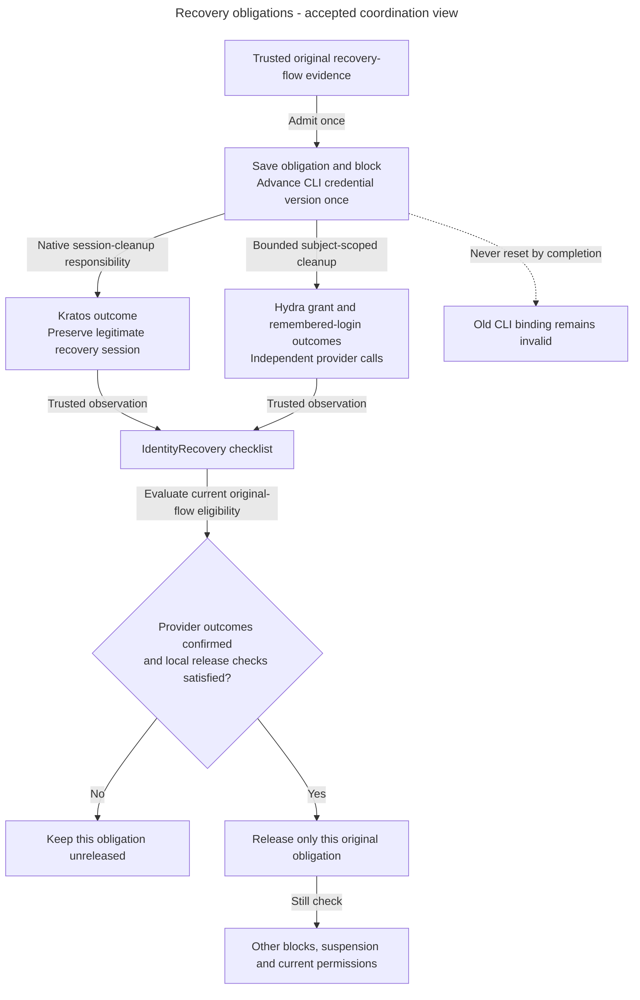

# Recovery blocks, cleanup and completion

Alice recovers a compromised identity. She needs a legitimate recovery session, but the attacker must not keep using old product or CLI access. Access temporarily blocks product work, permanently invalidates the old CLI generation, and tracks the original cleanup checklist. Those three protections have different completion conditions.

## Follow recovery admission

1. Establish trusted provider/installation identity and original recovery-flow evidence. Do not accept caller-supplied identity or a fresh settings query parameter as original-flow proof.
2. Record the recovery obligation. For a linked human, admission takes the conflicting exclusive organization lock so grant writes cannot ignore a newly committed block. Its fixed five-second database deadline includes waits and leaves rollback to the caller. An identity without a local link may still receive an obligation without local provisioning.
3. Advance the human CLI credential version once atomically for a new recovery. Duplicate delivery and block release do not reset it. Current authentication/authorization rejects old binding evidence even after the temporary block is later released.
4. Load the `IdentityRecovery` aggregate to record supported checklist transitions through its specific repository. Original admission metadata stays with infrastructure. Neither loading nor saving authenticates provider evidence or establishes release eligibility.
5. Record trusted outcomes and release only the eligible original flow through the local completion workflow. Other blocks remain authoritative. Completion before local admission provisions nothing.

An aggregate is the domain object responsible for cohesive state transitions. Here it protects Alice's cleanup checklist. Its repository preserves transaction-bound snapshots and conditional-save conflict detection. Keep exact instances within one caller transaction.

If a changed save conflicts, roll back and load current state before another decision. Do not automatically repeat provider calls. An unchanged save performs no writes or freshness checks.

## Bulk Hydra cleanup

The caller establishes the original identity's trusted provider and installation binding. `HumanOAuthCredentialRevoker` separates two bounded capabilities: subject/client bulk revocation of CLI grants, and subject-wide deletion of remembered Hydra logins. These have independent outcomes.

The SDK adapter lives in `infrastructure/revokers`. It makes one bounded attempt outside SQL transactions and translates provider outcomes. It owns no identity verification, durable scheduling or block release.

There are no automatic retries. Ordinary selected-device logout keeps its narrower scope. Preserve Kratos's legitimate recovery session.

Recovery uses bulk subject cleanup, not a per-login inventory, original-target snapshot or timestamp cutoff. Listed consent rows can be incomplete and must not choose cleanup targets. Neither a typed subject nor one successful acknowledgement establishes the whole recovery's Hydra outcome.

## Delayed requests and failures

An unfinished retry or an already dispatched cleanup call may invalidate newer CLI credentials. Report that possibility honestly. A durably completed event must not initiate new cleanup. Original obligations survive interruption and use the existing bounded reconciliation contract.

A login approval or refresh can cross the cleanup calls. HTTP-ordering tests distinguish outstanding authorization codes, prepared approvals, late token responses and approval between bulk calls. A held request or response does not freeze Hydra internally. Staged records are test evidence, not a credential inventory or authority to release a block.

The durable credential version supplements bulk cleanup. A late grant may remain accepted at Hydra and still receive Inframeld's invalid-token response. Refresh descendants keep the old version. Current Inframeld rejection does not establish Hydra-wide rejection or complete provider cleanup.

Pinned Kratos observations also distinguish recovery-code acceptance from password replacement. Accepting the recovery code leaves the old password usable until replacement. Settings pre-save and post-save failures have different persistence effects. A recovery-created settings flow preserves original-flow evidence, while a fresh settings flow cannot claim it through a query parameter.

## Track cleanup separately from access restoration

**Accepted coordination view.** Checklist persistence/local completion have inspected code. Production callbacks and full provider-cleanup/reconciliation wiring remain unfinished. This flow describes obligations, not a new formal state enumeration.

Arrows show causal obligations and checks. Confirmed cleanup cannot replace current local eligibility, release another recovery or restore removed grants. A pending or uncertain provider outcome remains incomplete. An unfinished or already dispatched bulk call can invalidate newer CLI credentials, while a completed event must initiate no new cleanup. See the [aggregate](../../../../apps/backend/src/inframeld_backend/access/domain/entities/identity_recovery.py) and [local completion service](../../../../apps/backend/src/inframeld_backend/access/application/services/identity_recovery_completion_service.py) for the implemented subset.

## Implementation status and limits

The aggregate, repository, admission and local completion service are implemented foundations recorded in the guides.

Production callbacks, complete provider-cleanup orchestration, bounded reconciliation, issuance coordination, safe production completion and concurrent first-local-admission qualification remain unfinished. Standalone bulk-provider tests, password-gap observations and test-only token hooks do not qualify those missing pieces.

Recovery never clears suspension, recreates removed permissions or lets an older completion release a newer independent block. Preserve ordinary account eligibility, current authorization on replay and product-specific visibility ordering.

## Sources and rationale

- [Recovery cleanup](../../../../docs/development/access-control.md#identity-recovery-cleanup), [completion workflow](../../../../docs/development/access-control.md#recovery-completion-workflow), [credential versions](../../../../docs/development/access-control.md#human-credential-versions) and [cleanup records](../../../../docs/development/data-model.md#identity-cleanup-records).
- [Bulk Hydra evidence](../../../../docs/development/access-control.md#hydra-cleanup-evidence), [discovery observations](../../../../docs/development/access-control.md#hydra-discovery-evidence), [issuance ordering](../../../../docs/development/access-control.md#hydra-issuance-evidence), [password-reset observations](../../../../docs/development/access-control.md#kratos-password-reset-evidence) and [reconciliation](../../../../docs/development/jobs-and-idempotency.md#identity-cleanup).
- [ADR-0058](../../../../docs/adr/ADR-0058-block-product-access-during-identity-recovery-cleanup.md), [ADR-0069](../../../../docs/adr/ADR-0069-release-completed-recovery-obligations-independently.md), [ADR-0070](../../../../docs/adr/ADR-0070-use-bulk-hydra-revocation-for-identity-recovery.md) and [ADR-0072](../../../../docs/adr/ADR-0072-version-human-cli-credentials-across-account-recovery.md).
- [Private recovery handoff](../../../../docs/development/access-contracts.md#recovery-wire) remains a delivery draft, not a new public recovery bypass.
