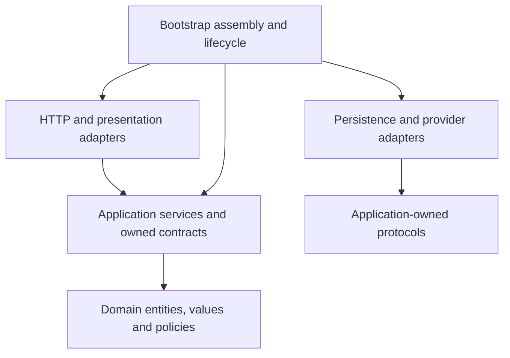
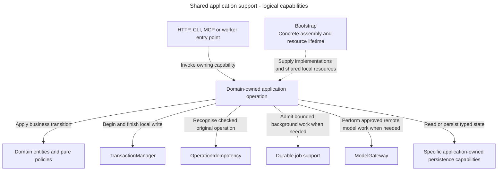

# Application boundaries and services

Alice asks where a new grant workflow belongs. Access owns the rule. A service coordinates the operation, domain objects decide valid changes, and adapters handle HTTP or database details. These boundaries keep one workflow from acquiring several competing implementations.

For code suggestions or reviews, read [Coding Standards](../../inframeld-coding-standards/SKILL.md). Its [service example](../../inframeld-coding-standards/references/services-and-use-cases.md) and [aggregate/repository example](../../inframeld-coding-standards/references/aggregates-and-repositories.md) teach the Python implementation. This reference owns how the components cooperate and retains the dependency-direction diagram.

## Owners, layers and dependencies

Knowledge owns sources, Indexing verified search data, Pipelines builds/query/receipts/feedback, Evaluation offline evidence, Releases serving selection and Access identity/authorization. Application workflows call stable Access operations rather than assembling permission checks independently. Read projections may join owners without becoming additional writers.

Jobs and audit are supporting records, not a seventh domain or event-sourcing framework.

Arrows show code dependency direction, not network calls. Infrastructure implements application-owned capabilities. Domain/application contracts do not import HTTP, ORM or vendor SDK types.

Bootstrap owns aggregate settings, concrete dependency assembly, application construction and resource lifecycle. Entry points stay small. The frontend retains its existing Next.js conventions.

## Shared support in an owning workflow

Alice's grant operation needs a transaction and safe replay. A later document job also needs durable background progress. These are supporting capabilities supplied to the owning domain operation, not additional product domains or compulsory dependencies for every service.

**Logical application view.** Transaction/idempotency foundations are implemented for the grant chain. Complete worker and gateway workflows retain their accepted target/qualification status.

Solid arrows show the support an operation may invoke. The dotted arrow means assembly. These are different from the source-dependency arrows above. Authentication happens before the grant transaction. Long provider waits and parsing remain outside SQL transactions. Typed results and shared process boundaries do not transfer authority between domains. See [the module map](../../inframeld-architecture/references/module-map.md) to choose the owner before its shared collaborators.

## State and decisions belong to domain objects

An entity has stable identity and cohesive state. An aggregate owns its state-transition rules and keeps mutable collections private. A service invokes that behavior and persists through the aggregate's specific repository.

Use pure policies for decisions involving explicit facts or several domain objects. Commands and Queries describe requested work, not an independent executor. Current authorization and state checks remain with services and domain rules. [Values and records](../../inframeld-coding-standards/references/values-and-records.md) explain record roles and their narrow interface exceptions.

Supporting audit and reservation writers do not need artificial aggregates. Creation, reads, authentication and external work have appropriate variations. Do not impose one generic execution framework on them.

## Services coordinate the complete workflow

Services own orchestration, checked-scope guards and application error translation. Translate recognized domain rejections with stable application-owned messages and preserve their causes. Keep loading/saving outside narrow domain-error catches. Do not relabel I/O or programming failures as domain denials.

For a complete write, inject `TransactionManager`, the specific authorizer, `OperationIdempotency` and the specific repository/persistence capability directly. The service opens the transaction. Bootstrap supplies a clean request-local session and closes it afterward.

Authentication runs first. Authorization precedes reservation or replay. Required audit and completion commit with the change. The implemented grant command demonstrates this ordering. It does not require a generic repository, command bus or workflow engine.

Follow the [service-writing guide](../../../../docs/development/application-structure.md#service-writing-guide) and [transaction/grant chain](transactions-jobs-and-idempotency.md) before suggesting a service or complete write.

## Provider waits and session ownership

Authentication readers use independent short database sessions after provider verification. Transaction-bound authorization readers use the caller's session.

Never share an `AsyncSession` across requests or keep a database session open while waiting for a provider. Provider I/O also stays outside SQL transactions. This avoids retaining database resources while an external system controls response time.

The explicitly named consent state initializer is a narrow ordering exception. It may perform bounded metadata work before browser verification, but must close that transaction before provider I/O.

Provider revokers perform bounded I/O on a trusted scope. They do not verify identity, schedule durable recovery or release an access block. Access's [recovery workflow](../../inframeld-access-models/references/recovery.md) owns those distinctions.

## Status and sources

These are mandatory application boundaries for generated, suggested and implemented backend components. Coding Standards owns declaration, organization, typed values, protocols, persistence conventions, tests and docstrings.

The current component map and supported grant/authentication flows have implementation references. Later upload and worker journeys remain accepted design where identified. Loading guidance authorizes no edits.

- [Component conventions](../../../../docs/development/application-structure.md#component-conventions), [service-writing guide](../../../../docs/development/application-structure.md#service-writing-guide), [grant chain](../../../../docs/development/application-structure.md#grant-command-flow), [authentication flow](../../../../docs/development/application-structure.md#authentication-flow) and [stable domain-error mapping](../../../../docs/development/error-handling.md#stable-domain-error-mapping).
- [ADR-0001](../../../../docs/adr/ADR-0001-use-one-modular-backend-with-clear-domain-boundaries.md), [ADR-0002](../../../../docs/adr/ADR-0002-separate-commands-and-queries-without-a-command-bus-framework.md) and [ADR-0065](../../../../docs/adr/ADR-0065-application-services-own-write-transactions.md).
