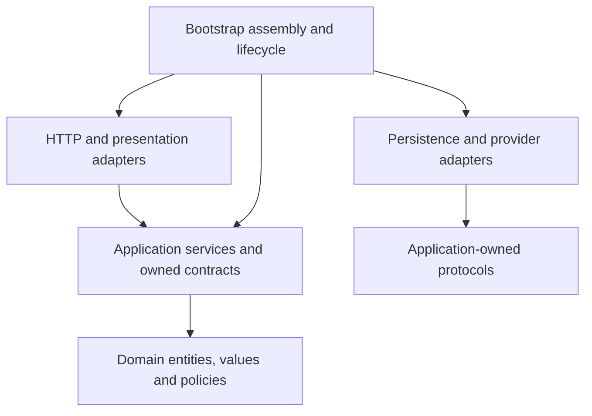
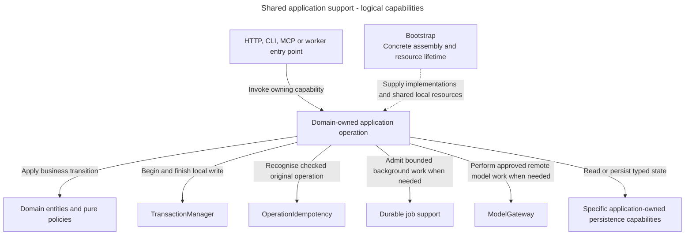
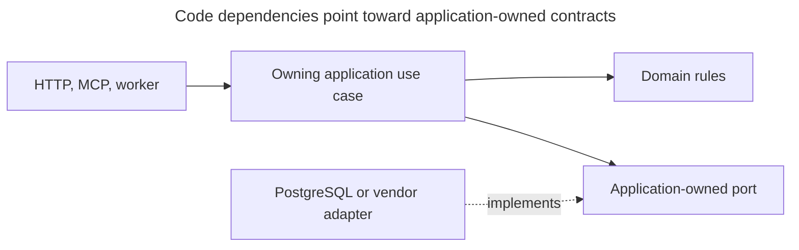

# Application boundaries and services

<a id="application-boundaries-and-services"></a>

Alice asks where a new grant workflow belongs. Access owns the rule. A service coordinates the operation, domain objects decide valid changes, and adapters handle HTTP or database details. These boundaries keep one workflow from acquiring several competing implementations.

For code suggestions or reviews, read [Coding Standards](../../inframeld-coding-standards/SKILL.md). Its [service example](../../inframeld-coding-standards/references/services-and-use-cases.md) and [aggregate/repository example](../../inframeld-coding-standards/references/aggregates-and-repositories.md) teach the Python implementation. This reference owns how the components cooperate and retains the dependency-direction diagram.

<a id="owners-layers-and-dependencies"></a>

## Owners, layers and dependencies

Knowledge owns sources, Indexing verified search data, Pipelines builds/query/receipts/feedback, Evaluation offline evidence, Releases serving selection and Access identity/authorization. Application workflows call stable Access operations rather than assembling permission checks independently. Read projections may join owners without becoming additional writers.

Jobs and audit are supporting records, not a seventh domain or event-sourcing framework.



Arrows show code dependency direction, not network calls. Infrastructure implements application-owned capabilities. Domain/application contracts do not import HTTP, ORM or vendor SDK types.

Bootstrap owns aggregate settings, concrete dependency assembly, application construction and resource lifecycle. Entry points stay small. The frontend retains its existing Next.js conventions.

<a id="shared-support-in-an-owning-workflow"></a>

## Shared support in an owning workflow

Alice's grant operation needs a transaction and safe replay. A later document job also needs durable background progress. These are supporting capabilities supplied to the owning domain operation, not additional product domains or compulsory dependencies for every service.

**Logical application view.** Transaction/idempotency foundations are implemented for the grant chain. Complete worker and gateway workflows retain their accepted target/qualification status.



Solid arrows show the support an operation may invoke. The dotted arrow means assembly. These are different from the source-dependency arrows above. Authentication happens before the grant transaction. Long provider waits and parsing remain outside SQL transactions. Typed results and shared process boundaries do not transfer authority between domains. See [the module map](../../inframeld-architecture/references/module-map.md) to choose the owner before its shared collaborators.

<a id="state-and-decisions-belong-to-domain-objects"></a>

## State and decisions belong to domain objects

An entity has stable identity and cohesive state. An aggregate owns its state-transition rules and keeps mutable collections private. A service invokes that behavior and persists through the aggregate's specific repository.

Use pure policies for decisions involving explicit facts or several domain objects. Commands and Queries describe requested work, not an independent executor. Current authorization and state checks remain with services and domain rules. [Values and records](../../inframeld-coding-standards/references/values-and-records.md) explain record roles and their narrow interface exceptions.

Supporting audit and reservation writers do not need artificial aggregates. Creation, reads, authentication and external work have appropriate variations. Do not impose one generic execution framework on them.

<a id="services-coordinate-the-complete-workflow"></a>

## Services coordinate the complete workflow

Services own orchestration, checked-scope guards and application error translation. Translate recognized domain rejections with stable application-owned messages and preserve their causes. Keep loading/saving outside narrow domain-error catches. Do not relabel I/O or programming failures as domain denials.

For a complete write, inject `TransactionManager`, the specific authorizer, `OperationIdempotency` and the specific repository/persistence capability directly. The service opens the transaction. Bootstrap supplies a clean request-local session and closes it afterward.

Authentication runs first. Authorization precedes reservation or replay. Required audit and completion commit with the change. The implemented grant command demonstrates this ordering. It does not require a generic repository, command bus or workflow engine.

Follow the [service-writing guide](../../inframeld-coding-standards/references/services-and-use-cases.md#service-writing-guide) and [transaction/grant chain](transactions-jobs-and-idempotency.md) before suggesting a service or complete write.

<a id="provider-waits-and-session-ownership"></a>

## Provider waits and session ownership

Authentication readers use independent short database sessions after provider verification. Transaction-bound authorization readers use the caller's session.

Never share an `AsyncSession` across requests or keep a database session open while waiting for a provider. Provider I/O also stays outside SQL transactions. This avoids retaining database resources while an external system controls response time.

The explicitly named consent state initializer is a narrow ordering exception. It may perform bounded metadata work before browser verification, but must close that transaction before provider I/O.

Provider revokers perform bounded I/O on a trusted scope. They do not verify identity, schedule durable recovery or release an access block. Access's [recovery workflow](../../inframeld-access-models/references/recovery.md) owns those distinctions.

<a id="one-backend-several-owners"></a>

<a id="model"></a>

<a id="1-one-backend-several-owners"></a>

## One backend, several owners

The backend runs as two separate processes, built from the same backend image:

- **API:** receives application requests.
- **Worker:** carries out background work using the same application operations and business rules.

The Next.js console, **Studio**, handles presentation and browser-session integration - it is not a second implementation of the backend's business logic.

A separate, restricted parser converts uploaded files. Because documents can be malicious, it runs within the [document-processing restrictions](../../inframeld-knowledge/references/uploads-and-source-sync.md) and cannot change application business records.

**Docker Compose is the only supported deployment method.**

For a human-readable map of each owner's main parts and selected workflows, read [the module map](../../inframeld-architecture/references/module-map.md). Shared application support is explained in [Application Contracts](./components-and-services.md). These logical views are distinct from process topology and source import direction. Proposed internal choices remain pending and must not be used as accepted component contracts.

<a id="architecture-principles-and-dependency-rules"></a>

### Architecture principles and dependency rules

**Domain-Driven Design (DDD)** organizes code around the product's concepts and rules: documents, indexes, pipelines, evaluations, releases, and access. Each business area has a clear owner.

**Clean Architecture** keeps those business rules independent of the technologies used to expose, store, or execute them. Changing a web framework or storage adapter should not require moving business rules into that technology.

**Lightweight CQRS**, short for _Command Query Responsibility Segregation_, separates operations that change state from operations that read it. It does not require separate databases or a messaging system.

These rules make ownership and dependencies strict. They do not require extra design patterns for their own sake.

<a id="which-code-may-depend-on-which"></a>

### Which code may depend on which

The dependency direction is:

```text
HTTP / browser-session adapters
    -> application commands and queries
        -> domain rules and values

PostgreSQL / Chroma / model / artifact adapters
    -> application-owned ports

Bootstrap composition root
    -> concrete implementations and configuration
```

These arrows describe code dependencies, not the order of network calls.

The **domain** contains business rules and values. It must not import FastAPI, an object-relational mapper (ORM), Chroma, Docling, LiteLLM, or identity-provider libraries.

The **application layer** carries out requests through **use cases**, the steps for an operation such as accepting an upload. Its inputs and results use values defined by Inframeld, rather than objects from a web framework or vendor library.

A **port** describes a capability the application needs, such as saving a file or calling a model. An **adapter** provides it using a particular technology. For example, an adapter translates a provider's response into the result type the application expects.

Startup code creates and connects these implementations. This is the **composition root**. Passing the required objects into a use case is called **dependency injection**. Domain code receives its dependencies directly rather than looking them up in a service locator or framework container.

<a id="resource-ownership-and-test-organization"></a>

### Resource ownership and test organization

[Access assembly](../../../../apps/backend/src/inframeld_backend/bootstrap/access_composition.py) creates stateless services and their configured SDK clients once per application. Cookie authentication needs the Kratos public client. Enabling human bearer authentication adds a separate Kratos admin client and Hydra admin client. `ApplicationSettings` requires Kratos and an explicit Kratos admin URL when Hydra is configured.

Assembly owns cleanup until construction succeeds, then transfers the clients to the application. If construction fails, it clears pools created so far. The [application lifespan](../../../../apps/backend/src/inframeld_backend/bootstrap/application_lifespan.py) starts the database compatibility check, disposes the database on exit and clears every configured provider pool, including failed startup or shutdown. The installed SDK context-manager exit alone does not release those pools. `Database` owns its pool and creates operation-local sessions. Construction and OpenAPI export make no provider or database network calls. Schema tools import `create_app` directly.

Unit tests mirror production layers and component roles. Integration tests are grouped under `access`, `postgres`, `kratos` and `observability`, with distinct scenario filenames. Shared typed seed builders, isolated database provisioning and validated browser-flow DTOs live under `tests/support`. Test doubles intended to replace provider verification use the `Mock` naming convention, explicitly implement their protocol and override its members. Public JSON is asserted when the wire representation is the behavior under test.

`pnpm check:backend` checks formatting, lint, strict Pyright, fast behavioral/contract tests and OpenAPI drift. `pnpm test:integration` starts one private PostgreSQL/Kratos/Hydra stack and runs the whole integration directory in one generic test container. The runner waits up to 60 seconds, applies application migrations and enables all provider integration flags. It mounts the committed test environment example and read-only source, with a temporary fingerprint key. Test services publish no host ports. Project-scoped cleanup runs before startup and on exit, verifies container/network removal and retains named test volumes. CI uses the same command. [The backend README](../../../../docs/development/guides/testing.md#integration-tests) explains focused runs and private endpoints. Both mocked-provider PostgreSQL scenarios and real Hydra scenarios remain useful. Follow [the evidence and remaining work](../../inframeld-access-models/references/credential-dispatch.md#implemented-human-authentication) before treating them as complete CLI/Ory runtime qualification. Review architecture and documentation manually. Automated tests cover behavior, API contracts, resource cleanup and integrations.

<a id="follow-a-command-and-a-query"></a>

<a id="operation"></a>

<a id="2-follow-a-command-and-a-query"></a>

## Follow a command and a query

A **command** changes state. Alice's upload command checks her current permissions, saves source information, and records the background work to perform. A **query** reads state. Studio's progress request reads the upload's status without starting it again.



Solid arrows show calls. The dashed arrow means the adapter implements the port. These are parts of the code, not separately deployed services. Startup code supplies the adapters to the use cases.

<a id="lightweight-cqrs-different-paths-for-changing-and-reading-state"></a>

### Lightweight CQRS: different paths for changing and reading state

Promoting a candidate version is a command. It runs through the owning use case and the domain rules for promotion.

Displaying Studio's Deployment table is a query. It needs a useful view of the current records, limited to what the caller may see.

A query returns a **data transfer object (DTO)**, a value containing the fields that screen or client needs. Its database reader selects permitted records from the same PostgreSQL database. Such a purpose-built view is called a **read projection**.

To display one Deployment row, the reader can select the required fields directly. It need not rebuild the full domain object, but it must still check permissions.

Read adapters may join records from different business areas. Each adapter still has an explicit owner, and being able to read across modules gives it no permission to write across them.

Keeping commands and queries separate needs no message bus, mediator, event-sourced history, separate read database, or general workflow engine.

Chroma holds derived search data outside PostgreSQL. Its [indexing protocol](../../inframeld-indexing/references/profiles-and-preparation.md) explains how to keep that data consistent. This special case does not require ordinary database reads to wait for a separate copy of their records to catch up.

<a id="shared-supporting-records"></a> <a id="supporting-records"></a>

## Shared supporting records

Transactions, jobs, spending, traces and imports support the six domains. They do not form another business domain or imply one table per concept. Read [operation identity and outcomes](idempotency-and-replay.md), [job attempts](jobs-and-recovery.md), [spending](spending-and-accounting.md), [import capture](configuration-export-and-import.md) or [trace policy and retained evidence](../../inframeld-pipelines/references/query-tracing-and-privacy.md) only when that contract matters. Implemented types and migrations own exact storage representations. Proposed records stay explicitly unimplemented.

<a id="status-and-sources"></a>

## Status and sources

These are mandatory application boundaries for generated, suggested and implemented backend components. Coding Standards owns declaration, organization, typed values, protocols, persistence conventions, tests and docstrings.

The current component map and supported grant/authentication flows have implementation references. Later upload and worker journeys remain accepted design where identified. Loading guidance authorizes no edits.

- [Component conventions](../../inframeld-coding-standards/references/component-roles-and-imports.md#component-conventions), [service-writing guide](../../inframeld-coding-standards/references/services-and-use-cases.md#service-writing-guide), [grant chain](../../inframeld-coding-standards/references/services-and-use-cases.md#grant-command-flow), [authentication flow](../../inframeld-access-models/references/architecture.md#authentication-flow) and [stable domain-error mapping](http-errors.md#stable-domain-error-mapping).
- [ADR-0001](../../../../docs/adr/ADR-0001-use-one-modular-backend-with-clear-domain-boundaries.md), [ADR-0002](../../../../docs/adr/ADR-0002-separate-commands-and-queries-without-a-command-bus-framework.md) and [ADR-0065](../../../../docs/adr/ADR-0065-application-services-own-write-transactions.md).
