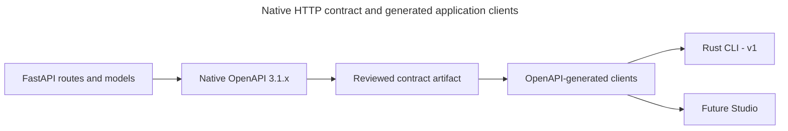

# Share behavior across HTTP, MCP and generated clients

SupportBot should receive the same permission, serving selection and retry outcome whether a supported adapter uses HTTP or MCP. HTTP carries ordinary web/API requests. Model Context Protocol (MCP) lets an assistant client call the accepted tools. Transport changes how input arrives. It must not create another authority or execution model.

## Follow a request across adapters

1. Parse and validate transport input. Authentication establishes a verified application-owned context rather than trusting tool arguments or caller-supplied groups.
2. Invoke the owning application service. The service coordinates current authority, transactions or external work and produces application-owned outcomes.
3. Convert those outcomes into the transport's documented success/error shape. Keep stable operation IDs, native error declarations, bounded pagination, asynchronous outcomes and answer-versus-receipt-only variants.

Feature HTTP conversions use static Mapper methods without I/O. Routes serialize, dependencies extract and invoke, middleware wraps lifecycle. Business fingerprint meaning stays in the application service. Adapters must not introduce another permission engine, retry engine or automatic default-resource implementation.

## Native OpenAPI and clients

OpenAPI is the machine-readable description of the HTTP operations and their inputs/results. Selected FastAPI/Pydantic output is authoritative native OpenAPI 3.1.x. Do not hand-edit generated output, weaken backend semantics for a generator or build a custom generator by implication. V1 delivers a Rust CLI and small Ory account UI. Full Studio is deferred and later uses its generated TypeScript client and the same CLI-led product rules.

Generate application clients from native OpenAPI without adding a replacement handwritten client. [ADR-0088](../../../../docs/adr/ADR-0088-use-a-pinned-patched-generator-for-the-rust-sdk.md) selects the pinned patched Rust generator. [ADR-0089](../../../../docs/adr/ADR-0089-select-patched-typescript-and-python-sdk-generators.md) selects the patched TypeScript and Python configurations. Follow the independently discoverable [Rust](../../inframeld-rust-sdk/SKILL.md), [TypeScript](../../inframeld-typescript-sdk/SKILL.md) or [Python](../../inframeld-python-sdk/SKILL.md) skill for consumption. Qualify incrementally against implemented contracts. Intended language targets are not qualified deliverables. Ory's clients serve Ory contracts, not a second Inframeld API. Historical client reviews do not establish current interoperability.

The [Rust comparison](../../../../docs/development/reports/rust-sdk-generator-comparison.md) and [TypeScript/Python comparison](../../../../docs/development/reports/typescript-python-sdk-generator-comparison.md) retain dated evidence and limitations. Selection does not establish released SDK support. The [shared SDK maintenance reference](../../inframeld-sdks/references/generator-maintenance.md) owns common patch and upgrade policy. Language references own their specific obligations, while runbooks retain commands and caches. [Shared conformance qualification](../../inframeld-sdks/references/shared-qualification.md), accepted in [ADR-0090](../../../../docs/adr/ADR-0090-qualify-sdks-with-shared-contract-scenarios.md), targets one scenario suite across the three SDKs. The unified SDK runner and operation-coverage gate are implemented. Automatic Linux checks cover applicable PRs, with macOS for generator changes and manual runs. Report actual platform execution separately, and configure external branch rules to require the SDK conformance aggregate. C# and Java delivery remain tentative. Application Contracts retains HTTP semantics and server-version compatibility policy.

Browser writes preserve user-session/CSRF protection. Server rendering retains the user's context without a global administrator key or cache shared between users. Backend work proceeds independently of deferred Studio.

The RFC 9457 error foundation and shared pagination models are implemented foundations. Each feature still checks cursor contents, scope and current authorization. Shared limits are 1–100 with default 25. Deterministic feature ordering includes a unique tie-breaker. Another page is an explicitly bounded request, not permission to traverse everything.

## MCP's deliberately small profile

MCP exposes only `query_deployment` and `get_answer_receipt` in the existing API process. Authenticate every mounted request. Mounting does not automatically inherit HTTP protection. Reuse ordinary application authorization, version selection, ModelGateway and business idempotency keys.

The selected SDK route uses a low-level `Server` and explicit tool-argument validation. It advertises no prompts, resources or subscriptions. Header-capable preconfigured trusted clients are supported. Human CLI Hydra login does not add universal OAuth discovery, third-party onboarding, verified per-user delegation or administrative tools. Tool arguments cannot establish credentials, and MCP request IDs cannot replace business retry identity.

Compare HTTP/MCP parity by exact scope, selected version/input, receipt identity and outcome. No extra tools follow from Evaluation, onboarding, feedback or diagnostics. Follow each owner's contracts when exposing supported behavior.

## Authentication and delivery status

Human HTTP cookie/bearer dispatch, current provider/local checks and native problem/challenge declarations have implementation evidence. Current human routes implement `invalid_authentication_request` and native cookie-or-bearer security alternatives. Separate real-provider tests do not establish a complete account UI, CLI lifecycle, application authenticator or verified recovery. API-audience human tokens do not become MCP credentials. Application-session routes and later maintenance/recovery wires remain accepted design/drafts where identified.

The application-connection wizard uses ordinary account/grant/key operations. It neither exports human credentials nor automatically issues a key at setup. Show-once delivery, partial outcomes and separately approved paid testing retain ordinary recovery rules.

- [API contracts](./http-mcp-and-generated-clients.md), [MCP](mcp-transport.md), [error handling](http-errors.md), [error maintainer reference](http-errors.md), [pagination](pagination.md) and [V1 scope](../../inframeld-architecture/references/v1-scope-and-extension-boundaries.md).
- [ADR-0003](../../../../docs/adr/ADR-0003-generate-the-authoritative-openapi-contract-from-backend-code.md), [ADR-0006](../../../../docs/adr/ADR-0006-use-official-generated-clients-for-application-api-access.md), [ADR-0053](../../../../docs/adr/ADR-0053-use-kratos-and-hydra-for-human-cli-authentication.md), [ADR-0055](../../../../docs/adr/ADR-0055-deliver-cli-first-v1-through-openapi-generated-clients.md) and [Access contracts](../../inframeld-access-models/references/actions-and-initial-grants.md).

## Share behavior across entry points

**MCP**, the Model Context Protocol, offers another way to call the same application operations. Pipelines still retrieves documents and produces answers. Access still decides permissions.

Studio calls the application HTTP API through the official generated TypeScript **SDK**, a client library for working with the backend.

Generate those clients from native OpenAPI. The selected Rust implementation is maintained under [ADR-0088](../../../../docs/adr/ADR-0088-use-a-pinned-patched-generator-for-the-rust-sdk.md). **V1 delivers the Rust CLI and small Ory account UI, not full Studio.** Backend work proceeds independently. Client compatibility is qualified incrementally against actual contracts. The future Studio follows the same application behavior under [ADR-0055](../../../../docs/adr/ADR-0055-deliver-cli-first-v1-through-openapi-generated-clients.md).

Repository skills are guidance for developers and agents. They do not run inside the application.

The MCP integration profile is accepted in [Using Inframeld through MCP](mcp-transport.md).

### Keep domain ownership at every entry point

Pipelines owns answers, receipts, and feedback. Evaluation owns offline comparisons, and Releases selects which version serves requests. Studio may display their information together without taking over any of their writes.

Default setup calls normal commands. A build reports that its version is ready, then a separate Releases command may make it live. [Onboarding](../../inframeld-architecture/references/first-use-and-private-defaults.md) and [publication modes](../../inframeld-pipelines/references/configuration-queries-and-builds.md) explain this flow. Retries and workers follow the same separation.

Access checks the verified caller's current permissions. An adapter cannot accept a client's claimed group list as proof. Model calls use ModelGateway, with provider secrets kept behind the [model connection boundary](model-gateway-and-connections.md).

## From backend code to a public contract

**OpenAPI** is the machine-readable description of the HTTP API. **Code-first** means that developers define the API in backend code and generate the OpenAPI document from it, rather than authoring the document separately.

Developers describe the API through FastAPI routes, Pydantic request and response models, shared response definitions, and explicit application metadata.

The responsibilities are distinct:

| Part | Responsibility |
| --- | --- |
| **FastAPI source** | The authoring authority: where developers define and change the API. |
| **Generated OpenAPI contract** | The client authority: what each operation means and how requests, responses, authentication, and errors are represented over HTTP. |
| **Committed JSON artifact** | The generated, reviewable contract included with a release. SDK generators and Studio consume it rather than defining parallel public models. |

The v1 generation and publication points are:

| Purpose | Command or location |
| --- | --- |
| Generate the runtime schema | `create_app().openapi()` |
| Store the generated artifact in Git | `contracts/openapi/v1/inframeld-v1.json` |
| Serve the schema from the running API | `/v1/openapi.json` |
| Regenerate the committed artifact | `pnpm openapi` |

Regenerate the JSON contract and clients when their source changes. Editing generated files by hand would hide the real source of the API definition.

Public fields use **lower camel case**. Each operation has a stable `operationId`, which identifies it to clients and generators. Schemas reuse shared components and declare their error responses explicitly.

CI compares the generated schema with the file committed in Git. A difference, called **contract drift**, fails the check. This check belongs to developing Inframeld itself. It does not release a customer's pipeline version.

## Publish and consume a change

The arrows show how definitions become generated files, not runtime calls. Change the backend, regenerate its contract, review the public effect, and check that the files agree. Never patch JSON to disguise a mismatch.

Use the language configurations selected by ADR-0088 and ADR-0089 under the shared SDK maintenance policy. Begin client qualification against implemented contract foundations, then extend it alongside feature delivery. Late upload/receipt operations do not block initial integration. Backend implementation proceeds independently. Neither a separate generator project nor deferred Studio is a v1 prerequisite.

Keep generated transport types at the client boundary and thin application-owned presentation adapters above them. Do not write a competing application HTTP client or weaken native schema meaning to satisfy a generator. [ADR-0055](../../../../docs/adr/ADR-0055-deliver-cli-first-v1-through-openapi-generated-clients.md) owns this delivery choice.

Rust, TypeScript and Python have selected unpublished SDK configurations. They are not automatically supported public releases. C# and Java remain tentative. Qualify each delivered client against errors, authentication, nullable/union results, pagination and delivered asynchronous/recovery outcomes before claiming support. Workflows without production HTTP contracts remain pending.

Generating and releasing an SDK package is repository-development work. It is unrelated to promoting a customer's PipelineVersion.

### Preserve the user's identity in browser and server requests

Browser requests use the same-origin Kratos session and **CSRF protection**, which guards against cross-site request forgery. The browser client must never contain integration keys, model-provider keys, or infrastructure secrets.

When Next.js calls the backend on Alice's behalf, it forwards only her allowed, verified session context. Client configuration belongs to that request. A shared administrator key cannot stand in for Alice.

Kratos account screens use its maintained client and account-flow contract. Server rendering, caching, and redirects may adapt these requests to Next.js, but must not introduce a second implementation of the application API.

A shared browser client instance must not keep the previous user's session or response data after the user changes.

### MCP invokes the same application behavior

**MCP**, the Model Context Protocol, offers another way to call the existing application operations. It does not generate a second answer engine from OpenAPI.

MCP tool inputs and results are **DTOs**, values that carry data between the tool and application. They map to the same operations, permission checks, and answer receipts as HTTP. V1 tools cover querying and receipts, not release or publication-mode administration.

The detailed contracts are defined in [Using Inframeld through MCP](mcp-transport.md) and [Understanding feedback on answers](../../inframeld-pipelines/references/answer-feedback.md).

## Separate documentation from product access

Keep `/v1/openapi.json`, `/docs`, `/redoc`, and `/health` public, without tenant data, secrets, or internal operational details. All product operations under `/v1` require authentication. A public “Try it out” page does not make its product operations anonymous.

Kratos identifies humans through browser sessions. The accepted human CLI path uses opaque Hydra access tokens with private introspection and current Kratos identity eligibility under [ADR-0053](../../../../docs/adr/ADR-0053-use-kratos-and-hydra-for-human-cli-authentication.md). Inframeld's own opaque application keys begin with `ifm_app_` and identify application accounts whose current permissions determine what they may do. Ory token formats stay unchanged. The public prefix selects a credential family, not an authenticated identity: full verification is mandatory, and failure cannot fall back to the human verifier.

A non-prefixed value is not thereby a valid human token. All paths use the same permission model. A query-only bot cannot build or release, and routing it to a canary version gives it no additional document access.

`GET /v1/session` and the existing project-grant write now support both Kratos browser cookies and human Hydra bearer tokens. The backend implements private token verification, current Kratos identity checks and local admission. The [Access guide](../../inframeld-access-models/references/credential-dispatch.md#implemented-human-authentication) records the implementation and tests. Their mocked-provider bearer coverage does not qualify the complete browser-to-CLI login. [Access credential dispatch](../../inframeld-access-models/references/credential-dispatch.md#credential-dispatch) selects exactly one verifier: the Kratos cookie path, `ifm_app_` bearer application-key path or other bearer Hydra human path. Reject competing credentials, duplicate Authorization headers and malformed header syntax before provider I/O. Do not try unknown tokens against several providers, accept ID/refresh tokens at product endpoints or exempt cookie-authenticated writes from CSRF. Product operations needing a human must not accept an application principal instead.

## Maintainer checks

Contract tests must cover nullable fields, unions of types, numeric limits, uploads, typed errors, first-answer and retry variants, and asynchronous `202` jobs in native OpenAPI 3.1.x.

These backend checks proceed before Studio and SDK verification. CI also checks that the generated schema matches the committed contract.

## Pending decisions for dependent implementation

Before choosing an unresolved implementation contract, load only the entry whose trigger applies:

- [PD-CONTRACTS-03: Define supported CLI and server release combinations](decision-cli-server-compatibility.md). Before distributing independently installable CLI/runtime releases or making a compatibility-sensitive public contract change.
- [PD-ACCESS-06: Authorize setup details before a Deployment exists](../../inframeld-access-models/references/decision-setup-read-authority.md). Before defining defaults/setup read contracts or implementing HTTP/MCP/CLI prepublication status resolution.

## Decision and reference map

Client generation and runtime support need verification against the current contract. The [V1 scope](../../inframeld-architecture/references/v1-scope-and-extension-boundaries.md) describes generated-client qualification, CLI journeys and the independent Ory account UI. Deferred Studio is not a release blocker. Historical tooling reviews supply no current interoperability evidence.

The shared error and pagination foundations are implemented. [Error qualification](http-errors.md#qualification-checklist) distinguishes inspected source from developer-reported results. The broader scenarios above are requirements, not claims that all their feature tests exist.

| Decision | Rationale |
| --- | --- |
| [ADR-0003](../../../../docs/adr/ADR-0003-generate-the-authoritative-openapi-contract-from-backend-code.md) | Generate the authoritative OpenAPI contract from backend code. |
| [ADR-0004](../../../../docs/adr/ADR-0004-use-rfc-9457-problem-details-for-http-errors.md) | Use RFC 9457 Problem Details for HTTP errors. |
| [ADR-0005](../../../../docs/adr/ADR-0005-use-bounded-cursor-pagination-for-lists.md) | Use bounded cursor pagination for lists. |
| [ADR-0006](../../../../docs/adr/ADR-0006-use-official-generated-clients-for-application-api-access.md) | Use official generated clients for application API access. |
| [ADR-0007](../../../../docs/adr/ADR-0007-keep-api-documentation-public-and-product-operations-protected.md) | Keep API documentation public and product operations protected. |
| [ADR-0044](../../../../docs/adr/ADR-0044-provide-mcp-through-a-thin-adapter-in-the-existing-api-process.md) | Provide MCP through a thin adapter in the existing API process. |
