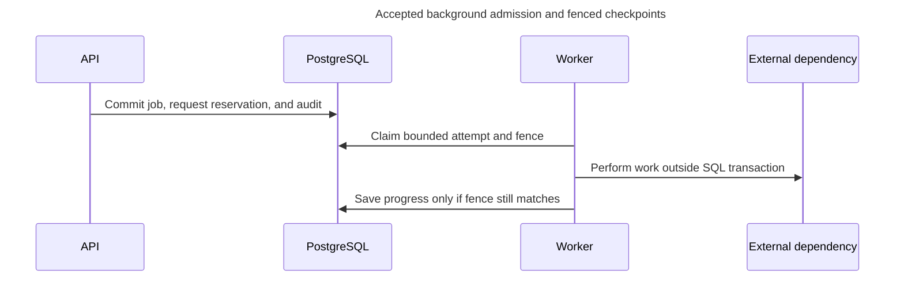

# Continue background work without repeating uncertain effects

<a id="continue-background-work-without-repeating-uncertain-effects"></a>

Alice starts a build and closes the progress view. Durable work records what was admitted and completed. A replacement worker must distinguish safe remaining work from a model call that may already have executed and charged.

> **Status:** accepted behavior is stated separately from proposed representations and qualification work. Existing Python types, generated OpenAPI and migrations own implemented shapes. Pending decisions are not accepted by this reference.

<a id="preserve-progress-and-distinguish-failure-from-uncertainty"></a>

### Preserve progress and distinguish failure from uncertainty

The job lifecycle uses these states:

```text
queued -> running -> succeeded | failed | canceled | recovery_required
```

A **checkpoint** records a completed file, batch, or evaluation case. A safe later attempt can keep that work instead of starting over.

Automatically retry only work known not to have been sent, or work proven safe to repeat. Limit waits between retries, called **backoff**, and by default allow **at most three application attempts**. [ADR-0083](../../../../docs/adr/ADR-0083-bound-hydra-recovery-cleanup-retries.md) selects a narrow exception for [Hydra recovery cleanup](../../inframeld-access-models/references/recovery-completion.md#hydra-cleanup-retry-budget). Access owns that budget. Other jobs keep the three-attempt limit.

When safe retries run out, record `failed` with the defined exhausted-budget reason so clients can distinguish it. There is no separate `paused` state.

**`failed` and `recovery_required` mean different things.** A failed operation may have exhausted safe retries. If remote work might already have happened and there is no proven safe retry, it needs a recovery decision instead. Another automatic attempt could repeat that work.

<a id="resume-the-same-job-only-when-the-remaining-work-is-safe"></a>

### Resume the same job only when the remaining work is safe

An authorized explicit resume can requeue the same job after checking current scope, ownership, retention, and whether the remaining work is safe to repeat. Keep completed checkpoints and attempt history.

For Hydra recovery cleanup, this generic resume rule cannot reset an earlier budget. [Access's host-authorized continuation policy](../../inframeld-access-models/references/recovery-completion.md#operator-cleanup-continuation) allows a separate bounded run on the same unfinished recovery after fresh explicit host authorization. Retain previous budgets and confirmed progress, deduplicate authorization requests and prevent parallel active runs for the same operation. The [protected recovery input](../../inframeld-access-models/references/host-maintenance.md#recovery-cleanup-continuation) and [logical delivery records](../../inframeld-access-models/references/credential-and-recovery-records.md#recovery-delivery-records) are accepted, with runtime implementation unfinished. Recovery continuation needs a unique request ID, not a reviewed-run ID or product credential. Other job types retain their existing rules.

[Access's failure policy](../../inframeld-access-models/references/recovery-completion.md#hydra-cleanup-failure-handling) may end a Hydra cleanup run before budget exhaustion for a known permanent rejection. A fresh explicit host authorization can continue eligible unfinished work after repair without waiting for the old deadline. Preserve the ended run's reason and provider uncertainty. Access owns [the exact failure/backoff mapping](../../inframeld-access-models/references/recovery-completion.md#hydra-cleanup-failure-handling). This recovery-specific rule changes no other job policy and grants no access-block release.

Resume must not revive a permanently retired generation, change saved payload bytes, or silently authorize a second model call whose earlier outcome is unknown.

<a id="cancellation-is-a-request-to-stop-not-a-reversal"></a>

### Cancellation is a request to stop, not a reversal

Cancellation records a request to stop. The worker checks it between limited-size units of work. It cannot undo a completed model call or an already-published release.

<a id="admit-work-and-claim-an-attempt"></a>

## Admit work and claim an attempt

When the API accepts work, it saves that decision before reporting success. This is **admission**. One database transaction saves the job, the record used to recognize retries, any already-known business IDs, and required audit information. Either all are saved or none are, so accepted work cannot lose its job or duplicate check.

Some IDs are discovered later. A source-sync job can find a document, create its records through the normal application command, then do the associated external work. The original HTTP request need not discover a million S3 objects before starting the sync.

<a id="one-worker-owns-the-supported-queue"></a>

### Workers own bounded execution

The application worker and a [dedicated recovery worker](../../../../docs/adr/ADR-0087-isolate-recovery-cleanup-in-a-dedicated-worker.md) use PostgreSQL-backed durable mechanics. Recovery has one active attempt and no document-processing work. This separates execution capacity without adding a broker or generic priority scheduler. For each claim, a worker:

1. **Claim one eligible job.** In a short transaction, lock the job and save the attempt, worker, expiry, and ownership token. Then finish the transaction.
2. **Do the work.** Process files and call external services without keeping that SQL transaction open.
3. **Save progress or completion only while still the owner.** Each save must present the current ownership token.

The time-limited claim is a **lease**. Its ownership token is a **fence**. If a replacement attempt takes over, PostgreSQL rejects writes carrying the old token. A late result from the old worker cannot become the application's current result.

An attempt that loses ownership is **stale**. Finishing its computation does not give it permission to publish database state.

<a id="keep-queue-infrastructure-proportionate-to-one-server"></a>

### Keep queue infrastructure proportionate to one server

PostgreSQL is also the queue for the single-server deployment. Index the status and next-attempt fields used to find jobs. Limit the queue size and simultaneous work, and monitor how long the oldest job has waited.

V1 needs no SQS, Kafka, Redis, dead-letter queue, or workflow engine. Webhooks are deferred. A future delivery queue or **outbox**, a record of notifications waiting to be sent, can be added when delivery requires it. Having a `WebhookDispatcher` interface is not a reason to add unused infrastructure.



The arrows show calls. The fence protects database progress and publication. It cannot cancel a request that an external service has already accepted.

<a id="checkpoints-cancellation-and-safe-resume"></a>

### Checkpoints, cancellation, and safe resume

Save progress between limited-size files, batches, or evaluation cases. Retry automatically only when work was definitely not sent or repeating it is known to be safe. Apply [the default attempt limit and documented Hydra exception](#preserve-progress-and-distinguish-failure-from-uncertainty) with bounded backoff. Once the budget is exhausted, record `failed` with that reason. There is no `paused` job state. Exhausting a recovery job's budget does not confirm provider cleanup or release its access block.

<a id="apply-the-same-jobs-to-ragas-work"></a>

### Apply the same jobs to Ragas work

For example, a starter-generation job may save 17 usable drafts before a provider fails. Preserve those drafts and per-unit outcomes. Reopening progress or review must not repeat completed calls. [Evaluation](../../inframeld-evaluation/references/generation-and-review.md#generation) owns generation/review semantics, while this guide owns durable attempts. Ragas is not another durable runner.

Checkpoint bounded sampling, extraction, synthesis, and evaluation units under the existing job/attempt identity. Check cancellation during preparation as well as before each gateway dispatch. A library executor handle returned after preparation cannot cancel earlier work by itself. Recheck the current attempt fence before persisting results, and do not hold a transaction open while waiting on a model.

Gateway-owned retries and budgets apply to nested calls and repairs too. Library retries must not multiply them. Budget exhaustion stops new dispatch with completed results retained, using existing failure outcomes. Cancellation cannot recall an already sent request. An unknown paid outcome follows [uncertain recovery](#uncertain), not silent resume/replay. A safe resume skips completed units. Continuing after uncertain work requires the explicit recovery decision described below.

An authorized person may resume the same job only after checking its current project or resource scope, ownership, retained data, and remaining work. Keep its checkpoints and attempt history. Resuming cannot revive a generation marked for permanent deletion, replace its fixed payload, or repeat an uncertain paid call. Cancellation is checked between units of work and cannot undo an already completed call or release.

<a id="separate-safe-retries-from-uncertain-work"></a>

<a id="uncertain"></a>

<a id="2-separate-safe-retries-from-uncertain-work"></a>

## Separate safe retries from uncertain work

A PostgreSQL lease controls database ownership. It does not control whether an external service continues executing a request.

<a id="a-lost-model-response-is-not-permission-to-call-the-model-again"></a>

### A lost model response is not permission to call the model again

Suppose the worker sends a model request and loses its connection. The provider may have completed and charged for the request, but Inframeld cannot determine that from the missing response.

Mark the operation `recovery_required`. **Do not automatically send another paid request**, even if a new attempt has taken over the database lease.

After reviewing the uncertainty, an operator may explicitly authorize a **new operation**. This is a new decision, not continuation of the old one.

Keep Inframeld's operation ID whether or not the provider returned its own reference. Save a provider reference only when one was actually returned.

<a id="a-captured-vector-payload-has-a-different-retry-path"></a>

### A captured vector payload has a different retry path

A vector generation contains embeddings the model has already produced. Before sending them to Chroma, [Indexing](../../inframeld-indexing/references/profiles-and-preparation.md) saves their exact record IDs and payload, meaning all the values to be written.

If Chroma's response is lost, the worker can send **those same IDs and saved values** again, verify the stored records, and mark them ready only while it still owns the job. It does not call the embedding model again.

This is a safe repeat within the existing job. It creates neither a new public operation nor a new provider request, so it does not contradict the rule for uncertain model calls.

| Situation | Required handling |
| --- | --- |
| **Model response lost. Provider outcome unknown** | Record `recovery_required`. Do not automatically redispatch the chargeable call. |
| **Chroma insert response lost. Exact immutable IDs and payload retained** | Retry or verify through [Preparing and searching reliable indexes](../../inframeld-indexing/references/profiles-and-preparation.md)’s bounded protocol, then publish only while the job still owns its fence. |
| **Retry payload missing/corrupt, stored records mismatched, or failure persistent** | Use the explicit recovery path rather than invent replacement data or continue ordinary retries. |

A delayed write of identical data does not change an immutable generation. It still matters during cleanup, because an old external write might finish after the application has begun deleting that generation.

**A lost response while inserting candidate data must not disable an otherwise healthy index.** The fence controls which attempt may publish readiness, not when Chroma finishes a request. This retry design still needs the [Indexing tests](../../inframeld-indexing/references/profiles-and-preparation.md) before its behavior is verified.

<a id="automation-recovery"></a>

<a id="a-failed-command-is-not-permission-to-start-again"></a>

### A failed command is not permission to start again

CI submits work with request key `import-ci-42`, but the acknowledgment is lost. The backend may already have accepted the operation. Report that uncertainty. Do not invent a job ID, claim that no work started or automatically replace the key.

Look up the original request using its original target, principal, project and meaningful inputs. Only the retained backend record can establish the result. The [automation outcome contract](cli-result-contracts.md#cli-automation-outcomes) explains command results, JSON and exit codes.

When a known job is read successfully, a failed job state can accompany a successful inspection command. Waiting for that job's failed requested workflow instead returns non-success, preserving confirmed partial effects. Neither reading nor watching reruns work. A previously returned admission acknowledgment does not establish current progress. A separate authorized read does. A wait timeout is not cancellation. A missing final output record is not proof that the server stopped.

If the original review and inputs remain applicable, only backend-confirmed eligible unfinished work may resume through the existing contract. Changed input or relevant state requires fresh reviewed work, not rewriting the original operation. Unknown paid outcomes remain unsafe to repeat even after the job's identity is recovered. Expired/restored/missing history limits duplicate-detection guarantees. Do not promise guaranteed recovery or silently resubmit as new work. Local hints and saved credentials supply neither authoritative server history nor missing permissions.

Keep Ctrl-C's cancellation request, its acknowledgment and actual termination distinct. `c` detaches the view. It cannot cancel or close the user's terminal. Cancellation or an output failure cannot roll back completed effects. Bounded retry, receipt-only answers, show-once secrets and current-authority checks remain unchanged. Specify concrete mappings and must prove the CLI behavior. This section is accepted design, not implementation evidence.

<a id="postgresql-delivers-background-jobs"></a>

### PostgreSQL delivers background jobs

The worker checks PostgreSQL for eligible jobs, claims a limited amount of work, and saves progress so another attempt can recover it. No queue broker is required. V1 also does not need an outbox dispatcher, a process that forwards saved messages to another system, merely to run background jobs.

**A process restart does not prove that an external operation failed.** A provider might have completed a call whose response was lost. [Background jobs, retries, and competing changes](./jobs-and-recovery.md) defines safe retries and how to represent uncertain outcomes.

<a id="maintainer-checks"></a>

<a id="8-maintainer-checks"></a>

## Maintainer checks

The following acceptance cases verify the behavior above. They are implementation requirements, not completed qualification.

| Area | Required verification |
| --- | --- |
| **Duplicate admission** | Simultaneous equivalent requests with the same key create one job. Different payloads conflict, including changed submitted credentials. |
| **Replay authorization** | Current permissions are rechecked. A remembered key does not bypass revocation or lost document access. |
| **Credential responses** | Plaintext secrets never enter logs or SQL response caches. A lost issued-key response follows the documented revoke-and-reissue path without creating a duplicate credential. |
| **Query retries** | Retrying does not repeat a model call. First-answer, receipt-only, in-progress, and uncertain outcomes remain distinguishable. |
| **Worker ownership** | Stale fences cannot record authoritative progress or publish results. |
| **External uncertainty** | Crashes between external dispatch and result persistence use the correct recovery path: exact captured vector writes differ from ambiguous model calls. |
| **Retry lifecycle** | Bounded attempts, exhausted-budget failure, safe authorized resume, preserved checkpoints/history, and cancellation follow the recorded rules. |
| **Competing release changes** | Independent commands cannot both update the same expected Deployment revision. |
| **Automatic updates and aliases** | Superseded work cannot publish, lost publication acknowledgements do not repeat transitions, and alias changes do not turn retries into new queries. |
| **Restore** | Restored queue state does not automatically authorize replay when later provider activity may be missing from the backup. |

<a id="decision-and-reference-map"></a>

<a id="decision-map"></a>

<a id="9-decision-and-reference-map"></a>

## Decision and reference map

External work is not guaranteed to happen exactly once. [Recovery](../../../../docs/development/operations/upgrades.md) handles missing backup history, and [Indexing](../../inframeld-indexing/references/vector-writes-and-retries.md#retries) defines the specific safe retry for saved vector payloads. Queue limits, safe resume, cancellation, and cases needing human intervention must remain explicit. A `failed` label alone cannot tell us whether repeating work is safe.

| Decision | Rationale |
| --- | --- |
| [ADR-0026](../../../../docs/adr/ADR-0026-persist-background-work-through-controlled-durable-attempts.md) | Persist background work through controlled durable attempts. |
| [ADR-0027](../../../../docs/adr/ADR-0027-identify-repeated-requests-by-caller-and-request-meaning.md) | Identify repeated requests by caller and request meaning. |
| [ADR-0028](../../../../docs/adr/ADR-0028-recover-answer-requests-through-receipts-without-a-full-answer-replay-cache.md) | Recover answer requests through receipts without a full-answer replay cache. |
| [ADR-0029](../../../../docs/adr/ADR-0029-use-expected-revisions-to-protect-competing-changes.md) | Use expected revisions to protect competing changes. |

Access commits the original cleanup handoff/run with trusted evidence. Its dedicated worker now implements claims, fenced checkpoints and proof-backed local completion. Additional host-authorized runs remain separate work. See [the owning records](../../inframeld-access-models/references/credential-and-recovery-records.md#recovery-delivery-records).
