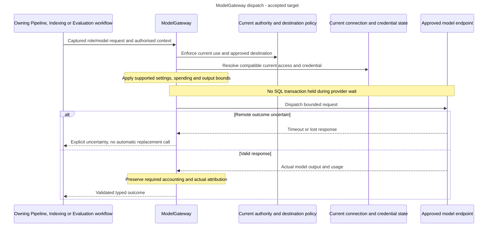

# One outbound model boundary

<a id="one-outbound-model-boundary"></a>

Alice runs a direct query, generates Evaluation cases and later changes a provider endpoint. Each path must share approved destinations, current credentials, spending and retry decisions. A library adapter or CLI prompt must not bypass those controls.

<a id="roles-and-responsibilities"></a>

The approved [outbound enforcement](decision-gateway-enforcement.md#approved-resolution), [provider-secret lifecycle](../../inframeld-access-models/references/decision-provider-secret-lifecycle.md#approved-resolution) and [transactional accounting](decision-spending-coordination.md#approved-resolution) contracts govern this target architecture. They select actual-path control, safe current-secret management and exact reservation/settlement behavior. Their implementation and assembled qualification remain pending.

## Choose a focused reading task

- For destination and per-call enforcement, read [Model dispatch and destinations](model-dispatch-and-destinations.md).

## Roles and responsibilities

ModelGateway is the application-owned boundary for remote model interaction. Embeddings, generation, extraction, synthesis, judges, repairs and optional probes all use it. Local parsing and the selected local reranker retain their own processing boundaries. Do not treat Chroma as an independent embedder or create a new gateway per consumer.

Consumers select stable connection IDs and role/model settings. Connections expose one current access configuration with separately managed credentials. Profiles fix expected numerical meaning.

Access controls management authority, Indexing checks embedding compatibility, and the gateway enforces approved dispatch. A connection manager can approve shared live impact without per-Deployment release rights. Pipeline Edit does not grant that authority.

<a id="follow-a-guarded-update-and-execution"></a>

## Follow a guarded update and execution

1. Review current effects, authority and dependencies in the backend. User acknowledgement alone is not enforcement. Name matches do not authorize overwrite.
2. Reject incompatible or unproven prepared/in-progress embedding dependencies before activation, including retained/hidden references. Do not retire data implicitly to make an update pass.
3. Bind new destination credentials explicitly and activate reviewed access atomically. Another connection is the isolation path. Restoring old settings is another guarded update, not recovery of historical secrets.
4. At admission, capture relevant current access observations. At dispatch, resolve current eligible credentials and verify the access configuration still matches the admitted operation.
5. Stop subsequent calls after relevant access changes instead of mixing old/new settings or rebinding a job. Retain actual observations for work already sent. Key-only rotation and metadata rename do not themselves change model meaning.

Manual release mode and Pipeline rollback do not restore shared access or credential bytes. Historical access revisions explain executions but cannot be selected for runtime. Exports capture current definitions and exact immutable profiles, not historical access variants or vectors.

<a id="validation-metadata-and-uncertainty"></a>

## Validation, metadata and uncertainty

Synthetic preflight is optional. Actual complete configuration, destination/security checks, spending admission and response validation remain required. Successful real use validates only the actual role/model/configuration and connection/credential revisions observed. It does not validate all models sharing a key, certify quality or declare index readiness.

Credential replacement begins untested without blocking use solely for missing validation evidence. A late old-key response cannot validate its replacement. Record evidence source/time and later failures, without repeating paid work to create evidence.

Reviewed metadata is a sourced, editable suggestion rather than a silent catalogue change or proof. Offline validation makes no provider calls. Qualified metadata reads use the same approved connection boundary.

The operator-approved local Ollama HTTP exception is credential-free. Secret-bearing connections require certificate-verified HTTPS. Provider secrets use the separate PostgreSQL/PyNaCl boundary and must not enter application retry/tracing records. Budget-policy administration is human-only and separate from dispatch accounting. Client estimates are not enforcement.

Timeouts and cancellation do not prove a remote call stopped. Keep gateway retry decisions centralized and bounded. Required accounting, current authorization, receipts and audit remain mandatory even if tracing fails.

Trace opt-out suppresses future capture/queued delivery. Re-enable does not resurrect suppressed executions. Diagnostic cleanup never regenerates a model answer.

<a id="one-call-through-the-shared-boundary"></a>

## One call through the shared boundary

**Accepted target dispatch view.** The participants are responsibilities, not newly implemented interfaces. A role selects what a call is for, such as query embedding or answer generation. A connection's current access settings select how to reach the service, while credentials have their own lifecycle.



The consumer still owns its saved results, current protected disclosure and workflow-specific retry/recovery. Relevant connection-access changes stop later dispatch rather than rebinding the operation to old or different settings. Metadata-only rename and credential-only rotation retain their documented exceptions. Failure of optional tracing cannot weaken mandatory controls. [The canonical model guide](./model-gateway-and-connections.md) owns exact dispatch and update rules.

<a id="one-model-boundary-several-roles"></a>

<a id="model"></a>

<a id="1-one-model-boundary-several-roles"></a>

## One model boundary, several roles

A **port** describes what the application needs from another component. An **adapter** supplies that capability using a library or service.

ModelGateway is Inframeld's port for generation and embeddings. Business modules pass application-defined requests and receive application-defined results, keeping provider clients outside their contracts.

| Operation | Required path |
| --- | --- |
| **Generate an answer to a user query** | Generation through `ModelGateway`. |
| **Embed a query for search** | Embeddings through `ModelGateway`. |
| **Embed document chunks while building an index** | Embeddings through `ModelGateway`. A chunk is a document excerpt prepared for retrieval. |
| **Generate answers during an evaluation** | Generation through `ModelGateway`. |
| **Generate starter evaluation cases** | Keyphrase extraction and synthesis through `ModelGateway`, using the explicitly selected generator connection. |
| **Run the v1 faithfulness judge** | Claim extraction and support judgments through `ModelGateway`, using the explicitly selected judge connection. |
| **Classify content using an LLM** | The same gateway rule applies whenever classification uses a large language model (LLM). |

The initial path is:

```text
Query, indexing, or evaluation use case
    -> ModelGateway: application-owned interface
        -> Embedded LiteLLM Python adapter
            -> Configured OpenAI, Ollama, or approved compatible endpoint
```

All roles use this interface, but may select different configured models and endpoints.

The initial adapter supports OpenAI, Ollama, and operator-approved OpenAI-compatible endpoints. Compatibility means implementing the relevant OpenAI-style operations, not every feature. A customer's enterprise gateway uses this same path.

LiteLLM runs as an embedded Python library. No separate LiteLLM Proxy service is required. Other adapters may implement ModelGateway, but application modules cannot bypass it.

Evaluation libraries must also use ModelGateway rather than create their own provider clients.

<a id="not-every-model-related-component-is-a-remote-llm-call"></a>

### Not every model-related component is a remote LLM call

The selected Ettin 32M local cross-encoder uses a separate bounded Reranker interface to reorder retrieved excerpts by relevance. Explicit hosted reranking uses the same Reranker contract but dispatches through ModelGateway and embedded LiteLLM. [ADR-0056](../../../../docs/adr/ADR-0056-support-explicit-local-hosted-or-disabled-reranking.md) selects local, hosted or explicit none. No failure fallback is permitted. Exact provider/model support and local asset/resource behavior still need qualification.

Docling uses DocumentProcessor and Chunker to convert files and divide them into search excerpts.

Neither silently calls a remote language model. A future remote processor must explicitly describe which data leaves the installation and where it goes.

Keep the connection's access settings and replaceable secret separate from each consumer's model selection. A Pipeline keeps its selected connection identity and model parameters, but uses that connection's current approved access settings and usable credential under [ADR-0054](../../../../docs/adr/ADR-0054-use-shared-current-model-connections.md). This changes access-configuration pinning, not the requirement to send every remote model call through ModelGateway.

<a id="maintainer-checks"></a>

<a id="8-maintainer-checks"></a>

## Maintainer checks

Choose and pin LiteLLM during implementation, then test that version. This guide does not claim an untested release is qualified.

| Area | Required verification |
| --- | --- |
| **Private endpoint support** | Exercise an OpenAI-compatible private test server using a custom CA and configured egress allowlists. |
| **Local HTTP exception** | Permit an approved local Ollama endpoint without credentials. Reject configuration and dispatch that would send a provider key or authorization header over HTTP. |
| **Provider mappings** | Exercise the selected OpenAI and Ollama mappings through the embedded adapter. |
| **Response validation** | Reject malformed or incompatible responses, wrong embedding dimensions, non-finite values, invalid identities, and unsupported operations. |
| **Independent role validation** | Verify chat and embeddings separately. Successful generation must not be treated as proof of working embeddings or correct dimensions. |
| **Optional preflight and real use** | Skip all synthetic calls, admit complete configurations, and record validation only after each real role call passes its response checks. Malformed, incomplete and uncertain calls must not create successful evidence. |
| **Credential lifecycle** | Test persistent storage and rotation. Replacing/removing a credential invalidates old role-validation status without rewriting pipeline semantics. |
| **Evidence races and recovery** | Finish an old call after key replacement/removal or a newer failure. Preserve its exact historical attribution without validating a new revision or hiding the later outcome. Evidence-write failure must not trigger another provider call. |
| **No implicit rerouting** | Verify that missing credentials and provider failures do not select another provider/model, and that an origin change does not implicitly forward an existing key. |
| **Gateway ownership** | Test evaluator attempts to bypass `ModelGateway`. No independent provider client or framework retry may evade the shared rules. |
| **Shared update and admission races** | Race connection updates with consumer creation, embedding preparation, credential rotation and a changed review. Either admit compatible work against the committed state or reject the stale mutation. Never leave a newly incompatible dependency behind. Hidden consumers must constrain the result without disclosure. |
| **Current dispatch and recovery** | Change access configuration after admission, while queued, between calls and before evaluation finalization or conditional publication. Stop new sends and preserve partial outcomes. Test API/worker cache freshness, lost update responses and already-dispatched results without silent rebinding or replay. |
| **Embedding compatibility** | Reject a different model/vector space and unknown endpoint equivalence before changing access settings or credentials. Equal dimensions, aliases and successful probes are insufficient proof. Verify the separate-connection/profile preparation route remains usable. |

These are acceptance requirements, not claims that implementation qualification has already passed.

<a id="pending-decisions-for-dependent-implementation"></a>

## Decision references for dependent implementation

Apply the accepted entries below when their scope matches. Discuss only choices still explicitly marked pending:

- [PD-CONTRACTS-01 (accepted): Enforce model policy on the actual outbound path](decision-gateway-enforcement.md). Before implementing model adapters/metadata/probe dispatch or selecting the actual transport/egress mechanism.
- [PD-CONTRACTS-02 (accepted): Coordinate budget policy, reservations and uncertain settlement](decision-spending-coordination.md). Before implementing budget mutation, reservation, settlement, usage normalization or unknown-charge recovery.
- [PD-ACCESS-05 (accepted): Implement and qualify the selected provider-secret lifecycle](../../inframeld-access-models/references/decision-provider-secret-lifecycle.md). When implementing protected provider-credential management, storage or deployment-key integration, and before claiming the complete secret boundary is qualified.

## Status, sources and unresolved scope

<a id="status-and-sources"></a>

These are accepted shared execution boundaries. Concrete actions, schemas, storage and runtime qualification stay with the owners. Do not infer another registry, arbitrary-header mechanism, SDK-distribution decision, workflow runner or quality approval.

- [Model connections](./model-gateway-and-connections.md), [shared access](model-connection-changes.md#shared-current), [dispatch freshness](model-dispatch-and-destinations.md#dispatch-freshness), [roles](model-validation.md#roles), [metadata](model-validation.md#model-metadata) and [spending](spending-and-accounting.md#spending).
- [Embedding compatibility](../../inframeld-indexing/references/materialization-verification.md#embedding-compatibility), [connection records](model-connection-changes.md#shared-current-connections), [validation records](model-validation.md#model-validation-evidence), [observability](../../inframeld-pipelines/references/query-tracing-and-privacy.md) and [portability](configuration-export-and-import.md).
- [ADR-0050](../../../../docs/adr/ADR-0050-make-model-preflight-optional-and-record-runtime-validation.md), [ADR-0051](../../../../docs/adr/ADR-0051-use-ragas-for-generated-tests-and-faithfulness-evaluation.md) and [ADR-0054](../../../../docs/adr/ADR-0054-use-shared-current-model-connections.md).

<a id="decision-and-reference-map"></a>

<a id="decision-map"></a>

<a id="9-decision-and-reference-map"></a>

Route shapes and the 16 KiB limit remain recommendations. Saving and validating a key remain separate. LiteLLM and private-endpoint compatibility need tests. Root-key replacement is future controlled maintenance, not an online key-management product.

| Decision | Rationale |
| --- | --- |
| [ADR-0023](../../../../docs/adr/ADR-0023-route-every-model-request-through-modelgateway.md) | Route every model request through ModelGateway. |
| [ADR-0024](../../../../docs/adr/ADR-0024-approve-outbound-destinations-before-model-calls.md) | Approve outbound destinations before model calls. |
| [ADR-0025](../../../../docs/adr/ADR-0025-separate-connection-meaning-from-replaceable-credentials.md) | Preserve the original rationale for credential separation. Consumer-pinned access is superseded by ADR-0054. |
| [ADR-0054](../../../../docs/adr/ADR-0054-use-shared-current-model-connections.md) | Use shared current connectivity with guarded changes, embedding compatibility and honest execution attribution. |
| [ADR-0050](../../../../docs/adr/ADR-0050-make-model-preflight-optional-and-record-runtime-validation.md) | Make preflight optional and record successful real calls as revision-specific validation. |
| [ADR-0048](../../../../docs/adr/ADR-0048-encrypt-outbound-credentials-in-postgresql-using-pynacl.md) | Encrypt outbound credentials in PostgreSQL using PyNaCl. |
