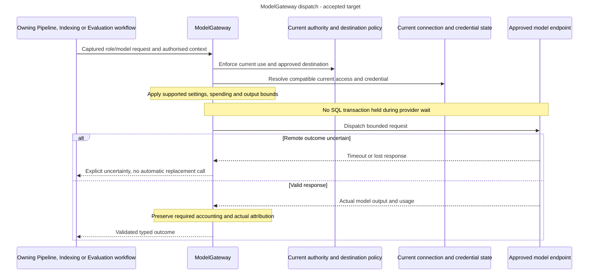

# One outbound model boundary

Alice runs a direct query, generates Evaluation cases and later changes a provider endpoint. Each path must share approved destinations, current credentials, spending and retry decisions. A library adapter or CLI prompt must not bypass those controls.

## Roles and responsibilities

ModelGateway is the application-owned boundary for remote model interaction. Embeddings, generation, extraction, synthesis, judges, repairs and optional probes all use it. Local parsing and the selected local reranker retain their own processing boundaries. Do not treat Chroma as an independent embedder or create a new gateway per consumer.

Consumers select stable connection IDs and role/model settings. Connections expose one current access configuration with separately managed credentials. Profiles fix expected numerical meaning.

Access controls management authority, Indexing checks embedding compatibility, and the gateway enforces approved dispatch. A connection manager can approve shared live impact without per-Deployment release rights. Pipeline Edit does not grant that authority.

## Follow a guarded update and execution

1. Review current effects, authority and dependencies in the backend. User acknowledgement alone is not enforcement. Name matches do not authorize overwrite.
2. Reject incompatible or unproven prepared/in-progress embedding dependencies before activation, including retained/hidden references. Do not retire data implicitly to make an update pass.
3. Bind new destination credentials explicitly and activate reviewed access atomically. Another connection is the isolation path. Restoring old settings is another guarded update, not recovery of historical secrets.
4. At admission, capture relevant current access observations. At dispatch, resolve current eligible credentials and verify the access configuration still matches the admitted operation.
5. Stop subsequent calls after relevant access changes instead of mixing old/new settings or rebinding a job. Retain actual observations for work already sent. Key-only rotation and metadata rename do not themselves change model meaning.

Manual release mode and Pipeline rollback do not restore shared access or credential bytes. Historical access revisions explain executions but cannot be selected for runtime. Exports capture current definitions and exact immutable profiles, not historical access variants or vectors.

## Validation, metadata and uncertainty

Synthetic preflight is optional. Actual complete configuration, destination/security checks, spending admission and response validation remain required. Successful real use validates only the actual role/model/configuration and connection/credential revisions observed. It does not validate all models sharing a key, certify quality or declare index readiness.

Credential replacement begins untested without blocking use solely for missing validation evidence. A late old-key response cannot validate its replacement. Record evidence source/time and later failures, without repeating paid work to create evidence.

Reviewed metadata is a sourced, editable suggestion rather than a silent catalogue change or proof. Offline validation makes no provider calls. Qualified metadata reads use the same approved connection boundary.

The operator-approved local Ollama HTTP exception is credential-free. Secret-bearing connections require certificate-verified HTTPS. Provider secrets use the separate PostgreSQL/PyNaCl boundary and must not enter application retry/tracing records. Budget-policy administration is human-only and separate from dispatch accounting. Client estimates are not enforcement.

Timeouts and cancellation do not prove a remote call stopped. Keep gateway retry decisions centralized and bounded. Required accounting, current authorization, receipts and audit remain mandatory even if tracing fails.

Trace opt-out suppresses future capture/queued delivery. Re-enable does not resurrect suppressed executions. Diagnostic cleanup never regenerates a model answer.

## One call through the shared boundary

**Accepted target dispatch view.** The participants are responsibilities, not newly implemented interfaces. A role selects what a call is for, such as query embedding or answer generation. A connection's current access settings select how to reach the service, while credentials have their own lifecycle.

The consumer still owns its saved results, current protected disclosure and workflow-specific retry/recovery. Relevant connection-access changes stop later dispatch rather than rebinding the operation to old or different settings. Metadata-only rename and credential-only rotation retain their documented exceptions. Failure of optional tracing cannot weaken mandatory controls. [The canonical model guide](../../../../docs/development/model-connections.md) owns exact dispatch and update rules.

## Status and sources

These are accepted shared execution boundaries. Concrete actions, schemas, storage and runtime qualification stay with the owners. Do not infer another registry, arbitrary-header mechanism, SDK-distribution decision, workflow runner or quality approval.

- [Model connections](../../../../docs/development/model-connections.md), [shared access](../../../../docs/development/model-connections.md#shared-current), [dispatch freshness](../../../../docs/development/model-connections.md#dispatch-freshness), [roles](../../../../docs/development/model-connections.md#roles), [metadata](../../../../docs/development/model-connections.md#model-metadata) and [spending](../../../../docs/development/model-connections.md#spending).
- [Embedding compatibility](../../../../docs/development/indexing.md#embedding-compatibility), [connection records](../../../../docs/development/data-model.md#shared-current-connections), [validation records](../../../../docs/development/data-model.md#model-validation-evidence), [observability](../../../../docs/development/observability.md) and [portability](../../../../docs/development/configuration-portability.md).
- [ADR-0050](../../../../docs/adr/ADR-0050-make-model-preflight-optional-and-record-runtime-validation.md), [ADR-0051](../../../../docs/adr/ADR-0051-use-ragas-for-generated-tests-and-faithfulness-evaluation.md) and [ADR-0054](../../../../docs/adr/ADR-0054-use-shared-current-model-connections.md).
