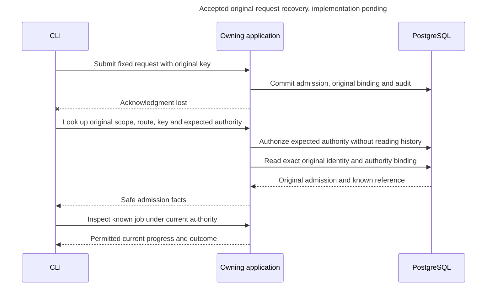

# Find original work and read its permitted outcome

Alice starts a build, but the acknowledgment disappears. The backend may already have committed the work. She needs to identify that original request, then inspect its saved state without starting another build.

> **Status:** logical application contracts accepted on 2026-10-29 through the approved joint #124/#156 specification plan. Original-request lookup now has a [native HTTP/backend implementation](../../../../docs/development/guides/original-request-lookup.md). The other contracts remain design unless their own implementation evidence says otherwise. Native OpenAPI and code own delivered representations, while tests establish their qualified scope. Existing [typed idempotency outcomes](idempotency-and-replay.md#temporary-operation-outcomes) retain authority for replay behavior.

## Choose the operation

| Question | Contract |
| --- | --- |
| Was my original request admitted? | [Original-request lookup](#original-request-lookup) |
| What has the known job actually done? | [Job inspection](#job-inspection) |
| Can remaining work be stopped? | [Cancellation](#cancellation) |
| May safe unfinished steps continue? | [Continuation](#continuation) |
| Did my Project deletion finish after membership disappeared? | [Deletion-status inspection](#deletion-status-inspection) |

Application Contracts owns these shared interfaces. Each domain supplies its outcome, progress units and exact authority. The CLI maps those facts through [invocation outcomes](cli-result-contracts.md) and [machine framing](cli-output-and-automation.md). Neither polling nor rendering performs the business operation.

## Original-request lookup

**Inputs.** The caller supplies the original request key, HTTP method, canonical logical route, original organization/Project identifiers where applicable and an expected original authority guard. The guard contains a closed authority family and the original action. It is an untrusted matching predicate, not permission or proof of admission. Capture it from the submitting operation before dispatch. An expected installation identity is checked against authoritative backend identity. Authentication supplies the current principal. The trusted installation binding supplies installation identity. User-supplied actor IDs, current aliases, changed defaults and a remembered job ID cannot replace those trusted bindings.

Use the same route meaning and scope as original admission. A logical default route stays that route even if its current Deployment target changed. Do not resolve today's default as a new request. A known operation reference can instead use its normal inspection contract.

**Authority.** Authenticate and authorize the expected guard before searching retained history. A denied guard fails identically whether history is absent, present, expired, legacy or mismatched. Never learn a hidden record's action and then choose a different public authorization failure. Only an exact immutable identity and authority-binding match may disclose an outcome.

The following minimal metadata rules were accepted on 2026-10-29. They do not establish runtime delivery or add permissions:

| Expected family | Current authority before search | Matching original target |
| --- | --- | --- |
| Project action-use | Current eligibility, Project visibility/membership and use permission for that accepted Project action | Original Organization and exact Project |
| Project grant-read | Eligible human, Project visibility/membership and can-use-and-grant for the exact action | Original Organization and exact Project |
| Organization action-use | Eligible human in the original Organization with use permission for the exact accepted Organization action | Original Organization, without a Project |

The delivered grant route's meaning is fixed: `POST /v1/projects/{project_id}/grants` uses Project grant-read for `create-access-groups`. A caller cannot downgrade it to ordinary action-use. Invalid method/route/family/action combinations fail before history search. This observes the original operation without reapplying recipient assignment eligibility or expected revision.

Generic action-use permits only content-free original operation/admission metadata. It does not permit current job results, resource inventory or source-derived content. Future resource-specific and deletion-exception families need their own original binding and pre-search authority contracts. They cannot be coerced into Project action-use.

After authorization, absent history, another binding, insufficient legacy metadata or a non-authoritative binding shape all return the same **Unresolved** observation without a match-specific reason, references or expiry. A valid exact binding whose retained outcome cannot be decoded remains a failed observation. Actual dependency failures and timeouts remain failures. This avoids revealing inaccessible history through status, details or recovery headers. Independently generated request correlation may differ. No constant-time database guarantee follows.

Resolve the retained original scope rather than selecting a convenient accessible Project. Ordinary reads retain current resource/source disclosure checks. Only the separately defined deletion projection has its narrow initiator exception. A key is correlation, never a credential.

**Result.** Return exactly one logical alternative:

| Alternative | Permitted facts |
| --- | --- |
| Completed synchronous operation | Original operation identity, safe result classification and retained outcome metadata, including expiry when established |
| Accepted asynchronous operation | Retained asynchronous admission, original operation identity, original admission facts and any established expiry. A permitted job reference is known or explicitly unknown, regardless of current job state |
| In progress | Original identity and the fact that synchronous processing is still in progress, rather than requiring recovery |
| Recovery required | Original identity and the safe uncertainty/recovery reason supplied by its owner, with no established asynchronous admission |
| Unresolved | No authoritative retained match can be established. This says nothing about whether work previously happened |

Admission and inspection are separate. Retained asynchronous admission selects **Accepted asynchronous operation** regardless of the job's current state. An admitted job's later `recovery_required` state does not select the lookup's **Recovery required** alternative. Finding an admission does not report today's job state. Read that state through [authorized job inspection](#job-inspection). Likewise, [retrying that accepted command](idempotency-and-replay.md#return-the-documented-outcome-instead-of-starting-duplicate-work) retains its original `202` meaning even after the job finishes.

**Admission without a known job reference.** The [shared accepted-operation record](idempotency-and-replay.md#temporary-operation-outcomes) carries operation metadata without a job reference. If admission is confirmed but a permitted job reference cannot be established, lookup still returns **Accepted asynchronous operation**. Its bounded observation contains the original operation identity, confirmed admission facts, any established expiry, an explicitly unknown job reference and dispatch not established. Missing a reference proves neither that work was not dispatched nor that it is queued, running, failed or recovery-required. It does not select **In progress**, **Recovery required** or **Unresolved** solely because that reference is unavailable. Unauthorized job facts remain omitted under the disclosure rules above.

An unknown reference describes limited lookup knowledge, not permission to commit a jobless admission. Preserve [atomic job admission](jobs-and-recovery.md#admit-work-and-claim-an-attempt). Further read-only lookup uses the original binding, or the owner's existing operation-inspection contract where available. Job inspection, cancellation and continuation still require a known original job reference and current authority. Do not guess a job ID, fabricate a replay `Location`, create replacement work or dispatch a provider request to fill the gap.

Lookup correlates the supplied original identity. It does not accept a replacement payload or certify that newly edited inputs equal the original inputs. A later replay retains server-owned fingerprint comparison. Continuation loads fixed retained inputs. Reusing a key with a changed payload cannot use lookup as approval to execute that change.

**Failures and effects.** Malformed input, invalid credentials, denied scope and unavailable lookup remain failures under the owning error contract. Do not disclose another principal's match or distinguish hidden history through diagnostic text. Report expiry only when authoritative retained evidence establishes it. Otherwise unresolved covers absent, expired, restored-away or unavailable matching history without claiming a specific cause. A transport timeout is a failed observation, not a successful unresolved observation. A CLI invocation solely inspecting a completed lookup exits `0` / `succeeded` even when its result is unresolved. Waiting for an original workflow whose completion cannot be established still exits `1` / `uncertain`. Neither maps an unresolved original effect to success.

Lookup creates no reservation, job, retry or provider dispatch. It returns no request payload, credential, fingerprint or original answer text. Query recovery remains [receipt-only](../../../../docs/adr/ADR-0028-recover-answer-requests-through-receipts-without-a-full-answer-replay-cache.md), and show-once secrets remain unrecoverable as plaintext. Lost history never permits automatic resubmission.

Arrows show requests and observations, not source dependencies or a replay. Worker execution can progress independently between the two reads. The illustrated lookup has a known job reference. A missing match or denied read follows the failure rules above instead of the illustrated successful recovery.

## Job inspection

**Inputs and authority.** Use a known original job reference and trusted installation/principal context. The server resolves its authoritative scope and checks current read authority, source disclosure and erasure. Changed CLI selection cannot retarget the reference. A previous successful poll grants no later access.

The logical projection has these components. These labels define meaning, not HTTP field names or a common untyped result map:

| Component | Contract |
| --- | --- |
| Original references | Known operation and job identities. A synchronous operation need not have a job |
| State | One existing job state: `queued`, `running`, `succeeded`, `failed`, `canceled`, `recovery_required` |
| Cancellation facts | Whether a request is durably recorded and whether stopping is confirmed. A recorded request alone is not confirmation |
| Retention | Established expiry, or explicitly unknown/not-yet-established expiry. Missing expiry never promises permanent history |
| Progress | Owner-typed activity and nonnegative counts with named units and separately known totals |
| Saved outcome | Owner-typed permitted references, confirmed effects and bounded unfinished/failed/uncertain summary |
| Continuation observation | Eligible, ineligible or not established, with a safe owner reason. Every execution rechecks eligibility |

The three reservation states `in_progress`, `replayable` and `recovery_required` describe duplicate detection. They are not this job enum. No `paused` state or client-derived success is added.

Unknown permitted values are explicit unknowns, never zero, empty success or invented percentages. Unauthorized optional facts are omitted. If current authority no longer permits the read itself, deny it rather than returning a misleading empty projection. An omitted protected component is not evidence of absence.

Domains own distinct progress populations. For an evaluation of 20 admitted cases with 19 answers, report those counts separately from cases scored, unscorable or unattempted. An answer saved without a score is neither a completed evaluation nor a missing answer. No shared per-item tracker or second Evaluation schema is introduced.

Detailed owner results use [ordinary bounded pages](pagination.md), default 25 and limit 1-100. The summary never requires reading every protected item or inventing an authoritative total. Do not copy excerpts, full results or exception bodies into common job metadata. Domain-specific payloads remain independently bounded by their owning contract.

Inspection returns a permitted projection or a safe validation, authentication, authorization, missing-history or availability failure. It never requeues work, refreshes an outcome by execution or reconstructs erased content.

## Cancellation

**Inputs.** Identify the original job in its fixed installation/scope and supply the cancellation request's own idempotency identity. Cancellation is a distinct mutation, not reuse of the original business command. Current cancellation authority is required. A status-read permission or local hint does not supply it.

The result distinguishes a durably recorded request, an already recorded request, an already terminal observation and a denied/ineligible request. Preserve confirmed terminal state rather than rewriting success or failure as canceled. Report known saved effects separately. No acknowledgment promises that an external call stopped or its charge was reversed.

After a lost acknowledgment, inspect the original job's cancellation facts or reconcile the same cancellation request. Do not create another business operation. Workers check cancellation at their existing bounded boundaries. Inspection of `canceled` confirms the job's cancellation outcome, not remote rollback.

Unknown remote completion stays unknown. Failed cancellation delivery, denied authority and unavailable history cannot be displayed as confirmed cancellation. Watching and cancellation are separate operations. [CLI interruption](cli-result-contracts.md#interruption-and-detachment) owns the bounded terminal behavior.

## Continuation

**Inputs.** Identify the original job and use a distinct idempotency identity for this continuation request. Load retained fixed inputs, checkpoints and attempt history on the server. Do not accept changed payloads or use current CLI defaults to replace original inputs.

Recheck current caller authority, retained scope, ownership, dependency state and safety of remaining work. Return accepted continuation of the same job, an equivalent already accepted continuation, a known terminal/no-remaining-work observation or a safe ineligible/failure result. Completed checkpoints and operation identity stay unchanged. Admission is not completion.

An eligible observation from inspection is informational. It does not reserve authority, guarantee later admission or permit repeating uncertain paid work. Missing retained inputs, retired resources, changed scope and unproven replay prevent ordinary continuation. Explicit new work after reviewing uncertainty remains a separate owning decision.

The accepted [PD-ACCESS-02](../../inframeld-access-models/references/decision-admitted-work-authority.md#approved-resolution) allows admitted product work to survive originating-credential expiry, rotation and individual key revocation while current principal/resource authority remains valid. A fresh valid credential for the original principal may request eligible explicit continuation without changing the original inputs or transferring ownership. Suspension, recovery-generation changes or lost required authority stop later protected steps. Restoring permission does not silently resume the job. Access's host-authorized recovery continuation keeps its separate original-obligation and budget contract.

## Deletion-status inspection

**Inputs and authority.** Supply the original deletion operation identity, or locate its original binding through the same narrow retained lookup. The server authenticates the current caller and checks that the currently eligible human is the authoritative original initiator. [ADR-0080](../../../../docs/adr/ADR-0080-limit-product-deletion-status-to-the-initiating-human.md) permits this read after ordinary Project membership disappears.

Return only original operation identity, the existing operation/job state where available, confirmed admission/access blocking, application/key shutdown completion, physical cleanup completion and established retention information. Unknown completion is unknown, not false proof of remaining work. A failed cleanup never removes the access block or implies rollback.

Expose no Project name, inventory, private-content counts, payloads, excerpts or general job details. Administrator status, an operation ID and prior membership grant no access. Invalid credentials, suspension, retirement or recovery restrictions still deny the read. Missing/expired history remains unresolved within this narrow authority, not proof of successful deletion or no effects.

This projection grants no cancellation, continuation, restoration or replacement membership. Host maintenance is not a product-credential fallback. [Project deletion](../../inframeld-knowledge/references/project-deletion.md) owns admission and physical completion. This document selects neither new retention periods nor an additional deletion-state enum.

## Retention, delivery and acceptance

Preserve [at least 24 hours of completed duplicate detection and active-work retention](idempotency-and-replay.md#limit-guarantees-to-retained-authoritative-history). An established expiry is published unchanged. Repeated reads or retries do not extend it. That floor does not select job-history or deletion-status lifetimes. PD-KNOWLEDGE-02's remaining periods are pending. The [accepted queue policy](decision-queue-saturation-and-cleanup.md#approved-resolution) governs saturation, with numerical operating limits still separate.

The following are downstream behavioral acceptance cases, not tests executed by this specification:

| Scenario | Required observation |
| --- | --- |
| Denied expected guard, history absent or retained under any binding | Same authorization failure before history search |
| Authorized guard, absent/mismatched/insufficient legacy binding | Same Unresolved observation with no match-specific diagnostics |
| Fixed grant route supplied with ordinary action-use | Reject invalid guard independently of history |
| Exact authorized binding with malformed outcome | Safe failed observation, not Unresolved |
| Admission committed, acknowledgment lost | Lookup identifies the original admission without another job or provider call |
| Admission retained, permitted job reference unavailable | Lookup returns Accepted asynchronous operation with original identity, any established expiry, job reference explicitly unknown and dispatch not established. No guessed job state, replacement admission or provider call |
| Later authorized lookup establishes the job reference | Return the same admitted operation with that known reference. Job inspection remains a separate authorized read |
| Synchronous request is still processing | Lookup returns In progress, without implying an asynchronous job |
| Original operation requires recovery with no established asynchronous admission | Lookup returns Recovery required with its safe owner reason |
| Accepted asynchronous job is queued or running | Lookup returns Accepted asynchronous operation. Authorized inspection supplies current job state |
| Accepted asynchronous job is succeeded, failed, canceled or `recovery_required` | Lookup still returns Accepted asynchronous operation. Inspection supplies the saved outcome or recovery facts |
| History expired or lookup timed out | Expiry is reported only if established, timeout remains failed observation, neither permits new work |
| Alias, Project or payload changed | Original binding is preserved, changed scope is not substituted, payload equivalence still needs normal fingerprint checks |
| Job failed after saving partial results | Inspection succeeds with actual failed state and permitted results, waiting for success fails |
| 20 admitted cases, 19 answers, fewer scores | Distinct owner populations remain visible without guessed completion |
| Cancellation races with completion | Preserve actual terminal state and request acknowledgment separately |
| Caller loses permission or source is erased | Deny or omit protected information under the owning disclosure contract |
| Old credential expires or is revoked | Reject incoming requests through an invalid credential. Already admitted jobs use current principal authority under PD-ACCESS-02, and explicit continuation still needs a fresh valid credential for the original principal without ownership transfer |
| Deletion removed membership | Eligible original initiator sees only the narrow projection, other administrators and ineligible initiators do not |

The native HTTP/backend lookup portion of #125 is delivered. Backend delivery remains #234-#237. CLI delivery remains #158, #159 and the operation-recovery family. Native models/OpenAPI will own delivered names and validation. No new route, DTO, schema artifact, persistence mechanism or workflow engine is specified here.
