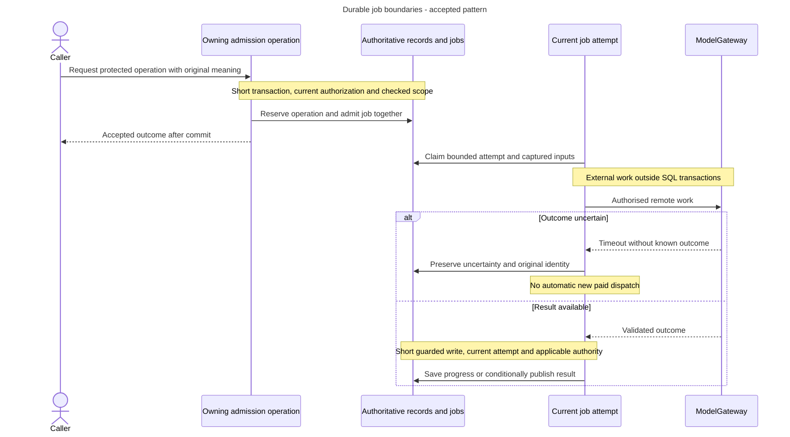

# Transactions, durable jobs and safe retries

<a id="transactions-durable-jobs-and-safe-retries"></a>

Alice grants Bob a permission and loses the response. The server may already have committed it. A retry must find the original outcome under current authority rather than granting again or returning an old answer to a now-ineligible caller.

<a id="operation-identity-and-current-authority"></a>

## Operation identity and current authority

Idempotency recognizes the same caller, key and request meaning as one operation. The same key with different meaning conflicts. Expected revisions separately detect competing changes. A stored outcome is metadata, not permission. Authenticate and authorize before reservation or replay.

The admission context, authenticated `access`, current `authorization`, typed `RequestFingerprint` and expected replay kind are explicit inputs to `OperationIdempotency`. Actor identity comes from access. Organization/project scope comes from authorization, never from inspecting the Command. Generic idempotency preserves the authorization result's project type. `IdempotencyService` alone assembles the low-level reservation request.

<a id="follow-the-implemented-grant-pattern"></a>

## Follow the implemented grant pattern

1. The static `ProjectUseOnlyGrantMapper` creates a flat Command from HTTP input. It constructs the typed response directly after narrowing the supported action. Fingerprint meaning belongs to the service.
2. The service computes the unchanged fingerprint before opening `TransactionManager`. Bootstrap supplies its adapters one clean request-local session and closes it afterward.
3. Inside the transaction, call `ProjectGrantAuthorizer` through the service's direct dependency. Immediately compare returned project scope to the Command, before reservation or replay. A mismatch raises an internal runtime error and rolls back. Scope matching does not replace current permission checks.
4. Pass current context/access/authorization/fingerprint/replay kind to idempotency. A completed retry can resolve its original outcome. New work retains the existing expected-project-revision check and lock/deadline contract.
5. Load the recipient through `ProjectMembershipRepository` in authorization scope. Check organization, project and recipient. Invoke `assign_use_only_grant()` with business details from the unchanged Command.
6. Save supported additions with the checked project-wide revision and original operation ID. Required audit, durable change and safe completion/replay metadata commit together.

Load/save stay outside narrow domain-error catches. Translate recognized aggregate rejections with stable application-owned messages and preserve causes. Persistence, audit, commit failure or cancellation must leave rollback with the service transaction. The repository neither commits nor retries and must discard transaction-bound instances after failure/end.

The Access-owned `ProjectOperationAdmissionService` and its request DTO also coordinate authorization and check returned project scope before lookup. They share `OperationIdempotency` while retaining their caller-owned transaction and rollback. Lower-level reservation adapters retain their existing contracts. Generic outcomes, reservation persistence and retries stay shared. Do not turn one complete product command into a claim that another workflow is qualified.

<a id="outcomes-and-background-attempts"></a>

## Outcomes and background attempts

`IdempotencyService` validates low-level reservation projections and returns distinct new-work, completed synchronous, accepted asynchronous or recovery-required outcomes. Synchronous expiry is required. Asynchronous expiry remains optional. Preserve the expected replay kind and typed project/organization scope.

Durable jobs save accepted work and progress across client disconnects or worker restart. Admit work and its reservation atomically in a short transaction, then perform external work outside it. Only the current fenced attempt may publish. A fence is an attempt/revision check preventing stale publication, not a way to cancel remote work.

A paid model timeout may mean the request ran and was billed. Missing output, a nonzero exit or unconfirmed cancellation cannot authorize a new dispatch. Frozen vector storage retries have a separate bounded protocol using already captured bytes. Identity-recovery cleanup has its own trusted original-obligation and bulk-provider boundaries, not another generic state machine.

<a id="a-durable-operation-across-transaction-and-provider-boundaries"></a>

## A durable operation across transaction and provider boundaries

**Accepted background-work pattern.** This explains the existing job contract, not a delivered universal runner. Fencing means checking an attempt/revision before publishing so an obsolete worker cannot publish a result.



The current authority and attempt checks are workflow-specific, not a new generic execution framework. Client disconnection does not imply cancellation, failure or authority for replacement work. Storage retries from captured vector bytes retain their separate protocol. Complete synchronous writes such as the grant command finish inside their service-owned transaction instead of being forced through this job shape.

## Complete-batch transaction composition

For Knowledge batches, accepted [PD-KNOWLEDGE-01](../../inframeld-knowledge/references/decision-complete-batch-handoff.md#approved-resolution) keeps durable child admissions and a conditional finalization. The owning application transaction commits exact selection, completion, safe replay outcome, required audit and durable continuation together after bounded inventory preparation. Use lower-level capabilities inside that transaction. Do not wrap independently transaction-owning complete services in an outer begin. New child jobs use the existing atomic capacity/admission contract. Network/storage waits remain outside SQL.

<a id="recovery-boundaries"></a>

## Recovery boundaries

Same-key replay resolves original inputs and target before new current settings. For a default alias, find the original logical-route record before resolving a rebound target, preventing another paid query. Stale reviewed revisions conflict. Preserve original installation/account/project identity through job recovery and imports.

Generated credentials are shown once. Keep secret-bearing fingerprints keyed and replay metadata secret-safe. Submitted provider secrets are never echoed. Completed answer retries are receipt-only rather than saved full-answer replay or regeneration. Required authorization, audit and accounting cannot be weakened by diagnostics failure.

Disaster restore can restore old permissions and retry history. Follow coherent security reconciliation before serving/replay rather than assuming historical state is current authority. Retention bounds remain explicit, not an unlimited content archive.

<a id="keep-changes-consistent"></a>

<a id="coordination"></a>

<a id="3-keep-changes-consistent"></a>

## Keep changes consistent

A rule that must remain true after a change is an **invariant**. An **aggregate** groups the related state and behavior responsible for protecting such rules. For example, a Deployment must reject a release change based on an outdated revision.

For example, a `Deployment` owns the rules for:

```text
attach_candidate
set_canary
abort_candidate
promote
rollback_promotion
```

Here, a Deployment selects the pipeline version serving requests. It is not a Docker deployment. Both the API and worker use its domain rules instead of implementing their own versions of promotion or rollback.

A PipelineVersion checks that its saved configuration is valid and immutable. Simpler facts can remain plain immutable values. A **source span**, for example, only identifies where an excerpt came from. Neither it nor a recorded metric needs an elaborate class hierarchy.

<a id="an-aggregate-does-not-mean-loading-every-related-row"></a>

### An aggregate does not mean loading every related row

An aggregate defines which rules belong together. It does not mean loading every related database row.

For a collection with one million documents, load the small controlling object and its revision reference. Create, verify, and read the membership records in batches or through database operations over sets of rows. This keeps memory use limited.

The aggregate's main object, called its root, protects the rules. Repository operations handle the larger volume of records.

<a id="keep-database-transactions-short"></a>

### Keep database transactions short

Application commands define short PostgreSQL transactions. A transaction groups database changes so they commit together or do not commit at all.

Domain code checks the business rules. Database adapters also reject duplicates, references to the wrong organization or project, and updates based on an outdated revision. These checks use uniqueness constraints, foreign keys, and conditional updates.

Both are needed because two requests can overlap. Alice's command may pass a check, then Bob may change the same record before Alice saves. Database checks prevent her save from breaking a rule or silently replacing his change.

**Admission** means saving that the application has accepted an operation. Its work record, job, retry outcome, and required audit event can all be saved together. The retry outcome tells the application what to return if Alice sends the same request again.

When one transaction owns these records, they can succeed or fail together. There is no need to save them separately and repair partial results later.

<a id="keep-external-calls-outside-long-sql-transactions"></a>

### Keep external calls outside long SQL transactions

Record acceptance, finish the database transaction, then call storage or a model. Save completion in another short transaction. Waiting for an external service must not keep a long SQL transaction open.

Workers call the same commands as the API, including when a source sync discovers a new document. A retry reuses the operation's identities. It must not create another domain model or a new source identity each time.

<a id="pending-decisions-for-dependent-implementation"></a>

## Decision references for dependent implementation

Apply the accepted entries below when their scope matches. Discuss only choices still explicitly marked pending:

- [PD-ACCESS-02 (accepted): Keep durable work and credential lifetime explicit](../../inframeld-access-models/references/decision-admitted-work-authority.md). Before admitting, executing or resuming durable work that must interpret credential expiry, rotation, revocation or replacement.
- [PD-KNOWLEDGE-01 (accepted): Finalize a complete collection selection without losing admitted input](../../inframeld-knowledge/references/decision-complete-batch-handoff.md). Before implementing batch completion, collection selection, parent/child recovery or the ingestion-to-automatic-update handoff.
- [PD-CONTRACTS-05 (accepted): Qualify cleanup and recovery under a full bounded queue](decision-queue-saturation-and-cleanup.md). When selecting worker claim/scheduling behavior or making claims about recovery/cleanup progress under saturation.

<a id="status-and-sources"></a>

## Status and sources

The grant chain is the implemented reference. Job workflows, later commands, recovery production wiring and exact CLI outcomes retain their own qualification. Do not add a universal executor, command bus, generic repository or speculative recovery aggregate.

- [Grant chain](../../inframeld-python-standards/references/services-and-use-cases.md#grant-command-flow), [service guide](../../inframeld-python-standards/references/services-and-use-cases.md#service-writing-guide), [membership repository](../../inframeld-python-standards/references/aggregates-and-repositories.md#membership-aggregate-and-repository), [jobs/idempotency](jobs-and-recovery.md) and [supporting records](components-and-services.md#shared-supporting-records).
- [ADR-0065](../../../../docs/adr/ADR-0065-application-services-own-write-transactions.md), [ADR-0066](../../../../docs/adr/ADR-0066-use-typed-operation-contexts-and-command-classification.md), [ADR-0067](../../../../docs/adr/ADR-0067-standardize-authorization-capabilities-with-typed-requests.md), [ADR-0068](../../../../docs/adr/ADR-0068-model-project-grants-through-project-membership-aggregates.md) and [error mapping](http-errors.md#stable-domain-error-mapping).
