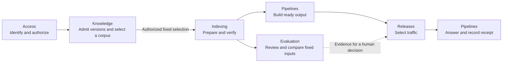

# From a document to an answer

Alice wants to ask questions about two Support documents, A1 and B1. The goal is a useful private answer with enough evidence to understand later changes. The following journey describes accepted behavior. Individual operations still need their stated implementation and qualification.

## Owners along the journey

Arrows show a product journey, not automatic authorization or code dependencies. Access checks also occur at later protected boundaries. Evaluation can run against captured working inputs before a release build, and its scores never authorize a release.

## Follow Alice

1. Alice authenticates. A separately authorized host claim establishes the first administrator when needed. Product admission and explicit grants remain separate from identity and OAuth consent. Private starter resources are ordinary resources. Alice is explicitly both member and manager of the starter group.
2. She configures the actual model roles and approved destinations. A saved provider secret supplies outbound authentication. Optional synthetic preflight can help, but complete valid configuration may be used without a separate test call. Real calls retain mandatory security and response checks.
3. Knowledge admits a complete bounded upload through private staging. It preserves logical source identity, immutable byte versions and explicit nonempty document audiences. Partial bytes or an incomplete batch cannot become a live corpus. A separately authorized selection freezes exact membership before downstream work. Admission alone does not select it.
4. Indexing processes admitted versions, obtains embeddings through ModelGateway and verifies exact search bindings. Upload success, parsing success and searchable readiness are different states.
5. Alice may query the Pipeline's working settings and evaluate captured inputs. No Experiment resource or release-ready PipelineVersion is required for this development loop. Temporary overrides do not save settings or publish traffic.
6. Build captures saved configuration and exact corpus inputs. Ordinary preparation creates a ready version. Target-specific publication has its own authority and current checks.
7. A query to Production selects the serving version, protects its dependencies with a bounded pin, retrieves currently permitted evidence and generates through ModelGateway. The live answer's receipt retains exact attribution, including final evidence that was not cited.

The default serving path starts in Automatic updates. Explicitly created Deployments default to Manual releases with an automatic option at creation.

Automatic work still needs the underlying mutation rights, Build and the target's release authority. Before a default Deployment exists, first publication has its separately authorized creation path.

## What changes and what stays fixed

Admitting replacement B2 leaves R1={A1,B1} fixed. A separately authorized complete selection can create R2={A1,B2}. [Collection selection](../../inframeld-knowledge/references/collection-selection-and-batches.md) defines that boundary. Indexing can reuse A's compatible search data. An admitted query or evaluation keeps its captured inputs while Alice edits the working Pipeline.

A failed build leaves healthy current traffic in place.

Switching Automatic to Manual invalidates old publication authority. Switching back admits fresh work and cannot revive the old job. Canaries and rollback require Manual mode.

Erasing B is stronger than omitting it from a new collection. Current access and publication are blocked before resumable physical cleanup. A historical version may become unavailable. Frozen history never promises permanent content retention or current permission.

If an answer response is lost, retry finds the original operation after current authentication and authorization. It returns the documented receipt-only outcome instead of another paid generation. Evaluation and direct-query records do not enter production feedback statistics.

### Maintainer checks

| Change | Constraint to preserve |
| --- | --- |
| SupportBot key rotates | Stable principal and current permissions remain the authority. |
| Alice leaves Support | Her relationships are removed. Grants she made to others remain. |
| A new vector execution uses identical inputs | New physical generation and record IDs. No overwrite. |
| A build is reserved but incomplete | No ready PipelineVersion or fabricated Deployment. |
| A feedback edit arrives after promotion | Original receipt attribution remains unchanged. |
| A test or rubric changes | New immutable evaluation input. Old results remain identifiable. |
| A provider credential is copied to another resource | Authenticated binding rejects dispatch. |
| A real model call completes after credential replacement | Evidence retains the used revision and cannot validate the replacement. |
| Preflight is skipped | No fabricated success and no marker-only readiness gate. Real security, response and materialization checks remain mandatory. |

## Status and sources

Setup requires neither a benchmark nor a judge. First-answer timing is flexible and unmeasured here. No diagram, default preset or historical evidence weakens access, verified readiness or paid-call uncertainty handling.

Read [Onboarding](first-use-and-private-defaults.md), [Knowledge](../../inframeld-knowledge/references/documents-and-collections.md), [Indexing](../../inframeld-indexing/references/profiles-and-preparation.md), [Pipelines and Releases](../../inframeld-pipelines/references/configuration-queries-and-builds.md), [Evaluation](../../inframeld-evaluation/references/generation-and-review.md), [Feedback](../../inframeld-pipelines/references/answer-feedback.md), and [Jobs](../../inframeld-application-contracts/references/jobs-and-recovery.md) for exact rules. [ADR-0052](../../../../docs/adr/ADR-0052-separate-experimental-execution-from-release-ready-pipeline-builds.md) explains the pre-release development loop.
