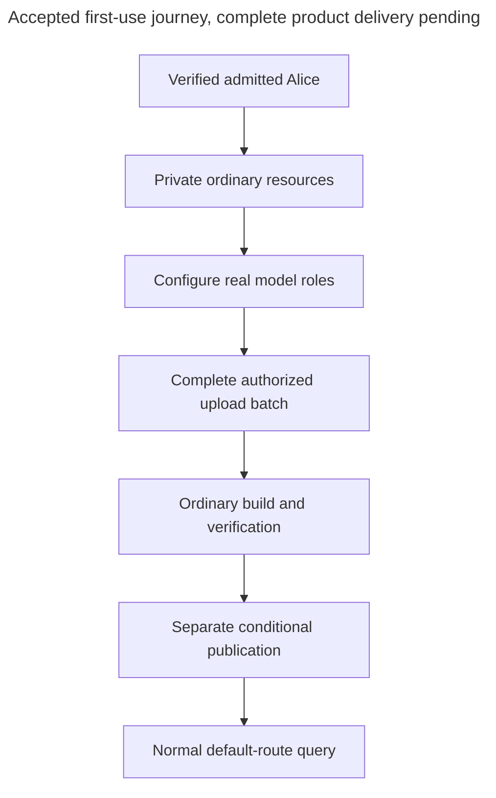

# First use and private defaults

<a id="first-use-and-private-defaults"></a>

Alice signs in, configures models and uploads two Support documents. Setup helps her reach an ordinary, authorized answer. It does not create a second permission system or make incomplete resources ready.

> **Status:** accepted behavior is stated separately from proposed representations and qualification work. Existing Python types, generated OpenAPI and migrations own implemented shapes. Pending decisions are not accepted by this reference.

<a id="private-defaults-are-ordinary-resources"></a>

## Private defaults are ordinary resources

The server operator controls a one-time claim that establishes the installation and the first verified human's explicit permissions. The first arbitrary public signup never becomes an administrator. This claim gives neither unrestricted UI authority nor host access. Kratos verifies identity, while Access separately controls admission, suspension, restoration, and project creation.

Each admitted human gets a private starter project, group, collection, processing preset, and Pipeline. The person is explicitly both member and manager of the group and receives the required setup and administration permissions, including Delete project. This setup neither requires nor grants Create projects. Other people's starters are separate, and installation administrators have no document-reading bypass.

Permissions name individual Pipelines and Deployments. Before the first Deployment exists, Alice needs Create Deployment, Build, permission for the underlying change, and access to its inputs. Creation saves the ready initial version and creator grants together, including Manage releases. Later releases need Manage releases on that Deployment. No placeholder Deployment or separate first-release permission is needed.



The arrows show successive steps within the application. Each step uses its existing domain and ordinary permission checks.

<a id="human-login"></a>

<a id="sign-in-before-provisioning-without-requiring-studio"></a>

### Sign in before provisioning, without requiring Studio

For the CLI, `local start` starts/reuses the managed runtime and returns with an explicit `setup --target local` next step. It does not sign in or claim administration. Guided setup or explicit login opens the system browser through the accepted Kratos-plus-Hydra flow. The small Ory account UI authenticates Alice through Kratos and handles the documented Hydra login/consent integration independently of the full Studio. [Access](../../inframeld-access-models/references/human-cli-login.md#human-cli-authentication) owns token verification and local-principal resolution. [ADR-0053](../../../../docs/adr/ADR-0053-use-kratos-and-hydra-for-human-cli-authentication.md) records this selected architecture.

Successful identity-provider login alone is insufficient. The first administrator must complete the separately authorized operator claim, and every human must pass current admission/account checks before private provisioning or product access. Local setup may use its narrowly bound host maintenance channel. Remote setup requires the remote operator's authorized action, not an implied SSH privilege. [Deployment](../../inframeld-application-contracts/references/cli-local-runtime.md#managed-local-http) specifies the managed same-machine HTTP exception. All other installations require HTTPS.

Reuse an existing valid login for the selected target/account. A changed issuer, a different verified person for an existing account alias, unavailable verification or incomplete admission must not silently create another identity or default project. Reopening setup follows the same saved state. Human CLI tokens stay in the qualified local credential store, not in a project file or an application integration. [Authentication qualification](../../inframeld-access-models/references/human-cli-credential-lifecycle.md#cli-authentication-qualification) remains pending. The existing cookie adapter alone does not establish this flow.

<a id="host-bootstrap"></a>

<a id="confirm-the-first-administrator-through-host-authority"></a>

### Confirm the first administrator through host authority

Local setup first obtains a verified Ory identity, keeping issued tokens transient until admission and secure saving succeed. Show that verified account and installation, and ask the host operator to confirm the initial explicit administrative grants. A typed email is not proof of identity. OAuth consent alone is not the bootstrap permission.

Invoke a narrow maintenance operation inside the verified managed backend using existing host/container authority. Bind it to the installation, not a target named `local` or whichever Docker context happens to be selected. Send any credential through protected stdin/IPC, never argv, environment or logs. The operation independently verifies the identity evidence through trusted Ory integration, then atomically saves the identity link, scoped grants and audit event. Repeating the original completed claim for the same identity returns its recorded result without recreating removed grants. A competing different identity fails. The [Access maintenance contract](../../inframeld-access-models/references/host-maintenance.md) requires expected immutable installation identity, protected bounded input and exact reviewed request state. The four organization grants remain separate from the seventeen additional-Project grants.

No public claim endpoint, shared claim password, browser host authority or Docker socket mounted in the backend is introduced. Remote first setup requires the equivalent operator action on the server. Ordinary remote login supplies no SSH or maintenance authority. [The accepted maintenance contract](../../inframeld-access-models/references/host-maintenance.md#maintenance) names `inframeld-maintenance` and limits its protected versioned JSON request to 64 KiB. The [version 1 maintenance draft](../../inframeld-access-models/references/host-maintenance.md#maintenance-wire) uses the CLI's transient Hydra human access token, independently introspected with current Kratos identity checks. It specifies proof, installation-identity initialization and input/output models for final review. Host execution authorizes the claim. The token identifies its recipient. Implement and qualify bootstrap/identity verification. After the claim, normal admission must still succeed before the CLI reports a usable saved login.

<a id="guided-setup-entry"></a>

<a id="start-setup-explicitly-and-resume-only-unfinished-work"></a>

### Start setup explicitly and resume only unfinished work

Setup guides an unconfigured or partly configured project to its first functioning pipeline. It is not ongoing administration and does not equate an existing project record with readiness. `local start` reports runtime health and the next `setup --target local` command, then returns without entering or prompting for onboarding. Starting local also preserves an existing remote selection. No mandatory `init` or project configuration file is required.

An explicit or saved unfinished project resumes its missing steps using current backend state and normal operation recovery. A ready project reports readiness and ordinary next commands without recreating a Pipeline, replaying a configuration wizard or making another paid demonstration query. An unavailable/inaccessible project fails without substituting a starter or treating denial as incomplete setup.

For a first-time user without a project selection, offer **Your starter project** as the recommended choice and **A new project** as the advanced choice. Do not add a generic existing-project picker or an experience-level question. Existing unfinished work remains reachable through explicit/saved context. Selecting the starter reuses it. Creating another project requires ordinary Create projects authority and leaves the starter untouched. Remembering context requires visible agreement and obeys [selection rules](../../inframeld-application-contracts/references/cli-targets-and-accounts.md#cli-context).

The New project choice calls ordinary project creation, not the private-starter provisioner. Creation saves the project, creator membership and [seventeen explicit initial Project-action grants](../../inframeld-access-models/references/actions-and-initial-grants.md#initial-project-grants) together. It does not provision a Pipeline or start model work. Setup then continues as separate steps. A naming conflict or denied permission saves no partial project. A lost response is reconciled before retry. If Alice stops after successful creation, her new project remains and later setup resumes it without duplication. CLI project management exposes the same operation outside setup.

Offer the starter's saved Display name once. Enter keeps it and its Name. A new label does not change stable IDs, bindings or publication mode. Any suggested Name change is a separate explicit review. Do not ask for collection, Pipeline or access-group names in that step. Resume preserves subsequent renames without asking again. Naming is optional and does not imply an extra registration field.

The starter is ordinary, not undeletable or permanently automatic. Creating/selecting another project and stop/start leave it intact. Deliberate mode changes remain unchanged on later setup. Authorized deliberate deletion records absence. Setup explains it and requires explicit repair/creation rather than resurrecting it. Destructive review identifies the target/project and consequences. `--no-input` alone is not confirmation.

Every guided choice has a noninteractive input path. Missing required input fails before that operation without prompts/browser/editor or blanket approval of later model calls. Completed earlier steps remain saved. A connection created separately during an abandoned setup remains a real resource, not a promise of cross-resource rollback. Precise command options, readiness reporting and recovery projections remain specification work. Ordinary backend workflows own their effects.

<a id="starter-naming"></a>

<a id="generate-a-readable-starter-name-once"></a>

### Generate a readable starter name once

For example, the backend provisions `Quiet Orbit` with Name `quiet-orbit`. Use the selected Python `coolname` package behind an infrastructure adapter, with a reviewed bundled Inframeld vocabulary and a preferred two-word pattern. The upstream function `generate_slug(2)` is a library identifier, not Inframeld's resource terminology. No model call, network naming service, personal information or credential participates in generation.

Save the generated Display name and Name in the same all-or-nothing, principal/purpose-idempotent starter provisioning operation as the project. Database uniqueness, not randomness, prevents collisions. Retry generated candidates only within a specified bound. Exhaustion fails provisioning honestly. A lost response or repeated setup returns the existing project and values, not another random name or partial starter.

The optional naming prompt starts from the persisted Display name. Keeping it is a complete choice. Editing that label may suggest a corresponding Name, but changing the existing Name needs a separate explicit reviewed choice. This is not a Kratos registration field or a reason to delay or duplicate provisioning. Resume preserves subsequent edits. Do not mass-rename existing projects or recreate deliberately deleted starters.

`coolname` was selected as a BSD-2-Clause dependency, not installed or qualified by this documentation. Retain copyright, conditions, disclaimer and applicable word-list notices in source and binary distribution materials. This selection does not change Apache-2.0 OSS scope or choose a future enterprise license. Package version, approved vocabulary, retry bounds, migrations and release licensing review remain delivery work. [Resource naming](resource-names-and-identity.md#resource-naming) owns name uniqueness, explicit rename and retirement.

<a id="make-provisioning-safe-to-repeat"></a>

### Make provisioning safe to repeat

Provisioning remains human-only in v1, including setup and first-Deployment creation. Use the [seventeen Project actions and fixed resource creator assignments](../../inframeld-access-models/references/actions-and-initial-grants.md#initial-assignments) through the ordinary owners. Starter admission does not require or grant Organization `create-projects`. Existing Projects/resources receive no automatic backfill. Applications may update already provisioned resources with eligible grants. Permitted revisions, Documents and cases are workflow output rather than resource provisioning.

After Kratos verifies Alice, save her starter setup in one short PostgreSQL transaction. This includes both group membership and management, the other setup records, the access change number, and audit. Either all are saved or none are. Follow the [member-plus-manager rule](../../inframeld-access-models/references/memberships-groups-and-handover.md#group-managers). A unique ownership-and-purpose key can be:

```text
(organization, verified human principal, starter)
```

A **principal** is the stable local identity of a human or application. This key lets a retry find Alice's existing starter project. Saved default bindings identify its group, collection, preset, and Pipeline by ID. The installation's one-time administrator claim has its own uniqueness check.

Do not keep the transaction open while calling Kratos, Hydra or a model. If saving fails, a later request can complete the same setup. If saving succeeds but the response is lost, return the existing IDs.

Record both completed setup and deliberate removal. Otherwise a restart could mistake deleted defaults for unfinished setup and recreate them. Database transactions and uniqueness rules are enough, without a distributed setup coordinator.

<a id="keep-starter-content-private"></a>

<a id="access"></a>

<a id="2-keep-starter-content-private"></a>

## Keep starter content private

Every Document lists at least one allowed group from its project. Uploads need Add documents on every group, even when the server chose the defaults. That permission includes no reading, replacement, deletion, sharing, or release rights. Imports also select Inframeld groups rather than copy the source system's permissions.

Changing defaults needs Manage upload defaults and management of every old and new group. It affects only future uploads. A missing or unauthorized group blocks the upload instead of making it public. [Access document rules](../../inframeld-access-models/references/query-and-document-authorization.md#documents) give the full permission list.

Setup issues no application key automatically. An authorized human must pass Access's key-administration and grant-authority checks. The application's access must be safe for everyone using it. Applications cannot administer permissions or incoming keys in v1. A person leaving follows ordinary handover or deletion rules.

After setup or publication, **Finish** remains the default. The optional CLI application-connection journey can guide account selection/creation, an explicit access review, separate show-once credential issuance and HTTP or MCP instructions. It uses ordinary Access operations and preserves partial-completion identities. An optional live test authenticates as the application, not Alice, and needs its own cost/data-transfer approval. Neither choosing MCP nor accepting this optional flow changes publication policy or exports Alice's Hydra credentials.

<a id="optional-sample-and-explicit-file-selection"></a>

## Optional sample and explicit file selection

Offer the Gutenberg English edition of R.U.R. As the optional sample. Choosing it is optional, not a prerequisite for using private documents. Treat its bytes as ordinary admitted knowledge with the same upload, parser, audience and publication checks. The selection does not authorize a hidden download, model call or bypass of source/licensing review.

Alice can select local files and folders before reviewing an upload. Show the selected scope, processing, outgoing data, estimated costs and publication effects before approval. Keep that scope explicit rather than scanning unrelated directories. Optional first questions use the ordinary query command after separate approval. Place spending controls before optional model tests.

<a id="maintainer-checks"></a>

<a id="8-maintainer-checks"></a>

## Maintainer checks

Use real PostgreSQL tests for simultaneous changes and the existing adapter-verification tests. They are required checks, not results already established by this guide.

| Area | Required verification |
| --- | --- |
| **Provisioning and creation** | The private group records its creator as both member and manager in the same transaction. Retries create no duplicates or manager-only state. Defaults start automatic without a fake-ready Deployment. Explicit creation defaults manual and honors an explicit automatic choice. A failed or incomplete first batch never serves. |
| **Optional model preflight** | Permit skipping synthetic tests without blocking an otherwise ready first publication. Real calls validate only their exact role/model/revisions after response checks. Missing credentials/configuration and invalid embeddings still fail. Late old-key results cannot validate a replacement. |
| **Successful and failed replacements** | Automatic publication uses complete ready bindings, records previous/history, and preserves answer/feedback attribution. Failed replacement preserves healthy current serving. Erasure and unavailability retain their separate rules. |
| **Mode-switch races** | Exercise publication versus switching to manual in both commit orders, and automatic → manual → automatic while an old build runs. Only still-authorized work may publish. |
| **Overlapping batches** | Supersede both queued and running work. Verify complete corpus membership, no stale overwrite, and no fallback to an older result when the newest request fails. |
| **Crashes and retries** | Restart between build completion, publication, and acknowledgment. Retry mode/update commands with the same and different keys. Prevent duplicate admission, duplicate pointer transitions, and implicit repetition of uncertain paid calls. |
| **Candidate and rollback rules** | Reject enabling automation with a candidate at 0% or nonzero traffic. Reject manual canary/release commands in automatic mode. Rollback stays manual. Re-enabling clearly authorizes the selected pending update. |
| **Current access and lifecycle** | Test revoked grants, upload-only/query-only actors, differing target permissions, erased inputs, default deletion/rebinding, and unavailable rollback targets. Neither mode nor an old job bypasses current policy. |
| **Client parity** | Verify HTTP/Studio/SDK status and MCP query/receipt behavior through mode changes. Add no administrative MCP tools. A comparison neither pauses publication nor promotes its preferred version. |

Client **parity** means that HTTP, Studio, SDKs, and MCP observe the same application behavior and state. They do not implement separate versions of the workflow.

<a id="decision-and-reference-map"></a>

<a id="decision-map"></a>

<a id="9-decision-and-reference-map"></a>

## Decision and reference map

Private defaults and reversible modes are settled. Selector fields, timing assumptions, and detailed verification remain as labelled. [Supporting records](../../inframeld-application-contracts/references/components-and-services.md#supporting-records) defines bindings and markers, and [release coordination](../../inframeld-releases/references/publication-and-automatic-updates.md#modes) defines the checks that stop outdated publication. Backend work can proceed while Studio waits for SDK suitability.

| Decision | Rationale |
| --- | --- |
| [ADR-0046](../../../../docs/adr/ADR-0046-provision-creator-private-defaults-through-ordinary-resources.md) | Provision creator-private defaults through ordinary resources. |
| [ADR-0049](../../../../docs/adr/ADR-0049-require-group-managers-to-be-ordinary-members.md) | Record the creator as both member and manager of the private group. |
| [ADR-0047](../../../../docs/adr/ADR-0047-support-reversible-publication-modes-per-deployment.md) | Support reversible publication modes per Deployment. |
| [ADR-0050](../../../../docs/adr/ADR-0050-make-model-preflight-optional-and-record-runtime-validation.md) | Allow optional model preflight and validation through successful real use. |
