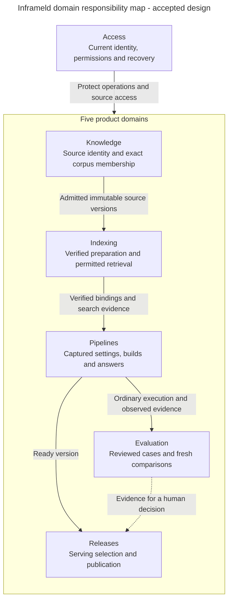

# Find the owner before designing the component

Alice replaces handbook B1 with B2 and wants Production to use the change. Several owners participate, but each protects a different decision. This map helps an engineer find the right module before choosing a service, repository or adapter.

A module here is an area of responsibility inside one backend. API and worker processes reuse its application behaviour. The boxes do not prescribe separate services or a new class for every capability.

Releases supplies the selected serving version back to ordinary Pipeline execution. That return interaction is described here to keep the overview readable. Arrows show responsibility and information hand-offs. They are not an approved call graph or import direction. Access also protects later dispatch and disclosure. Evaluation results provide no publication authority. Deployment-selected configuration, current connection access and fixed execution inputs retain their separate meanings.

## Pick the relevant architecture

| If the component must decide… | Start with… |
| --- | --- |
| Who the caller is and whether the operation is allowed now | [Access architecture](../../inframeld-access-models/references/architecture.md) |
| Which source bytes and versions belong to a collection | [Knowledge architecture](../../inframeld-knowledge/references/architecture.md) |
| Whether exact search data is usable, reusable or removable | [Indexing architecture](../../inframeld-indexing/references/architecture.md) |
| Which inputs execute and what produced an answer | [Pipelines architecture](../../inframeld-pipelines/references/architecture.md) |
| How a fixed set of questions is reviewed and compared | [Evaluation architecture](../../inframeld-evaluation/references/architecture.md) |
| Which ready version receives traffic | [Releases architecture](../../inframeld-releases/references/architecture.md) |

Choose the owner's public application capability when crossing a boundary. A read projection can combine facts without acquiring another owner's mutation authority. The shared database does not make every module an independent writer of every record.

## Shared support and dependency direction

[Application Contracts](../../inframeld-application-contracts/references/components-and-services.md) explains transaction, retry, job and transport boundaries. [ModelGateway](../../inframeld-application-contracts/references/model-gateway-and-connections.md) controls remote model dispatch. Access owns management authority and secret protection, while Indexing owns embedding compatibility. Neither gateway nor jobs becomes another business domain.

Code dependencies point toward domain rules and application-owned capabilities. Infrastructure implements those capabilities. Bootstrap assembles concrete objects and manages resource lifetime. See the [dependency-direction diagram](../../inframeld-application-contracts/references/components-and-services.md#owners-layers-and-dependencies) for that different view.

For component design or structural code review, read the owning module architecture, relevant workflow and Coding Standards. Shared components use Application Contracts. A narrow behaviour question can use its workflow directly. It needs neither this entire map nor every architecture reference.

## Accepted responsibilities and pending choices

The domain responsibilities and focused internal boundaries are accepted. Each module architecture links the owning decisions and identifies accepted detailed contracts and their remaining implementation/qualification. Transaction handoffs, concurrency, concrete inputs/results and production qualification retain their stated status. An accepted component boundary does not select every public API, physical schema or implementation mechanism.

[The architecture introduction](../../../../docs/ARCHITECTURE.md), [application structure](../../inframeld-application-contracts/references/components-and-services.md) and [ADR-0001](../../../../docs/adr/ADR-0001-use-one-modular-backend-with-clear-domain-boundaries.md) own these boundaries. [The data model](resource-names-and-identity.md) owns exact record relationships and their implementation status.

[PD-ACCESS-03 production recovery contracts](../../inframeld-access-models/references/decision-recovery-production-completion.md) are resolved by ADR-0085. Consult their acceptance matrix and owning workflows for the implemented private callbacks, durable cleanup and protected host continuation, with their qualification limits. First-local-admission integration, account restoration and other maintenance modes remain separate work.

## Accepted decision navigation

The developer approved the presented batches and authorized best-effort resolution of all remaining choices on 2026-10-29. These records now select policy. Numerical limits/objectives are chosen qualification targets, not measured support. Follow only the owning contract matching the work. Native DTOs, physical schemas and tests remain normal implementation tasks, without reopening these choices.

### Resolved decision references

| Decision | Owner | Status |
| --- | --- | --- |
| [PD-ACCESS-01: Check application-key currentness at the right boundary](../../inframeld-access-models/references/decision-key-currentness.md) | access-models | Accepted policy. Apply its matching trigger; implementation and qualification retain their own evidence. |
| [PD-ACCESS-02: Keep durable work and credential lifetime explicit](../../inframeld-access-models/references/decision-admitted-work-authority.md) | access-models | Accepted policy. Apply its matching trigger; implementation and qualification retain their own evidence. |
| [PD-ACCESS-05: Implement and qualify the selected provider-secret lifecycle](../../inframeld-access-models/references/decision-provider-secret-lifecycle.md) | access-models | Accepted policy. Apply its matching trigger; implementation and qualification retain their own evidence. |
| [PD-ACCESS-06: Authorize setup details before a Deployment exists](../../inframeld-access-models/references/decision-setup-read-authority.md) | access-models | Accepted policy. Apply its matching trigger; implementation and qualification retain their own evidence. |
| [PD-ARCHITECTURE-01: Select a measured supported workload and resource envelope](../../inframeld-architecture/references/decision-supported-operating-envelope.md) | architecture | Accepted policy. Apply its matching trigger; implementation and qualification retain their own evidence. |
| [PD-ARCHITECTURE-02: Match availability and recovery claims to the supported deployment](../../inframeld-architecture/references/decision-availability-backup-and-restore.md) | architecture | Accepted policy. Apply its matching trigger; implementation and qualification retain their own evidence. |
| [PD-CONTRACTS-01: Enforce model policy on the actual outbound path](../../inframeld-application-contracts/references/decision-gateway-enforcement.md) | application-contracts | Accepted policy. Apply its matching trigger; implementation and qualification retain their own evidence. |
| [PD-CONTRACTS-02: Coordinate budget policy, reservations and uncertain settlement](../../inframeld-application-contracts/references/decision-spending-coordination.md) | application-contracts | Accepted policy. Apply its matching trigger; implementation and qualification retain their own evidence. |
| [PD-CONTRACTS-04: Bind import review and partial recovery to exact actions](../../inframeld-application-contracts/references/decision-import-review-and-recovery.md) | application-contracts | Accepted policy. Apply its matching trigger; implementation and qualification retain their own evidence. |
| [PD-CONTRACTS-05: Qualify cleanup and recovery under a full bounded queue](../../inframeld-application-contracts/references/decision-queue-saturation-and-cleanup.md) | application-contracts | Accepted policy. Apply its matching trigger; implementation and qualification retain their own evidence. |
| [PD-EVALUATION-01: Define exact case generation and review operations](../../inframeld-evaluation/references/decision-case-review-contracts.md) | evaluation | Accepted policy. Apply its matching trigger; implementation and qualification retain their own evidence. |
| [PD-EVALUATION-02: Coordinate fixed runs and expose honest protected results](../../inframeld-evaluation/references/decision-run-and-result-contracts.md) | evaluation | Accepted policy. Apply its matching trigger; implementation and qualification retain their own evidence. |
| [PD-EVALUATION-03: Qualify embedded Ragas without hidden calls or false confidence](../../inframeld-evaluation/references/decision-ragas-integration-and-calibration.md) | evaluation | Accepted policy. Apply its matching trigger; implementation and qualification retain their own evidence. |
| [PD-INDEXING-01: Exchange complete prepared bindings between Indexing capabilities](../../inframeld-indexing/references/decision-capability-binding-contracts.md) | indexing | Accepted policy. Apply its matching trigger; implementation and qualification retain their own evidence. |
| [PD-INDEXING-02: Define what current index health can actually detect](../../inframeld-indexing/references/decision-health-observation.md) | indexing | Accepted policy. Apply its matching trigger; implementation and qualification retain their own evidence. |
| [PD-INDEXING-03: Keep source passage identity stable when chunking changes](../../inframeld-indexing/references/decision-source-coordinates.md) | indexing | Accepted policy. Apply its matching trigger; implementation and qualification retain their own evidence. |
| [PD-INDEXING-04: Qualify frozen storage retries and final erasure barriers](../../inframeld-indexing/references/decision-storage-retries-and-erasure.md) | indexing | Accepted policy. Apply its matching trigger; implementation and qualification retain their own evidence. |
| [PD-INDEXING-05: Select and prove a bounded parser runtime](../../inframeld-indexing/references/decision-parser-runtime-profile.md) | indexing | Accepted policy. Apply its matching trigger; implementation and qualification retain their own evidence. |
| [PD-KNOWLEDGE-01: Finalize a complete collection selection without losing admitted input](../../inframeld-knowledge/references/decision-complete-batch-handoff.md) | knowledge | Accepted policy. Apply its matching trigger; implementation and qualification retain their own evidence. |
| [PD-KNOWLEDGE-02: Choose bounded retention without weakening explicit erasure](../../inframeld-knowledge/references/decision-retention-erasure-policy.md) | knowledge | Accepted policy. Apply its matching trigger; implementation and qualification retain their own evidence. |
| [PD-PIPELINES-01: Capture fixed inputs and complete execution through its receipt](../../inframeld-pipelines/references/decision-execution-build-receipt-contracts.md) | pipelines | Accepted policy. Apply its matching trigger; implementation and qualification retain their own evidence. |
| [PD-PIPELINES-02: Make a confirmed trace opt-out stop later capture and delivery](../../inframeld-pipelines/references/decision-trace-policy-fencing.md) | pipelines | Accepted policy. Apply its matching trigger; implementation and qualification retain their own evidence. |
| [PD-RELEASES-01: Persist Deployment transitions with one shared control check](../../inframeld-releases/references/decision-deployment-state-and-concurrency.md) | releases | Accepted policy. Apply its matching trigger; implementation and qualification retain their own evidence. |

The additional [model metadata and connection-reference contract](../../inframeld-application-contracts/references/model-metadata-and-validation.md#accepted-metadata-and-reference-contract), recorded by ADR-0123, resolves the remaining model-metadata/deletion specification scope.

- [PD-CONTRACTS-03](../../inframeld-application-contracts/references/decision-cli-server-compatibility.md) is accepted under [ADR-0095](../../../../docs/adr/ADR-0095-support-matching-qualified-cli-and-runtime-releases.md). Follow its CLI/runtime compatibility policy. Remote enforcement and release-pair qualification remain separate delivery work.
- [PD-ACCESS-04](../../inframeld-access-models/references/decision-recovery-first-admission.md) is accepted under [ADR-0082](../../../../docs/adr/ADR-0082-coordinate-first-admission-and-recovery-by-identity.md). Follow [identity coordination](../../inframeld-access-models/references/identity-admission-coordination.md) before implementing first admission, recovery admission/completion or credential-state initialization. The shared coordinator and recovery/initialization participants are implemented with PostgreSQL concurrency coverage. Complete first-admission integration remains unfinished.

### Business areas and state ownership

The six areas below own different records and rules inside one codebase. These are not six separate microservices.

| Area | What it owns |
| --- | --- |
| **Knowledge** | Source identity, document lifecycle and versions, collection revisions and their document memberships. |
| **Indexing** | The settings and state needed to prepare searchable indexes: processing and embedding profiles, processing generations, vectorizations, layouts, materializations, publication, and reconciliation. |
| **Pipelines** | Immutable pipeline configuration and its links to prepared indexes (materialization bindings). Retrieval and generation orchestration. It also owns answer receipts and their current feedback records, as explained below. |
| **Evaluation** | Cases and immutable benchmark/evaluator inputs, evaluation-run evidence, metric results, and comparisons. |
| **Releases** | Deployments, candidate cohorts (groups routed to a trial version), promotion, candidate abort, and rollback. |
| **Access** | Mapping callers to application principals, organization and project scope, permission decisions. |

A **principal** identifies the human or application making a request. An **index materialization** identifies search data prepared for particular documents and processing settings. **Reconciliation** means checking that recorded index state agrees with what is actually stored, then resolving any difference.

Processing and indexes may be separate submodules inside Indexing. However, **only Indexing decides whether a materialization is ready**.

The accepted internal operation boundaries are recorded in [ADR-0075](../../../../docs/adr/ADR-0075-separate-document-lifecycle-from-collection-selection.md), [ADR-0076](../../../../docs/adr/ADR-0076-separate-index-preparation-retrieval-and-retirement.md), [ADR-0077](../../../../docs/adr/ADR-0077-separate-pipeline-settings-builds-and-answer-execution.md), [ADR-0078](../../../../docs/adr/ADR-0078-separate-evaluation-case-work-run-coordination-and-scoring.md), [ADR-0079](../../../../docs/adr/ADR-0079-protect-deployment-transitions-with-a-focused-aggregate.md). Read the owning module architecture for its focused responsibilities and remaining contracts. These choices do not require a class, protocol or repository for every named concept. A Deployment aggregate owns its cohesive transition behavior, while services retain current authorization and transaction orchestration.

### How modules work together

To request a change owned by another module, use that module's public application operations. Unrelated modules must not update each other's tables directly.

Modules may share IDs and a small value identifying the caller and relevant project. Putting every domain model into a shared package would make the modules depend on one another's internals and obscure who may change them.

Jobs and audit records support the application. They do not become another owner of evaluations, Deployments, or documents.

An evidence screen may combine information from several modules. Its read code can join their records, but it must not become another writer of evaluation or Deployment state. Showing information together does not change who owns it.

Private native recovery notifications use [the Access-owned callback process](../../inframeld-access-models/references/private-recovery-handoff.md#implemented-private-delivery), selected in [ADR-0086](../../../../docs/adr/ADR-0086-serve-recovery-notifications-through-a-private-backend-process.md). It shares the backend image. The [dedicated worker](../../inframeld-access-models/references/recovery-completion.md#implemented-execution-and-proof-backed-completion) executes durable provider cleanup and proof-backed release. The separate [host-maintenance command](../../inframeld-access-models/references/host-maintenance.md#recovery-cleanup-continuation) authorizes additional bounded runs.
