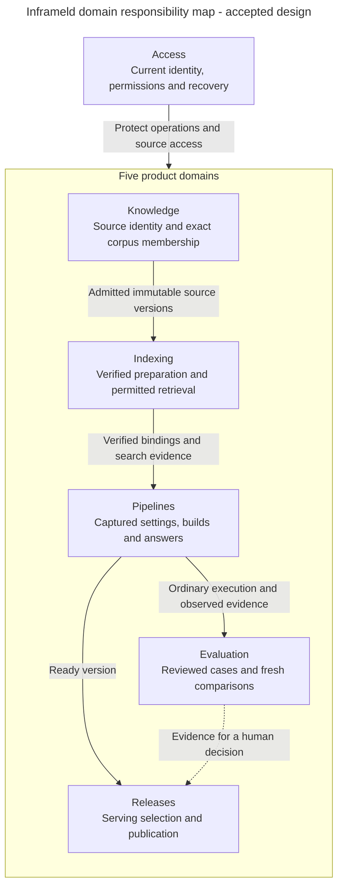

# Find the owner before designing the component

Alice replaces handbook B1 with B2 and wants Production to use the change. Several owners participate, but each protects a different decision. This map helps an engineer find the right module before choosing a service, repository or adapter.

A module here is an area of responsibility inside one backend. API and worker processes reuse its application behaviour. The boxes do not prescribe separate services or a new class for every capability.

Releases supplies the selected serving version back to ordinary Pipeline execution. That return interaction is described here to keep the overview readable. Arrows show responsibility and information hand-offs. They are not an approved call graph or import direction. Access also protects later dispatch and disclosure. Evaluation results provide no publication authority. Deployment-selected configuration, current connection access and fixed execution inputs retain their separate meanings.

## Pick the relevant architecture

| If the component must decide… | Start with… |
| --- | --- |
| Who the caller is and whether the operation is allowed now | [Access architecture](../../inframeld-access-models/references/architecture.md) |
| Which source bytes and versions belong to a collection | [Knowledge architecture](../../inframeld-knowledge/references/architecture.md) |
| Whether exact search data is usable, reusable or removable | [Indexing architecture](../../inframeld-indexing/references/architecture.md) |
| Which inputs execute and what produced an answer | [Pipelines architecture](../../inframeld-pipelines/references/architecture.md) |
| How a fixed set of questions is reviewed and compared | [Evaluation architecture](../../inframeld-evaluation/references/architecture.md) |
| Which ready version receives traffic | [Releases architecture](../../inframeld-releases/references/architecture.md) |

Choose the owner's public application capability when crossing a boundary. A read projection can combine facts without acquiring another owner's mutation authority. The shared database does not make every module an independent writer of every record.

## Shared support and dependency direction

[Application Contracts](../../inframeld-application-contracts/references/components-and-services.md) explains transaction, retry, job and transport boundaries. [ModelGateway](../../inframeld-application-contracts/references/model-gateway-and-connections.md) controls remote model dispatch. Access owns management authority and secret protection, while Indexing owns embedding compatibility. Neither gateway nor jobs becomes another business domain.

Code dependencies point toward domain rules and application-owned capabilities. Infrastructure implements those capabilities. Bootstrap assembles concrete objects and manages resource lifetime. See the [dependency-direction diagram](../../inframeld-application-contracts/references/components-and-services.md#owners-layers-and-dependencies) for that different view.

For component design or structural code review, read the owning module architecture, relevant workflow and Coding Standards. Shared components use Application Contracts. A narrow behaviour question can use its workflow directly. It needs neither this entire map nor every architecture reference.

## Accepted responsibilities and pending choices

The domain responsibilities and focused internal boundaries are accepted. Each module architecture links the owning decisions and identifies contracts still to specify. Transaction handoffs, concurrency, concrete inputs/results and production qualification retain their stated status. An accepted component boundary does not select every public API, physical schema or implementation mechanism.

[The architecture introduction](../../../../docs/ARCHITECTURE.md), [application structure](../../../../docs/development/application-structure.md) and [ADR-0001](../../../../docs/adr/ADR-0001-use-one-modular-backend-with-clear-domain-boundaries.md) own these boundaries. [The data model](../../../../docs/development/data-model.md) owns exact record relationships and their implementation status.
