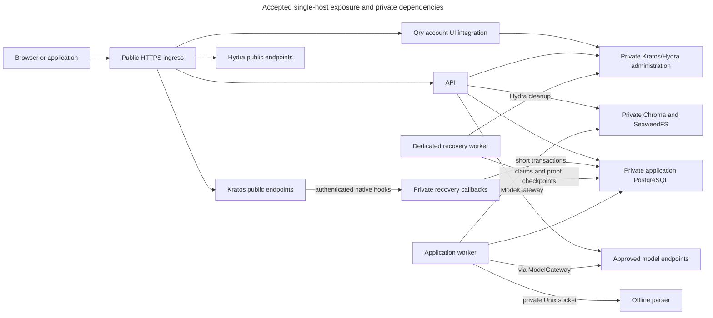

# Runtime deployment and durable storage

## Choose a focused reading task

- For durable stores and paths, read [Storage topology](storage-topology.md).

## Understand the runtime services

Each release must name its tested Linux and container-runtime versions, dependencies, and image digests. A digest identifies exact container-image content, so a later change to a tag cannot silently change what is installed.

Docker Desktop can run a local trial. That trial does not establish that the Linux production security checks have passed.

The installation needs no AWS, Cognito, Vercel, hosted Chroma, cloud secret manager, or cloud infrastructure account. Its **S3-compatible API** is an interface for storing objects. Using it, or reading sources through an S3 connector, does not require hosting Inframeld on AWS.

Custom OpenAI-compatible model endpoints remain available in **open-source software (OSS)**. All model calls, including evaluation, use the application’s `ModelGateway` boundary.

V1 runs on one server. Kubernetes, Terraform for a hosted platform, multi-host operation, and automatic horizontal scaling are deferred. A future **Enterprise Edition (EE)** could use Chroma Cloud and hosted Kratos or Ory Network while keeping the same domain ownership and identity technology. V1 does not depend on those services.

### Give each runtime component one clear responsibility

In the table below, **ingress** is the entry point for incoming traffic and **TLS** protects HTTPS connections. An **artifact** is stored content, such as an uploaded file or processing result. A **manifest** is a saved inventory. **Vectors** are numbers used to search for relevant document excerpts.

| Component | Responsibility and exposure |
| --- | --- |
| **HTTPS ingress** | The production/network application entry point. Terminates TLS, routes web/API and Kratos/Hydra public endpoints, and enforces request-size/time bounds. Trust forwarded headers only from configured proxies, not arbitrary callers. The managed-local HTTP exception below does not apply to ordinary network installations. |
| **Ory account UI integration** | Small browser login, consent and recovery experience needed for human CLI login independently of the full Studio. Uses official Ory clients and documented Kratos/Hydra flows. Private server-side administration credentials never reach the browser. Exact image/container arrangement remains release qualification work. |
| **Full Studio (deferred)** | Not required in the v1 runtime or release chain. When delivered, use a production build and the same generated-client/identity contracts. The account UI above is required independently. |
| **Python API** | Handles admission, authorization, queries, and release commands. Admission means durably accepting requested work. Database and vector services need no public ports. |
| **Python application worker** | Runs the same application release/image as the API through a different command. Executes bounded durable application jobs from PostgreSQL. Support one application worker alongside the dedicated recovery worker. Vector mutation ownership follows [Preparing and searching reliable indexes](../../inframeld-indexing/references/profiles-and-preparation.md). |
| **Recovery worker** | Uses the backend image with a separate command and no listener. Executes one recovery attempt at a time through PostgreSQL ownership and proof reconciliation. It needs database and private Hydra access, without artifact volumes, model credentials or the callback key. [ADR-0087](../../../../docs/adr/ADR-0087-isolate-recovery-cleanup-in-a-dedicated-worker.md) records the isolation boundary. |
| **Isolated parser service** | Converts untrusted documents using [Processing untrusted documents safely](../../inframeld-knowledge/references/uploads-and-source-sync.md)’s per-attempt sandbox. Has no network, credentials, general artifact volume, or Docker socket. Its only worker connection is a private IPC socket. IPC means interprocess communication. |
| **Recovery callbacks** | A private backend process on port 8081, sharing the backend image and application database. It accepts authenticated native Kratos evidence only. Publish no host port or public route. It requires no Hydra client or fingerprint key. |
| **PostgreSQL** | Holds authoritative application state, jobs, permissions, and operation records on durable storage. Accessible only privately. Kratos and Hydra each use their own database and database role, separate from application state, with separately controlled migrations. One PostgreSQL server can host all three. |
| **Chroma server** | A private HTTP service with its own durable volume. API and worker use its client API, not a shared embedded persistence directory. |
| **SeaweedFS artifact storage** | A private S3-compatible service on durable storage behind the application-owned artifact interface. Its master, volume, filer, and S3 roles fit in one process/container. Their responsibilities are explained below. |
| **Kratos identity service** | Self-hosted human identities, sign-in methods and browser sessions, integrated with the account UI. Administration remains private. A local trial needs no cloud identity account. |
| **Hydra OAuth/OIDC service** | Explicitly selected for first-party human CLI login and token lifecycle under ADR-0053. Public protocol endpoints are exposed through the configured ingress. Administration and introspection remain private. It is not the owner of Inframeld grants or application/provider keys. |

OSS supports optional installation-level **OpenID Connect (OIDC)** sign-in through Kratos. The operator configures an external identity provider when one is wanted. CI jobs and integrations instead use Inframeld's [application credentials](../../inframeld-access-models/references/authorization.md), which identify an application account and use its current permissions. They do not require another identity issuer.

### Qualify Kratos, Hydra and the account UI as one login path

Alice's CLI opens her system browser, Kratos verifies her identity through the account UI, and Hydra returns the standard authorization result to the CLI. The backend privately verifies subsequent opaque access tokens and current Kratos identity eligibility before checking its own Access state. [The Access guide](../../inframeld-access-models/references/human-cli-login.md#human-cli-authentication) owns the trust boundary and its detailed registration, credential-lifecycle and qualification requirements.

Provision the official `inframeld-cli` public client using Hydra's private administration interface during installation. Ordinary setup users do not register OAuth clients. Configure the API URL, expected issuer, API audience, redirect rules and account-UI origins explicitly. Expose only necessary public protocol/UI endpoints. Use service-specific secrets, private administration, separate migrations and official Ory APIs rather than shared identity-table reads or a custom token issuer.

The accepted release policy is the latest suitable reviewed OSS Kratos and Hydra releases, with exact tested versions and image digests. Check advisories and compatible account-UI/client versions before pinning. Device authorization must remain unavailable until its specific release gates pass. Never use a floating `latest` tag, silently change distribution or upgrade identity services during `local start`. The [current provider review](./runtime-deployment-and-storage.md) distinguishes release selection from security clearance.

Primary accepted defaults are a five-minute access token, seven-day rolling refresh token, one-minute authorization code and eight-hour Kratos browser session. Use the respective containers' documented environment settings and the [credential-lifecycle configuration inventory](../../inframeld-access-models/references/human-cli-credential-lifecycle.md#cli-credential-lifecycle). These are deployment settings, not user-project files. Other flow/session settings need qualified keys and explicit effective defaults, not guessed values. Refresh rotation, zero reuse grace and no positive token/identity-eligibility cache remain the selected profile.

Preserve Hydra's identity/protocol state, client registrations, keys and required configuration in the coordinated identity backup/upgrade procedure. A container restart must not create a new issuer, change account mappings or invalidate persisted state accidentally. Restoring older identity state may revive old credentials, so security reconciliation precedes reopening access. Exact migration/restore and cross-product revocation behavior require release tests. This edit neither runs migrations nor qualifies a restore.

**Inspected implementation boundary:** the backend implements cookie/bearer authentication and checked consent. [Development Compose](../../../../compose.dev.yaml) includes pinned Hydra with its own persistent database, a loopback public endpoint and private administration. Explicit setup steps validate native lifetime settings, finish provider migrations and reconcile the CLI client before starting the containerized API. API startup itself performs no registration mutation. The [local setup guide](../../../../docs/development/getting-started/local-setup.md#configure-the-cli-client) owns those commands.

The isolated [integration stack](../../../../compose.test.yaml) has no published ports and runs one pytest collection, including production client provisioning, refresh/reuse/logout and isolated lifetime overrides. Private test approvals and native-login scenarios establish their respective provider boundaries. Account pages, Rust CLI storage/interaction, production recovery orchestration and the packaged runtime remain separate work. The developer stack still publishes the application database on loopback for host development, so it is not the fully isolated CLI-managed runtime. [Access evidence](../../inframeld-access-models/references/credential-dispatch.md#implemented-human-authentication) records the authentication boundary.

### Reuse these processes for MCP, evaluation, and generated clients

The additional client and evaluation capabilities do not each need another service:

| Capability | Where it runs |
| --- | --- |
| **First-party MCP** | The Model Context Protocol adapter mounts the official Python SDK inside the existing API process. It reuses application operations and authorization, adding no container, store, or identity issuer. [Using Inframeld through MCP](../../inframeld-application-contracts/references/mcp-transport.md) defines the accepted transport/client profile and its pending qualification. |
| **Ragas** | An embedded worker library for starter generation and claim-based faithfulness, with explicit generator/judge bindings through `ModelGateway`. No hosted evaluation account or extra service. External evaluation/trace exporters remain deferred. |
| **CLI's generated application client** | A build artifact inside the Rust CLI, not another backend service. Future Studio uses its generated TypeScript client. Generator selection and runtime compatibility need qualification. |

These capabilities share the existing API and worker processes. The account UI serves identity flows. Full Studio is deferred.

For Ragas workers, set `RAGAS_DO_NOT_TRACK=true` before importing or using the library and disable library-owned external callbacks/exporters. Do not provide Ragas with provider credentials or independent clients. The gateway resolves credentials for authorized calls. Keep secrets, prompts, excerpts, and answers out of ordinary library logs. This does not disable Inframeld's independently controlled operational or RAG-workload tracing. Verify actual outbound destinations, default constructors, retry limits, and any required local assets with the locked dependencies before release. [Evaluation](../../inframeld-evaluation/references/gateway-and-jobs.md#gateway) records v0.4.3 source-inspected compatibility and the still-unexecuted qualification plan.

## Trace public and private access

The arrows show allowed request paths, not every internal dependency. Storage and identity administration stay private. The parser has no external network connection and communicates with the worker only through its local socket.

### Restrict access and resources for the whole installation

| Boundary | Production requirement |
| --- | --- |
| **Public exposure** | Publish only the intended HTTPS ingress. Keep PostgreSQL, Chroma, artifact internals, identity administration, and parser IPC private. |
| **Networks and mounts** | Give services only the network attachments and filesystem mounts they need. The web service does not need data-volume access. |
| **Runtime privileges** | Pin images by release and digest, run application services as non-root, drop unnecessary capabilities, prohibit Docker socket mounts, and use read-only root filesystems where compatible. |
| **Resource use** | Explicitly limit CPU, memory, process count, and temporary disk use. |
| **Readiness** | Verify usable dependencies and required security controls. A health check is not an authorization check and does not replace permission enforcement on requests. |

The operator controls the host, Docker daemon, filesystem permissions, TLS material, outbound networking, and backups. These responsibilities remain even when Compose starts the services together.

Host full-disk encryption and encrypted off-host backups protect stored data when it is offline. They do not hide plaintext from a compromised running service or a host administrator.

### Separate infrastructure secrets from saved provider credentials

The operator supplies installation secrets, while users can save model-provider credentials through the application. These need different storage:

| Secret category | Storage and access |
| --- | --- |
| **Infrastructure/bootstrap material** | Protected operator-supplied files mounted only into the services that need them through service-specific Compose secrets. Bootstrap material supports the installation’s initial trusted setup. |
| **Application-entered model credentials** | Authenticated ciphertext in PostgreSQL using PyNaCl, as selected in [Connecting models and protecting provider credentials](../../inframeld-application-contracts/references/model-gateway-and-connections.md). Authenticated ciphertext combines encryption with integrity checking. Users must be able to save these credentials through the application. |
| **Persistent root encryption key** | Supplied separately and mounted only into the API and worker. It is not a credential that every container receives. |

Compose mounts secret files into selected containers. **It does not encrypt or manage those secrets for the operator.** Provider files mounted by the operator also do not replace the application's ability to save credentials entered during onboarding.

No cloud secret manager or OpenBao service is selected. Never put secret values in tracked Compose files, image layers, job payloads, telemetry, or response replay records. The recorded reference for mount behavior is [Docker Compose secrets](https://docs.docker.com/compose/how-tos/use-secrets/).

The installation must enforce [parser isolation](../../inframeld-indexing/references/parser-isolation-and-validation.md#isolation). If it cannot establish the required sandbox, it must fail readiness rather than run parsing in an ordinary worker subprocess or a privileged container. Studio has no access to the database, artifact volumes, or provider keys.

## Provider image and upgrade qualification

Executable provider pins belong to Compose and the backend lockfile, not a copied version table. The selected OSS upgrade addressed the Kratos courier-admin advisory [CVE-2026-33503](https://github.com/ory/kratos/security/advisories/GHSA-hgx2-28f8-6g2r). Hydra has its [related pagination advisory](https://github.com/ory/hydra/security/advisories/GHSA-r9w3-57w2-gch2). Keep administration private regardless of version.

Production security clearance remains pending. The reviewed official images had unresolved Go, dependency and operating-system findings on both supported image architectures. A successful provider behavior test does not establish vulnerability-free images, reachability analysis or safe recovery release. The earlier audit excluded the editable backend and Git-sourced Ory SDKs from its package coverage. Do not present that audit as complete dependency clearance.

Before production approval, review actual pinned image contents, supported base distributions, source-only SDKs and advisory reachability. The [reviewed Go TLS advisory](https://github.com/golang/vulndb/blob/master/data/reports/GO-2026-6607.yaml) and [Alpine support policy](https://alpinelinux.org/releases/) identify relevant review inputs. Historical scanner match counts have intentionally been removed. Recheck current primary sources when qualifying deployment.

Provider upgrades may migrate identity databases independently of application migrations. Back up retained identity data and qualify each supported host/architecture. A private Podman/arm64 observation does not prove Docker/amd64 execution or complete recovery execution. Native callback delivery has its own [private qualification](../../inframeld-access-models/references/private-recovery-handoff.md#implemented-private-delivery). Follow [upgrades](../../../../docs/development/operations/upgrades.md) and the availability/recovery pending decision before making operating claims.

## Maintainer checks

The following are release criteria, not tests completed by this record.

| Area | Required verification |
| --- | --- |
| **Installation and identity** | Install on a fresh machine and complete an authenticated local trial. Pin tested Kratos, Hydra, account-UI and SeaweedFS images and client libraries. Verify subject mapping, private introspection, current identity eligibility, refresh/revocation behavior and the [authentication qualification requirements](../../inframeld-access-models/references/human-cli-credential-lifecycle.md#cli-authentication-qualification). |
| **Exposure and isolation** | Verify production TLS, private ports, parser isolation, and required security/readiness controls. |
| **Managed-local exception** | Prove the [managed-local HTTP contract](../../inframeld-application-contracts/references/cli-local-runtime.md#managed-local-http), including rejected remote/tunnel targets, exact origins, restart/reset identity and no identity-admin exposure. Do not infer production TLS readiness from local success. |
| **Durable execution** | Restart jobs and demonstrate the documented retry and uncertain-outcome behavior. |
| **Storage failures** | Kill storage during upload, fill its disk, restart with acknowledged writes, and corrupt a test artifact. Partial writes must never become published references. Checksum failures must be visible. |
| **Storage authorization** | Prove unauthorized S3 access is denied rather than assuming credentials are enforced because the service starts. |
| **Recovery** | Back up and restore a consistent set, including filer metadata, volume bytes, Chroma, identity/application state, and required keys/configuration. |
| **Upgrades and product behavior** | Exercise controlled migrations and the release-loop smoke test, a short end-to-end check of the essential workflow. |

## Decision and reference map

Exact versions and settings, supported hosts, disk limits, durability, and recovery timings still need tests. Multi-host operation, horizontal scaling, and cloud adapters require later decisions. A trial can explicitly use disposable data, but it still requires authentication, permissions, and parser isolation.

| Decision | Rationale |
| --- | --- |
| [ADR-0035](../../../../docs/adr/ADR-0035-deploy-v1-on-one-server-through-docker-compose.md) | Deploy v1 on one server through Docker Compose. |
| [ADR-0053](../../../../docs/adr/ADR-0053-use-kratos-and-hydra-for-human-cli-authentication.md) | Kratos plus Hydra for human CLI login, with private administration and a bounded managed-local HTTP exception. |
| [ADR-0036](../../../../docs/adr/ADR-0036-use-seaweedfs-through-the-application-s3-storage-boundary.md) | Use SeaweedFS through the application S3 storage boundary. |
