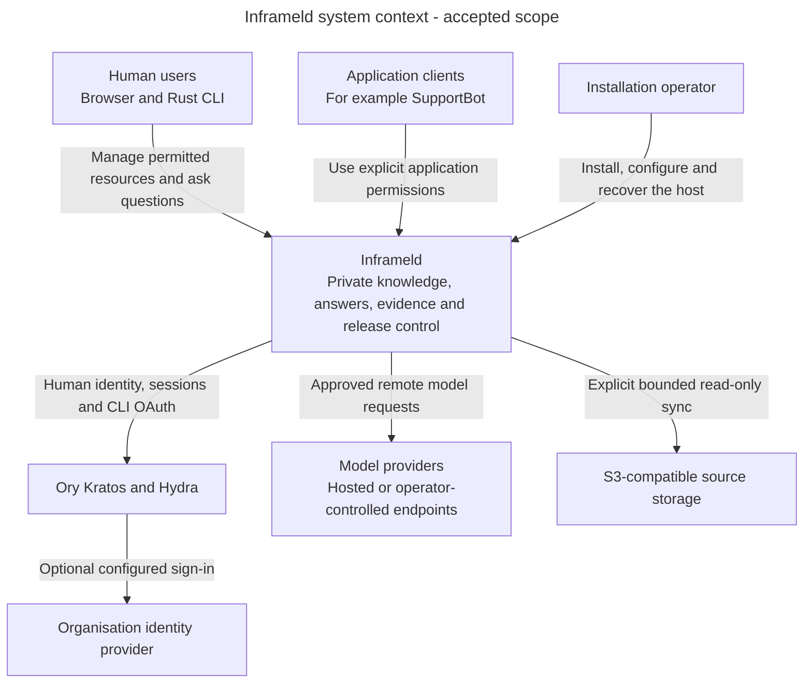

# Inframeld in its surroundings

Alice wants private answers from Support's handbook. SupportBot needs an application identity to ask the same product questions. The operator needs to install and recover the server. These are different relationships with one software system.

This is the **accepted system context**. The Inframeld box means the product as a whole, not one process. External boxes describe dependencies or callers. Some may run on the same server. Their position here does not prescribe hosting or public network access.

Arrows name interactions across the product boundary. They do not grant permission or show code imports. Application keys identify a separate local application account. Human browser and CLI credentials identify the same existing human. Host administration is separate from authority through product APIs.

## What the system promises to coordinate

Knowledge records exact source versions. Indexing prepares verified search data. Pipelines executes captured settings against currently permitted evidence. Evaluation supplies offline comparisons. Releases controls serving selection. Access checks who may do each protected operation now.

A useful answer needs these owners to cooperate. Uploading a file does not itself make it searchable. A ready build does not itself change traffic. A successful historical result does not preserve permission after a grant is removed.

External model calls pass through the shared ModelGateway boundary. Selecting an endpoint does not permit a fallback provider after failure. Source sync uses reviewed saved scope and explicit credentials. Importing configuration does not contact a source automatically.

## Where to zoom next

- Read [System overview](system-overview.md) for processes, storage and trust boundaries.
- Read [Module map](module-map.md) for responsibilities and the owning domain's architecture.
- Read [Document to answer](document-to-answer.md) for Alice's complete product journey.

## Status and sources

This view describes accepted product scope. V1 targets the Rust CLI and small Ory account UI. Full Studio is deferred. The diagram does not establish delivered clients, production identity qualification or measured capacity.

[The product introduction](../../../../docs/ARCHITECTURE.md), [deployment design](runtime-deployment-and-storage.md), [Access](../../inframeld-access-models/references/authorization.md) and [source synchronisation](../../inframeld-knowledge/references/uploads-and-source-sync.md#source-sync) own the details. PostgreSQL, Chroma and SeaweedFS appear in the runtime view because they are parts of the installation rather than independent product users.
