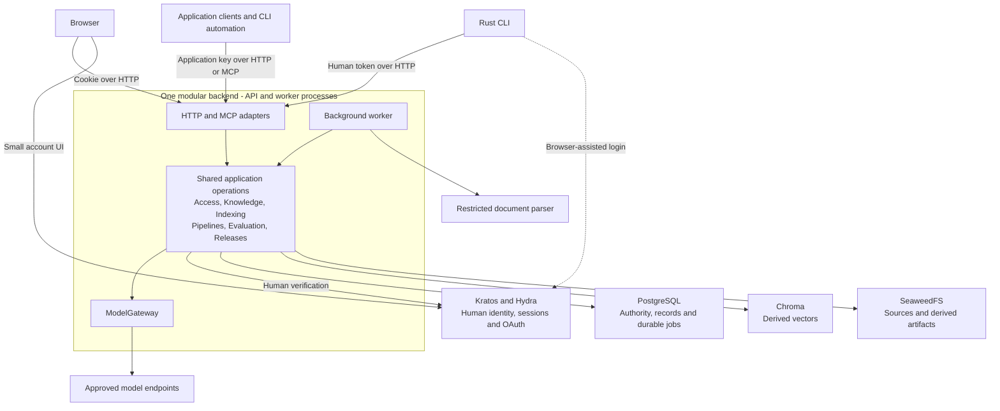

# System overview: runtime topology

Alice runs Inframeld on one server and wants to know where her documents, questions and credentials travel. This is an interaction map of the accepted architecture. It is not a claim that every path is implemented or qualified.

For who uses the product, start with [System context](system-context.md). For logical domain ownership, use [Module map](module-map.md). This view explains where work runs. A process is a running program, while a module is an area of shared code and responsibility.

API, worker, parser, identity services and stores are runtime pieces. The Operations and ModelGateway boxes below represent code responsibilities reused by the backend processes. They do not add a process or service per domain.

## Processes and responsibilities

The API receives product requests. A worker carries out admitted background work. Both use the same backend application operations and domain rules.

A separate restricted parser handles untrusted documents. ModelGateway is the shared outbound model boundary, not a seventh domain or an independently required network service.

Arrows show interactions, not code import directions or a separate service for each box. The operations box represents shared code. Application keys can also be used by the CLI. The human-token arrow describes HTTP access and does not add human OAuth to the accepted MCP profile.

## Follow one request

1. An entry point parses input and establishes the caller's authenticated identity. Access separately checks current eligibility and authority for the operation.
2. The owning application service coordinates rules through application-owned capabilities. A capability describes a job such as loading membership or calling a provider, without exposing vendor types to business rules.
3. A short transaction admits durable work or commits a change and its required audit. The worker later claims the relevant job attempt.
4. Provider calls and document processing run outside SQL transactions. Remote embeddings, generation, judges, repairs and optional probes all use ModelGateway.
5. The current authorized attempt may publish its result. Preparing search data does not itself change Deployment traffic.

Bootstrap constructs concrete dependencies and closes resources. Entry points stay small. PostgreSQL owns current membership, grants, revision coordination and retained operation identity. Chroma must not become an alternative permission or serving-state database.

## Failure and trust boundaries

A valid provider identity does not create a local account or grant permission. OAuth consent, host bootstrap, local product admission and project authorization have different purposes. An operator controls the host without automatically becoming an unrestricted reader through product APIs.

A SQL lease or revision guard can prevent stale publication. It cannot cancel an already dispatched remote call. A timeout therefore does not prove a paid request did no work.

Missing credentials, an unhealthy required shard, unsupported parser isolation or changed authority must follow their documented failure path. None permits an unfiltered or alternate-provider fallback.

## Status and sources

V1 targets a Rust CLI and the small Ory account UI independently of full Studio. Future Studio uses the same generated application contracts and user context. Do not infer deployed UI, complete CLI lifecycle, universal MCP interoperability, production recovery completion or measured capacity from this diagram.

The [architecture introduction](../../../../docs/ARCHITECTURE.md), [application structure](../../inframeld-application-contracts/references/components-and-services.md), [deployment guide](runtime-deployment-and-storage.md), and [ADR-0001](../../../../docs/adr/ADR-0001-use-one-modular-backend-with-clear-domain-boundaries.md) own these boundaries. Use [API contracts](../../inframeld-application-contracts/references/http-mcp-and-generated-clients.md), [MCP](../../inframeld-application-contracts/references/mcp-transport.md) and the [CLI delivery plan](v1-scope-and-extension-boundaries.md) for delivery scope and qualification.
