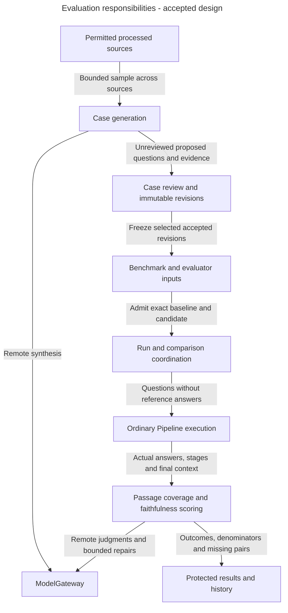
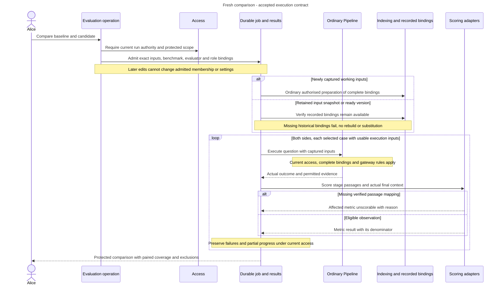

# Evaluation architecture: compare fixed inputs with honest evidence

Alice changes a reranker and wants to know whether answers improve. She needs the same reviewed questions on both sides, fresh execution and clear reporting when a case cannot be scored. An old score or a missing result cannot silently become evidence that the new configuration is better.

## What Evaluation owns

Evaluation owns generated cases, review, immutable case revisions, benchmarks, evaluator revisions, runs, comparisons and protected history. A benchmark fixes case membership and revisions. An evaluator revision fixes how observations are scored. A comparison executes two selected configurations against the same frozen benchmark and evaluator.

Knowledge supplies source identity. Indexing supplies processed passages and coordinates. Pipelines executes ordinary questions. Access protects current source and result access. ModelGateway controls every remote generator, judge and repair call. Evaluation supplies evidence, while Releases retains publication authority.

## Main parts and boundaries

**Accepted responsibility view.** Ragas is an embedded library behind application adapters, not a separate service or owner of durable state.

Arrows show data and execution responsibilities. Generation proposes cases. Review accepts particular revisions. Generation, review and evaluation are separate explicit operations. An evaluation executes questions and scores eligible observations. Setup can finish without any of them.

## Follow a fresh comparison

**Accepted target workflow.** Both sides may be ready versions or captured working inputs. Neither requires a new release build merely to compare settings.

The diagram's result step also requires current inspection authority. Run authority alone does not grant result inspection. An execution failure or lost source access remains an explicit outcome. It does not permit substituting a newer corpus or silently dropping a case. An unavailable historical binding is not rebuilt to make an old input appear runnable.

Faithfulness asks whether the answer's claims are supported by the final context actually supplied to generation. Reference answers and expected passages are evaluation inputs only. They must not leak into Pipeline execution or add missing support to the judge. Passage coverage is a different metric. For example, 16 covered cases among 19 mappable cases plus one unscorable case is 16/19 with one unscorable, not 16/20.

## Data and execution

PostgreSQL retains selected identities, progress and permitted results. Protected source-linked content remains subject to current audiences, source access and erasure. Fixed inputs do not freeze permission or guarantee permanent evidence availability.

Durable jobs save accepted work and progress across watcher disconnection or restart. Preparation and per-case work are bounded. Provider calls stay outside SQL transactions. All nested generation, judging and repairs use ModelGateway. A paid timeout does not authorise automatic redispatch.

Relevant connection-access changes stop later dispatch and identify interrupted or changed-environment evidence. Credential-only rotation and metadata-only rename retain their specific exceptions. Both comparison sides execute freshly rather than subtracting historical scores. Paired coverage identifies cases with comparable observations on both sides. Show missing pairs and their outcomes alongside that population rather than shrinking the benchmark silently.

## What exists today

This is accepted Evaluation design. Ragas compatibility was source-inspected as recorded by the guide, but no Evaluation module, runtime integration or human judge calibration is established by this view. The logical records do not mandate physical tables or one aggregate per concept.

Read [generation and review](generation-and-review.md), [benchmarks and comparisons](benchmarks-and-comparisons.md), [metrics and evidence](metrics-and-evidence.md), [gateway and jobs](gateway-and-jobs.md) and [history and transfer](history-and-dataset-transfer.md) for their own limits.

## Decisions still needed and sources

[ADR-0078](../../../../docs/adr/ADR-0078-separate-evaluation-case-work-run-coordination-and-scoring.md) accepts focused case generation/review operations, run/comparison coordination and scoring adapters. The [owning guide](../../../../docs/development/evaluation.md#evaluation-operation-boundaries) retains exact case/run, per-metric, protected-result and bounded-progress contracts still to specify. Ragas remains embedded, with runtime integration and calibration still unqualified.

[Evaluation](../../../../docs/development/evaluation.md), [Evaluation records](../../../../docs/development/data-model.md#evaluation), [jobs](../../../../docs/development/jobs-and-idempotency.md) and [model connections](../../../../docs/development/model-connections.md) own accepted behaviour and qualification.
