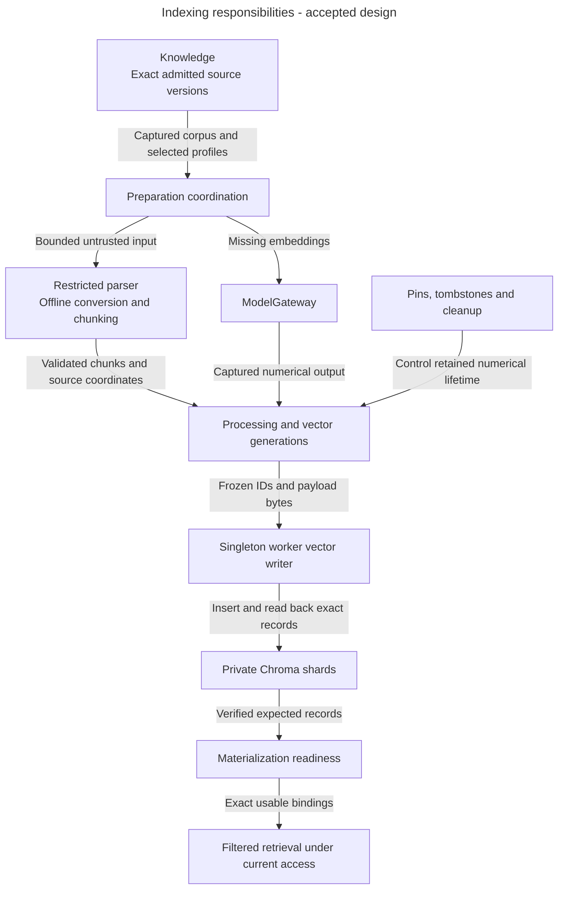
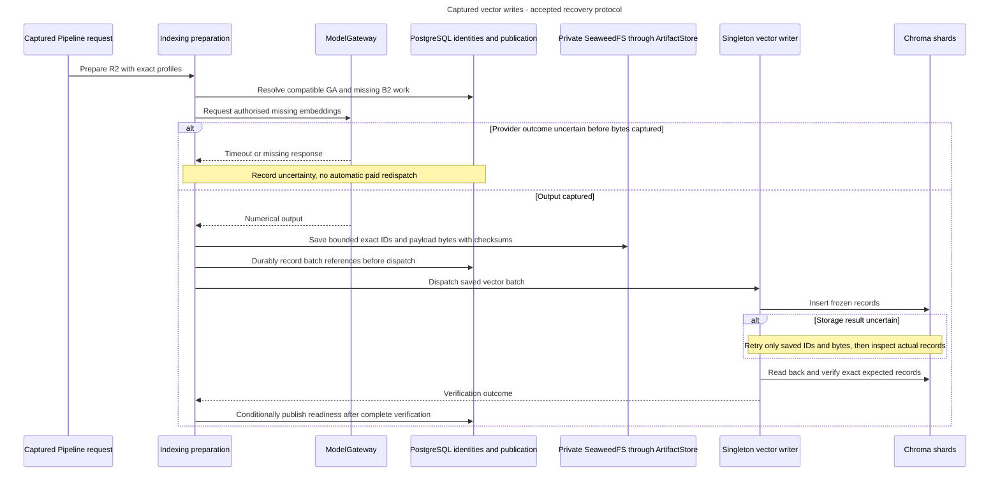

# Indexing architecture: prepare exact data and prove it is usable

Alice admits B2, then an authorized selection includes it in a new revision. The old revision still needs B1's vectors, while the newly selected revision can reuse unchanged A1's vectors. Indexing must prepare only the required new data and prove each selected revision has its complete search bindings.

## What Indexing owns

Indexing owns processing/embedding profiles, processed chunks, numerical generations, physical vector layouts, materialization readiness, permission-filtered retrieval and numerical cleanup. Knowledge supplies admitted source versions and exact membership. Access supplies current permissions. Pipelines requests preparation or retrieval. Releases owns traffic.

A profile fixes settings. A generation identifies actual processing or numerical execution. A materialization is the verified collection of exact source, profile and generation bindings needed to search. These concepts do not each require an aggregate, repository or runtime process.

## Main parts and boundaries

**Accepted responsibility view.** The boxes describe logical capabilities, not implemented types.

Arrows describe data and lifecycle responsibilities. PostgreSQL owns membership, current authority and recorded readiness. Private SeaweedFS artifacts hold processed outputs and exact retry bytes through `ArtifactStore`. Chroma stores derived immutable vectors. A logical Collection is not a physical Chroma shard. API code may read through the retrieval path, while only the supported singleton worker writer mutates Chroma under its process-lifetime lock.

## Follow changed content and an uncertain write

**Accepted target workflow.** GA is A1's retained compatible generation. The new revision selects GA and a new GB2. GB1 remains while R1 needs it.

A storage retry reuses known bytes. A provider timeout before those bytes exist cannot do so. Idempotency recognises original work, and attempt/revision checks stop an obsolete result publishing. They cannot cancel an already sent request. Partial storage success remains unready.

A prompt-only change may reuse a compatible ready materialization. Changing embedding meaning needs a distinct appropriate profile/connection and ordinary preparation. Reject incompatible or unproven shared embedding changes before activation. An alias, matching dimensions or a successful probe cannot prove unchanged numerical meaning.

## Data and execution

Parsing is offline with pinned assets, bounded input/output and worker validation. Unsupported isolation fails without privileged fallback. Every remote embedding uses ModelGateway. Store source/artifact coordinates for text actually returned so Evaluation can measure passage coverage.

A query intersects exact revision membership with current access using server-generated filters. Empty authorised scope performs no Chroma search. A failed required shard fails visibly. Never replace either case with an unfiltered search.

Pins record that work still needs retained data. Tombstones retire identities before resumable deletion, including protection from late writes. Authorised erasure can invalidate historical versions. A historical ready label is not current dependency health or proof of complete erasure.

## What exists today

This is accepted Indexing design. It does not claim an implemented parser coordinator, vector writer or retrieval service. Existing worker/backend assumptions still need the source-specific backend, security, failure and resource qualification in the guide. Reuse does not make full verification free or establish measured capacity.

Read [profiles and preparation](profiles-and-preparation.md), [frozen vector retries](vector-writes-and-retries.md), [retrieval](retrieval-and-filtering.md) and [retirement](retirement-and-erasure.md) for their precise rules.

## Decisions still needed and sources

[ADR-0076](../../../../docs/adr/ADR-0076-separate-index-preparation-retrieval-and-retirement.md) accepts focused preparation/readiness, retrieval and numerical retirement capabilities. The [owning guide](#indexing-capability-boundaries) links accepted [PD-INDEXING-01](decision-capability-binding-contracts.md#approved-resolution) for exact bindings, complete results, unavailable outcomes and pins. Current-health detection and physical cleanup qualification remain separate pending choices. The selected engine, frozen-byte retries and qualification limits remain in force.

[The Indexing guide](profiles-and-preparation.md), [Indexing records](records.md#indexing), [model connections](../../inframeld-application-contracts/references/model-gateway-and-connections.md) and [ingestion security](../../inframeld-knowledge/references/uploads-and-source-sync.md) own the accepted protocols and qualification limits.

## Internal architecture decisions

The component boundaries below are accepted. They explain how to divide responsibilities inside the existing backend. Accepted detailed contracts are linked below. Separately pending choices retain their own triggers. Accepted behavior elsewhere in this guide continues to own permissions, lifecycle and failure rules.

 

### Separate index preparation, retrieval and retirement

**Status:** Accepted in [ADR-0076](../../../../docs/adr/ADR-0076-separate-index-preparation-retrieval-and-retirement.md), with implementation and qualification unfinished.

Indexing has focused preparation/readiness, retrieval and numerical retirement/cleanup capabilities. Preparation and retirement use the supported singleton vector writer. Retrieval exposes permission-filtered reads to query callers. These responsibilities remain inside the existing backend.

Explicit typed bindings identify the exact corpus, profiles, generations and layout passed between these parts. Existing readiness verification, frozen-byte retries, current-health checks and shared retention gates remain authoritative. Reuse the existing jobs and transaction support. This split selects no new vector engine, process or generic workflow framework.

**Accepted contracts, implementation and qualification pending.** Apply [PD-INDEXING-01](decision-capability-binding-contracts.md#approved-resolution) for scoped materialization identities, complete bounded projections and pin lifetime. Apply [PD-INDEXING-03](decision-source-coordinates.md#approved-resolution) for canonical artifacts and source mappings. Current-health detection, backend completion barriers and parser runtime limits retain their own pending choices. These are logical capabilities, not a class, repository or process per box. Exact backend, security, resource and concurrency qualification remains required. A numerical reuse key cannot authorize redispatch of an uncertain paid request.

## Decision references for dependent implementation

Apply accepted entries when their scope matches. Discuss only choices still explicitly pending:

- [PD-INDEXING-01 (accepted): Exchange complete prepared bindings between Indexing capabilities](decision-capability-binding-contracts.md). Before defining preparation, retrieval or retirement application ports and their complete input/result records.
- [PD-INDEXING-02: Define what current index health can actually detect](decision-health-observation.md). Before implementing reconciliation, ongoing serving-health checks or claims about how quickly storage loss is detected.
- [PD-INDEXING-03 (accepted): Keep source passage identity stable when chunking changes](decision-source-coordinates.md). Before defining parsed artifact identities, source-span fields, chunk transformation mappings or passage-coverage implementation.
- [PD-INDEXING-04: Qualify frozen storage retries and final erasure barriers](decision-storage-retries-and-erasure.md). When implementing frozen-write retry/retirement adapters, selecting artifact completion mechanics or qualifying final-erasure claims.
- [PD-INDEXING-05: Select and prove a bounded parser runtime](decision-parser-runtime-profile.md). Before fixing parser numerical limits or shipping the assembled parser image/sandbox/host profile.
