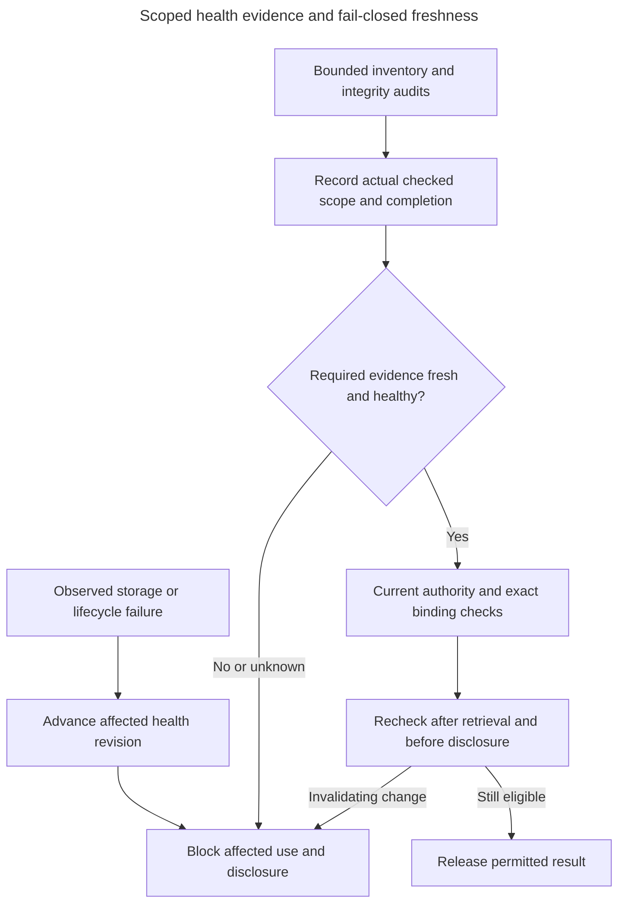

# PD-INDEXING-02: Define what current index health can actually detect

**Status:** ACCEPTED on 2026-10-29 in [ADR-0118](../../../../docs/adr/ADR-0118-audit-index-health-with-explicit-freshness-and-unknown-outcomes.md). Implementation and qualification remain separate delivery work.

**Owner:** `inframeld-indexing`

The developer explicitly approved the presented batch-4 contracts and delegated selection of all remaining decisions to the assistant on 2026-10-29, requesting repository/GitHub recording and plain-language justification. This resolution is accepted under that authority. It selects logical policy, not implemented code or passing qualification.

## Contents

- [Approved resolution](#approved-resolution)
- [Why and example](#why-and-example)
- [Implementation and required evidence](#implementation-and-required-evidence)
- [Architectural impact and dependencies](#architectural-impact-and-dependencies)
- [Historical context and alternatives](#historical-context-and-alternatives)
- [Sources and finalization](#sources-and-finalization)

## Approved resolution

Use bounded periodic plus event-triggered Indexing verification with separately recorded scope and freshness. Inventory/identity/placement audits are due every 5 minutes, have a 2-minute execution deadline and maximum accepted successful observation age of 10 minutes. Full numerical/content-integrity audits are due every 12 hours, have a 30-minute deadline and maximum accepted successful age of 24 hours. Initial complete readiness verification supplies the initial evidence only for the checks it actually performed. Record trusted manifests, checked generation/shard set, counts/hashes, check kind, observed storage/health generation, start/completion and outcome. A health revision is a change counter, not a sensor or an assertion that every fault is instantly detectable.

Use 128-record pages, at most 8 MiB per read and one external audit read in flight. Compare exact IDs, immutable metadata and recorded placement against the complete expected inventory; compare actual canonical numerical/content fingerprints to trusted frozen manifests in the full check. A stored hash copied from the expected metadata is not proof of actual bytes. Preserve the supported immutable-payload/engine interpretation and report unqualified behavior rather than inventing a tolerant success.

Run the bounded read-only audit activity in an existing runtime independently of ordinary FIFO job admission. No new broker or product-worker pool is added, and no audit path mutates Chroma. Give near-due inventory checks priority between bounded full-audit pages so a long integrity pass cannot silently extend inventory freshness. Both deadlines still apply; budget exhaustion makes the relevant observation stale/unknown. Record current failure/recovery health transitions through the ordinary short Indexing SQL capability.

Observe failures, corruption, missing/misplaced records and lifecycle inconsistencies immediately when discovered. Invalidate the affected required generation/shard and advance its health revision. Trigger bounded rechecks after storage errors and before private reopening after restore or untrusted storage restart. A failed unrelated candidate does not invalidate independent healthy serving data. A stale audit/fence cannot clear a newer failure; recovery publishes a new healthy revision only after required full verification for the affected dependency succeeds.

Unknown/stale required observations block affected admission, retrieval, provider disclosure and final result release under the existing dependency checks. Do not return partial or unfiltered answers, extend timestamps because the audit task is delayed, or substitute another generation. Pinning protects ordinary lifetime, not health. Continue after a fresh eligible explicit operation under current checks, never automatically repeat a possibly paid call. Source erasure retains its immediate stronger rule.

Qualification must demonstrate the selected omission/corruption detection windows, actual readback semantics, mixed-load cost, freshness expiry and recovery on the chosen profile. Until tests pass, publish no detection guarantee. Even qualified periodic observation allows a fault to exist between checks; returned-result validation and SQL revisions cannot detect every unobserved omission at once. No full-corpus scan is added to every query.

## Why and example

An index can lose a record without returning an error. Periodic checks can discover that omission, but a ready label or unchanged counter cannot discover it by itself.

Bob accidentally loses one vector that Alice's current query would never retrieve. The inventory audit detects the missing ID. If audits stop running, health becomes unknown after its freshness limit and affected serving stops.

Audits consume predictable reads and can temporarily block service when freshness cannot be proved. They give an explicit detection window without pretending every query verifies every vector.

## Observation and use sequence

The audit runs independently of ordinary FIFO job admission, with one external read at a time. An unchanged revision cannot discover an unobserved fault.

## Apply the accepted contract

Use this contract when the original trigger matches. Do not ask for the same policy decision again. Concrete native methods, DTO names and physical schemas are implementation choices consistent with this contract and the repository conventions. Missing measurements, fixtures or assembled evidence block the affected qualification/support claim, not authorized implementation or isolated tests. A failed test is not permission to weaken an accepted safety boundary.

## Implementation and required evidence

Silent omitted/misplaced/corrupt record, known failure/recovery race, stale audit completion, independent candidate, missed deadlines under long jobs, read bounds and private restore/restart verification.

These are required checks, not tests run or successful production evidence. No application edits, paid calls or production changes follow merely from recording this decision.

## Architectural impact and dependencies

Indexing health projection/reconciler, Pipeline pre-send/disclosure checks, Releases usability, operational readiness and restore. Update health-observation and invalidation sequences.

Load neighboring decisions only under these conditions:

- [PD-ARCHITECTURE-01 (accepted): Select a measured supported workload and resource envelope](../../inframeld-architecture/references/decision-supported-operating-envelope.md). For verification cost and acceptable operating bounds.

## Historical context and alternatives

The following preserves the earlier problem, context and options. Statements that a choice was open describe that earlier analysis. The approved resolution above now settles it.

### Original problem and example

Historical analysis before this resolution.

One published Chroma record disappears while its shard still answers searches. Alice asks a question whose nearest results never include that missing record. Validating returned results succeeds, and an unchanged SQL health revision cannot reveal an omission that nobody has observed.

Readiness verification and invalidation of known unhealthy dependencies are accepted. Normal-operation detection triggers, observation scope, freshness and unknown-health outcomes are not selected. The design does not promise instant detection of every silent external loss.

### Original accepted context and evidence

Historical context before this resolution. Unchanged invariants still apply.

Build verification checks expected inventory and selected bytes. Queries validate returned identities/content references and compare dependency-health generations at the documented boundaries. Restore verifies dependencies privately. Reconciliation belongs to Indexing.

A health generation is a revision that changes when a known condition changes. It is not a sensor. A successful health observation establishes only its checked scope. Already-sent content cannot be recalled, and no observation makes remote state atomic with PostgreSQL.

### Considered alternatives and trade-offs

Historical options, resolved by the approved contract above.

1. **Bounded periodic plus event-triggered audits.** Check defined inventories/integrity on a schedule and after failures or lifecycle events. This offers an explicit detection window at controlled cost, but silent loss may persist between observations.
2. **Broader use-time verification.** Verify more of a selected dependency before using it. This narrows some detection gaps, but can make normal queries expensive and still needs a precise scope rather than a universal health claim.
3. **Demand-triggered checks with an explicit limited guarantee.** Rely on build, restore, observed failures and returned-result validation, clearly disclosing what is not continuously detected. This is simpler, but supports weaker ongoing integrity assurances.

## Sources and finalization

- [Health and retention protocol](retirement-and-erasure.md#retirement).
- [Remaining health contract](architecture.md#indexing-capability-boundaries).
- [Materialization records](records.md#indexing).
- [Restoration checks](../../../../docs/development/operations/upgrades.md).

Follow [decision finalization](../../../../docs/development/guides/architecture-decisions.md#just-in-time-architecture-decisions) for a later change to this accepted policy. Qualification evidence must identify its artifacts, environment, failures and limits. This record does not fabricate implementation or a passing test.
