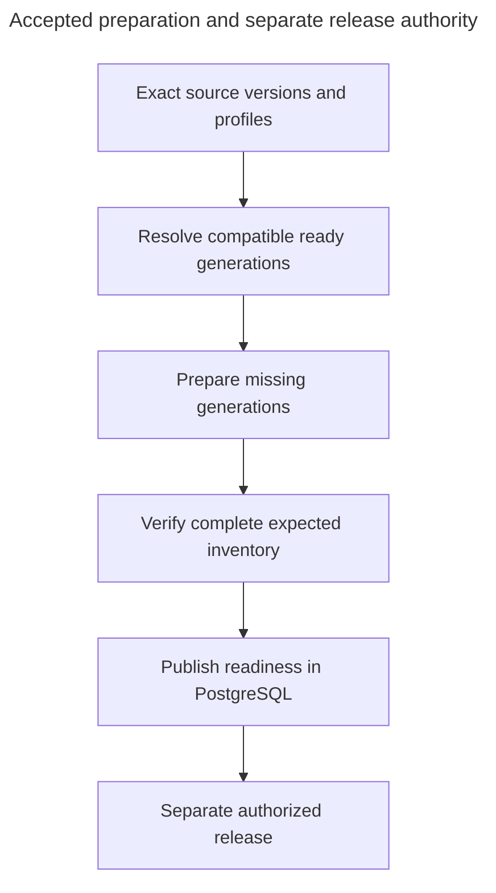

# Verify the exact prepared search data

Alice changes B1 while A1 remains unchanged. Reusing A1 saves numerical work, but Indexing must still verify the complete expected data for the selected revision. A total vector count cannot establish that every required record is correct.

## Return exact verified bindings

Accepted [PD-INDEXING-01](decision-capability-binding-contracts.md#approved-resolution) returns the existing scoped IndexMaterialization identity and the complete typed projection needed by each consumer. It fixes exact corpus membership, profiles, index/layout, generation manifests, expected/verified hashes and counts, per-shard completion and observed health generation. Large inventories remain immutable paged manifests. Pending or failed preparation is not a ready binding.

Resolve selected usable dependencies and acquire the operation pin in the same short retention-gate transaction. A missing, retired, incompatible or unconfirmed required dependency fails without selecting newer data, hidden re-preparation or partial retrieval. Readiness is separate from current authority and health. The complete contract owns pin lifetime and safe unavailable outcomes.

## Prepare and verify a materialization

### Distinguish a model migration from an unsafe shared update

Alice's documents were embedded with model A. Selecting model B for a direct query is allowed, but querying A's vectors with B's query embedding is not. A matching array length does not make two vector spaces compatible. The model/profile selection describes requested behavior. A verified materialization supplies matching prepared data.

| Situation | Required result |
| --- | --- |
| **Choose another embedding model or vector-space setting** | Save the appropriate new immutable profile and Pipeline working revision, or admit an explicit per-request override. This alone makes no model calls and changes no live data. |
| **Direct query or Build with that profile** | Reuse genuinely compatible ready data, otherwise disclose and admit ordinary preparation. New numerical outputs get new generation identities. No retrieval until complete matching bindings are verified. |
| **Try to query mismatched model/profile and prepared data** | Block before incompatible retrieval. Do not silently choose the old model, search anyway or start unapproved re-embedding. |
| **Edit shared connectivity while prepared or in-progress data depends on it** | Reject the entire connection update if it changes vector meaning or compatibility is unproven. Leave access settings, credentials, profiles and old data unchanged. |
| **Rotate a credential or rename metadata without changing the access/model contract** | No new embedding profile or vectors solely for that change. Required credential, response and current access checks remain. |

The connection-update guard considers all retained prepared dependencies and admitted preparation, not just live Deployment pointers or dependencies visible to the manager. Coordinate new dependency admission and updates so concurrent preparation cannot create a gap. A historical index kept for rollback is still a dependency. Ordinary reference-aware retirement is separate, not an automatic way around rejection.

Use the profile's explicit expected provider/model identity, known model revision where supported, dimensions, normalization, metric and relevant model-input settings to check meaning. In v1, changing provider, endpoint/base path or provider API version is not presumed compatible with existing data. Supported identity evidence may establish compatibility. An alias, dimensions or optional probe alone cannot. If it cannot be established, the shared update is rejected. This does not require a synthetic probe before ordinary model use or promise detection of unannounced provider-side changes.

Offer the isolated migration: create another connection when access settings must change, select the appropriate new profile, prepare it, query/evaluate, then Build and release. Compatible processing artifacts can be reused. Old vectors are neither relabelled nor overwritten. [Model connections](../../inframeld-application-contracts/references/model-connection-changes.md#connection-compatibility) owns the shared-update operation and [ADR-0054](../../../../docs/adr/ADR-0054-use-shared-current-model-connections.md) records the decision.

Numerical execution records the actual access revision used. Profiles reference a connection ID, not an executable historical access revision. A relevant access change observed during admitted work stops remaining model dispatches under [the dispatch contract](../../inframeld-application-contracts/references/model-dispatch-and-destinations.md#dispatch-freshness). Previously captured vector payloads retain their identity and ordinary safe-storage recovery rules. That does not authorize another model call or certify incomplete work ready.

The arrows show the order of work. Indexing prepares and checks the data. Releases decides whether a ready version receives traffic. Both are parts of the same backend.

### Separate the build and release steps

| Phase | Application / PostgreSQL work | Processing, model, or Chroma work |
| --- | --- | --- |
| **Admit B2 and R2** | Store the source version and exact R2 membership. Request M2 as unready. | No existing vectors change. |
| **Prepare missing work** | Resolve reuse keys, select GA/GC, admit GB2, and record bounded progress and frozen payload references. | Parse/chunk B2 in the isolated processor. Obtain two embeddings through `ModelGateway`. Insert b2.1/b2.2 into their recorded shards. |
| **Verify M2** | Read the expected six-record inventory and check dependencies. | Verify the new numerical records. Check expected IDs, immutable metadata, and placement for all six records, including GA/GC. |
| **Publish readiness** | Conditionally mark M2 ready after every required check passes. | No membership metadata update. |
| **Evaluate and release** | Evaluate P-V2. Authorized commands attach it, enable a canary, or promote its Deployment pointer. | Queries use the selected version's filter. Promotion itself writes no vectors. |
| **Retire R1 ordinarily** | Wait for deployment, build, rollback, and query references to end. Revoke unused GB1's reuse and tombstone it. | Delete b1.1/b1.2 when safe. Do not write to GA/GC. |

A **tombstone** permanently marks a physical identity as retired so it cannot be reused or made live again. The full retirement protocol appears below.

A build saves the exact Pipeline configuration, collection revisions, and profiles it will use. Later Pipeline edits do not replace those choices. Shared connections remain current operational dependencies: changed admitted access revisions stop further model dispatch instead of selecting old access settings. Finishing a build and sending traffic to it are separate actions.

The application may reserve a PipelineVersion ID when a build starts. It publishes the complete version, including its fixed references to prepared data, only after every required materialization is ready. A **materialization** is the verified search data for an exact collection revision and set of profiles.

### Preparation can serve a direct query without creating a release version

Alice may query the Pipeline with a different reranker before building any PipelineVersion. [Pipelines](../../inframeld-pipelines/references/direct-queries.md#preview) captures the effective configuration and exact corpus, then asks Indexing for compatible verified materializations. A changed reranker usually reuses them. Changed chunking or embedding semantics may require new processing/vectors. Disclose and admit that preparation with its cost and limits, using the same worker, gateway and verification behavior as a release build.

Indexing supplies immutable prepared bindings to the execution-input snapshot, not a Deployment pointer or release-ready version. Unready, missing or incompatible bindings block questions and evaluations. Preparation completion never authorizes publication. Existing live generations remain untouched, and query-preparation inserts follow the same single-writer, uncertainty and cleanup rules. A direct query is not a second index engine or permission to query a partial index.

Active direct-query work uses bounded artifact pins. Retaining snapshot metadata does not permanently retain every numerical generation. A release build can reuse still-compatible verified outputs, but must not silently reconstruct missing historical numerical data or claim that changed bindings were evaluated. Source erasure and present health checks apply to both direct Pipeline and live execution.

A prompt-only pipeline version can reuse M1 without another physical collection or vectorization. Retaining R1 does not preserve old access rights: current permissions can exclude B from either revision.

### Verify the materialization, not the shard's global count

M2 expects six records even though its shared shards contain eight while R1 is retained. A total count of eight proves neither that M2 is wrong nor that all six required records exist. Check M2's exact inventory using the [verification rules below](#record-and-verify-the-exact-expected-data). Missing records, incompatible profiles, wrong placement, or fingerprint conflicts block publication.

### Bounded memory does not mean constant total work

Reusing vectors saves model calls and writes. It does not remove the work of assembling and checking the collection.

If a revision contains **D** document-version memberships and **N** chunks, assembling its manifest can read or copy D memberships. Verification can read N records even when Alice changed only one document. These are the O(D) and O(N) costs used in the estimates below. Preparing an authorized search filter also grows with the number of permitted generations.

Reading a limited-size page at a time keeps memory use under control. It does not reduce the total number of records to check. **Only changed chunks need new Chroma inserts, but a release still does work across the larger collection.**

### Admit sources once and prepare additional profiles on demand

Alice uploads a document once. She does not choose an embedding profile for every file. Later builds can process that same source under different supported parsing/chunking settings and model profiles.

The project or build selects those profiles. The application records the document version, reuses a compatible processing result when one exists, and requests new embeddings only where needed. Producing those numerical embeddings is called **vectorization**.

Creating a profile first saves it in PostgreSQL and queues its setup. The worker prepares the required configuration and storage afterward. The database transaction does not wait for Chroma setup, and creating a profile does not immediately re-embed the entire project.

| Change | Required behavior |
| --- | --- |
| **Create an additional profile** | Record and provision it asynchronously. Index data under it on demand, rather than silently multiplying model cost and memory use. |
| **Change the embedding model, dimensions, normalization, distance metric, or semantic gateway behavior** | Create a new immutable embedding profile. Semantic behavior means what vectors the configured connection/model produces, not merely which credential permits the call. |
| **Rotate a credential without changing semantics** | Do not create a new embedding profile solely because the secret changed. |
| **Change the processing profile** | Produce new chunks and embeddings where required, reusing the original unchanged source bytes rather than requiring another upload. |
| **Change only the prompt with the same collection revision and profiles** | Reuse the ready materialization. |

Show progress for each step separately: accepting the source, processing it, setting up a profile, producing vectors, creating the logical revision, and verifying its materialization. A single “ready” flag would hide which work is complete.

V1 offers supported processing profiles. Arbitrary parser or chunker plugins are deferred. The application-owned processing interfaces leave room for them without requiring a plugin system now.

### Preserve source coordinates for evaluation

An expected passage can remain the same when a new chunking profile divides it differently. Expose the DocumentVersion, immutable canonical conversion-artifact identity, and source spans for processed passages and returned chunks under accepted [PD-INDEXING-03](decision-source-coordinates.md#approved-resolution). Coordinates are zero-based Unicode code-point half-open ranges in the exact stored canonical text. Normalize LF before coordinates and preserve other Unicode, case and whitespace. Conversion identity excludes chunk-only settings, allowing different chunking generations to share genuinely identical canonical parsed content. Generation-scoped chunk IDs alone cannot establish equivalent evidence. Truncated generation context needs mappings for the retained text, not the original full chunk.

[Evaluation](../../inframeld-evaluation/references/passage-coverage.md#passages) owns the full-coverage calculation and freezes expectations from already processed text. It needs no additional parsing, embeddings, or relationship graph for its starter preset. If parser outputs lack a verified shared coordinate mapping, report that limitation: Evaluation marks the case unscorable rather than guessing from text similarity. These mappings and conversions still require implementation qualification. This is not a guarantee of arbitrary cross-parser compatibility.

### Verify a materialization before publishing its readiness

The [materialization record](records.md#materialization-record-and-lifecycle) identifies the exact collection revision, profiles, index, and saved shard layout. Complete verification makes it ready. Losing a required dependency later can make it stale.

A half-finished materialization cannot serve as a partially ready one. When automatic retries run out, keep the same job ID and show that the retry budget was exhausted. An explicit safe resume follows the [job recovery rules](../../inframeld-application-contracts/references/jobs-and-recovery.md).

### Record and verify the exact expected data

Save the selected generation IDs, expected and verified immutable manifest hashes, record counts, progress for each shard, and publication state. These records explain what was checked and what remains.

Verification has two related responsibilities:

| What is being verified? | Required evidence |
| --- | --- |
| **A new physical vector generation** | Check the actual numerical records against their frozen payload. An expected hash copied into record metadata is not proof that the stored vector matches. |
| **A new materialization** | Initially read all expected IDs, immutable metadata, and placement in bounded pages. Reuse already-verified numerical-generation evidence and perform targeted checks of actual bytes. |

For a membership-only change, reuse the earlier numerical-verification evidence without downloading every coordinate again. Targeted checks still inspect actual bytes. Read the required inventory in limited-size pages so verification does not load it all into memory.

After checking the data, make one short PostgreSQL transaction confirm that this attempt still owns the job and that its dependencies and lifecycle still allow publication. Mark it ready only if all those checks pass together.

Adding or retiring a revision does not change shared ready vectors. PostgreSQL records membership. The [saved-write procedure](vector-writes-and-retries.md#retries) governs changes to physical records.

### Full verification still has a cost

Measure the [membership and verification reads](#bounded-memory-does-not-mean-constant-total-work) as well as saved writes. A one-document update can still require checks across the whole collection.
