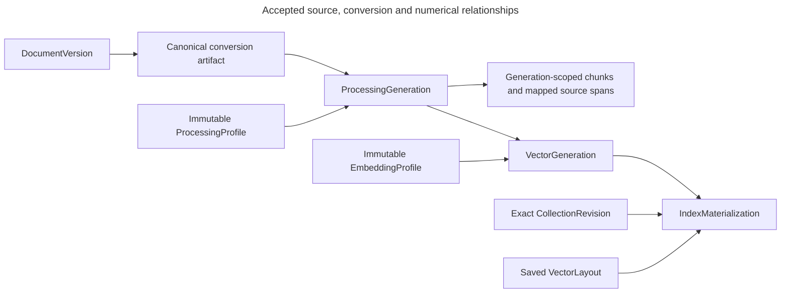

# Index profiles, generations and bindings

<a id="index-profiles-generations-and-bindings"></a>

Alice changes B1 while A1 is unchanged. Indexing can reuse compatible A1 data and create a new numerical generation for B2. The records below distinguish requested meaning, actual output and verified searchable bindings.

> **Status:** accepted behavior is stated separately from proposed representations and qualification work. Existing Python types, generated OpenAPI and migrations own implemented shapes. Pending decisions are not accepted by this reference.

<a id="indexing"></a>

<a id="indexing-profiles-generations-and-materializations"></a>

## Apply accepted PD-INDEXING-02

Accepted [PD-INDEXING-02](decision-health-observation.md#approved-resolution) selects this workflow's detailed contract. An index can lose a record without returning an error. Periodic checks can discover that omission, but a ready label or unchanged counter cannot discover it by itself. Apply its exact bounds, current-state checks and failure outcomes. Native implementation and qualification remain separate.

## Indexing: profiles, generations, and materializations

<a id="distinguish-sources-processing-results-indexes-and-bindings"></a>

### Distinguish sources, processing results, indexes, and bindings

Knowledge records which source versions belong to a collection revision. Indexing records how those versions were processed and made searchable. Collections can share prepared vectors rather than keep private copies.

A **chunk** is an excerpt produced by processing a document. An **embedding** is a numerical vector representing text for similarity search.

| Concept | Responsibility |
| --- | --- |
| **`ProcessingProfile`** | Immutable parser/chunker behavior: how the source is read and divided into chunks. |
| **`ProcessingGeneration`** | The resulting chunk evidence for a document version processed under that profile. |
| **`EmbeddingProfile`** | Immutable vector-space configuration: semantic gateway routing, model, dimensions, normalization, and distance metric. Dimensions specify the number of values in a vector. Normalization and the metric determine how vectors are prepared and compared. |
| **`VectorGeneration`** | One immutable physical numerical execution for a document processing generation and embedding profile. It owns its record IDs and frozen manifest evidence. A manifest is an inventory of expected records, identities, and verification information. |
| **`VectorIndex`** | The application’s profile-specific search resource. It is not necessarily one physical Chroma collection. |
| **`VectorLayout` / `VectorShard`** | The immutable placement contract and the physical shard references. A shard is a partition of the index. The layout records how records are placed. |
| **`IndexMaterialization`** | A verified binding of one collection revision and profile combination to exact physical generations in one layout. It identifies the searchable data required for that revision. |
| **`PipelineIndexBinding`** | An immutable reference from a pipeline version to a ready materialization. It selects existing verified index data rather than copying it into the pipeline. |

<a id="profiles-describe-behavior-not-just-names"></a>

### Profiles describe behavior, not just names

An immutable embedding profile identifies its organization/project, selected connection ID, expected provider/model identity or alias, dimensions, normalization, and distance metric. It does not select a historical connection access revision. Numerical executions record the actual access revision and observed provider model identity separately under [shared connectivity](../../inframeld-application-contracts/references/model-connection-changes.md#shared-current-connections).

A change that can alter vector meaning creates a new profile. Credential rotation alone does not, provided the semantics remain unchanged.

The connection's current access configuration must remain compatible with prepared and in-progress data. Reject an incompatible or unproven shared update before mutation under [Indexing's compatibility rule](materialization-verification.md#embedding-compatibility). A new profile does not make old vectors compatible. Ordinary preparation must supply verified matching data before retrieval.

An immutable processing profile identifies parser/chunker behavior and implementation. Its processing generation identifies the resulting chunks.

<a id="keep-compatibility-separate-from-physical-execution"></a>

### Keep compatibility separate from physical execution

| Identity | Purpose |
| --- | --- |
| **Semantic reuse key** | Organization/project + document version + processing generation + embedding profile. It finds compatible, healthy, ready work without another model call. |
| **Physical vectorization generation** | One immutable numerical execution, or incarnation, for that key. It has a unique, never-reused generation ID, an exact manifest, and frozen write batches. |
| **Physical record ID** | A versioned, deterministic encoding or hash of organization/project + vectorization-generation ID + chunk ID. The generation ID is part of the **record ID**, not only metadata. |

**A fresh model response must never overwrite a retained generation.** Different numerical output requires a new physical generation and therefore different record IDs, even when the semantic reuse key is unchanged.

Logical collection and pipeline IDs are not part of vector identity. Compatible collections and pipelines can therefore share the same physical records.

For each reuse key, PostgreSQL coordinates one decision at a time: use a ready generation, join work already being built, or accept one new attempt. An attempt that loses ownership cannot publish. Unreferenced attempts are cleaned up rather than selected for serving.

Each Chroma record contains explicit embeddings, immutable chunk content or a content reference, and immutable scope/profile/document/generation/chunk metadata. It contains **no mutable revision membership, permission-group list, or serving flag**.

PostgreSQL tracks generation state and manifest references. It does not need a row for every vector. Read large inventories and artifacts in limited-size pages.

<a id="physical-layout-and-sharding"></a>

### Physical layout and sharding

One application vector index belongs to an organization, project, and embedding profile. Its immutable layout records the placement-algorithm version, fixed shard count, and physical shard references.

The physical namespace includes:

```text
organization_id + project_id + embedding_profile_id + layout_id + shard_id
```

The saved layout and stable record identity determine where a record goes. Placement must not depend on a process-local hash or how many containers happen to be running.

**Changing the layout is a deliberate migration, not an environment-variable edit.** Do not create a Chroma collection for every logical collection, revision, or pipeline.

The same bounded write, verification, and query paths work with one or several shards. Qualification must include at least two.

In the supported installation, S0 and S1 are Chroma collections **inside one server on one host**. They divide the records between them rather than copy them. They share CPU, memory, and the consequences of server or host failure. Two shards do not provide high availability or double the machine's capacity.

Automatic re-sharding, several writer hosts, distributed Chroma, and Kubernetes are deferred. The saved layout and adapter interface leave room for migration work, but do not make switching backends effortless.

<a id="convert-documents-into-application-owned-artifacts-and-chunks"></a>

### Convert documents into application-owned artifacts and chunks

A **port** is an application-owned interface describing a capability. An **adapter** implements that interface using a particular library or runtime.

| Port | Responsibility |
| --- | --- |
| **`DocumentProcessor`** | Converts an admitted input into a canonical parsed artifact whose structure is defined by Inframeld. Admission means the application has accepted the input for processing. |
| **`Chunker`** | Produces bounded chunk candidates with source spans. A source span identifies where an excerpt came from in the original document. |

A **canonical parsed artifact** is the application’s standard representation of a parsed document. Downstream code uses that representation rather than needing to understand Docling’s internal objects.

The logical data flow is:

```text
Admitted source document
    -> DocumentProcessor
        -> Application-owned parsed artifact
            -> Chunker
                -> Bounded chunk candidates with source spans
```

Docling supplies the built-in PDF, Markdown, and text adapter. Translate its objects into Inframeld's representation at that boundary. **Domain and application contracts must not expose Docling types, and saved artifacts must not rely solely on Docling's own format.**

This keeps the processing result understandable to the application independently of the library that produced it.

### Canonical conversion identity and coordinates

Accepted [PD-INDEXING-03](decision-source-coordinates.md#approved-resolution) separates canonical conversion identity from downstream chunking. Bind the exact DocumentVersion, scoped format/version, converter implementation/assets/settings and canonical content/structure digest. Exclude chunk-only settings and execution timestamps. Separate ProcessingGenerations can share the same genuinely identical canonical artifact without sharing chunk identities.

Preserve structured block/table provenance and a deterministic reading-order text stream, with LF block/row separators and TAB cell separators. Normalize line endings before coordinates, otherwise preserve Unicode code points, case and whitespace. The full contract covers embedded delimiters and cell identity. Source spans bind exact version/artifact and zero-based Unicode code-point [start,end) ranges. Returned text carries explicit ordered segment mappings. Discontiguous spans stay separate, repeated mapped headers count once and synthetic text has no invented source coordinates. Different conversion output requires proven correspondence or an explicit unscorable comparison.

<a id="record-processing-choices-in-an-immutable-profile"></a>

### Record processing choices in an immutable profile

A processing profile fixes how source bytes become parsed content and chunks. Changing those settings creates a new profile instead of changing the meaning of an existing one.

The profile records supported formats, tokenizer and chunking behavior, processing limits, and parser/model identity. Supported bounded options include hybrid chunking, chunk-token limits, peer merging, and table-header behavior.

| Option | What it controls |
| --- | --- |
| **Hybrid chunking** | The supported chunking strategy that combines document structure with token-size constraints. |
| **Chunk-token limits** | How much text a chunk may contain, measured using the configured tokenizer. |
| **Peer merging** | Whether compatible peer chunks can be combined within the supported limits. |
| **Table-header behavior** | How table-header information is handled in processing and chunk output. |

These are supported configuration choices, not permission to install an arbitrary chunking implementation.

**Optical character recognition (OCR)** reads text from images, such as scanned pages. It is available only with explicitly supported assets and processing limits. PDF support alone does not promise every OCR configuration.

<a id="a-profile-change-creates-new-processing-results-not-another-upload-requirement"></a>

### A profile change creates new processing results, not another upload requirement

A **processing generation** identifies the result produced from a source under a particular processing profile. Changing the profile creates a new generation. The unchanged source bytes do not need to be uploaded again.

For example, changing a chunk-token limit creates a new processing configuration and generation for the existing source. It must not rewrite the old generation’s meaning.

Start the user experience with a tested preset. The profile editor can expose more supported options later, but a simpler interface must not remove the underlying profile and generation identities.

<a id="source-and-numerical-identity"></a>

### Source and numerical identity



The arrows show required inputs and references. Reusing a processing result requires matching source version, implementation, model/tokenizer revisions, and every setting that can affect output. Chunk IDs belong to their ProcessingGeneration. Compatible vectorization inputs can reuse a ready VectorGeneration. A new numerical execution always gets a new physical identity.

<a id="materialization-record-and-lifecycle"></a>

### Materialization record and lifecycle

An IndexMaterialization binds `collection_revision_id + processing_profile_revision_id + embedding_profile_id + vector_index_id + layout_id`. Save its exact generation references, expected and verified manifest hashes, counts, and progress per shard. Its lifecycle is `requested → indexing → ready | failed`. Ready data can become stale if a verified dependency becomes invalid or unavailable.

A manifest is a fixed inventory, read in pages when large. Its hash can verify identity but cannot reconstruct missing vector numbers. Indexing owns readiness and current dependency health. Pipelines owns the references to that data.

A health generation changes on loss, corruption, and recovery, but not unrelated candidate insertion. Pins protect active use against ordinary retirement. Once a generation ID is permanently retired, it is never reused.

The [Indexing guide](profiles-and-preparation.md) explains verification, saved-write retries, search filters, pins, and cleanup. PostgreSQL's current state determines the allowed search filter. Clients do not supply that authority, and vectors do not store changing collection membership, permission groups, or serving flags.

### Prepared-binding projection

The existing IndexMaterialization is the compact scoped binding reference under accepted [PD-INDEXING-01](decision-capability-binding-contracts.md#approved-resolution). Its trusted projection references exact collection membership, processing/embedding profiles, index/layout, processing/vector generations, expected/verified manifest hashes/counts and per-shard verification completion. Observed lifecycle/health facts remain distinct from immutable verification evidence. Large inventories are immutable paged manifests. Consumer binding sets must include every required materialization. These logical records prescribe no new public DTO, physical table or duplicate binding aggregate.

<a id="indexing-application-boundaries"></a>

### Indexing application boundaries

[ADR-0076](../../../../docs/adr/ADR-0076-separate-index-preparation-retrieval-and-retirement.md) separates preparation/readiness, retrieval and numerical retirement capabilities. They exchange exact typed bindings while preserving the singleton vector writer and shared retention gates. Accepted [PD-INDEXING-01](decision-capability-binding-contracts.md#approved-resolution) selects the existing scoped materialization identity, complete bounded projections, immutable paged inventories, unavailable outcomes and operation-owned pins. Accepted PD-INDEXING-02/04 select the health and physical-cleanup policies, with qualification still required.

<a id="authoritative-application-state"></a>

### Authoritative application state

Collection L initially has revision R1. Document B changes from B1 to B2, creating revision R2.

The tables describe the information the application needs, not a finalized SQL schema. A large inventory of records can live in an immutable SeaweedFS manifest, meaning a saved list that cannot change. PostgreSQL records its identity and whether it has been published.

| Application record or manifest | R1 | R2 after verification |
| --- | --- | --- |
| **Logical collection** | L | The same L. |
| **Exact membership** | A1, B1, C1. | New membership A1, B2, C1. R1 is unchanged. |
| **Selected physical generations** | M1 maps A1 → GA, B1 → GB1, C1 → GC. | M2 maps A1 → GA, B2 → GB2, C1 → GC. |
| **Profiles and layout** | PP1 / E1 / I / LAYOUT1. | The same PP1 / E1 / I / LAYOUT1. |
| **Expected chunks** | GA: a1.1, a1.2<br>GB1: b1.1, b1.2<br>GC: c1.1, c1.2. | Reuse GA and GC. Use GB2: b2.1, b2.2 instead of GB1 **in M2's inventory only**. |
| **Readiness evidence** | M1 is ready after its six expected records are verified. | M2 becomes ready only after its six expected records are verified. |
| **Pipeline binding** | P-V1 binds M1. | P-V2 binds M2. This does not promote P-V2. |

<a id="physical-storage"></a>

### Physical storage

S0 and S1 already exist. R2 inserts two records into them. It does not create an R2 Chroma collection. The final column explains the timeline and is not stored as mutable Chroma metadata.

| Record | Immutable generation | Source chunk | Shard | Why it is present |
| --- | --- | --- | --- | --- |
| a1.1 | GA | A1, chunk 1 | S0 | Inserted for R1, unchanged for R2. |
| a1.2 | GA | A1, chunk 2 | S1 | Inserted for R1, unchanged for R2. |
| b1.1 | GB1 | B1, chunk 1 | S1 | Retained while R1 is needed. |
| b1.2 | GB1 | B1, chunk 2 | S0 | Retained while R1 is needed. |
| c1.1 | GC | C1, chunk 1 | S0 | Inserted for R1, unchanged for R2. |
| c1.2 | GC | C1, chunk 2 | S1 | Inserted for R1, unchanged for R2. |
| b2.1 | GB2 | B2, chunk 1 | S0 | Newly inserted for R2. |
| b2.2 | GB2 | B2, chunk 2 | S1 | Newly inserted for R2. |

There are **six records before the change, eight while both revisions are retained, and six after GB1 can safely be removed**.

GA and GC keep the same IDs, values, metadata, and shard locations. R1 searches GA, GB1, and GC. R2 searches GA, GB2, and GC. Changing the search filter lets the two revisions share unchanged records without adding a changing collection-membership field to Chroma.
