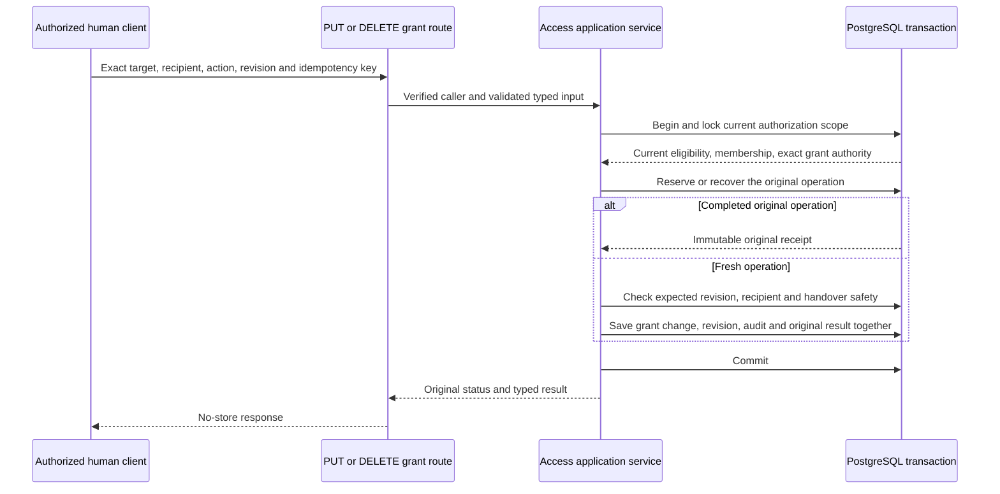
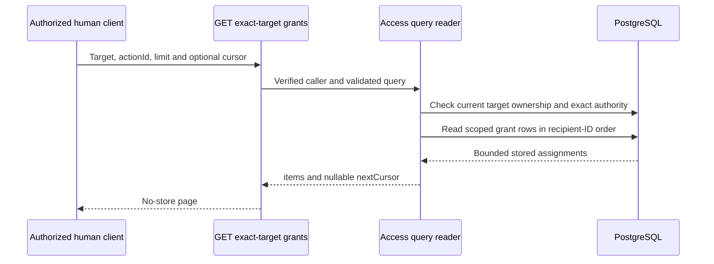

# Describe a finishable issue

Alice wants Bob to administer a specific permission. A useful issue names the operation, the current authority needed, the exact state changed and the result Bob can verify. The [implementation template](../../../../.github/ISSUE_TEMPLATE/implementation.md) is the canonical blank format. This reference explains how to fill it and when another format is appropriate.

## Choose the kind of work

| Kind | Adaptation |
| --- | --- |
| Implementation | Use the template's Outcome, Deliverables, Technical approach, Acceptance, Verification and References. List owned public interfaces when applicable. |
| Delivery defect | Give expected versus observed behavior, a minimal reproduction or inspected evidence, impact, tentative correction or bounded investigation, acceptance and exclusions. Use the existing [bug form](../../../../.github/ISSUE_TEMPLATE/bug_report.yml) for public intake. A reporter need not design the solution. Complete the delivery detail before assignment. |
| Epic or aggregate | State the outcome, actual native child responsibilities, exclusions and completion boundary. Keep implementation detail and acceptance evidence in children. Use the existing `epic` label. |
| Specification | State concrete unanswered questions, accepted constraints, outputs needing approval, affected consumers and review examples. Link the owning pending analysis. A specification label alone does not prove an unresolved decision exists. |
| Qualification | Describe the behavior to demonstrate, producer capabilities, artifacts/environment/inputs, required cases and injected failures, evidence and limitations. A plan is not a passing result. |
| Deferred Studio or post-v1 | State intended behavior, accepted constraints, known producers and explicit deferral. Do not invent future backend contracts or place deferred work into v1. |

Use `type:implementation`, `type:specification` or `type:qualification` for open leaves. Apply `needs-decision` only when an unresolved answer prevents that issue's implementation. Missing qualification evidence does not prohibit evidence-gathering tests. [Delivery triage](../../inframeld-backlog-delivery/references/discovered-defects.md) owns interruption decisions for discovered defects.

For a defect, distinguish an observed failure from a source-supported risk. A review finding need not claim a runtime incident. Keep useful redacted evidence and its affected revision, without private transcripts, protected captures or operational inventories.

Human-facing deliveries use one linked qualification issue per delivery, reusing an existing one across supporting PRs and retries. Follow the [human template](../../../../.github/ISSUE_TEMPLATE/human_qualification.md) and [Testing's procedure](../../inframeld-testing/references/human-qualification.md). Explain unavailable capabilities and their owners rather than inventing commands. Keep reusable procedures separate from dated execution comments. Human-work deferral cannot absorb missing implementation or required automated qualification. [Delivery closure](../../inframeld-backlog-delivery/references/gates-and-recovery.md#separate-implementation-and-human-acceptance) owns that distinction.

## Supply direction without copying a manual

Describe a stable outcome rather than today's code inventory. Give a junior engineer the causal flow: entry point, owning application/domain behavior, saved state and result. Explain terms when introduced. Add the important rejection, interruption, changed-permission and competing-write cases. A small operation diagram is useful when those boundaries are otherwise hard to follow. An HTTP issue should enumerate its routes, inputs and results. A storage or documentation issue should describe its actual interfaces instead.

Use default-branch links with stable anchors for governing workflows and contracts. Pin a revision when citing inspected implementation or verification evidence, rather than freezing the entire reading list. Inspect exact code/OpenAPI/migrations before claiming an implemented representation. Link relevant sections rather than copying global standards or entire catalogues. An example may contain exact fields needed to explain the contract. Mark proposed fields and illustrative results clearly. For accepted unpublished guidance, identify its exact path and pending publication or real PR. Do not link `main` to content it does not contain.

Keep progress in completed deliverables, PR links and scoped evidence. Update the issue when acceptance, prerequisite capability, reading route or a genuine decision changes. Code reorganization alone does not require a dated starting-point section. Preserve comments and historical results. Use native relationships without a second manual dependency status.

## Worked example: Access-owned grant administration

The following issue body illustrates the Access-owned #226 boundary and selected POST consolidation in [ADR-0128](../../../../docs/adr/ADR-0128-consolidate-exact-target-grant-mutations.md). It is an authoring example, not a competing Access specification or a claim of implementation. The target contract is accepted, while POST retirement remains implementation work and the current operation remains supported until cutover. Copy only source-checked detail appropriate to the actual issue, and recheck receiving owners when restructuring.

### Outcome

Alice can inspect, assign, downgrade and remove an exact action grant on an Organization, Project, access group or application account. A grant identifies one recipient, action and target. `canGrant: false` permits use. `canGrant: true` permits use and delegation. A grant does not create membership, document access or current account eligibility.

### Deliverables

For each base below, implement `GET {base}/grants`, `PUT {base}/grants/{recipient_principal_id}/{action_id}` and `DELETE` at that same mutation path. Use the existing concrete operation IDs from [grant contracts](../../inframeld-access-models/references/grant-contracts.md#full-action-grant-operations).

| Base | Owned actions | Existing grant table | Coordinated revision |
| --- | --- | --- | --- |
| `/v1/organizations/{organization_id}` | `admit-users`, `suspend-users`, `restore-users`, `create-projects` | `organization_action_grants` | `organizations.access_revision` |
| `/v1/projects/{project_id}` | The fixed Project action catalogue | `project_action_grants` | `projects.access_revision` |
| `/v1/projects/{project_id}/access-groups/{access_group_id}` | `add-documents`, `update-documents`, `delete-documents` | `group_action_grants` | Owning Project Access revision |
| `/v1/projects/{project_id}/application-accounts/{application_principal_id}` | `issue-application-keys`, `revoke-application-keys`, `delete-application-account` | `application_action_grants` | Owning Project Access revision |

Provide the supporting reads:

- `GET /v1/my-organization-access`: the caller's own Organization access and reviewed revision.
- `GET /v1/projects/{project_id}/my-access`: the caller's own Project relationships and reviewed revision.
- `GET /v1/projects/{project_id}/grant-recipients`: eligible Project recipients for the specified exact target/action, with the accepted `targetKind`, `targetId`, `actionId`, `limit` and `cursor` inputs.

Consolidate Project mutation on PUT/DELETE by retiring `POST /v1/projects/{project_id}/grants` and its generated operation under ADR-0128. Migrate actual callers deliberately. POST's duplicate rejection and PUT's ability to change an existing grant differ, so do not redirect or replay POST as PUT automatically. Preserve historical original-operation lookup under its current authority and unresolved-effect safeguards.

### Technical approach

Access owns these routes and grant rules. Use the existing concrete target types and tables. Load a group's or application's authoritative owning Project before checking or changing its grants. Group administration and application-account creation supply their real producers through #225 and #229. Their creation uses already delivered Project authority, without requiring every remaining #226 target first. Future resource features own their real target tables and grant integration rather than adding placeholder resources here.

The diagrams show request flow inside the modular backend and PostgreSQL. They do not introduce separate network services or a generic grants registry.



Organization writes use their Organization revision and lock. Project-scoped writes use the accepted Organization/Project lock order and owning Project revision. Current eligibility and exact authority precede replay. A completed retry returns its original result before fresh-write revision and recipient checks, without applying the change again. The group-manager alternative covers only document-action administration on that same group. Authority over an application account is distinct from permissions received by the application.

Applications receive only catalogue-eligible use-only assignments. They cannot receive delegation authority or human-only administration actions. Reject unsupported target/action/recipient combinations before saving them.



Bind cursors to the exact scope/action and reauthorize every page. Reads create no reservation, revision or change audit. Recipient discovery lists eligible members of the same Project. It is not an installation-wide directory. Organization recipients use verified admitted principal IDs.

PUT requires strict JSON `canGrant` and `expectedAccessRevision`. DELETE has no body and takes the revision as one query field. Both require the existing single `Idempotency-Key`. Retain ordinary authentication, cookie-write CSRF, bounded parsing, current-credential and Problem Details behavior.

Illustrative Project request and response, using the existing flat Project response fields:

```http
PUT /v1/projects/7cb13c67-b1ed-40c0-b686-ffb2adcd3a87/grants/608b87fd-c2ab-491b-9b71-519ce4286bd8/create-access-groups
Content-Type: application/json
Idempotency-Key: support-bob-create-groups-1

{"canGrant": false, "expectedAccessRevision": 7}
```

```json
{
  "operationId": "grant-operation-1",
  "idempotencyExpiresAt": "2026-11-06T12:00:00Z",
  "projectId": "7cb13c67-b1ed-40c0-b686-ffb2adcd3a87",
  "recipientPrincipalId": "608b87fd-c2ab-491b-9b71-519ce4286bd8",
  "actionId": "create-access-groups",
  "canGrant": false,
  "accessRevision": 8,
  "changed": true
}
```

The request assumes an authenticated eligible human with exact use-and-grant authority. Cookie clients also supply trusted Origin and the required CSRF header. The expiry and operation identity illustrate a response, not an observed run.

### Acceptance

| Situation | Required result |
| --- | --- |
| Create a valid absent assignment | 201, `changed: true`, one revision increment and one audit event. |
| Change an existing assignment | 200, `changed: true`, one revision increment and one audit event. |
| Set the already stored level | 200, `changed: false`, no revision increment or change audit. |
| Delete an existing assignment | 200, `removed: true`, `changed: true`, one revision increment and one audit event. |
| Delete an already absent assignment | 200, `removed: true`, `changed: false`, no revision increment or change audit. |
| Retry a completed original request while currently authorized | Original status and receipt, without reapplying the mutation or restoring a later-removed grant. |
| Stale fresh-write revision, cross-Project target, unsupported action or ineligible recipient | Existing appropriate Problem Details response, with no partial mutation. |
| Concurrent downgrade/departure would strand a required responsibility | Enforce the owning handover rule under the coordinated lock. |
| Caller loses required authority before retry or a later page | Deny disclosure or mutation under current authority. |

### Verification

Test domain decisions and service ordering, then prove the grant/revision/audit/original-result transaction with real PostgreSQL. Include no-op, lost-response replay, changed recipient state, revoked caller authority, conflicting writes and rollback. Verify target scoping, pagination, strict HTTP parsing, current credential checks and CSRF. Cover every added operation through generated Rust, TypeScript and Python clients using the existing SDK qualification mechanism. Keep actual human execution in its linked qualification issue.

### References

- [Grant administration and current authority](../../inframeld-access-models/references/grant-administration.md).
- [Target-specific transport contracts](../../inframeld-access-models/references/grant-contracts.md).
- [Fixed actions and eligible recipients](../../inframeld-access-models/references/actions-and-initial-grants.md#fixed-action-catalogue).
- [Ordered lifecycle writes and original receipts](../../inframeld-access-models/references/access-lifecycle-persistence.md).
- [Idempotency and original outcomes](../../inframeld-application-contracts/references/idempotency-and-replay.md).
