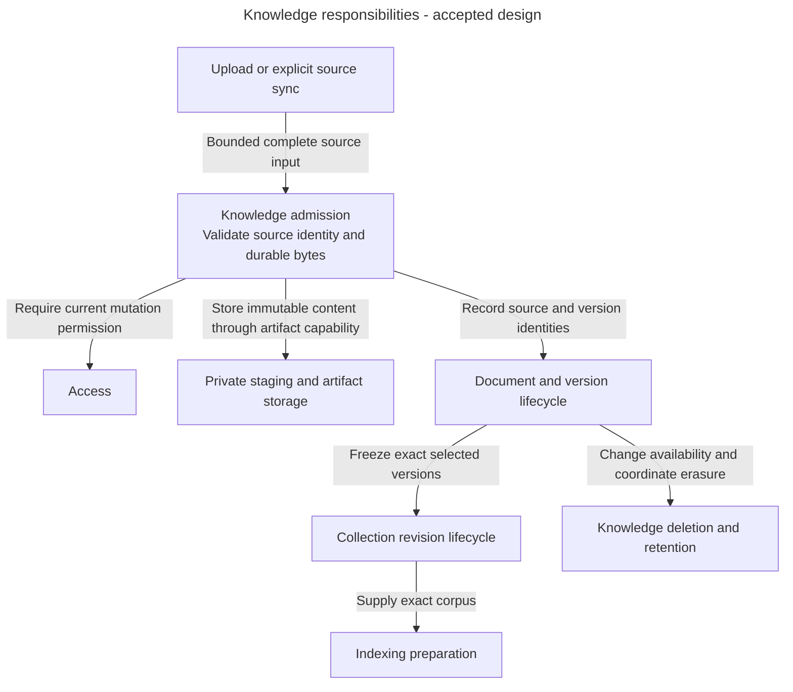
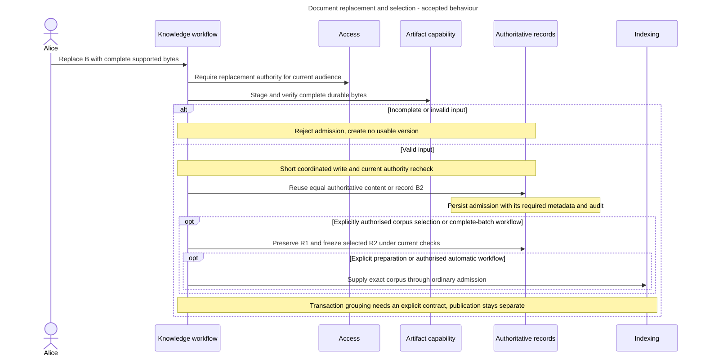

# Knowledge architecture: preserve which source version was accepted

Alice replaces Support handbook B1 with B2 while a question still uses R1={A1,B1}. Knowledge must preserve the earlier selection and make a new version available for later work. It also has to control who may upload, replace, share or erase the content.

## What Knowledge owns

Knowledge owns source identity, Documents, immutable DocumentVersions, Collections, exact CollectionRevisions, admission and bounded source synchronisation. A Document is the logical source. A DocumentVersion identifies fixed bytes. A CollectionRevision freezes exact versions for an operation.

Access owns current permission. Indexing owns processing and verified search data. Pipelines captures execution inputs and builds ready versions. Releases selects traffic. Admitting B2 alone changes none of those other owners' decisions.

## Main parts and boundaries

**Accepted responsibility view.** These are capabilities to implement, not inspected classes or an aggregate per box.

Arrows describe responsibility hand-offs. They do not prescribe a public API or import graph. An artifact is stored content. Storing an object is not admission until the owning workflow has verified complete durable content and saved its authorised meaning.

## Follow a replacement

**Accepted target workflow.** A document audience is its saved nonempty list of permitted access groups. Alice needs Update documents on every saved group to replace it. Existing read work has captured R1. In this example Alice also selects B2 for a new revision through an authorised selection or complete-batch workflow.

The new selection is explicit or comes from the accepted complete-batch workflow. Replacing content does not silently retarget every collection or admitted execution. For changed content, R2={A1,B2} leaves R1 fixed. Equal authoritative content may reuse a version, subject to the same authorization and non-disclosure rules.

An admitted operation is work the server has durably accepted. A lost response uses that original operation and saved artifacts. It does not permit a second source or an uncertain paid retry. Source sync preserves source identity and checkpoints. An incomplete inventory cannot prove that an unseen object disappeared.

## Data and execution

PostgreSQL owns identities, exact membership and authority. SeaweedFS holds immutable source and derived artifacts through application-owned capabilities. Filenames are display labels, not storage paths or authority. Parsing runs later in the restricted processing boundary under Indexing's profiles.

Document audiences are nonempty and project-local. Reading requires ordinary membership in at least one allowed group. Replacement requires Update documents on every saved audience group and preserves that audience. Sharing is separately authorised human work requiring management of every old and new group. Add, read, replace and erase remain different permissions. Changed audience or authority is rechecked before the applicable change commits. A source credential does not import upstream access lists into Inframeld. Configuration import does not contact the source automatically.

Removing B from a future selection differs from erasing B. Erasure first blocks prohibited access and then coordinates resumable physical cleanup with Indexing and artifact retention. Old queries, citations and evaluation evidence remain subject to current access and erasure. Immutable identity promises a fixed reference, not permanent availability.

## What exists today

This is accepted design, not a delivered Knowledge module. The inspected backend source has Access, shared and bootstrap foundations. Source admission, synchronisation, durable artifacts and deletion still need their domain-specific implementation and qualification. Existing generic infrastructure does not qualify those complete workflows.

Read [documents and collections](documents-and-collections.md), [uploads and source sync](uploads-and-source-sync.md) and [deletion and retention](deletion-and-retention.md) for applicable rules. Do not infer a service, repository or table for each named concept.

## Decisions still needed and sources

[ADR-0075](../../../../docs/adr/ADR-0075-separate-document-lifecycle-from-collection-selection.md) accepts focused document/version and collection-selection operations coordinated by an application workflow for complete batches. The [owning guide](../../../../docs/development/knowledge-lifecycle.md#knowledge-operation-boundaries) retains transaction/consistency, durable handoff and committed batch-membership contracts still to specify. This accepted split adds no schema or API and does not make replacement select a new corpus implicitly.

[Knowledge lifecycle](../../../../docs/development/knowledge-lifecycle.md), [ingestion security](../../../../docs/development/ingestion-security.md), [Knowledge records](../../../../docs/development/data-model.md#knowledge) and [retention](../../../../docs/development/retention-and-deletion.md) remain authoritative. The proposed component split must preserve their accepted behaviour.
