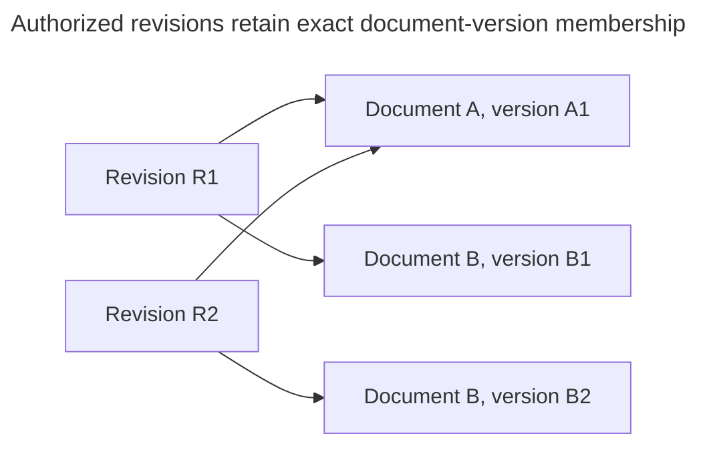

# Documents, collections and frozen inputs

Alice replaces the Support handbook while a query is already running. The running query must keep the evidence it captured. New work may use the replacement after ordinary preparation. Knowledge provides the identities that make this distinction possible.

## Choose a focused reading task

- For complete selection and batch coordination, read [Collection selection and batches](collection-selection-and-batches.md).

## Source identity and version identity

A Document identifies a logical source. A DocumentVersion identifies immutable bytes. A Collection selects a corpus, and a CollectionRevision fixes exact versions. For R1={A1,B1}, replacing B gives B2 and R2={A1,B2}. R1 remains unchanged. Retained Pipeline inputs follow exact versions rather than a mutable latest pointer.

Re-observing authoritative equal content reuses the version. Changed bytes create another. Names and filenames are not stable identity, and arbitrary S3 ETags are not content checksums. Preserve original source identity and current groups during replacement. Do not rewrite earlier versions.

## Portable configuration and generated cases

Configuration export transfers definitions, not document bytes or vector backups. Imported collections are empty, and reusing a collection does not alter its contents. Collection view/edit/delete and Source configuration/sync/credential/deletion actions remain separate. Retiring a Source or Collection does not erase admitted Documents.

A manifest inventories identities and fingerprints. It neither grants access nor proves numerical materialization readiness. Avoid loading a whole large collection into memory or creating an aggregate/repository for every noun.

Evaluation owns generated questions, reference answers and case review. Generation samples permitted frozen versions across documents and sections, not only successful retrieval hits. Those derived excerpts retain source access and erasure obligations. Replacing B1 with B2 must not retarget an existing expected passage. Erasure can instead make it unavailable. Evaluation dataset transfer is separate from corpus admission.

## Stable documents and exact versions

A **Document** identifies the same logical source over time, such as the refund handbook. Each **DocumentVersion** contains one fixed version of its content. A **Collection** names a group of documents, also called a **corpus**. A **CollectionRevision** saves exactly which versions that selection contains.

The arrows show membership. After Alice changes B, R2 contains A1 and B2. R1 still contains A1 and B1. Its saved references never follow the newest bytes automatically. The [Knowledge records](records.md#knowledge) define these relationships.

### Define reproducibility without promising identical execution

The record of where a result came from is its **lineage**. It tells us which inputs, settings, and stored outputs were used. It does not promise that running them again will produce the same answer.

A hosted language model may produce different text or change behind the same model alias. Rebuilding an approximate similarity-search index may change result ordering too. These are limits on repeatability even when the input history is known.

**IDs and hashes alone cannot reconstruct numerical embeddings.** Knowing which inputs were used is not the same as retaining the actual numerical output.

| Capability | Meaning and limit |
| --- | --- |
| **Lineage records** | Preserve the identities and relationships needed to explain an execution. |
| **Normal immutable-write recovery** | Accepted for qualification under [Preparing and searching reliable indexes](../../inframeld-indexing/references/profiles-and-preparation.md). This is distinct from reconstructing lost product state. |
| **Tested backup and restore** | Remain the recovery baseline under [Upgrading and recovering an installation](../../../../docs/development/operations/upgrades.md). |
| **Product-level reconstruction** | Deferred. Lineage is not a promise that Inframeld can rebuild every lost artifact. |
| **Permanent numerical archives** | Deferred. Immutable physical generations do not imply permanent retention of every vector payload. |

The fixed physical generations, PostgreSQL membership records, and group-based application permissions are accepted choices. The implementation still needs tests, including measurements of the cost of finding exactly which search generations a caller may use.

### Examples of the resulting behavior

| Change or event | Expected behavior |
| --- | --- |
| **Release prompt B against the same corpus and profiles.** | Reuse the compatible ready materialization. The prompt change does not require new embeddings. |
| **Change the embedding model.** | Create lineage for the new vector space rather than overwrite the old numerical generations. |
| **Revoke Alice's document access.** | Deny her historical source reads too, even though the historical hashes remain recorded. |
| **Delete source data needed by an older release.** | The rollback target may become unavailable. Report that fact rather than fabricate reproducibility. |

These relationships describe responsibilities within the application. They need neither separate services nor a database-backed domain object for every item in a manifest, which is an inventory of saved outputs.

## Status, sources and unresolved scope

An unavailable or erased dependency may invalidate historical query inputs or releases. Frozen identity does not authorize reconstruction from newer sources. Upload completion cannot declare an index ready. These are accepted lifecycle rules, not evidence that all routes, storage schemas or first-use behavior are implemented.

- [Knowledge lifecycle](./documents-and-collections.md), [frozen corpus](collection-selection-and-batches.md#corpus), [portable Knowledge resources](source-configuration-and-credentials.md#portable-knowledge) and [Knowledge records](records.md#knowledge).
- [Configuration portability](../../inframeld-application-contracts/references/configuration-export-and-import.md), [Access capability catalogue](../../inframeld-access-models/references/actions-and-initial-grants.md#capability-catalogue) and [V1 scope](../../inframeld-architecture/references/v1-scope-and-extension-boundaries.md).
- [Evaluation generation](../../inframeld-evaluation/references/generation-and-review.md#generation), [protected history](../../inframeld-evaluation/references/history-and-dataset-transfer.md#history), [ADR-0008](../../../../docs/adr/ADR-0008-preserve-immutable-versions-and-their-provenance.md) and [ADR-0052](../../../../docs/adr/ADR-0052-separate-experimental-execution-from-release-ready-pipeline-builds.md).

Knowing a result's origin does not guarantee identical model answers, permanent vector archives, or reconstruction of missing bytes. Recovery depends on [coordinated backups](../../../../docs/development/operations/upgrades.md). The full lifecycle and the cost of checking permitted membership still need testing.

| Decision | Rationale |
| --- | --- |
| [ADR-0008](../../../../docs/adr/ADR-0008-preserve-immutable-versions-and-their-provenance.md) | Preserve immutable versions and their provenance. |
| [ADR-0015](../../../../docs/adr/ADR-0015-keep-document-group-access-separate-from-operational-permissions.md) | Keep document-group access separate from operational permissions. |
| [ADR-0036](../../../../docs/adr/ADR-0036-use-seaweedfs-through-the-application-s3-storage-boundary.md) | Use SeaweedFS through the application S3 storage boundary. |
| [ADR-0039](../../../../docs/adr/ADR-0039-block-access-before-resumable-physical-deletion.md) | Block access before resumable physical deletion. |
