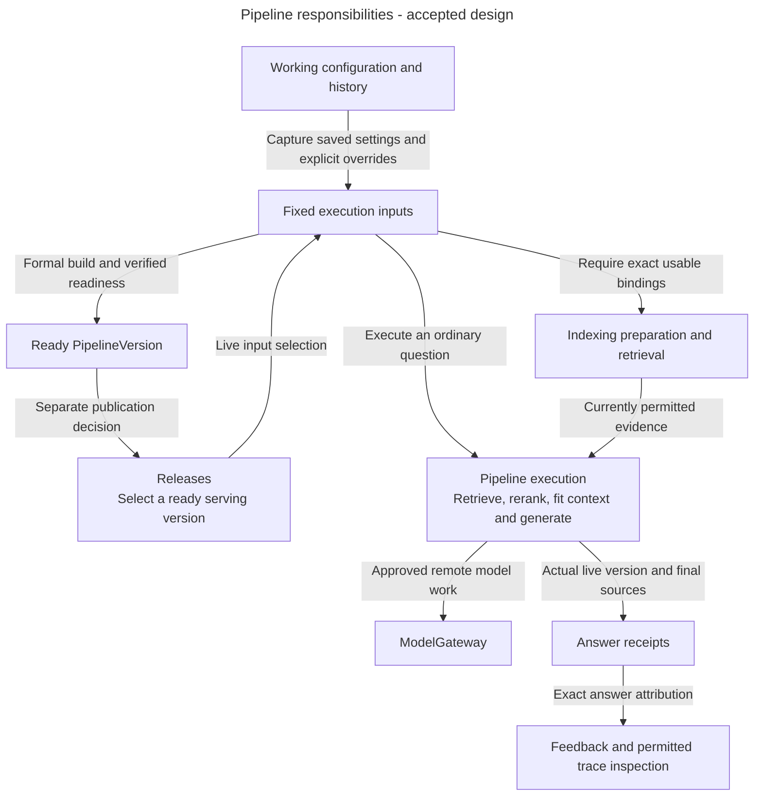
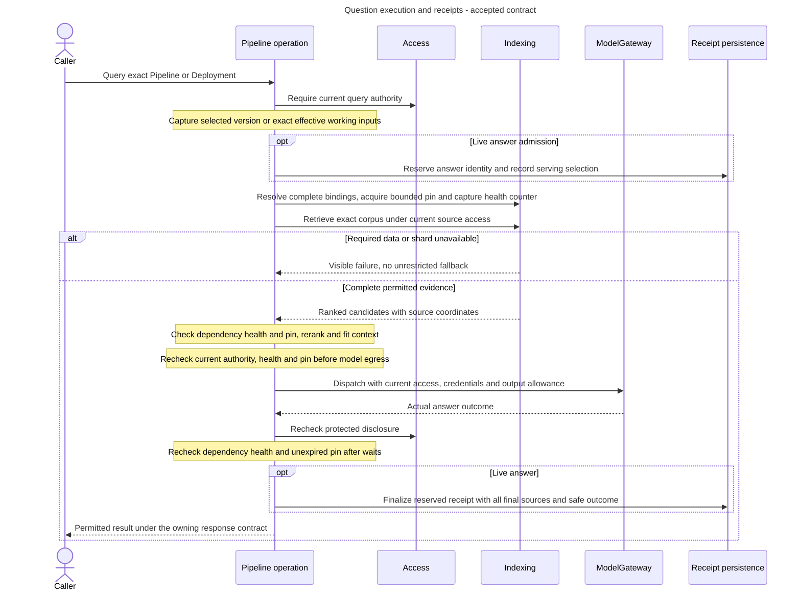

# Pipelines architecture: execute the inputs the caller selected

Alice tries a question with saved revision 17 and a temporary reranker override. While it runs, she saves revision 18. The first question must keep its admitted inputs and still respect current access. It must not quietly become a query against revision 18 or publish a new release.

## Accepted detailed contracts

The developer resolved this module's detailed policy choices on 2026-10-29. Apply [PD-PIPELINES-01](decision-execution-build-receipt-contracts.md#approved-resolution) and its directly linked accepted neighbors. Earlier descriptions of remaining input/result or concurrency design now refer to native implementation and qualification, not another policy-approval gate. Preserve the focused component split and one ordinary execution path where selected.

## What Pipelines owns

Pipelines owns working configuration/history, captured execution inputs, builds, ordinary answer execution, receipts and feedback. Knowledge supplies exact corpus membership. Indexing supplies verified preparation and filtered retrieval. Releases supplies serving selection. Evaluation calls the ordinary execution path with its own frozen cases.

An execution-input snapshot records exact effective settings and verified dependencies. A PipelineVersion is the successful output of a release build. Working revisions, snapshots, ready versions and live serving selection solve different problems.

## Main parts and boundaries

**Accepted responsibility view.** These capabilities are not delivered classes or a user-programmable graph engine.

Arrows describe logical input and result relationships. Access checks protect selection, dispatch and disclosure even where omitted for readability. All paths share ordinary execution. Direct questions and Evaluation do not create a second query engine.

## Follow a question

**Accepted target workflow.** A live question starts with a selected ready version. A direct question captures working settings and any supported override before ordinary preparation. Verified bindings identify the exact prepared source and vector data those inputs need. A query pin is a time-limited record that keeps ordinary cleanup from removing dependencies during the query. It does not restore revoked access or repair lost data.

The dependency-health counter changes when required data is lost, corrupted or invalidated. Recheck it after retrieval, before evidence leaves for a model and before returning. Discard the protected result if it changed or the pin expired, even when caller permissions are unchanged. A live answer reserves its original identity at admission and finalizes that receipt before response release. Failed or uncertain execution is not an answer eligible for feedback.

Optional remote reranking and query embeddings also use ModelGateway. Local reranking retains its own bounded processing rules. Settings that a provider cannot honour fail rather than being silently dropped. Later Pipeline edits and serving-pointer changes cannot reroute an admitted question.

If a paid response is lost, current authentication and authorization still protect retry. Completed live-answer recovery is receipt-only. It does not regenerate an answer or expose a hidden saved-answer cache. Direct-query and Evaluation results do not enter production feedback statistics.

## Data and execution

PostgreSQL owns working history, exact execution records, build outcomes and receipt attribution. Source artifacts and numerical dependencies remain under Knowledge/Indexing ownership. A build may reserve an identity early but only verified successful preparation produces a ready version.

External model waits stay outside SQL transactions. Use short transactions for admission and required saved results. Relevant connection-access changes stop remaining dispatch. Credential rotation and metadata-only rename retain their documented exceptions. Manual mode or Pipeline rollback does not restore old endpoints or provider secrets.

Feedback links to the actual live answer. Trace recording, trace inspection and trace-policy administration have different authority and retention. Diagnostics failure cannot weaken required accounting, audit or query checks.

## What exists today

These are accepted execution and configuration contracts. There is no implemented Pipelines domain in the inspected backend source. Existing Access, transactions and error-handling foundations do not qualify complete query, build, receipt or feedback workflows. Full Studio remains deferred, with CLI-led contracts.

Read [configuration, queries and builds](configuration-queries-and-builds.md), [answer execution and receipts](answer-execution-and-receipts.md) and [feedback and tracing](feedback-and-tracing.md) for conditional detail.

## Decisions still needed and sources

Accepted [PD-INDEXING-01](../../inframeld-indexing/references/decision-capability-binding-contracts.md#approved-resolution) already supplies the exact prepared materialization/projection and pin-lifetime contract. The Pipeline capture, continuation and execution-result/receipt handoffs below are now selected by accepted PD-PIPELINES-01.

[ADR-0077](../../../../docs/adr/ADR-0077-separate-pipeline-settings-builds-and-answer-execution.md) accepts focused settings/capture, readiness-build and answer-execution capabilities, retaining one ordinary execution path. The [owning guide](#pipeline-operation-boundaries) retains complete binding/result, capture, receipt and transaction/external-work contracts selected by the accepted decision above. This selects no new framework or public API.

[The Pipeline guide](configuration-queries-and-builds.md), [Pipeline records](records.md#pipelines), [jobs](../../inframeld-application-contracts/references/jobs-and-recovery.md) and [feedback](answer-feedback.md) own the contracts. [Releases architecture](../../inframeld-releases/references/architecture.md) explains separate traffic authority.

### Pipeline application boundaries

[ADR-0077](../../../../docs/adr/ADR-0077-separate-pipeline-settings-builds-and-answer-execution.md) separates settings/capture, readiness-build and answer-execution capabilities. Direct questions, Evaluation and serving share ordinary execution with complete fixed inputs. Accepted PD-PIPELINES-01 now selects capture, prepared-binding, result/receipt and transaction handoffs. No extra Experiment resource or executor is implied.

## Internal architecture decisions

The component boundaries below are accepted. They explain how to divide responsibilities inside the existing backend. The detailed logical contracts are now accepted in the linked decision records. Native representations and qualification remain implementation work. Accepted behavior elsewhere in this guide continues to own permissions, lifecycle and failure rules.

 

### Separate Pipeline settings, builds and answer execution

**Status:** Accepted in [ADR-0077](../../../../docs/adr/ADR-0077-separate-pipeline-settings-builds-and-answer-execution.md), with implementation and qualification unfinished.

Pipelines separates settings management/input capture, readiness builds and ordinary answer execution. Direct questions, Evaluation and production use the same ordinary execution path with complete fixed inputs. Captured inputs are records of selected work, not independent executors.

Readiness builds use the exact authorized saved configuration and corpus supplied by their owning caller, including the Deployment-selected inputs of automatic workflows. They do not follow later edits or use a run ID/unsaved override as release configuration. Publication stays with Releases. The split makes effects clear at the cost of explicit input/result and handoff contracts, without adding an Experiment resource, generic executor or command bus.

**Accepted contracts, implementation and qualification pending.** Apply PD-PIPELINES-01 and its accepted neighbors for exact logical state, input/result, revision and coordination rules. Native DTOs, physical schema and assembled behavior still need implementation and scoped evidence. Do not reopen the selected policy or infer a table, process or repository per logical record.

## Accepted decision references for dependent implementation

Apply the accepted contract whose trigger matches. Qualification remains separate from policy approval:

- [PD-PIPELINES-01 (accepted): Capture fixed inputs and complete execution through its receipt](decision-execution-build-receipt-contracts.md). Before defining captured input/build/execution interfaces, preparation continuation or receipt admission/finalization.
- [PD-PIPELINES-02 (accepted): Make a confirmed trace opt-out stop later capture and delivery](decision-trace-policy-fencing.md). Before implementing trace capture/buffering/export delivery, opt-out acknowledgment or history-deletion fencing.

## Decision and reference map

[Pipelines](records.md#pipelines) and [Releases](../../inframeld-releases/references/records-and-transitions.md#releases) define the records. [Jobs](../../inframeld-application-contracts/references/jobs-and-recovery.md) explains attempt ownership and lost responses. [Onboarding](../../inframeld-architecture/references/first-use-and-private-defaults.md) covers the route before its first Deployment exists. Routing, release changes, reranking, and simultaneous operations still need implementation tests.

| Decision | Rationale |
| --- | --- |
| [ADR-0052](../../../../docs/adr/ADR-0052-separate-experimental-execution-from-release-ready-pipeline-builds.md) | Query and evaluate fixed captured working-configuration inputs before an explicit policy-controlled build of saved configuration. |
| [ADR-0008](../../../../docs/adr/ADR-0008-preserve-immutable-versions-and-their-provenance.md) | Preserve immutable versions and their provenance. |
| [ADR-0032](../../../../docs/adr/ADR-0032-keep-canary-assignment-stable-for-the-same-caller-and-affinity-key.md) | Keep canary assignment stable for the same caller and affinity key. |
| [ADR-0033](../../../../docs/adr/ADR-0033-separate-build-readiness-from-release-authority.md) | Separate build readiness from release authority. |
| [ADR-0040](../../../../docs/adr/ADR-0040-bind-pipeline-versions-to-verified-profile-specific-materializations.md) | Bind pipeline versions to verified profile-specific materializations. |
| [ADR-0042](../../../../docs/adr/ADR-0042-rerank-selected-evidence-through-a-local-cross-encoder-boundary.md) | Rerank selected evidence through a local cross-encoder boundary. |
| [ADR-0047](../../../../docs/adr/ADR-0047-support-reversible-publication-modes-per-deployment.md) | Support reversible publication modes per Deployment. |
