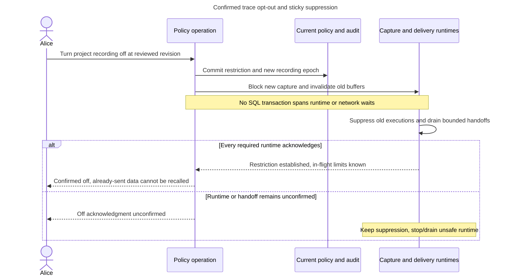

# PD-PIPELINES-02: Make a confirmed trace opt-out stop later capture and delivery

**Status:** ACCEPTED on 2026-10-29 in [ADR-0112](../../../../docs/adr/ADR-0112-fence-trace-capture-delivery-and-history-deletion.md). Implementation and qualification remain separate delivery work.

**Owner:** `inframeld-pipelines`

The developer explicitly approved the presented batch-4 contracts and delegated selection of all remaining decisions to the assistant on 2026-10-29, requesting repository/GitHub recording and plain-language justification. This resolution is accepted under that authority. It selects logical policy, not implemented code or passing qualification.

## Contents

- [Approved resolution](#approved-resolution)
- [Why and example](#why-and-example)
- [Implementation and required evidence](#implementation-and-required-evidence)
- [Architectural impact and dependencies](#architectural-impact-and-dependencies)
- [Historical context and alternatives](#historical-context-and-alternatives)
- [Sources and finalization](#sources-and-finalization)

## Approved resolution

Use revisioned installation policy and Project preference with a monotonically changing recording epoch and execution-local sticky suppression. Record the eligible epoch at execution admission. An opt-out invalidates every older eligible execution for later project-attributable capture, persistence and delivery. Turning recording on admits new eligible executions only. Separate operational/workload switches, effective operator restrictions, exact human policy/deletion authority and independent trace inspection remain unchanged.

All instrumentation that can capture protected content must check the controlled boundary before copying it into a span, log, queue or exporter. Disable automatic instrumentation that cannot comply. Platform operational spans cannot become an alternate prompt/context/answer stream. Unknown policy suppresses optional recording, while business authorization/accounting/receipt failures keep their normal behavior. Optional diagnostics loss does not itself fail a healthy query.

The off operation first durably commits the restriction, epoch and audit under expected policy revision. Block new capture/export authorizations immediately. Invalidate queued buffers and require all registered capture/export runtimes to acknowledge the new epoch and drain their bounded critical sections before confirming off. New runtimes load current restrictions before accepting work. No SQL transaction spans a network wait. If a runtime cannot acknowledge, stop/drain that runtime or keep acknowledgment unconfirmed; never report success from a saved flag alone. The query may continue without recording.

Dispatch authorization and actual external delivery must be accounted for separately. Classify already-sent delivery as in flight and disclose that it cannot be recalled. A not-yet-sent authorized buffer is suppressed. An uncertain handoff must be reconciled/drained before claiming that no later handoff can start. The barrier must prove this for the supported single-host topology, including stale processes; process-local flags alone are insufficient. This is a narrow tracing restriction barrier, not a new universal workflow engine.

Every persistence/delivery attempt checks current recording epoch, trace identity, source restrictions and deletion generation. Bounded retries send only previously captured still-permitted bytes, never rerun a model. Initial limits are 256 spans per execution, 64 KiB per event, 8 MiB captured payload per execution and 32 MiB total diagnostic queue per process, with at most two local exporter attempts and a five-second delivery deadline. Exhaustion drops optional new diagnostics with safe partial/unavailable counters, not protected fallback logs or failure of the answer. External exporters remain disabled until their same restriction boundary is qualified.

Explicit history deletion is a separately authorized reviewed immutable trace selection/cutoff. Atomically record read blocking, tombstones/deletion generation, audit and the original durable cleanup obligation. Include selected active trace identities so late append/retry cannot recreate that history. Future new executions outside the selection retain normal recording policy. Expiry and source erasure apply the same read-before-cleanup and no-resurrection rule. Required audit, accounting and explicitly retained Evaluation evidence are separate stores. Preserve physical-cleanup-pending and external-copy limitations. A lost acknowledgment recovers the original restriction/cutoff. Re-enabling or increasing retention restores nothing already suppressed or erased.

## Why and example

Tracing should help diagnose a query without becoming a second, uncontrolled copy of private data. A confirmed off action must affect running processes and queued writes, not just a settings screen.

Alice switches recording off while Query A is running, then switches it on again. A keeps answering but never resumes capture. New Query B may record. Deleting A's history also blocks a late queued write from recreating it.

The acknowledgment barrier adds bounded coordination and may report unconfirmed off during a broken runtime. This is preferable to falsely saying private capture stopped.

## Coordination sequence

The query can continue under its ordinary authority. Re-enabling recording applies to new eligible executions only.

## Apply the accepted contract

Use this contract when the original trigger matches. Do not ask for the same policy decision again. Concrete native methods, DTO names and physical schemas are implementation choices consistent with this contract and the repository conventions. Missing measurements, fixtures or assembled evidence block the affected qualification/support claim, not authorized implementation or isolated tests. A failed test is not permission to weaken an accepted safety boundary.

## Implementation and required evidence

Race capture/persist/export against off/on and deletion; unreachable/stale runtime; automatic instrumentation; queue saturation; source erasure; lost acknowledgment; already-sent delivery and uncertain handoff. No paid calls are authorized by this documentation.

These are required checks, not tests run or successful production evidence. No application edits, paid calls or production changes follow merely from recording this decision.

## Architectural impact and dependencies

Pipelines execution instrumentation, shared operational spans/queues, project policy commands, deletion/retention and CLI outcome representation. Update off/on and delivery-race sequences.

Load neighboring decisions only under these conditions:

- [PD-KNOWLEDGE-02 (accepted): Choose bounded retention without weakening explicit erasure](../../inframeld-knowledge/references/decision-retention-erasure-policy.md). For retention and source-derived erasure.
- [PD-ACCESS-02 (accepted): Keep durable work and credential lifetime explicit](../../inframeld-access-models/references/decision-admitted-work-authority.md). Only when the underlying durable workload’s authority is affected.

## Historical context and alternatives

The following preserves the earlier problem, context and options. Statements that a choice was open describe that earlier analysis. The approved resolution above now settles it.

### Original problem and example

Historical analysis before this resolution.

Query A begins with recording on. Alice switches project tracing off while spans are buffered. She turns it on again before A finishes. A must keep answering normally, but its stopped capture must not restart or flush old buffers. Newly admitted Query B may record under the current policy.

The privacy outcome is accepted. Exact ordering/fencing at capture, persistence and delivery is not selected. A collector filter after sensitive capture cannot prove that a confirmed off result stopped stale workers or queued payloads.

### Original accepted context and evidence

Historical context before this resolution. Unchanged invariants still apply.

Installation categories and project preferences are distinct from inspection authority. Project opt-out suppresses both project-attributable categories. Re-enable applies to new eligible work, not an already suppressed execution. Already saved traces follow current access, retention and erasure.

Optional diagnostics failure cannot fail an otherwise healthy query or excuse missing required accounting, audit or receipts. A tracing delivery retry sends only already-captured still-permitted data and never reruns a model. Already handed-off external data cannot be recalled, but no later handoff may start after the effective restriction.

### Considered alternatives and trade-offs

Historical options, resolved by the approved contract above.

1. **Use revisioned policy and execution-local suppression.** Capture eligible policy at admission, make stopped capture sticky for that execution and recheck current restrictions before persistence/delivery. This fits bounded queues, but the effective off acknowledgment needs a proven concurrent handoff boundary.
2. **Coordinate opt-out with an explicit bounded drain/barrier.** Establish the restriction, invalidate stale buffers and wait for a defined handoff boundary before confirming off. This makes acknowledgment meaning visible, but adds latency and failure/unknown outcomes.

## Sources and finalization

- [Trace lifecycle and coordination](query-tracing-and-privacy.md#trace-lifecycle).
- [Trace authority](query-tracing-and-privacy.md#trace-authority).
- [Diagnostic scope](../../../../docs/adr/ADR-0063-defer-product-non-query-diagnostic-browsing.md).

Follow [decision finalization](../../../../docs/development/guides/architecture-decisions.md#just-in-time-architecture-decisions) for a later change to this accepted policy. Qualification evidence must identify its artifacts, environment, failures and limits. This record does not fabricate implementation or a passing test.
