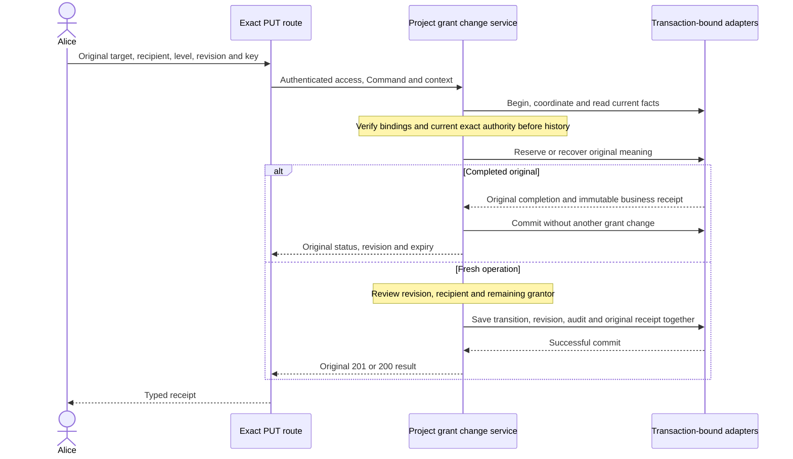

# Write a service around a complete use case

<a id="write-a-service-around-a-complete-use-case"></a>

Alice grants Bob use-only `create-access-groups` permission on Support. Alice may lose the response and retry, or her permission may change before the retry. The operation must preserve both the business change and its safeguards.

This reference teaches the implementation shape. [Application Contracts](../../inframeld-application-contracts/references/transactions-jobs-and-idempotency.md) and the [canonical service-writing guide](#service-writing-guide) own transaction, replay and execution rules. Access owns authorization. Read those sources for an affected workflow rather than treating this example as a new specification.

<a id="worked-example-add-a-complete-database-write"></a>

## Worked example: add a complete database write

**Situation.** You need an application operation that another entry point can invoke without rebuilding HTTP's authorization or database plumbing. The operation implemented by `ProjectGrantChangeService` is the reference.

**Decision and placement.** Put the public `ProjectGrantChanger` protocol and `SetProjectActionGrantCommand` in Access application roles. Put the instantiated implementation in `application/services/project_grant_change_service.py`. Inject operational and I/O capabilities directly. Domain rules stay on the membership aggregate and policies. A repository loads and saves that aggregate, while bootstrap constructs adapters.

A transaction saves related database changes together or rolls them all back. Idempotency means repeating the same operation identity and meaning can recover its outcome without applying the change again. Neither mechanism grants permission.

**Inspected teaching excerpt:** the imports, constructor and complete public methods selected from [apps/backend/src/inframeld_backend/access/application/services/project_grant_change_service.py](../../../../apps/backend/src/inframeld_backend/access/application/services/project_grant_change_service.py). This excerpt explains composition and typed inputs. It is not a standalone or replacement module. The linked class owns the complete `_manage` workflow, current-authority predicates, original-receipt checks and fresh-write safeguards described below.

```python
from typing import override
from inframeld_backend.access.application.commands.remove_project_action_grant_command import (
    RemoveProjectActionGrantCommand,
)
from inframeld_backend.access.application.commands.set_project_action_grant_command import (
    SetProjectActionGrantCommand,
)
from inframeld_backend.access.application.dtos.access_context_dto import AccessContextDTO
from inframeld_backend.access.application.dtos.project_action_grant_change_result_dto import (
    ProjectActionGrantChangeResultDTO,
)
from inframeld_backend.access.application.protocols.project_action_grant_result_reader import (
    ProjectActionGrantResultReader,
)
from inframeld_backend.access.application.protocols.project_action_grant_result_writer import (
    ProjectActionGrantResultWriter,
)
from inframeld_backend.access.application.protocols.project_grant_changer import ProjectGrantChanger
from inframeld_backend.access.application.protocols.project_grant_management_facts_reader import (
    ProjectGrantManagementFactsReader,
)
from inframeld_backend.access.application.protocols.project_membership_repository import (
    ProjectMembershipRepository,
)
from inframeld_backend.access.application.services.project_grant_change_fingerprint_service import (
    ProjectGrantChangeFingerprintService,
)
from inframeld_backend.shared.application.dtos.idempotency_context_dto import (
    IdempotencyContextDTO,
)
from inframeld_backend.shared.application.protocols.operation_idempotency import (
    OperationIdempotency,
)
from inframeld_backend.shared.application.protocols.transaction_manager import TransactionManager


class ProjectGrantChangeService(ProjectGrantChanger):
    def __init__(
        self,
        transaction_manager: TransactionManager,
        operation_idempotency: OperationIdempotency,
        membership_repository: ProjectMembershipRepository,
        project_grant_change_fingerprint_service: ProjectGrantChangeFingerprintService,
        *,
        grant_management_facts_reader: ProjectGrantManagementFactsReader,
        grant_result_reader: ProjectActionGrantResultReader,
        grant_result_writer: ProjectActionGrantResultWriter,
    ) -> None:
        self._transaction_manager = transaction_manager
        self._operation_idempotency = operation_idempotency
        self._membership_repository = membership_repository
        self._project_grant_change_fingerprint_service = project_grant_change_fingerprint_service
        self._grant_management_facts_reader = grant_management_facts_reader
        self._grant_result_reader = grant_result_reader
        self._grant_result_writer = grant_result_writer

    @override
    async def set_action_grant(
        self,
        *,
        access: AccessContextDTO,
        command: SetProjectActionGrantCommand,
        context: IdempotencyContextDTO,
    ) -> ProjectActionGrantChangeResultDTO:
        return await self._manage(
            access=access,
            command=command,
            context=context,
            fingerprint=self._project_grant_change_fingerprint_service.for_set(command),
        )

    @override
    async def remove_action_grant(
        self,
        *,
        access: AccessContextDTO,
        command: RemoveProjectActionGrantCommand,
        context: IdempotencyContextDTO,
    ) -> ProjectActionGrantChangeResultDTO:
        return await self._manage(
            access=access,
            command=command,
            context=context,
            fingerprint=self._project_grant_change_fingerprint_service.for_remove(command),
        )
```

<a id="walk-through-the-decisions"></a>

## Walk through the decisions

1. **Make collaborators visible.** The constructor names transactions, current management facts, idempotency, membership persistence, original result readers/writers and the configured fingerprint helper. Bootstrap supplies their one request-local session. A transaction object does not hide a repository or authorizer.
2. **Separate the inputs.** `access` supplies verified caller evidence. The immutable Command supplies requested target, recipient, action, level and reviewed revision. `context` retains the original key, concrete route and method. The Command establishes neither identity nor permission.
3. **Validate request meaning.** The service checks method, exact route and the supported catalogue before database work. The fingerprint helper retains stable purposes and canonical bytes for PUT and DELETE. Retired POST meaning is never converted into a new PUT.
4. **Observe and authorize current state.** Inside the bounded transaction, the facts reader takes compatible coordination and reports actor, target, recipient and remaining-grantor facts. The service checks returned bindings and applies the existing principal, Project visibility and exact-delegation policies. These checks precede history.
5. **Resolve the original operation.** Reservation receives checked scope, current authority, original context and expected safe-result kind. A completed replay must match its retained exact business receipt. It returns before fresh recipient, expected revision or handover checks and performs no mutation.
6. **Check fresh intent.** New work checks the reviewed revision. PUT requires an eligible recipient and supported grant combination. DELETE can clear suspended recipients and return no-change after departure. Organization/kind and application owning-Project checks still constrain the target.
7. **Change the aggregate only when needed.** Load an existing membership in checked scope and verify its identity. Apply the requested set/remove transition. A downgrade or removal that would strand exact eligible-human authority fails before persistence. No-op results retain the current revision.
8. **Save an immutable receipt with the change.** A changed grant, one revision increment, required audit, original completion and business receipt commit together. An authorized no-op still records its original result without another revision or change audit.
9. **Wait for commit.** A return inside the transaction context waits for successful exit. Failure and cancellation propagate for rollback. An uncertain response follows original-key recovery rather than a guessed new write.

The aggregate load, transition and save form only part of the complete operation. Copying those calls without current authorization, scope, replay, revision, handover, audit and receipt checks would change its meaning.

<a id="worked-example-handle-a-retry-or-failed-transition"></a>

## Worked example: handle a retry or failed transition

**Situation.** Alice loses a successful response, retries with revision `7`, and later loses delegation authority.

**Decision.** Keep replay explicit. With current authorization and matching operation identity/meaning, the saved result returns without loading or saving membership, even though the original revision is no longer current. A later attempt with revoked authority fails before idempotency lookup. A saved result is not permission.

The linked complete service supplies the actual branches. [The service tests](testing-and-documentation.md#worked-example-test-service-ordering-and-replay) show code proving their effects.

For new work, a stale revision stops before membership load. Wrong returned scope is an internal contract failure. An existing assignment is an explicit PUT change or no-op, rather than a creation-only duplicate conflict. Recognized rejections keep stable application messages instead of copying arbitrary domain exception text. Required persistence, audit and completion failures propagate, and the transaction owner rolls back. Cancellation is not a successful result.

An uncertain commit communication or lost response does not authorize new work with a fresh key. Follow the existing retry/recovery contract. The transaction manager neither retries automatically nor joins an already active transaction or creates a savepoint. Repository failure invalidates its tracked state. Discard the repository and loaded aggregates rather than attempting to continue the operation.

<a id="worked-example-choose-a-different-service-shape"></a>

## Worked example: choose a different service shape

**Situation.** You add authentication instead of a grant change. A provider controls response time, and a database rollback cannot undo a remote effect.

**Decision and inspected example.** `HumanSessionAuthenticationService` injects a verifier, identity reader and recovery-block reader. Its [complete authenticate method](../../../../apps/backend/src/inframeld_backend/access/application/services/human_session_authentication_service.py) verifies the provider first, then performs local reads and decisions under explicit deadlines. It does not wrap provider verification in the grant transaction. The [independent reader example](protocols-and-persistence.md#worked-example-read-a-typed-projection) includes complete source showing the shorter session boundary.

**Other variations.** These are design variations, not claims that a new endpoint exists. Creating an aggregate constructs valid new state after authorization and applicable admission rather than loading a nonexistent object. Reads use scoped readers and typed projections. Audit and reservation writers do not need artificial aggregates. Durable jobs and remote effects retain their admission/execution/recovery contracts. Lower-level admission helpers keep caller-owned transactions unless deliberately migrated.

Do not require every service to inject the grant example's full collaborator set. Reuse existing authorization families and operational capabilities when the workflow needs them. Do not add a generic executor, repository framework or command bus to hide the differences.

<a id="sources-status-and-review"></a>

## Sources, status and review

This is an inspected example of exact Project grant management, not qualification of every future command. Membership changes and the concrete Organization, group and application-account grant services retain their own workflows. Existing test reports remain recorded evidence unless personally rerun.

Review a proposed service by following typed input, current authority, checked target, replay branch, domain behavior, persistence and result. Check what fails before each side effect. Qualify actual behavior through domain, service and appropriate persistence tests. Do not add architecture or naming-enforcement tests.

- [Service-writing guide](#service-writing-guide), [complete grant chain](#grant-command-flow) and [stable domain-error mapping](../../inframeld-application-contracts/references/http-errors.md#stable-domain-error-mapping).
- [ADR-0065: service-owned transactions](../../../../docs/adr/ADR-0065-application-services-own-write-transactions.md), [ADR-0066: typed operation inputs](../../../../docs/adr/ADR-0066-use-typed-operation-contexts-and-command-classification.md), [ADR-0067: authorization capabilities](../../../../docs/adr/ADR-0067-standardize-authorization-capabilities-with-typed-requests.md) and [ADR-0068: membership aggregate/repository](../../../../docs/adr/ADR-0068-model-project-grants-through-project-membership-aggregates.md).

<a id="service-writing-guide"></a>

<a id="writing-an-application-service"></a>

### Writing an application service

Use this convention when generating, suggesting, reviewing or implementing backend services. Read Python Standards' [complete worked service example](./services-and-use-cases.md) for code and step-by-step decisions, and its [aggregate/repository example](aggregates-and-repositories.md) when those components are affected. Alice granting Bob permission on Support is the implemented reference: [`ProjectGrantChangeService.set_action_grant()`](../../../../apps/backend/src/inframeld_backend/access/application/services/project_grant_change_service.py) coordinates the operation, while [`ProjectMembership.set_action_grant()`](../../../../apps/backend/src/inframeld_backend/access/domain/entities/project_membership.py) protects the assignment transition. The [request walkthrough](#grant-command-flow) follows the real collaborators from HTTP through commit. Other domains adopt these responsibilities as their workflows are implemented.

<a id="put-each-decision-with-its-owner"></a>

#### Put each decision with its owner

A rich domain model owns meaningful behavior as well as state. The membership rejects an existing assignment at either grant level and leaves its collection unchanged on rejection. The service calls that behavior instead of inspecting a public collection, deciding the rule itself and asking a writer to insert a grant. Use business verbs on aggregates and keep their mutable collections private. Value objects validate their own invariants. Pure policies express decisions involving explicit facts or several domain objects, such as whether Alice may delegate an action to Bob.

The service still owns sequencing, checked-scope guards, retry branches and application error translation. Those responsibilities do not need to move onto an entity. Commands describe requested changes, and DTOs carry observations or results. They remain appropriate without becoming entities. Choose a focused aggregate around the state and rules that must stay consistent, as [ADR-0068](../../../../docs/adr/ADR-0068-model-project-grants-through-project-membership-aggregates.md) does for one member's direct grants.

| Component | Responsibility in the grant example |
| --- | --- |
| HTTP dependency and static mapper | Authenticate, enforce applicable CSRF, convert validated input to the flat Command and retry context, then convert committed output to the response. |
| Public application Protocol | `ProjectGrantChanger` defines inputs, results, failures and transaction ownership. |
| Application service | `ProjectGrantChangeService` coordinates the complete operation through explicit dependencies. |
| Authorization capability and domain policies | Check current visibility, eligibility and delegation under the existing coordination rules. Return the exact checked scope. |
| Aggregate and children | `ProjectMembership` owns the assignment transition and its complete direct-grant collection. Children cannot be mutated around that behavior. |
| Specific repository | Load existing membership and save supported changes, revision and required audit without committing. Keep ORM rows and persistence snapshots in infrastructure. |
| Shared operational capabilities | `TransactionManager` controls transaction lifetime. `OperationIdempotency` decides reservation/replay outcomes. Neither decides permission or mutates the aggregate. |
| Bootstrap | Assemble concrete adapters on one clean request-local session and close it afterward. |

<a id="follow-the-complete-database-command-sequence"></a>

#### Follow the complete database command sequence

For an aggregate-changing database command with the grant workflow's retry and revision contract:

1. Authenticate and map at the transport boundary. Pass authenticated access, the flat Command and operation context separately. Commands do not supply caller identity or proof of authority.
2. Compute the application-owned fingerprint before opening the transaction. Keep the established purpose and canonical bytes stable.
3. Enter `TransactionManager.begin()` in the service. Authorize current state and match the returned scope to the requested target before reservation or replay. After matching, use authorization scope downstream and leave the Command unchanged.
4. Call `OperationIdempotency.reserve_or_recover()` with the existing contexts, checked authorization, typed fingerprint and expected replay kind. Keep replay as an explicit branch. A completed replay returns before membership loading, mutation or saving.
5. For new work, check the expected revision against current authorization. Load the aggregate through its specific repository and verify the returned scope and target identity before mutation.
6. Invoke domain behavior. Translate only a recognized domain rejection whose application meaning is known, using an application-owned message and preserving its cause. Keep loading and saving outside that narrow catch. Follow [the error-mapping contract](../../inframeld-application-contracts/references/http-errors.md#stable-domain-error-mapping).
7. Save through the repository with the checked revision and original operation identity where required. Record completion through `OperationIdempotency.record_completed_result()` and require the appropriate completed outcome before commit. The change, revision, required audit and completion metadata share the transaction. Return only after successful transaction exit. A `return` inside the context still waits for its exit and commit.
8. Let the transport mapper serialize the committed result. A failure or cancellation before commit propagates for rollback. Uncertain commit communication requires the existing retry/recovery contract and does not justify starting fresh work automatically.

Constructor dependencies must make the workflow's collaborators visible. Inject I/O and operational capabilities through application Protocols, with explicit implementation inheritance and overrides. Pure application helpers, such as the fingerprint service, can remain concrete. Do not construct adapters inside the service or fetch repositories from a transaction object. Keep caller input on the method, domain state on the aggregate, and session/cache lifetime in infrastructure and bootstrap. All transaction-bound collaborators must use the same session. Types alone do not establish this guarantee.

<a id="name-collaborators-and-guards"></a>

#### Name collaborators and guards

Apply the shared [capability-naming convention](../../inframeld-coding-standards/SKILL.md#shared-conventions) to constructor parameters and their stored attributes. `facts`, `writer`, `results` and `fingerprints` hide the collaborator's responsibility. Use names such as `membership_facts_reader`, `membership_change_writer`, `membership_result_reader` and `membership_fingerprint_service`. Keep enough context to distinguish capabilities without mechanically repeating the enclosing service's full name. Already clear names such as `credential_state_reader` need no expansion.

**Inspected teaching excerpt:** the complete constructor of `ProjectMembershipChangeService` in [apps/backend/src/inframeld_backend/access/application/services/project_membership_change_service.py](../../../../apps/backend/src/inframeld_backend/access/application/services/project_membership_change_service.py). The linked module supplies the protocol and service imports, enclosing class and remaining methods. This is a constructor excerpt, not a standalone service or replacement module.

```python
    def __init__(
        self,
        *,
        transaction_manager: TransactionManager,
        membership_facts_reader: ProjectMembershipChangeFactsReader,
        membership_change_writer: ProjectMembershipChangeWriter,
        membership_result_reader: ProjectMembershipChangeResultReader,
        operation_idempotency: OperationIdempotency,
        membership_fingerprint_service: ProjectMembershipChangeFingerprintService,
    ) -> None:
        self._transaction_manager = transaction_manager
        self._membership_facts_reader = membership_facts_reader
        self._membership_change_writer = membership_change_writer
        self._membership_result_reader = membership_result_reader
        self._operation_idempotency = operation_idempotency
        self._membership_fingerprint_service = membership_fingerprint_service
```

The same service uses `_require_safe_completed_operation`, which explains the condition established before receipt recovery. `_completed` would hide that rejection is possible and that only a safe synchronous outcome is supported. Keep other helpers' names faithful to what they establish, without requiring this particular prefix for unrelated behavior.

Update constructor keywords, stored attributes, composition sites, test doubles and current examples together when renaming a dependency. This naming convention does not change factories, session lifetime or the workflow's collaborators.

<a id="adapt-the-pattern-to-the-workflow"></a>

#### Adapt the pattern to the workflow

Keep these ownership rules consistent without adding collaborators a workflow does not need:

| Workflow | Appropriate variation |
| --- | --- |
| Creating an aggregate | After authorization and applicable admission checks, create it through domain construction or a factory that enforces its invariants, then persist it. Do not require loading an aggregate that does not exist yet. |
| Reading information | Use scoped readers and typed projections. A read does not need an aggregate, reservation or write transaction just to match the command shape. |
| Authentication and provider verification | Preserve their provider/session lifecycle and short local reads. Never hold the grant transaction open while awaiting a provider. |
| Durable jobs and external effects | Follow [jobs and idempotency](../../inframeld-application-contracts/references/jobs-and-recovery.md) for admission, execution, retries and recovery. A database rollback cannot undo an external effect. |
| Lower-level admission and persistence helpers | Retain their explicit caller-owned transaction contracts unless deliberately migrated. Audit and reservation writers remain valid supporting capabilities. |

Reuse existing operational utilities and authorization families. Add domain behavior when a real transition needs it. Keep feature-specific names and invariants with their owner rather than introducing a generic command executor, repository framework or aggregate wrapper.

<a id="verify-behavior-at-the-boundaries"></a>

#### Verify behavior at the boundaries

Follow repository TDD sequencing. Domain tests exercise valid transitions, invalid scope and rejection without mutation. Service tests exercise authorization before lookup, scope guards, replay without another mutation, revision handling, explicit error mapping and failure propagation. PostgreSQL tests exercise atomic change/audit/completion, rollback, cancellation and actual concurrency. The [grant service tests](../../../../apps/backend/tests/unit/access/application/services/test_project_grant_change_service.py), [repository scenarios](../../../../apps/backend/tests/integration/access/test_project_membership_repository_postgres.py) and [recovery coordination scenarios](../../../../apps/backend/tests/integration/access/test_recovery_authorization_postgres.py) are concrete examples.

Review ownership and component layout manually. Do not replace these behavioral checks with architecture, inheritance-layout or naming-enforcement tests. This convention is qualified through the complete grant operation and the existing admission helper's shared capabilities. Further complete product workflows still need their own behavioral qualification.

<a id="grant-command-flow"></a>

<a id="follow-the-implemented-grant-command"></a>

### Follow the implemented grant command

Alice grants Bob use-only `create-access-groups` permission on Support with expected revision `7`. Her request carries an idempotency key. The backend must either commit the grant, revision `8`, audit event and replay metadata together, or leave no partial change.

Read this implementation from the outside inward:

1. [The exact-target HTTP routes](../../../../apps/backend/src/inframeld_backend/access/http/routes/project_action_grant_change_routes.py) authenticate and check cookie-write CSRF before opening request-local composition. The shared route parser bounds and strictly parses JSON or the bodyless DELETE revision query.
2. [The static mapper](../../../../apps/backend/src/inframeld_backend/access/http/mappers/project_action_grant_change_mapper.py) constructs `SetProjectActionGrantCommand` or `RemoveProjectActionGrantCommand` from the exact path and reviewed input. It separately retains the original method, concrete route and key in `IdempotencyContextDTO`.
3. [Bootstrap](../../../../apps/backend/src/inframeld_backend/bootstrap/project_grant_composition.py) shares one session across transaction, scoped facts, membership persistence, audit, idempotency and original business-result adapters. The service owns the transaction. Bootstrap closes the session after the operation.
4. [The service](../../../../apps/backend/src/inframeld_backend/access/application/services/project_grant_change_service.py) checks request meaning, computes the stable fingerprint and reads current management facts under compatible locks. It rejects wrong actor/target bindings, stale credentials, hidden Project scope, recovery ineligibility and missing exact delegation before reservation or replay.
5. `OperationIdempotency.reserve_or_recover()` receives current checked scope. A supported completed replay loads and verifies its immutable business receipt, then returns without another membership transition. Fresh work alone checks expected revision, recipient assignment eligibility and remaining human responsibility.
6. The membership repository loads and verifies an existing scoped aggregate. A changed set/remove is saved with one revision increment and required audit. Original completion and the exact business receipt share this transaction. A no-op saves its original outcome with unchanged revision and no change audit.
7. After successful transaction exit, the mapper serializes the original status, revision and business fields. A new assignment returns 201. An existing change, no-op or removal returns 200. A replay retains the original response rather than today's state.

`SqlAlchemyTransactionManager` controls transaction lifetime and rejects an already active transaction. It does not join, create a savepoint, authorize, cache a business receipt or retry uncertain work. [The idempotency input contract](../../inframeld-application-contracts/references/idempotency-and-replay.md#reservation-inputs) keeps trusted scope and request metadata separate without requiring every use case to construct a low-level reservation writer request.

<a id="trace-one-grant-and-its-retries"></a>

### Trace one grant and its retries

Alice sends exact PUT for Bob with `canGrant: false`, reviewed revision `7` and original key `grant-bob-1`. The first successful assignment commits revision `8`, audit and the original receipt together. After response loss, the same method, concrete route, actor, key and body recover that receipt only while Alice retains current exact delegation authority.



Changing Bob, the level or another meaningful input while retaining the original key conflicts. Losing current authority denies replay before history. Completed-history expiry limits duplicate detection, not Bob's grant lifetime. A later request with the old revision fails the fresh-write revision check. Unknown history never authorizes automatic new work.

The retired POST keeps its historical method, literal route, fingerprint and outcome under ordinary retention. Read-only original-operation lookup does not invoke PUT or recreate that write.
