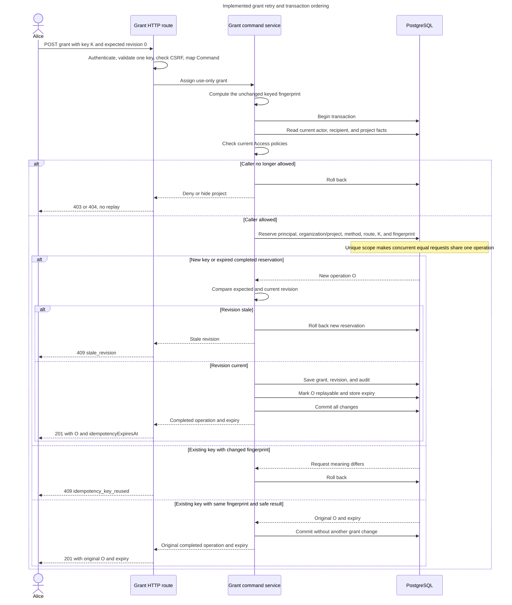

# Write a service around a complete use case

<a id="write-a-service-around-a-complete-use-case"></a>

Alice grants Bob use-only `create-access-groups` permission on Support. Alice may lose the response and retry, or her permission may change before the retry. The operation must preserve both the business change and its safeguards.

This reference teaches the implementation shape. [Application Contracts](../../inframeld-application-contracts/references/transactions-jobs-and-idempotency.md) and the [canonical service-writing guide](#service-writing-guide) own transaction, replay and execution rules. Access owns authorization. Read those sources for an affected workflow rather than treating this example as a new specification.

<a id="worked-example-add-a-complete-database-write"></a>

## Worked example: add a complete database write

**Situation.** You need an application operation that another entry point can invoke without rebuilding HTTP's authorization or database plumbing. The operation implemented by `ProjectGrantChangeService` is the reference.

**Decision and placement.** Put the public `ProjectGrantChanger` protocol and `AssignProjectUseOnlyGrantCommand` in Access application roles. Put the instantiated implementation in `application/services/project_grant_change_service.py`. Inject operational and I/O capabilities directly. Domain rules stay on the membership aggregate and policies. A repository loads and saves that aggregate, while bootstrap constructs adapters.

A transaction saves related database changes together or rolls them all back. Idempotency means repeating the same operation identity and meaning can recover its outcome without applying the change again. Neither mechanism grants permission.

**Code.** The following is the complete inspected service module, including imports, constructor, replay branch and result helper. It deliberately retains the checks surrounding load, business action and save:

**Inspected teaching excerpt:** complete inspected module from [apps/backend/src/inframeld_backend/access/application/services/project_grant_change_service.py](../../../../apps/backend/src/inframeld_backend/access/application/services/project_grant_change_service.py). This is existing code for explanation, not replacement or insertion instructions.

```python
from typing import override

from inframeld_backend.access.application.commands.assign_project_use_only_grant_command import (
    AssignProjectUseOnlyGrantCommand,
)
from inframeld_backend.access.application.dtos.access_context_dto import AccessContextDTO
from inframeld_backend.access.application.dtos.project_use_only_grant_authorization_request_dto import (
    ProjectUseOnlyGrantAuthorizationRequestDTO,
)
from inframeld_backend.access.application.protocols.project_grant_authorizer import (
    ProjectGrantAuthorizer,
)
from inframeld_backend.access.application.protocols.project_grant_changer import ProjectGrantChanger
from inframeld_backend.access.application.protocols.project_membership_repository import (
    ProjectMembershipRepository,
)
from inframeld_backend.access.application.services.project_grant_change_fingerprint_service import (
    ProjectGrantChangeFingerprintService,
)
from inframeld_backend.access.domain.errors.project_grant_errors import (
    ProjectGrantAlreadyExistsError,
)
from inframeld_backend.shared.application.dtos.accepted_async_operation_dto import (
    AcceptedAsyncOperationDTO,
)
from inframeld_backend.shared.application.dtos.completed_synchronous_operation_dto import (
    CompletedSynchronousOperationDTO,
)
from inframeld_backend.shared.application.dtos.new_operation_reservation_dto import (
    NewOperationReservationDTO,
)
from inframeld_backend.shared.application.dtos.operation_admission_context_dto import (
    OperationAdmissionContextDTO,
)
from inframeld_backend.shared.application.dtos.recovery_required_operation_dto import (
    RecoveryRequiredOperationDTO,
)
from inframeld_backend.shared.application.enums.operation_replay_kind import OperationReplayKind
from inframeld_backend.shared.application.errors.application_errors import (
    ConflictError,
    StaleRevisionError,
)
from inframeld_backend.shared.application.protocols.operation_idempotency import (
    OperationIdempotency,
)
from inframeld_backend.shared.application.protocols.transaction_manager import TransactionManager

class ProjectGrantChangeService(ProjectGrantChanger):
    def __init__(
        self,
        transactions: TransactionManager,
        authorizer: ProjectGrantAuthorizer,
        idempotency: OperationIdempotency,
        memberships: ProjectMembershipRepository,
        fingerprints: ProjectGrantChangeFingerprintService,
    ) -> None:
        self._transactions = transactions
        self._authorizer = authorizer
        self._idempotency = idempotency
        self._memberships = memberships
        self._fingerprints = fingerprints

    @override
    async def assign_use_only(
        self,
        *,
        access: AccessContextDTO,
        command: AssignProjectUseOnlyGrantCommand,
        context: OperationAdmissionContextDTO,
    ) -> CompletedSynchronousOperationDTO:
        fingerprint = self._fingerprints.for_assign_use_only(command)

        async with self._transactions.begin():
            authorization = await self._authorizer.require_authorization(
                access=access,
                request=ProjectUseOnlyGrantAuthorizationRequestDTO(
                    project_id=command.project_id,
                    recipient_principal_id=command.recipient_principal_id,
                    action_id=command.action_id,
                ),
            )

            if authorization.project_id != command.project_id:
                raise RuntimeError("Authorization returned a different project than requested.")

            operation = await self._idempotency.find_or_reserve(
                context=context,
                access=access,
                authorization=authorization,
                fingerprint=fingerprint,
                expected_replay_kind=OperationReplayKind.SAFE_RESULT,
            )

            if not isinstance(operation, NewOperationReservationDTO):
                return self._require_completed_result(operation)

            # A replay keeps its original revision. Only new work checks current state.
            if authorization.project_access_revision != command.expected_access_revision:
                raise StaleRevisionError()

            membership = await self._memberships.get(
                organization_id=authorization.organization_id,
                project_id=authorization.project_id,
                principal_id=command.recipient_principal_id,
            )
            if (
                membership.organization_id != authorization.organization_id
                or membership.project_id != authorization.project_id
                or membership.principal_id != command.recipient_principal_id
            ):
                raise RuntimeError(
                    "The loaded membership does not match the authorized assignment."
                )

            try:
                membership.assign_use_only_grant(
                    action_id=command.action_id,
                    assigned_by_principal_id=access.actor_principal_id,
                )
            except ProjectGrantAlreadyExistsError as error:
                raise ConflictError("This project action grant already exists.") from error

            await self._memberships.save(
                membership,
                expected_project_access_revision=authorization.project_access_revision,
                operation_id=operation.operation_id,
            )
            completed = await self._idempotency.record_completed_result(
                operation, replay_kind=OperationReplayKind.SAFE_RESULT
            )
            return self._require_completed_result(completed)

    @staticmethod
    def _require_completed_result(
        operation: CompletedSynchronousOperationDTO
        | AcceptedAsyncOperationDTO
        | RecoveryRequiredOperationDTO,
    ) -> CompletedSynchronousOperationDTO:
        if (
            not isinstance(operation, CompletedSynchronousOperationDTO)
            or operation.replay_kind is not OperationReplayKind.SAFE_RESULT
        ):
            raise ConflictError("The grant operation has no completed replay outcome.")
        return operation
```

<a id="walk-through-the-decisions"></a>

## Walk through the decisions

1. **Make collaborators visible.** The constructor names transactions, the specific authorizer, idempotency, memberships and the configured fingerprint helper. It does not create a PostgreSQL repository or fetch one from a transaction object. [The composition example](component-roles-and-imports.md#worked-example-add-the-grant-operation) shows one clean session supplied to every transaction-bound adapter.
2. **Separate the inputs.** `access` identifies the authenticated caller and evidence. `command` carries the requested change. `context` carries the stable retry key, method and canonical route. The Command does not establish caller identity or permission.
3. **Compute meaning before database work.** The operation's fingerprint helper retains the canonical input and purpose. Fingerprint equality alone does not authorize replay.
4. **Open the transaction and authorize now.** `require_authorization` reads current facts under the established coordination rules. The service checks the returned project against the requested project before looking up even a completed operation. It then uses checked organization/project scope downstream.
5. **Admit or replay.** `find_or_reserve` receives context, access, current authorization, typed fingerprint and expected replay kind. A supported completed outcome returns before membership loading. New work alone checks the expected revision.
6. **Load the aggregate and verify the target.** `get` uses checked scope and the requested recipient. The service checks organization, project and principal on the returned object. A broken adapter must not redirect the mutation.
7. **Invoke the business action.** `assign_use_only_grant` owns duplicate rejection and changes the private collection. The service translates only that recognized rejection to a stable application conflict, with `from error` preserving its cause. Loading and saving stay outside this narrow catch.
8. **Save and complete together.** `save` receives the checked project-wide revision and original operation ID. The repository saves supported additions, revision and required audit without committing. Completion records share that transaction.
9. **Wait for transaction exit.** A `return` inside `async with` still waits for its exit. Commit must succeed before the caller receives the result. HTTP serialization follows successful service completion.

The load → business action → save loop is the domain-change portion of steps 6–8. Copying only those three calls would lose the operation's current authorization, scope, replay, revision, audit and completion contract.

<a id="worked-example-handle-a-retry-or-failed-transition"></a>

## Worked example: handle a retry or failed transition

**Situation.** Alice loses a successful response, retries with revision `7`, and later loses delegation authority.

**Decision.** Keep replay explicit. With current authorization and matching operation identity/meaning, the saved result returns without loading or saving membership, even though the original revision is no longer current. A later attempt with revoked authority fails before idempotency lookup. A saved result is not permission.

The complete method above shows the actual branches. [The service tests](testing-and-documentation.md#worked-example-test-service-ordering-and-replay) show code proving their effects.

For new work, a stale revision stops before membership load. Wrong returned scope is an internal contract failure. A duplicate domain assignment maps to `ConflictError("This project action grant already exists.")`. Do not copy arbitrary domain exception text into that application message. Required persistence, audit and completion failures propagate, and the transaction owner rolls back. Cancellation is not a successful result.

An uncertain commit communication or lost response does not authorize new work with a fresh key. Follow the existing retry/recovery contract. The transaction manager neither retries automatically nor joins an already active transaction or creates a savepoint. Repository failure invalidates its tracked state. Discard the repository and loaded aggregates rather than attempting to continue the operation.

<a id="worked-example-choose-a-different-service-shape"></a>

## Worked example: choose a different service shape

**Situation.** You add authentication instead of a grant change. A provider controls response time, and a database rollback cannot undo a remote effect.

**Decision and inspected example.** `HumanSessionAuthenticationService` injects a verifier, identity reader and recovery-block reader. Its [complete authenticate method](../../../../apps/backend/src/inframeld_backend/access/application/services/human_session_authentication_service.py) verifies the provider first, then performs local reads and decisions under explicit deadlines. It does not wrap provider verification in the grant transaction. The [independent reader example](protocols-and-persistence.md#worked-example-read-a-typed-projection) includes complete source showing the shorter session boundary.

**Other variations.** These are design variations, not claims that a new endpoint exists. Creating an aggregate constructs valid new state after authorization and applicable admission rather than loading a nonexistent object. Reads use scoped readers and typed projections. Audit and reservation writers do not need artificial aggregates. Durable jobs and remote effects retain their admission/execution/recovery contracts. Lower-level admission helpers keep caller-owned transactions unless deliberately migrated.

Do not require every service to inject all five grant collaborators. Reuse existing authorization families and operational capabilities when the workflow needs them. Do not add a generic executor, repository framework or command bus to hide the differences.

<a id="sources-status-and-review"></a>

## Sources, status and review

This is an inspected example of the implemented human use-only assignment workflow, not qualification of every future command. Membership creation/removal and other grant changes remain separate work. Existing test reports remain recorded evidence unless personally rerun.

Review a proposed service by following typed input, current authority, checked target, replay branch, domain behavior, persistence and result. Check what fails before each side effect. Qualify actual behavior through domain, service and appropriate persistence tests. Do not add architecture or naming-enforcement tests.

- [Service-writing guide](#service-writing-guide), [complete grant chain](#grant-command-flow) and [stable domain-error mapping](../../inframeld-application-contracts/references/http-errors.md#stable-domain-error-mapping).
- [ADR-0065: service-owned transactions](../../../../docs/adr/ADR-0065-application-services-own-write-transactions.md), [ADR-0066: typed operation inputs](../../../../docs/adr/ADR-0066-use-typed-operation-contexts-and-command-classification.md), [ADR-0067: authorization capabilities](../../../../docs/adr/ADR-0067-standardize-authorization-capabilities-with-typed-requests.md) and [ADR-0068: membership aggregate/repository](../../../../docs/adr/ADR-0068-model-project-grants-through-project-membership-aggregates.md).

<a id="service-writing-guide"></a>

<a id="writing-an-application-service"></a>

### Writing an application service

Use this convention when generating, suggesting, reviewing or implementing backend services. Read Python Standards' [complete worked service example](./services-and-use-cases.md) for code and step-by-step decisions, and its [aggregate/repository example](aggregates-and-repositories.md) when those components are affected. Alice granting Bob permission on Support is the implemented reference: [`ProjectGrantChangeService.assign_use_only()`](../../../../apps/backend/src/inframeld_backend/access/application/services/project_grant_change_service.py) coordinates the operation, while [`ProjectMembership.assign_use_only_grant()`](../../../../apps/backend/src/inframeld_backend/access/domain/entities/project_membership.py) protects the assignment transition. The [request walkthrough](#grant-command-flow) follows the real collaborators from HTTP through commit. Other domains adopt these responsibilities as their workflows are implemented.

<a id="put-each-decision-with-its-owner"></a>

#### Put each decision with its owner

A rich domain model owns meaningful behavior as well as state. The membership rejects an existing assignment at either grant level and leaves its collection unchanged on rejection. The service calls that behavior instead of inspecting a public collection, deciding the rule itself and asking a writer to insert a grant. Use business verbs on aggregates and keep their mutable collections private. Value objects validate their own invariants. Pure policies express decisions involving explicit facts or several domain objects, such as whether Alice may delegate an action to Bob.

The service still owns sequencing, checked-scope guards, retry branches and application error translation. Those responsibilities do not need to move onto an entity. Commands describe requested changes, and DTOs carry observations or results. They remain appropriate without becoming entities. Choose a focused aggregate around the state and rules that must stay consistent, as [ADR-0068](../../../../docs/adr/ADR-0068-model-project-grants-through-project-membership-aggregates.md) does for one member's direct grants.

| Component | Responsibility in the grant example |
| --- | --- |
| HTTP dependency and static mapper | Authenticate, enforce applicable CSRF, convert validated input to the flat Command and retry context, then convert committed output to the response. |
| Public application Protocol | `ProjectGrantChanger` defines inputs, results, failures and transaction ownership. |
| Application service | `ProjectGrantChangeService` coordinates the complete operation through explicit dependencies. |
| Authorization capability and domain policies | Check current visibility, eligibility and delegation under the existing coordination rules. Return the exact checked scope. |
| Aggregate and children | `ProjectMembership` owns the assignment transition and its complete direct-grant collection. Children cannot be mutated around that behavior. |
| Specific repository | Load existing membership and save supported changes, revision and required audit without committing. Keep ORM rows and persistence snapshots in infrastructure. |
| Shared operational capabilities | `TransactionManager` controls transaction lifetime. `OperationIdempotency` decides reservation/replay outcomes. Neither decides permission or mutates the aggregate. |
| Bootstrap | Assemble concrete adapters on one clean request-local session and close it afterward. |

<a id="follow-the-complete-database-command-sequence"></a>

#### Follow the complete database command sequence

For an aggregate-changing database command with the grant workflow's retry and revision contract:

1. Authenticate and map at the transport boundary. Pass authenticated access, the flat Command and operation context separately. Commands do not supply caller identity or proof of authority.
2. Compute the application-owned fingerprint before opening the transaction. Keep the established purpose and canonical bytes stable.
3. Enter `TransactionManager.begin()` in the service. Authorize current state and match the returned scope to the requested target before reservation or replay. After matching, use authorization scope downstream and leave the Command unchanged.
4. Call `OperationIdempotency.find_or_reserve()` with the existing contexts, checked authorization, typed fingerprint and expected replay kind. Keep replay as an explicit branch. A completed replay returns before membership loading, mutation or saving.
5. For new work, check the expected revision against current authorization. Load the aggregate through its specific repository and verify the returned scope and target identity before mutation.
6. Invoke domain behavior. Translate only a recognized domain rejection whose application meaning is known, using an application-owned message and preserving its cause. Keep loading and saving outside that narrow catch. Follow [the error-mapping contract](../../inframeld-application-contracts/references/http-errors.md#stable-domain-error-mapping).
7. Save through the repository with the checked revision and original operation identity where required. Record completion through `OperationIdempotency.record_completed_result()` and require the appropriate completed outcome before commit. The change, revision, required audit and completion metadata share the transaction. Return only after successful transaction exit. A `return` inside the context still waits for its exit and commit.
8. Let the transport mapper serialize the committed result. A failure or cancellation before commit propagates for rollback. Uncertain commit communication requires the existing retry/recovery contract and does not justify starting fresh work automatically.

Constructor dependencies must make the workflow's collaborators visible. Inject I/O and operational capabilities through application Protocols, with explicit implementation inheritance and overrides. Pure application helpers, such as the fingerprint service, can remain concrete. Do not construct adapters inside the service or fetch repositories from a transaction object. Keep caller input on the method, domain state on the aggregate, and session/cache lifetime in infrastructure and bootstrap. All transaction-bound collaborators must use the same session. Types alone do not establish this guarantee.

<a id="adapt-the-pattern-to-the-workflow"></a>

#### Adapt the pattern to the workflow

Keep these ownership rules consistent without adding collaborators a workflow does not need:

| Workflow | Appropriate variation |
| --- | --- |
| Creating an aggregate | After authorization and applicable admission checks, create it through domain construction or a factory that enforces its invariants, then persist it. Do not require loading an aggregate that does not exist yet. |
| Reading information | Use scoped readers and typed projections. A read does not need an aggregate, reservation or write transaction just to match the command shape. |
| Authentication and provider verification | Preserve their provider/session lifecycle and short local reads. Never hold the grant transaction open while awaiting a provider. |
| Durable jobs and external effects | Follow [jobs and idempotency](../../inframeld-application-contracts/references/jobs-and-recovery.md) for admission, execution, retries and recovery. A database rollback cannot undo an external effect. |
| Lower-level admission and persistence helpers | Retain their explicit caller-owned transaction contracts unless deliberately migrated. Audit and reservation writers remain valid supporting capabilities. |

Reuse existing operational utilities and authorization families. Add domain behavior when a real transition needs it. Keep feature-specific names and invariants with their owner rather than introducing a generic command executor, repository framework or aggregate wrapper.

<a id="verify-behavior-at-the-boundaries"></a>

#### Verify behavior at the boundaries

Follow repository TDD sequencing. Domain tests exercise valid transitions, invalid scope and rejection without mutation. Service tests exercise authorization before lookup, scope guards, replay without another mutation, revision handling, explicit error mapping and failure propagation. PostgreSQL tests exercise atomic change/audit/completion, rollback, cancellation and actual concurrency. The [grant service tests](../../../../apps/backend/tests/unit/access/application/services/test_project_grant_change_service.py), [repository scenarios](../../../../apps/backend/tests/integration/access/test_project_membership_repository_postgres.py) and [recovery coordination scenarios](../../../../apps/backend/tests/integration/access/test_recovery_authorization_postgres.py) are concrete examples.

Review ownership and component layout manually. Do not replace these behavioral checks with architecture, inheritance-layout or naming-enforcement tests. This convention is qualified through the complete grant operation and the existing admission helper's shared capabilities. Further complete product workflows still need their own behavioral qualification.

<a id="grant-command-flow"></a>

<a id="follow-the-implemented-grant-command"></a>

### Follow the implemented grant command

Alice grants Bob use-only `create-access-groups` permission on Support with expected revision `7`. Her request carries an idempotency key. The backend must either commit the grant, revision `8`, audit event and replay metadata together, or leave no partial change.

Read this real implementation from the outside inward:

1. [The HTTP route](../../../../apps/backend/src/inframeld_backend/access/http/routes/project_grant_routes.py) authenticates through its dependency, including cookie CSRF, then calls `ProjectUseOnlyGrantMapper.to_command()` and `to_operation_context()`.
2. [The static mapper](../../../../apps/backend/src/inframeld_backend/access/http/mappers/project_use_only_grant_mapper.py) wraps the parsed IDs in the flat `AssignProjectUseOnlyGrantCommand`. `OperationAdmissionContextDTO` carries the key, method and canonical route. Neither record supplies permission.
3. [Bootstrap composition](../../../../apps/backend/src/inframeld_backend/bootstrap/project_grant_composition.py) opens a clean session and injects the transaction manager, specific authorizer, idempotency operation, membership repository and fingerprint service. Each database adapter uses that same session. The provider closes the session after the call.
4. [The application service](../../../../apps/backend/src/inframeld_backend/access/application/services/project_grant_change_service.py) computes the fingerprint before `TransactionManager.begin()`. Inside it, the service builds `ProjectUseOnlyGrantAuthorizationRequestDTO` from the Command's project, recipient and action and calls `ProjectGrantAuthorizer.require_authorization(access, request)` to check current facts under the existing locks. The service immediately compares the returned project ID with the Command's requested project. A mismatch raises `RuntimeError` and rolls back before `OperationIdempotency.find_or_reserve()` can reserve or inspect prior work, including a completed replay. The existing unexpected-error handler returns a generic HTTP 500 for this internal contract failure.
5. The service passes its existing admission context, authenticated access context, current authorization result, typed fingerprint and expected replay kind to `find_or_reserve()`. The shared service takes the actor from access and both scope IDs from authorization, without inspecting the Command. `IdempotencyService` alone assembles the low-level reservation request, validates the adapter's result and returns a [distinct workflow outcome](../../inframeld-application-contracts/references/idempotency-and-replay.md#workflow-outcomes). An authorized `CompletedSynchronousOperationDTO` replay returns the original operation and expiry without another grant write. For `NewOperationReservationDTO`, expected revision `7` must match the current authorization revision. The service then calls `ProjectMembershipRepository.get()` with checked organization/project scope and the requested recipient. It verifies the returned membership's organization, project and principal before calling `membership.assign_use_only_grant()` with the requested action and authenticated actor. The aggregate rejects an existing assignment at either level. The service maps that domain error to the existing conflict response. `save()` receives the changed membership, checked project revision and original operation ID. It advances the project revision once, inserts additions and delegates required audit to `AuditEventWriter.append()` in the same transaction. Replay and stale revisions never load a membership.
6. `OperationIdempotency.record_completed_result()` accepts that new reservation and records safe replay metadata. The shared service requires the stored synchronous expiry before returning a completed outcome. The grant service rejects recovery-required or asynchronous outcomes inside its transaction. Only after commit can the route use `ProjectUseOnlyGrantMapper.to_response(command=command, result=result)` to return the unchanged HTTP response. The mapper narrows the supported action and constructs `ProjectUseOnlyGrantResponse` directly with typed arguments.

`ProjectGrantChangeService` implements the public `ProjectGrantChanger` Protocol. Its collaborators are direct constructor dependencies, rather than repositories fetched from a transaction object. `SqlAlchemyTransactionManager` handles transaction lifetime only. It rejects an already active transaction instead of joining it or creating a savepoint. It propagates failures without automatic retries.

The [idempotency input contract](../../inframeld-application-contracts/references/idempotency-and-replay.md#reservation-inputs) keeps retry metadata and trusted scope explicit without making every workflow construct `OperationReservationRequestDTO`. That DTO remains the reservation writer's input. Commands carry the requested business change, while authentication and current authorization establish the caller and complete scope separately. `AuthorizedOperationScope[ProjectScope]` requires organization and project fields. Project authorization DTOs implement it with `ProjectId`, while organization-scoped inputs can supply `None`. The generic `find_or_reserve()` preserves that project type without weakening project-specific results to optional fields. Concrete DTOs declare their own fields, just like project Commands. `RequestFingerprint` validates an immutable 32-byte digest and hides its value from its representation. It preserves the existing HMAC bytes.

The context manager does not decide whether its body should run. The service keeps the replay branch explicit. A new common eligibility rule still belongs in the shared Access policy and loading, rather than this orchestration or the HTTP mapper. The fingerprint keeps its original purpose and canonical bytes so reservations made before this refactor remain recognizable.

A stale revision, failed audit write, failed completion or cancellation before commit rolls back the database effects. A lost response after commit is handled by an authorized retry with the same key and meaning. Failed or uncertain commit communication cannot justify submitting new work with a fresh key.

This is the implemented example for new complete database writes. Access owns [`ProjectOperationAdmissionService`](../../../../apps/backend/src/inframeld_backend/access/application/services/project_operation_admission_service.py) and its `ProjectOperationAdmissionRequestDTO`, because the helper coordinates project authorization. It also uses shared `OperationIdempotency`, after current action authorization and trusted scope derivation. It creates `ProjectActionAuthorizationRequestDTO` for the action family and checks the returned project before idempotency lookup. It converts method, canonical route and key into `OperationAdmissionContextDTO`. Its caller specifies the expected replay kind and owns the transaction. Generic retry decisions, outcomes and reservation persistence stay shared. Sharing them does not qualify a second complete product command. Provider cleanup, account lifecycle aggregates and the other grant workflows remain separate work.

<a id="trace-one-grant-and-its-retries"></a>

### Trace one grant and its retries

Alice assigns Bob use-only `create-access-groups` permission with key `grant-bob-1` and expected project access revision `0`. The diagram abbreviates the key as K and the saved operation ID as O. The implemented grant command fingerprints the meaningful fields and checks current authority on every attempt. Its reservation, grant, new revision, and audit event commit together.



For example, if Carol is also an eligible project member, changing Bob to Carol while keeping `grant-bob-1` conflicts. Losing permission blocks a replay before the saved result is returned. Once completed history expires, the same key is treated as a new request. Alice's old expected revision would then fail the grant's revision check. Expiry limits duplicate detection, not the lifetime of Bob's grant.

The [grant application service](#grant-command-flow) computes the fingerprint from its Command and owns the transaction. `IdempotencyService`, implementing `OperationIdempotency`, validates reservation state through the existing writer. It does not authorize, commit, cache arbitrary business results or reconstruct responses.
