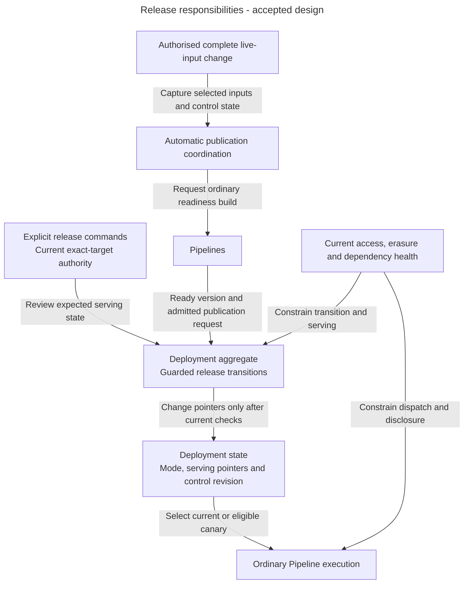
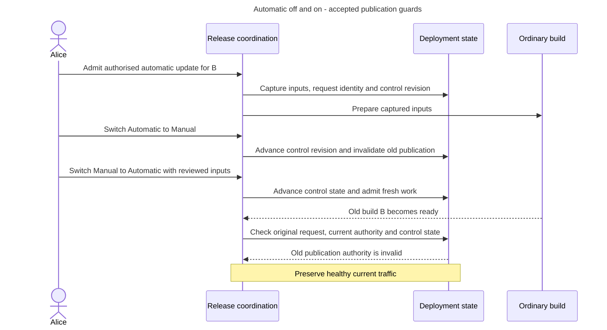

# Releases architecture: change traffic under current authority

Production serves version A. Alice starts an automatic update for B, switches to Manual, then switches back to Automatic. B may still finish preparing, but the earlier request must never regain permission to move traffic merely because the mode changed back.

## What Releases owns

Releases owns Deployment serving selection, current/candidate/designated-previous pointers, publication modes, stable canary assignment and guarded transitions. A Deployment is the stable destination callers query. It selects a complete ready PipelineVersion rather than mutable working settings.

Pipelines owns readiness builds and answer execution. Indexing owns verified search data and its current health. Access owns current release authority. Evaluation supplies evidence. Publication requires neither an evaluation nor a judge, and Evaluation cannot publish or switch Automatic off.

A candidate is a ready version being tried before promotion. A canary sends a stable subset of authorised caller identities to it. The designated previous version is the single eligible rollback target, subject to current checks.

## Main parts and boundaries

**Accepted responsibility view.** These are responsibilities inside the backend, not an implemented release engine or new network services.

Arrows describe workflow and data responsibilities. Build success records readiness, not publication. A control revision is a changing number used to detect operator choices made since work was admitted. It is separate from the version being built.

## Follow the off/on race

**Accepted target workflow.** Assume Production already exists. First default publication has its separate authorised creation path.

The mode change does not need to discard useful preparation. It invalidates the old authority to publish. A superseded request cannot become a fallback if newer work fails. Publication rechecks selected inputs, newest authorised request, current attempt, mode/control revision, serving state and current permissions together.

The default onboarding path starts Automatic. Explicit new Deployments default Manual unless automatic mode is deliberately selected. Canaries and rollback require Manual. Even a 0% attached candidate blocks switching to Automatic.

## Data and execution

PostgreSQL owns current mode, pointers, control state and admitted publication identity. A short coordinated write applies a checked transition. Long preparation and model calls remain outside that transaction under ordinary jobs and Pipeline rules.

Suppose current=A, previous=Z and candidate=B. Rejecting B leaves A and Z unchanged. Promoting B makes B current and A previous. Rollback later uses and consumes the eligible designated previous target. It is not an unlimited history browser. A stale command conflicts instead of overwriting another operator.

Canary allocation uses stable principal and rollout identities. Key rotation does not reshuffle callers, and percentages describe identities rather than exact request counts. A retained ready label does not prove current health or permission to serve erased evidence.

Manual mode and Pipeline rollback do not freeze shared connections or restore old credentials. Those changes have separate authority and safety checks. Missing or erased rollback inputs produce an unavailable outcome while preserving healthy current traffic.

## What exists today

These are accepted release behaviours. There is no implemented Releases module in the inspected source tree and no measured canary distribution implied by this diagram. Public mappings, concurrency, current health and runtime delivery still need their qualification.

Read [publication and automatic updates](publication-and-automatic-updates.md) and [canaries and rollback](canaries-and-rollback.md) for detailed creation, authority and pointer rules.

## Decisions still needed and sources

[ADR-0079](../../../../docs/adr/ADR-0079-protect-deployment-transitions-with-a-focused-aggregate.md) accepts a focused Deployment aggregate, with current authority/readiness facts and transaction orchestration supplied by application services. The [owning guide](../../../../docs/development/pipelines-and-releases.md#deployment-transition-boundary) retains exact state/load/save and concurrent-control contracts still to specify. This selects no physical schema or locking algorithm and changes no accepted publication, canary or rollback rule.

[The Pipeline/Release guide](../../../../docs/development/pipelines-and-releases.md), [Release records](../../../../docs/development/data-model.md#releases), [onboarding](../../../../docs/development/onboarding.md) and [Access](../../../../docs/development/access-control.md) own the contracts.
