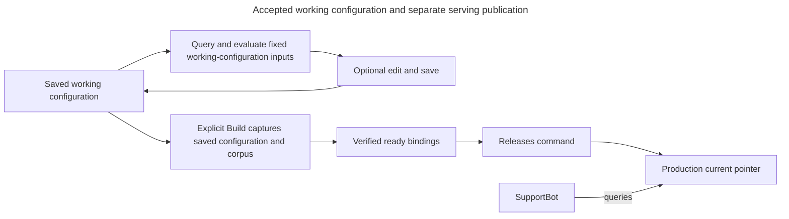

# Deployment state and release transitions

<a id="deployment-state-and-release-transitions"></a>

Production serves A, retains Z for one-step rollback and may try candidate B. A Deployment groups these related choices. The state model below is accepted design, while its exact persistence and concurrency mechanism remain pending.

> **Status:** accepted behavior is stated separately from proposed representations and qualification work. Existing Python types, generated OpenAPI and migrations own implemented shapes. Pending decisions are not accepted by this reference.

<a id="releases"></a>

<a id="releases-endpoints-pointers-and-publication-control"></a>

## Releases: endpoints, pointers, and publication control

<a id="give-each-deployment-explicit-state-and-a-stable-contract"></a>

### Give each Deployment explicit state and a stable contract

A **pointer** is a stored reference to a pipeline version, not a copy of that version’s configuration.

| Deployment state | Meaning |
| --- | --- |
| **`current`** | The version selected when a request is not assigned to an active candidate. A real Deployment starts with a current version. |
| **`candidate`** | An optional version attached for review or a canary. Attaching it starts at 0% traffic. |
| **`previous`** | The optional, designated immediate rollback target. This is one target, not an unlimited stack of earlier releases. |
| **Canary percentage** | The allocation of routing buckets to the candidate. It does not promise an exact percentage of requests. |
| **Rollout identity** | An immutable identity for the candidate rollout. Changing its percentage keeps this identity. Attaching a replacement candidate creates another. |
| **Deployment revision** | A number that increases as Deployment state changes. Commands use it to detect that someone else changed the state. |
| **Publication mode** | Whether publication follows Automatic updates or Manual releases. |
| **Automatic-update binding** | The explicitly selected document/configuration inputs used by automatic updates, separate from the Pipeline's current working revision. Working edits and direct queries do not move this binding. |
| **Publication control revision** | The revision used to invalidate publication authority captured before a mode switch. See [publication guards](publication-and-automatic-updates.md#modes). |

A pointer must target a **complete immutable PipelineVersion in the same project**. That version must satisfy the endpoint's query contract, the request and response behavior its clients expect.

Clients continue using the same endpoint while an engineer changes its selected version through the CLI, API or future Studio. This stability applies only to versions with compatible query contracts.

Check that the version's required materializations are available when a release transition uses them. A past successful build or an old readiness display cannot prove they are usable now.

<a id="nondefault-deployments-also-start-with-a-real-ready-version"></a>

### Nondefault Deployments also start with a real ready version

Creating a Deployment needs Create Deployment on the project and a ready, compatible initial PipelineVersion. One authorized transaction saves the Deployment, its initial current version, and the human creator's explicit initial permissions, including can-use-and-grant Manage releases on that Deployment.

If Alice selects Automatic updates, she also selects its update inputs. Any pending corpus/configuration must be displayed explicitly. Starting its update requires the separate Build and input checks.

The ready initial version remains current while that update runs. If the selected inputs already match, report up-to-date without another model call. Creation must never treat an unfinished build as current.

Keep three kinds of change separate. A new complete authorized live-input batch or policy-controlled automatic Build creates a newer update-request identity, replacing older work. A mode or input-binding change advances the publication control revision, invalidating old permission to publish. Working saves/restores and direct-query/evaluation do neither. The job also records its expected serving revision and attempt fence, which identifies the attempt still allowed to finish. [Releases](publication-and-automatic-updates.md#modes) checks these together before publication.

<a id="deployment-transition-owner"></a>

### Deployment transition owner

[ADR-0079](../../../../docs/adr/ADR-0079-protect-deployment-transitions-with-a-focused-aggregate.md) selects a focused Deployment aggregate for related serving/mode/control state and valid transitions. Application services obtain current authorization/readiness facts and own the load, business action, save transaction. The exact aggregate/repository contract and concurrent-control mechanism remain design work. The logical state above does not prescribe physical tables.

<a id="release-changes-move-pointers-not-history"></a>

### Release changes move pointers, not history

```text
Deployment -> mutable current/candidate/previous pointers
```

Releases owns changes to these serving references.

Promotion, candidate rejection, and rollback change the references described below. They never rewrite an answer already produced.

A live query selects **one PipelineVersion for its entire execution** and records which variant it used. Direct Pipeline queries and evaluation likewise use one fixed set of captured working-configuration inputs or a selected version. Neither a configuration edit nor a release change may switch one execution's inputs halfway through.

Here, fixed inputs mean Pipeline/model choices, corpus and prepared bindings, not an executable historical connection configuration. Observe current access revisions at admission and enforce [dispatch freshness](../../inframeld-application-contracts/references/model-dispatch-and-destinations.md#dispatch-freshness). A relevant shared access change blocks subsequent model calls in admitted work. An already-sent call may finish with its actual attribution. A retained snapshot cannot opt back into old access settings.

The backend establishes citations from source IDs and **source spans**, which identify locations in source content. A model cannot create valid IDs or locations by inventing them.



The direct-query loop never reaches a serving pointer. The explicit Build workflow creates a version, then follows the selected Deployment's publication policy. Its underlying preparation and Releases commands remain separate. These are application resources in one backend, not Docker deployments.

<a id="alice-creates-the-first-deployment"></a>

### Alice creates the first Deployment

Create Pipeline and Create Deployment are separate project permissions. When an authorized human creates either resource, they receive explicit initial **can use and grant** assignments on the new resource. These permissions do not cover existing resources or every resource created later. Renaming a resource does not change its permission identity.

Creating a Deployment includes choosing its initial PipelineVersion. That version must be ready, belong to the same project, and satisfy the Deployment's input/output contract. The backend saves the Deployment, its initial version, and the creator's initial permissions together, including Manage releases. There is no empty placeholder Deployment or separate first-release permission.

Alice can subsequently manage releases on Deployment A through that grant. She cannot publish to Deployment B without permission there. Her creator grants can be transferred or removed and do not give her additional document or model-connection access.

For the **first automatic publication**, no default Deployment exists yet. The initiating human therefore needs Create Deployment, plus Build on the selected Pipeline, permission to make the underlying change, and access to its inputs. The worker checks those permissions again before sending work and before publishing.

Creation saves the Deployment, initial version, creator grants, and project's default-route reference together. Automatic-publication settings move from the default setup record to the Deployment in that same change. The [onboarding](publication-and-automatic-updates.md#updates) and [publication](publication-and-automatic-updates.md#modes) checks still protect readiness, expected state, mode, control revision, request identity, and resource lifecycle. These checks prevent outdated work from publishing after the setup changes.

If another request creates the Deployment first, Alice's request to **create** one cannot silently become a request to **update** it.
