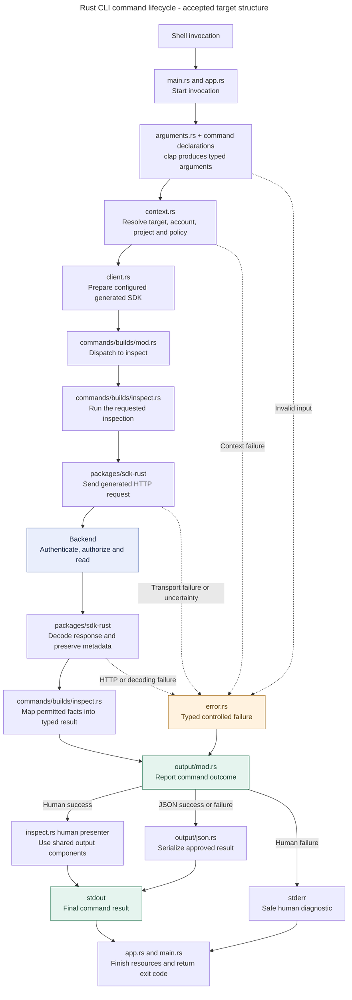

# Structure Rust CLI commands around typed results

Alice inspects a failed build. The CLI obtains the currently permitted facts through the generated SDK, then presents them as concise human output or structured JSON. Inspection succeeds even though the build failed. Waiting for that build to succeed asks for a different outcome. [CLI result contracts](../../inframeld-application-contracts/references/cli-result-contracts.md) owns that distinction.

> **Status:** accepted target structure and presentation boundaries on 2026-10-28, recorded in [ADR-0097](../../../../docs/adr/ADR-0097-organize-rust-cli-by-command-family-and-typed-results.md). The executable implements offline help/version. The library additionally implements explicit SDK construction and stateless discovery, alongside private packaging tooling. Accepted design does not establish general JSON, progress, prompts or product-command implementation. The [common JSON framing](../../inframeld-application-contracts/references/cli-output-and-automation.md) and [invocation/signal mappings](../../inframeld-application-contracts/references/cli-result-contracts.md) are accepted through the joint #124/#156 specification. Exact feature-command vocabulary, typed leaf payloads and runtime implementation remain #158 and the owning command issues' work.

| Reader question | Read |
| --- | --- |
| Where does a command belong? | [Responsibilities and placement](#responsibilities-and-placement) |
| Where do clap declarations live? | [Compose one command tree](#compose-one-command-tree-from-local-declarations) |
| What happens during an invocation? | [Command lifecycle](#command-lifecycle) |
| How do results reach humans and scripts? | [Typed outcomes](#typed-outcomes-and-two-renderers) and [shared presentation](#shared-presentation-and-interaction) |
| What demonstrates the behavior? | [Checks for a new command](#checks-for-a-new-command) |

## Responsibilities and placement

Keep one CLI Cargo package with a small executable and library. A crate is a compilation/API boundary, while modules organize code within it. Use command-family modules inside the package. Keep the generated SDK and private xtask in their existing packages. Extract another crate when actual reuse or a demonstrated compilation-boundary benefit justifies its public API and maintenance.

The [component-role reference](module-design.md) owns the two supported patterns: a small command adapter and a substantial reusable capability. It defines operation, value, policy and adapter placement without imposing an identical Onion tree on every feature. Use it for internal decomposition, while this reference owns the root command structure and presentation lifecycle. [Rust documentation guidance](documentation.md) owns component rustdoc and examples.

The implemented foundation already places runtime orchestration in private `app.rs`, preserving the public `run` re-export. `commands/version.rs` directly writes the offline result from `BuildMetadata::render`, also used by packaging qualification. The zero-argument command has no empty argument record. Stateless discovery is a separate cohesive capability, as mapped in [module design](module-design.md#capability-pattern). The xtask has private argument and application modules, a packaging context, and separate archive-preflight and native-qualification modules behind its verification facade. These concrete components do not establish the general reporting framework below.

The following is the target organization under `apps/cli/`. The build family illustrates placement, without selecting public command names. Create files with real uses rather than empty scaffolding.

```text
apps/cli/
├── src/
│   ├── main.rs
│   ├── lib.rs
│   ├── app.rs
│   ├── arguments.rs
│   ├── context.rs
│   ├── client.rs
│   ├── error.rs
│   ├── metadata.rs
│   ├── commands/
│   │   ├── mod.rs
│   │   ├── version.rs
│   │   └── builds/
│   │       ├── mod.rs
│   │       ├── inspect.rs
│   │       └── list.rs
│   ├── output/
│   │   ├── mod.rs
│   │   ├── components.rs
│   │   ├── json.rs
│   │   ├── progress.rs
│   │   ├── style.rs
│   │   └── values.rs
│   └── interaction.rs
├── tests/
└── xtask/
```

| Area | Responsibility |
| --- | --- |
| `main.rs` | Enter the application and return its process exit. |
| `lib.rs` | Declare modules and expose the small runtime/tooling API. |
| `app.rs` | Coordinate parsing, dependency setup, dispatch and finalization. |
| `arguments.rs` | Root command selection, global options and genuinely shared argument groups. |
| `context.rs` | Resolve explicit target/account/project inputs and invocation policy under the owning context contract. |
| `client.rs` | Construct the configured generated SDK and provide shared client-boundary support. |
| `error.rs` | Classify shared CLI failures while preserving useful safe causes and metadata. |
| `metadata.rs` | Retain embedded build and compatibility metadata ownership. |
| `commands/<family>/` | Group family dispatch and command-specific arguments, execution, results and human views. |
| `output/` | Own final reporting, JSON framing and shared human rendering mechanics. |
| `interaction.rs` | Obtain explicit inputs and decisions under the invocation's interaction policy. |

Keep a small command's argument struct, execution function, typed result and human presenter together. Separate their functions and responsibilities even when they share a file. Split substantial or independently reusable pieces when needed. Rust does not inherit Python's one-primary-type-per-file rule.

Keep command-specific helpers local. Share a helper within the family when related commands use it, and promote common rendering decisions into `output/`. Do not move every result into a global models folder, introduce a command trait per operation, or add a registry merely to dispatch a closed command enum.

## Compose one command tree from local declarations

Consider the illustrative syntax `inframeld builds inspect bld_123 --json --no-input`. A clap declaration describes accepted input, help and argument relationships. It performs no product operation.

| Declaration owner | Example responsibility |
| --- | --- |
| `apps/cli/src/arguments.rs` | Declare shared flags once and select the build family. |
| `apps/cli/src/commands/builds/mod.rs` | Declare the family's subcommand enum, referencing inspection arguments. |
| `apps/cli/src/commands/builds/inspect.rs` | Declare the inspection-specific build selector beside its handler. |

For example, this is a complete illustrative declaration-only new file at `apps/cli/src/commands/builds/inspect.rs`. It is not an implemented product command.

```rust
use clap::Args;

#[derive(Debug, Args)]
pub(crate) struct Arguments {
    /// Build to inspect.
    #[arg(value_name = "BUILD_ID")]
    pub(crate) build_id: String,
}
```

The family enum's `Inspect` variant carries `inspect::Arguments`, and the root enum carries the family arguments. clap composes these references into one parser and help tree. The string above represents raw input only. Validate and convert it using the approved identifier contract rather than treating parsing as resource existence or authorization.

Use shared global flags with clap's global propagation where their meaning is shared. Qualify their use before and after subcommands and their presence in subcommand help. Reuse argument groups for genuinely shared inputs. Create a separate resolved-options record when configuration precedence or validation changes meaning, rather than copying every argument struct into another identical type.

Use a non-exiting parse boundary such as `try_parse_from` so controlled argument failures reach shared reporting. The [machine-channel contract](../../inframeld-application-contracts/references/cli-output-and-automation.md#use-one-predictable-machine-channel) defines diagnostic output intent on parsing failure and the help/version/completion channel exceptions. Keep that narrow intent selection separate from command parsing and execution.

## Command lifecycle

The diagram follows an ordinary remote inspection. Solid arrows show calls and returned information. Dotted arrows show representative controlled failures. The blue backend box is a separate process, while all other nodes execute within the CLI process. Labels describe target responsibilities, not a claim that every named source file or command already exists.



After parsing, resolve the invocation's explicit selections and independent output, interaction, terminal and verbosity policies. Keep shared invocation state cohesive and pass required capabilities narrowly. Avoid a context containing every service. [Targets and accounts](../../inframeld-application-contracts/references/cli-targets-and-accounts.md) owns selector precedence and authority.

The family dispatcher invokes the handler. The handler calls the generated operation and maps its permitted response into a typed CLI result. It retains available response metadata and useful typed failures. The backend owns permissions, resource state, revision guards, job lifecycle and retry eligibility. `client.rs` does not grow another handwritten endpoint client or an automatic repair/retry layer.

The shared reporting boundary selects the human presenter or JSON serializer and converts the command outcome to its approved exit. A family dispatcher can pass its typed result and presenter function to shared finalization. Use a small presentation trait only when actual concrete results benefit. Neither a generic executor nor a universal representation tree is required.

Offline help and version take an early path without persistent account context or remote client construction. Descriptive dry-run takes its defined explanation path before the requested operation. Its bounded metadata-read exception remains with [output and automation](../../inframeld-application-contracts/references/cli-output-and-automation.md#explain-an-invocation-without-performing-its-operation). Longer commands can separately send confirmed progress observations to `output/progress.rs` on stderr.

## Typed outcomes and two renderers

Keep what the caller requested, the command outcome and confirmed resource state distinct. A typed result may carry known effects, warnings and relevant recovery facts. Preserve partial and uncertain information without inventing a job identity or a no-effect claim.

A command's human presenter composes shared components from those facts. JSON serializes the approved typed representation directly. Do not scrape human text, serialize table cells or expose the SDK response as an automatically stable CLI schema. Human durations can be formatted while JSON retains its approved numeric representation.

A successful inspection of a failed job exits `0`. Waiting for a requested workflow that fails or only partly completes ordinarily exits `1`. Missing or incompatible invocation inputs ordinarily exit `2`. The [result contract](../../inframeld-application-contracts/references/cli-result-contracts.md#separate-command-success-from-background-work-success) owns those meanings, remaining per-command mappings and qualifications. File organization does not settle exact JSON fields or signal behavior.

## Shared presentation and interaction

[Application Contracts' presentation reference](../../inframeld-application-contracts/references/cli-presentation-components.md) owns reusable component responsibilities and semantic limits. Place field lists, tables, summaries and change-review mechanics in `components.rs` initially, semantic styles in `style.rs` and human value formatting in `values.rs`. Shared output also owns destination capabilities, sanitization, paging and progress rendering. Split components when real uses justify it.

Use one outer reporting owner for controlled success/failure, streams and exit conversion. Ordinary JSON has one final versioned object, including controlled failures. Help, version, completion, raw artifacts and secrets retain their explicitly specified channel behavior. A killed process or broken output may leave incomplete framing. Absence of a result cannot establish absence of effects.

Presenters and progress sinks perform no SDK calls, credential refresh, authorization or retry decisions. Prompts obtain explicit inputs under `interaction.rs`. They cannot create a fallback identity, elevate permissions or supply missing values in noninteractive execution. Shared components cannot fetch protected details or guess missing counts to complete a screen.

## Public surface, tooling and evolution

Keep modules private or `pub(crate)` unless a real consumer needs an API. `lib.rs` exposes the runtime entry and, when completion/manual generation is delivered, a small command-definition factory for xtask. Both runtime parsing and tooling consume the same clap declarations. Review existing consumers before narrowing current public seams.

Keep the selected [library stack](cli-libraries.md) as the rendering/tooling baseline. Add dependencies with actual features, preserving the pinned toolchain and strict authored-code checks. The generated SDK retains generator-owned settings.

The existing private xtask remains responsible for packaging and qualification. Its normalization, metadata and native verification ownership stays documented in the [CLI guide](../../../../apps/cli/README.md). Its evidence output does not define the public command envelope.

## Checks for a new command

Follow the [shared behavioral TDD contract](../../inframeld-coding-standards/references/testing-and-documentation.md). Check actual behavior at suitable boundaries:

- Exercise requested outcomes, relevant rejection, partial effects and uncertainty. Inspection and successful background execution remain distinct.
- Check human and JSON views against the same permitted facts, with explicit assertions for approved machine fields and types.
- Exercise arguments, global flags, missing/noninteractive inputs, streams, exits and color-free output through process tests.
- Check narrow widths and hostile terminal text where presentation supports them. Review representative human snapshots without making them the sole semantic test.
- Demonstrate that rendering and dry-run add no requested operation or extra SDK call. Preserve necessary authorized metadata exceptions.
- Test paging, explicit streaming, raw artifacts and show-once secrets where supported. Resolve channel conflicts before effects.
- Keep controlled SDK/HTTP evidence distinct from provider, database and release qualification.

Use local unit tests for pure conversion/presentation and process or integration tests for observable boundaries. Do not add code-layout, naming, import-boundary or composition-root construction tests.

Include the short manual feature recipe required by [CLI directory guidance](../../../../apps/cli/AGENTS.md#manual-feature-verification), linking the existing developer guide in the handoff. State when a library-only feature has no executable entry point. The [documentation reference](documentation.md#examples-that-teach-and-remain-valid) distinguishes component examples, automated checks and a manual user journey.

## Reading the implementation and sources

[The current CLI guide](../../../../apps/cli/README.md) owns implemented commands and verification limits. [ADR-0097](../../../../docs/adr/ADR-0097-organize-rust-cli-by-command-family-and-typed-results.md) records the accepted structure and alternatives. Application Contracts owns behavior, Rust Standards owns authored Rust conventions, and the [Rust SDK skill](../../inframeld-rust-sdk/SKILL.md) owns generated consumption and maintenance.

The external examples inform this choice without imposing their whole architecture: [Cargo command modules](https://github.com/rust-lang/cargo/blob/master/src/bin/cargo/commands/build.rs), [uv's command-family facade](https://github.com/astral-sh/uv/blob/main/crates/uv/src/commands/mod.rs) and [shared Printer](https://github.com/astral-sh/uv/blob/main/crates/uv-command-support/src/printer.rs), [ripgrep printers](https://github.com/BurntSushi/ripgrep/blob/master/crates/printer/src/lib.rs), and [Jujutsu UI](https://github.com/jj-vcs/jj/blob/main/cli/src/ui.rs). [clap's derive tutorial](https://docs.rs/clap/latest/clap/_derive/_tutorial/) and [global-argument API](https://docs.rs/clap/latest/clap/builder/struct.Arg.html#method.global) explain the declaration mechanics.
