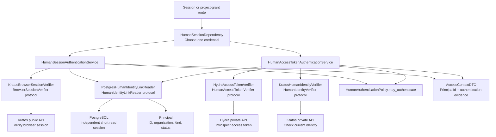
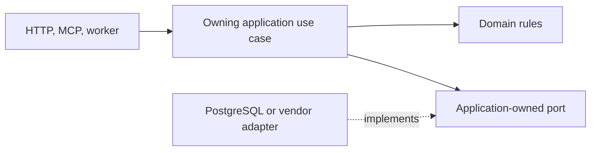

# How the application is organized

Use this guide to find the code that should own a change. Start with [the product overview](../ARCHITECTURE.md), then follow Alice's upload below. The [data model](data-model.md) defines records, and [API contracts](api-contracts.md) defines how clients call the backend.

Alice updates a handbook in Support. Knowledge records the document, Indexing prepares it for search, and a later release may make the new version live. Keeping these responsibilities separate lets us change one part without giving it control over the others.

Sections 1–2 explain the owners and follow a request. Sections 3–5 explain how to save changes safely and review an implementation.

> **Design status:** These are accepted v1 design rules. The component map and human-session flow describe the implemented backend foundation. The upload, worker, and later domain journeys describe accepted behavior that still needs implementation and verification where noted.

## Contents

| Reader’s question | Start here |
| --- | --- |
| Where does my change belong? | [1. One backend, several owners](#model) |
| Which component should I open? | [Component map and conventions](#component-conventions) |
| How do common eligibility rules stay in one place? | [Shared Access eligibility](#shared-access-eligibility) |
| How do authorization capabilities scale? | [Typed authorization families](#typed-authorization) |
| How should I write a service with rich domain behavior? | [Service-writing guide](#service-writing-guide) |
| What does a complete write operation look like? | [Implemented grant command](#grant-command-flow) |
| What evidence does an access context carry? | [Authentication evidence](#access-context-evidence) |
| How does a human-session request work? | [Implemented authentication flow](#authentication-flow) |
| Where are CLI credential versions captured and checked? | [Credential-version flow](#human-credential-version-flow) |
| How does work reach its owner? | [2. Follow a command and a query](#operation) |
| Where do transactions start and end? | [3. Keep changes consistent](#coordination) |
| What belongs in HTTP, Studio, or MCP? | [4. Share behavior across entry points](#entry-points) |
| How do I review a change? | [5. Maintainer checks](#maintainer-checks) |
| Why these choices, and what remains open? | [6. Decision and reference map](#decision-map) |

<a id="model"></a>

## 1. One backend, several owners

The backend runs as two separate processes, built from the same backend image:

- **API:** receives application requests.
- **Worker:** carries out background work using the same application operations and business rules.

The Next.js console, **Studio**, handles presentation and browser-session integration - it is not a second implementation of the backend's business logic.

A separate, restricted parser converts uploaded files. Because documents can be malicious, it runs within the [document-processing restrictions](ingestion-security.md) and cannot change application business records.

**Docker Compose is the only supported deployment method.**

For a human-readable map of each owner's main parts and selected workflows, read [the module map](../../.agents/skills/inframeld-architecture/references/module-map.md). Shared application support is explained in [Application Contracts](../../.agents/skills/inframeld-application-contracts/references/components-and-services.md). These logical views are distinct from process topology and source import direction. Proposed internal choices remain pending and must not be used as accepted component contracts.

### Architecture principles and dependency rules

**Domain-Driven Design (DDD)** organizes code around the product's concepts and rules: documents, indexes, pipelines, evaluations, releases, and access. Each business area has a clear owner.

**Clean Architecture** keeps those business rules independent of the technologies used to expose, store, or execute them. Changing a web framework or storage adapter should not require moving business rules into that technology.

**Lightweight CQRS**, short for _Command Query Responsibility Segregation_, separates operations that change state from operations that read it. It does not require separate databases or a messaging system.

These rules make ownership and dependencies strict. They do not require extra design patterns for their own sake.

### Which code may depend on which

The dependency direction is:

```text
HTTP / browser-session adapters
    -> application commands and queries
        -> domain rules and values

PostgreSQL / Chroma / model / artifact adapters
    -> application-owned ports

Bootstrap composition root
    -> concrete implementations and configuration
```

These arrows describe code dependencies, not the order of network calls.

The **domain** contains business rules and values. It must not import FastAPI, an object-relational mapper (ORM), Chroma, Docling, LiteLLM, or identity-provider libraries.

The **application layer** carries out requests through **use cases**, the steps for an operation such as accepting an upload. Its inputs and results use values defined by Inframeld, rather than objects from a web framework or vendor library.

A **port** describes a capability the application needs, such as saving a file or calling a model. An **adapter** provides it using a particular technology. For example, an adapter translates a provider's response into the result type the application expects.

Startup code creates and connects these implementations. This is the **composition root**. Passing the required objects into a use case is called **dependency injection**. Domain code receives its dependencies directly rather than looking them up in a service locator or framework container.

<a id="component-conventions"></a>

### Finding a component in the implemented backend

Follow **domain → layer → component role**. First choose the owner, then the layer, then the job the component performs. To follow a business workflow, open its application service; to inspect a collaborator's contract, open its protocol. Authentication and authorization share these role folders inside Access.

The layout below shows the main components under `apps/backend/src/inframeld_backend/`. Individual row mappings and some shared adapters are abbreviated. Create a role folder only when implemented code needs it.

```text
inframeld_backend/
├── main.py
├── migrate.py
├── bootstrap/                         # construction, assembly, settings, lifecycle
│   ├── application_factory.py
│   ├── application_settings.py
│   ├── access_composition.py
│   ├── project_grant_composition.py
│   ├── access_components.py
│   ├── application_resources.py
│   └── application_lifespan.py
├── access/
│   ├── domain/
│   │   ├── entities/principal.py
│   │   ├── value_objects/             # PrincipalId, ProjectId, ActionId, identity values
│   │   ├── enums/                     # PrincipalKind, PrincipalStatus, ProjectStatus
│   │   ├── policy_inputs/action_authorization_policy_input.py
│   │   └── policies/                  # named classes with pure static methods
│   │       ├── action_authorization_policy.py
│   │       ├── human_authentication_policy.py
│   │       └── project_visibility_policy.py
│   ├── application/
│   │   ├── commands/assign_project_use_only_grant_command.py
│   │   ├── services/
│   │   │   ├── human_session_authentication_service.py
│   │   │   ├── human_access_token_authentication_service.py
│   │   │   ├── unavailable_human_session_authentication_service.py
│   │   │   └── action_authorization_service.py
│   │   ├── protocols/
│   │   │   ├── human_session_authenticator.py
│   │   │   ├── human_access_token_authenticator.py
│   │   │   ├── human_access_token_verifier.py
│   │   │   ├── human_identity_verifier.py
│   │   │   ├── action_authorizer.py
│   │   │   ├── browser_session_verifier.py
│   │   │   ├── human_identity_link_reader.py
│   │   │   └── project_action_facts_reader.py
│   │   ├── dtos/
│   │   │   ├── access_context_dto.py
│   │   │   ├── verified_human_identity_dto.py
│   │   │   ├── project_action_target_dto.py
│   │   │   └── project_action_facts_dto.py
│   │   └── value_objects/
│   │       ├── browser_session_credential.py
│   │       └── human_access_token_credential.py
│   ├── http/
│   │   ├── routes/                    # current_session_routes, project_grant_routes
│   │   ├── dependencies/              # HumanSessionDependency, CSRFProtectionDependency
│   │   ├── mappers/project_use_only_grant_mapper.py
│   │   ├── openapi/human_authentication_responses.py
│   │   └── responses/                 # CurrentSessionResponse, ProjectUseOnlyGrantResponse
│   └── infrastructure/
│       ├── readers/                   # PostgresHumanIdentityLinkReader, project facts reader
│       ├── mappers/postgres_human_credential_state_mapper.py
│       ├── revokers/hydra_human_oauth_credential_revoker.py
│       ├── verifiers/
│       │   ├── kratos_browser_session_verifier.py
│       │   ├── hydra_access_token_verifier.py
│       │   └── kratos_human_identity_verifier.py
│       ├── settings/                   # KratosSettings, HydraSettings, CSRFSettings
│       ├── rows/                      # one ORM row or mapping base per module
│       └── types/enum_types.py
└── shared/
    ├── domain/
    │   ├── errors/domain_errors.py
    │   └── validation/value_validation.py
    ├── application/
    │   ├── errors/
    │   ├── enums/application_error_code.py
    │   ├── dtos/command_context_dto.py
    │   └── value_objects/             # RequestId and OperationId
    ├── http/
    │   ├── routes/health_routes.py
    │   ├── dependencies/request_identity.py
    │   ├── middleware/request_context_middleware.py
    │   ├── requests/pagination_query.py
    │   ├── responses/                 # PageResponse, ProblemDetails, ValidationIssue
    │   ├── handlers/
    │   ├── mappers/
    │   ├── builders/
    │   ├── openapi/
    │   ├── definitions/               # problem definition and reviewed catalogue
    │   ├── types/                     # problem codes and bounded field aliases
    │   └── validation/
    └── infrastructure/
        ├── resources/database.py
        ├── settings/database_settings.py
        ├── migrations/migration_runner.py
        ├── rows/                      # Alembic's version row and mapping base
        ├── errors/
        ├── logging/
        ├── diagnostics/
        ├── timing/
        └── types/logging_types.py
```

### Component roles and naming

Use one primary public type per production module, with a matching snake-case filename. Entities, IDs, enums, and policy inputs have separate defining modules. Cohesive exception families, private helpers, constants, and framework type aliases may remain grouped. Import from the defining module; do not retain compatibility aliases after an internal move.

| Role | Naming and example | Responsibility |
| --- | --- | --- |
| Application operation | Capability-named protocol: `HumanSessionAuthenticator`, `ActionAuthorizer` | Specify public inputs, results, failures, and ownership independently of HTTP and vendors. |
| Application service | `*Service`: `HumanSessionAuthenticationService` | Coordinate the complete workflow through injected protocols. |
| I/O capability | Specific protocol: `BrowserSessionVerifier`, `ProjectActionFactsReader` | State the external capability the application requires. |
| Provider revocation | Specific protocol: `HumanOAuthCredentialRevoker`, with `HydraHumanOAuthCredentialRevoker` in `infrastructure/revokers` | Revoke a trusted provider scope and report confirmation, rejection or uncertainty. |
| Aggregate repository | Specific protocol: `ProjectMembershipRepository`, with `PostgresProjectMembershipRepository` in `infrastructure/repositories` | Load an existing aggregate and persist supported changes and audit in the caller's transaction. |
| Entity | `Principal` in `entities/principal.py` | Hold account state with stable identity; equality follows its ID. |
| Value object | `PrincipalId`, `IdentitySubject`, `BrowserSessionCredential` in `value_objects` | Give a value its meaning and enforce its invariants. |
| Enum | `PrincipalStatus` in `enums/principal_status.py` | Define a closed vocabulary. |
| CQRS command input | `*Command` in `commands/*_command.py` | Describe the change to request, such as `AssignProjectUseOnlyGrantCommand`. |
| CQRS query input | `*Query` in `queries/*_query.py` | Describe the read to request, such as `GetProjectQuery`. |
| Other application DTO | `*DTO` in `dtos/*_dto.py` | Carry results, read projections, or caller/operation context. |
| Dedicated policy input | `*PolicyInput` in `policy_inputs/*_policy_input.py` | Supply the values a domain policy needs for its decision. |
| Policy | `*Policy` in `policies/*_policy.py` | Make a pure decision through static methods with explicit inputs. |
| Adapter | Technology-prefixed `PostgresHumanIdentityLinkReader`, `KratosBrowserSessionVerifier` | Perform I/O and convert external values at the boundary. |
| HTTP dependency | `*Dependency` | Extract request inputs and invoke an application operation. |
| Routes | `*_routes.py` | Register endpoints and translate their inputs and outputs. |
| Feature HTTP mapper | Static `*Mapper` class in `mappers/*_mapper.py` | Convert validated HTTP input to a Command and application results to the published response. Perform no I/O. |
| HTTP model | `*Request` / `*Response` | Validate or serialize the wire contract using Pydantic. |
| Middleware | `*Middleware` in `*_middleware.py` | Wrap the ASGI request lifecycle. |
| ORM mapping | `*Row` in `infrastructure/rows` | Map persisted fields using typed constructors and expressions. |
| Shared persistence conversion | Technology-prefixed static `*Mapper` in `infrastructure/mappers` | Convert database projections into application/domain values when several adapters share that conversion. Perform no I/O or authorization. |
| Settings | `*Settings` in `infrastructure/settings` | Validate resource configuration; bootstrap aggregates it. |
| Bootstrap assembly | `AccessComponents`, `ApplicationResources` | Group constructed collaborators and owned resources. These are not application DTOs. |

Existing published HTTP names such as `ProblemDetails` and `ValidationIssue` are preserved, including their OpenAPI descriptions. New HTTP models use Request/Response naming. CQRS command and query inputs end in `Command` and `Query`, without `DTO`. Other application transfer records use the uppercase `DTO` suffix, including command/query results, read projections, and caller/operation metadata.

`AssignProjectUseOnlyGrantCommand` is implemented under Access's `application/commands/` folder and describes the supported grant change. `GetProjectQuery` remains a naming example for a future read that benefits from a named input. Create role folders with the first real workflow that needs them. Query results can still be DTOs, and `CommandContextDTO` remains metadata rather than a command input.

This follows the CQRS distinction between a request to change state and a request to read it. Microsoft describes a command as a specialized DTO and illustrates a purpose-specific name such as `CreateOrderCommand`. Inframeld uses the more specific `Command` and `Query` suffixes for these input roles. They need no DTO base class or command bus. The agreed nominal `Command` base supplies classification only. See [Microsoft's command definition](https://learn.microsoft.com/en-us/dotnet/architecture/microservices/microservice-ddd-cqrs-patterns/microservice-application-layer-implementation-web-api#the-command-class) and [CQRS overview](https://learn.microsoft.com/en-us/azure/architecture/patterns/cqrs).

[ADR-0066](../adr/ADR-0066-use-typed-operation-contexts-and-command-classification.md) selects a nominal `Command` base in `shared/application/commands/command.py` and the field-based `ProjectCommand` Protocol in `shared/application/protocols/project_command.py`. A concrete project Command explicitly inherits both and declares `project_id: ProjectId` itself. The interface provides neither stored fields nor execution. Commands for organization-wide changes need no project field. A Protocol cannot extend a nominal class, so the two bases meet on the concrete Command.

Strict Pyright rejects the wrong field type and an attempt to instantiate an explicit implementation missing `project_id`. This does not guarantee an error at the incomplete class declaration, perform runtime field validation or express read-only access through the Protocol. Concrete Commands remain frozen, slotted dataclasses. These required-field contracts and nominal classification are narrow exceptions to the normal preference for behavioral interfaces.

Keep execution in application services behind capability-named protocols. A command or query input may reject invalid values or inconsistent combinations of its own fields without I/O. It cannot establish current permission, resource existence, or a match with the current stored revision. Preserve those checks in their owning workflows. Direct typed parameters remain valid when a separate input record would add no useful meaning.

A FastAPI dependency and ASGI middleware have different lifetimes. FastAPI invokes `HumanSessionDependency` for the route that declares it. `RequestContextMiddleware` wraps requests at the ASGI boundary. The cookie workflow belongs to `HumanSessionAuthenticationService`, and the human bearer workflow belongs to `HumanAccessTokenAuthenticationService`. The dependency chooses one of them before provider verification.

### Record roles: DTO, policy input, entity, and value object

A dataclass is an implementation mechanism, not a record's architectural role. Use standard `@dataclass(frozen=True, slots=True)` for command/query inputs, other application DTOs, policy inputs, and immutable value objects. Do not add custom decorators, empty protocols, or generic record frameworks. Keep nominal Command classification and required-field interfaces limited to the agreed ADR-0066 exceptions. Dataclass annotations do not perform runtime validation. Value objects retain their explicit checks, and command/query inputs may validate their own input constraints.

| Implemented record | What it means |
| --- | --- |
| `VerifiedHumanIdentityDTO` | The provider verified this authority/subject pair. Local account admission remains to be checked. |
| `AccessContextDTO` | The authenticated caller's principal ID and required authentication evidence, without cached status or permissions. |
| `ProjectActionTargetDTO` | The exact project selected for authorization; no proof of existence or visibility. |
| `ProjectActionFactsDTO` | Stored project/account status, membership, and exact-grant existence returned by a reader. |
| `ActionAuthorizationPolicyInput` | The eligibility and grant values the action policy consumes. |
| `CommandContextDTO` | Trusted request and operation identities used in command diagnostics. |
| `Principal` | A local account snapshot whose entity identity remains its `PrincipalId`. |
| `PrincipalId` | A UUID belonging to the principal identifier type, without proof that an account exists. |

Only `PolicyInput` identifies a dedicated policy input record. The word "Facts" in `ProjectActionFactsDTO` describes the reader's data. Its DTO suffix makes its application boundary explicit. The service converts it into the policy input. Policies may also accept an existing entity or typed parameters directly: human admission consumes `PrincipalAccessPolicyInput`, and project visibility accepts status and membership parameters.

[`Principal`](../../apps/backend/src/inframeld_backend/access/domain/entities/principal.py) contains its ID, organization, kind, and status. Equality and hashing use only its ID. The identifiers and enums live in separate files without weakening that cohesive entity. Pass the entity when a rule needs its state together; pass its ID when only identity is needed.

UUID IDs are frozen, slotted dataclasses wrapping a parsed UUID. Constructors reject raw strings, and equal UUIDs in different ID classes remain distinct. Preserve existing UUID versions and zero values. Parse and validate at external boundaries, then explicitly wrap/unwrap IDs at persistence and transport boundaries. Existence and authorization require their normal checks.

Identity authorities and subjects are separate value objects, grouped by `VerifiedHumanIdentityDTO` after provider verification. `BrowserSessionCredential` remains application-owned and hides its contents in representations and validation messages. Never log its explicit `.value`. `RequestId` and `OperationId` represent correlation, not authority.

### Qualified policy calls

Call pure business decisions through their policy class:

| Call | Decision |
| --- | --- |
| `HumanAuthenticationPolicy.may_authenticate(...)` | Is the linked principal a currently eligible human? |
| `ProjectVisibilityPolicy.may_view_project(...)` | May this caller learn that the organization-scoped project exists? |
| `ActionAuthorizationPolicy.may_perform_action(policy_input)` | Does current eligibility include the exact requested grant? |

Policy methods use `@staticmethod`, explicit inputs, and no I/O or mutable class state. Services own orchestration and their injected collaborators.

### Static utilities and mappers

Default reusable pure production conversion and validation utilities to cohesive named classes with `@staticmethod` methods. Import the class directly and call it by name. For example, import `ValueValidation` from its defining module and call `ValueValidation.require_uuid(value)`, rather than exposing a standalone check or using a module-qualified utility call. Shared primitive checks belong to `ValueValidation` in `shared/domain/validation/value_validation.py`. Value-specific invariants stay on their owning value objects.

Keep static utility classes focused on one purpose and free of I/O or mutable class state. Do not collect unrelated functions in miscellaneous `Utils` classes. Small private helpers, test fixtures and framework-required callables may remain functions. Standard-library and SDK module imports remain valid where appropriate.

Feature HTTP mappers and shared technology-prefixed persistence mappers retain their required static roles and perform no I/O or authorization. Services remain instantiated with injected collaborators. Entities own state transitions. This utility preference does not convert stateful workflows into static methods or automatically migrate existing helpers.

Use dedicated value types when identity, invariants, secrecy or accidental mixing matter. Preserve enums/literals for closed vocabularies, free-form text and other documented primitive or serialization-boundary exceptions. Do not introduce a value object solely to wrap every scalar. The [Coding Standards skill](../../.agents/skills/inframeld-coding-standards/SKILL.md) explains these conventions through contextual examples.

Read the current [action policy input](../../apps/backend/src/inframeld_backend/access/domain/policy_inputs/action_authorization_policy_input.py) and [action policy](../../apps/backend/src/inframeld_backend/access/domain/policies/action_authorization_policy.py) for exact declarations. The contract below explains how they compose shared eligibility without maintaining a second copy of their signatures here.

<a id="shared-access-eligibility"></a>

### Shared Access eligibility and focused lifecycle behavior

Alice's recovery block affects authentication, action use and delegation. Adding a separate boolean argument to every operation would spread one rule across the backend. [ADR-0064](../adr/ADR-0064-centralize-principal-eligibility-and-keep-access-aggregates-focused.md) instead gives common product eligibility one domain-policy owner and a cohesive input. Human authentication, project action authorization and the supported grant command now use this structure. The focused recovery aggregate, repository and completion service implement local checklist transitions, persistence and per-flow release. Production callback/provider integration remains unfinished.

| Component | Current responsibility or planned lifecycle work |
| --- | --- |
| `Principal` | Preserve local account identity and observed kind/status. Add lifecycle methods with the suspension/restoration workflows that require them. |
| `PrincipalAccessPolicyInput` | Carry the observed Principal, pending-recovery fact and evaluated credential currentness together. It is a frozen, slotted domain policy input for one attempt. |
| `PrincipalAccessPolicy` | Own the pure common active-account check and compose it with no-pending-recovery for product use. It performs no I/O. |
| Authentication, action and delegation policies | Compose common eligibility, then apply their own caller-kind and operation-specific rules. Visibility remains a distinct decision. |
| Application DTOs and operation-specific policy inputs | Facts DTOs report stored observations. Application services build the cohesive principal input for operation policies. A DTO remains data, not a domain aggregate. |
| Access authorization operations | Coordinate exact-scope facts, visibility and authority checks. Action authorization returns the checked organization and project. Grant authorization also returns the current project access revision needed by the caller's transaction. Its result grants no future authority. |
| PostgreSQL facts readers | Load the required values and convert them at the boundary. Prefer a single facts projection rather than executing another reader inside a reader. |
| `IdentityRecovery` | Protect the original flow's independent provider outcomes and local release transition. The application must first check current eligibility and competing obligations. |
| `IdentityRecoveryRepository` | Load and save an existing checklist within one caller-owned transaction. Preserve original admission metadata and reject conflicting changed saves. |

`ProjectActionFactsDTO` carries the stored `principal`, while `ProjectGrantChangeFactsDTO` carries the stored `actor`. Both also report `has_pending_recovery` and optional `HumanOAuthCredentialFactsDTO`. After loading these observations, each authorizer calls `PrincipalAccessEvaluationService.evaluate()` to interpret the authentication evidence and construct `PrincipalAccessPolicyInput`. Operation policies compose that input with membership and exact-grant facts. Readers do not evaluate eligibility, and policies do not import application DTOs or ORM types. [Credential query and policy boundaries](#credential-query-and-policy-boundaries) explain the full chain.

Keep public authorization capabilities specific. `ActionAuthorizer` remains the entry point for ordinary action checks. [`ProjectGrantChangeService`](../../apps/backend/src/inframeld_backend/access/application/services/project_grant_change_service.py) calls `ProjectGrantAuthorizer`, implemented by [`ProjectGrantAuthorizationService`](../../apps/backend/src/inframeld_backend/access/application/services/project_grant_authorization_service.py), before reserving work or returning a replay. The authorization result supplies the current organization and revision for that transaction. Access services may compose specialized reader protocols. This does not call for a universal authorization service or generic policy engine.

The application operation owns the grant transaction under [ADR-0065](../adr/ADR-0065-application-services-own-write-transactions.md) and supplies its session to transaction-bound adapters. Bootstrap owns opening and closing that request-local session. Lower-level admission and persistence helpers remain caller-transaction bound. Lock acquisition and updates may require several statements. Facts used together should come from a coherent projection where practical, with recovery expressed alongside current membership and grant existence. Shared SQL-expression construction may be factored without performing I/O. Missing installation metadata must remain distinguishable from an absent block.

The grant facts reader takes the shared organization lock before the exclusive project lock. Linked recovery admission takes the conflicting exclusive organization lock. Both adapters bound their database work and leave commit or rollback to the caller. [Access](access-control.md#shared-principal-eligibility) owns their current five-second deadlines and failure behavior. Provider calls stay outside these transactions.

The shared input, composed policies, authorization boundaries and linked-recovery coordination are implemented. [Recovery authorization tests](../../apps/backend/tests/integration/access/test_recovery_authorization_postgres.py) check current-state replay and concurrent writes in PostgreSQL. The recovery aggregate protects cleanup-state transitions and its repository persists them. The completion service now checks current local release facts. Provider cleanup and safe concurrent first local admission remain qualification work.

[Access behavior](access-control.md#shared-principal-eligibility) owns failure ordering and recovery exceptions. [Attempt-local inputs](data-model.md#principal-eligibility-inputs) own the record distinction. Database authorization evidence is separate from the unfinished provider cleanup and account-UI/CLI lifecycle qualification.

The [recovery repository](../../apps/backend/src/inframeld_backend/access/application/protocols/identity_recovery_repository.py) follows the same specific-repository boundary as membership persistence. It loads an already admitted `IdentityRecovery` by trusted installation/provider and original flow. The [PostgreSQL adapter](../../apps/backend/src/inframeld_backend/access/infrastructure/repositories/postgres_identity_recovery_repository.py) tracks exact instances and private value snapshots on one active transaction. It saves only provider outcomes and release time, conditional on the original admission and loaded values still matching. A changed stored value raises `ConflictError`, requiring rollback and a new repository/load before another decision. Unchanged saves perform no writes or freshness check. The adapter adds no explicit coordination locks, commits, provider calls or automatic retries. Original operation ID, event kind and admission time remain infrastructure metadata, outside the domain entity. [Recovery records](data-model.md#identity-cleanup-records) describe the mapping and [PostgreSQL tests](../../apps/backend/tests/integration/access/test_identity_recovery_repository_postgres.py) exercise its behavior.

[`IdentityRecoveryCompletionService`](../../apps/backend/src/inframeld_backend/access/application/services/identity_recovery_completion_service.py) implements `IdentityRecoveryCleanupRecorder` through direct `TransactionManager`, completion-facts and repository dependencies. Its configured installation/provider scope is server-owned. Within its transaction it checks the original event, validates the loaded aggregate, applies supplied provider outcomes and uses `IdentityRecoveryReleasePolicy` before saving. The policy requires both confirmations and either an active human or no local account. It reuses `PrincipalAccessPolicy.is_account_active()` without pretending a recovery block is absent for ordinary product access. Each flow releases only itself under [ADR-0069](../adr/ADR-0069-release-completed-recovery-obligations-independently.md).

The [completion facts reader](../../apps/backend/src/inframeld_backend/access/infrastructure/readers/postgres_identity_recovery_completion_facts_reader.py) uses the same session and locks the linked organization before reading current account/admission/other-flow facts in a typed projection. Its five-second deadline includes lock waits. Returned other-pending metadata is observational, not authority. Missing admission conflicts instead of provisioning an obligation. An already released repeat skips mutation/save, while an unreleased repeat can recheck local eligibility. [The Access walkthrough](access-control.md#recovery-completion-workflow) owns the complete local sequence and qualification limits. Bootstrap/private callbacks and complete provider-cleanup orchestration remain future integration work. Bulk Hydra calls are implemented separately below.

<a id="human-oauth-consent"></a>

### Native login and external consent orchestration

Alice's CLI login gives Kratos the password-verification and Hydra login steps. Inframeld owns the consent decision, through `HumanOAuthConsentHandler` and `HumanOAuthConsentService`. Follow [ADR-0071](../adr/ADR-0071-use-native-kratos-login-and-checked-hydra-consent.md) and the [browser handoff](api-contracts.md#human-oauth-consent).

The HTTP dependency extracts one cookie and enforces POST CSRF. A static mapper converts the HTTP input into an inspection Query or decision Command. The service calls its specific `OAuthConsentRequestReader`, current `BrowserSessionVerifier` and `OAuthConsentDecisionWriter`. Inspection/denial use the independent recovery-block reader. Allow decisions additionally use the explicitly named credential-state initializer and reader described in [the versioned flow](#human-credential-version-flow). A pure `HumanOAuthConsentPolicy` limits client/access. Bootstrap injects SDK adapters using the existing lifespan-owned clients.

The service makes the two paths explicit. `_read_supported_request()` reads Hydra's challenge and rejects unsupported client, scope or audience before any browser or local-state work. `_check_read_only_request()` then verifies the browser and recovery state for inspection or denial. Denial submits Hydra's rejection only after those checks. `_prepare_approval()` captures credential state, verifies the browser, rereads state and returns a required binding for approval. Both observations must remain unblocked and unchanged. There is no flag-driven optional approval result.

Unsupported access returns 403 even if the supplied cookie would fail verification. HTTP credential selection and POST CSRF still run first. Supported approvals still initialize/capture state before browser verification, including when that verification later fails. Inspection and denial never initialize versions.

This is provider orchestration, not a local aggregate mutation. Do not invent a consent entity, open a SQL transaction around provider waits or require local principal admission. The recovery reader owns only a short independent session. Provider calls default to five seconds each within the existing ten-second total budget. Late results cannot establish success, cancellation propagates and no write is automatically retried.

Request/display DTOs carry attempt-local evidence. The later decision rereads current state. The service cannot make its recovery check atomic with a remote approval. Its returned continuation contains private flow state and must remain outside logs. The [provider observations](access-control.md#native-hydra-consent) explain the remaining recovery coordination requirement.

<a id="provider-revocation"></a>

### Bulk provider cleanup for recovery

Alice resets her password. The [revocation capability](../../apps/backend/src/inframeld_backend/access/application/protocols/human_oauth_credential_revoker.py) accepts her verified provider subject, rather than individual login IDs or a business Command. Its [Hydra adapter](../../apps/backend/src/inframeld_backend/access/infrastructure/revokers/hydra_human_oauth_credential_revoker.py) makes separate calls to revoke her `inframeld-cli` token grants and forget all her Hydra remembered logins. The latter operation has no client filter. Neither call changes Bob's credentials or revokes Kratos browser sessions.

The application must establish the subject's provider and installation binding before calling. The adapter opens no database transaction, persists no checklist and releases no access block. Each call has an explicit finite positive deadline. The injected SDK client has retries and debug logging disabled, and its caller owns the pool. Errors expose no provider body or credentials.

A timeout or cancellation does not stop the SDK thread or establish its remote result. Under [ADR-0070](../adr/ADR-0070-use-bulk-hydra-revocation-for-identity-recovery.md), a delayed call or unfinished retry may invalidate newer Alice credentials. A durably completed event must not initiate another cleanup. Ordinary selected-device logout keeps its narrower scope. Follow [the provider evidence](access-control.md#hydra-cleanup-evidence) for verified behavior and the remaining production callback, durable reconciliation and issuance-coordination work. One successful bulk call is not confirmation of the whole recovery.

<a id="typed-authorization"></a>

### Typed authorization capabilities

Alice performing a project action and assigning Bob permission to perform it are different decisions. Both need current eligibility, but assignment also checks delegation authority and the recipient. [ADR-0067](../adr/ADR-0067-standardize-authorization-capabilities-with-typed-requests.md) gives both a common calling convention without combining their rules.

[`Authorizer[RequestType, ResultType]`](../../apps/backend/src/inframeld_backend/access/application/protocols/authorizer.py) declares the abstract keyword-only method `require_authorization(access, request)`. The family Protocol specializes request and result types. Concrete services and test doubles explicitly inherit their family and mark the method with `@override`. Inheriting this required behavior does not create an empty marker interface.

| Family | Request | Result | Existing consumer |
| --- | --- | --- | --- |
| `ActionAuthorizer` | `ProjectActionAuthorizationRequestDTO`: project and action selected by the trusted workflow. | `ProjectActionAuthorizationDTO`: matched organization and project. | `ProjectOperationAdmissionService` |
| `ProjectGrantAuthorizer` | `ProjectUseOnlyGrantAuthorizationRequestDTO`: project, recipient and action being delegated. | `ProjectGrantAuthorizationDTO`: matched scope and current project access revision. | `ProjectGrantChangeService` |

Requests are frozen, slotted Access application DTOs, independent of business Commands and HTTP models. They carry no retry context, fingerprint or expected revision. The concrete authorizers keep their existing facts readers, visibility ordering and domain policies. `ActionAuthorizationService` converts its request into the existing `ProjectActionTargetDTO` for the reader. Shared eligibility still has one domain-policy owner.

Both consumers compare the returned project with the requested project before reservation or replay. A mismatch raises `RuntimeError`. After matching, use scope from authorization downstream and preserve the requested business input unchanged. The grant service owns rollback through its transaction manager. The admission helper never commits or rolls back on its own, and its caller retains transaction ownership.

Reuse the ordinary action family for another operation needing the same kind of exact project-action check. The trusted application workflow chooses the required action, rather than taking a permission selector from HTTP input. Add another family when a decision needs materially different inputs or rules. The shared Protocol standardizes signatures and does not execute policy, force a caller to authorize or make a result a reusable permission certificate. Behavioral denial, scope-mismatch, replay and database tests establish the actual boundaries. This qualifies two existing consumers, not a second complete product write workflow.

<a id="service-writing-guide"></a>

### Writing an application service

Use this convention when generating, suggesting, reviewing or implementing backend services. Read Coding Standards' [complete worked service example](../../.agents/skills/inframeld-coding-standards/references/services-and-use-cases.md) for code and step-by-step decisions, and its [aggregate/repository example](../../.agents/skills/inframeld-coding-standards/references/aggregates-and-repositories.md) when those components are affected. Alice granting Bob permission on Support is the implemented reference: [`ProjectGrantChangeService.assign_use_only()`](../../apps/backend/src/inframeld_backend/access/application/services/project_grant_change_service.py) coordinates the operation, while [`ProjectMembership.assign_use_only_grant()`](../../apps/backend/src/inframeld_backend/access/domain/entities/project_membership.py) protects the assignment transition. The [request walkthrough](#grant-command-flow) follows the real collaborators from HTTP through commit. Other domains adopt these responsibilities as their workflows are implemented.

#### Put each decision with its owner

A rich domain model owns meaningful behavior as well as state. The membership rejects an existing assignment at either grant level and leaves its collection unchanged on rejection. The service calls that behavior instead of inspecting a public collection, deciding the rule itself and asking a writer to insert a grant. Use business verbs on aggregates and keep their mutable collections private. Value objects validate their own invariants. Pure policies express decisions involving explicit facts or several domain objects, such as whether Alice may delegate an action to Bob.

The service still owns sequencing, checked-scope guards, retry branches and application error translation. Those responsibilities do not need to move onto an entity. Commands describe requested changes, and DTOs carry observations or results. They remain appropriate without becoming entities. Choose a focused aggregate around the state and rules that must stay consistent, as [ADR-0068](../adr/ADR-0068-model-project-grants-through-project-membership-aggregates.md) does for one member's direct grants.

| Component | Responsibility in the grant example |
| --- | --- |
| HTTP dependency and static mapper | Authenticate, enforce applicable CSRF, convert validated input to the flat Command and retry context, then convert committed output to the response. |
| Public application Protocol | `ProjectGrantChanger` defines inputs, results, failures and transaction ownership. |
| Application service | `ProjectGrantChangeService` coordinates the complete operation through explicit dependencies. |
| Authorization capability and domain policies | Check current visibility, eligibility and delegation under the existing coordination rules. Return the exact checked scope. |
| Aggregate and children | `ProjectMembership` owns the assignment transition and its complete direct-grant collection. Children cannot be mutated around that behavior. |
| Specific repository | Load existing membership and save supported changes, revision and required audit without committing. Keep ORM rows and persistence snapshots in infrastructure. |
| Shared operational capabilities | `TransactionManager` controls transaction lifetime. `OperationIdempotency` decides reservation/replay outcomes. Neither decides permission or mutates the aggregate. |
| Bootstrap | Assemble concrete adapters on one clean request-local session and close it afterward. |

#### Follow the complete database command sequence

For an aggregate-changing database command with the grant workflow's retry and revision contract:

1. Authenticate and map at the transport boundary. Pass authenticated access, the flat Command and operation context separately. Commands do not supply caller identity or proof of authority.
2. Compute the application-owned fingerprint before opening the transaction. Keep the established purpose and canonical bytes stable.
3. Enter `TransactionManager.begin()` in the service. Authorize current state and match the returned scope to the requested target before reservation or replay. After matching, use authorization scope downstream and leave the Command unchanged.
4. Call `OperationIdempotency.find_or_reserve()` with the existing contexts, checked authorization, typed fingerprint and expected replay kind. Keep replay as an explicit branch. A completed replay returns before membership loading, mutation or saving.
5. For new work, check the expected revision against current authorization. Load the aggregate through its specific repository and verify the returned scope and target identity before mutation.
6. Invoke domain behavior. Translate only a recognized domain rejection whose application meaning is known, using an application-owned message and preserving its cause. Keep loading and saving outside that narrow catch. Follow [the error-mapping contract](error-handling.md#stable-domain-error-mapping).
7. Save through the repository with the checked revision and original operation identity where required. Record completion through `OperationIdempotency.record_completed_result()` and require the appropriate completed outcome before commit. The change, revision, required audit and completion metadata share the transaction. Return only after successful transaction exit. A `return` inside the context still waits for its exit and commit.
8. Let the transport mapper serialize the committed result. A failure or cancellation before commit propagates for rollback. Uncertain commit communication requires the existing retry/recovery contract and does not justify starting fresh work automatically.

Constructor dependencies must make the workflow's collaborators visible. Inject I/O and operational capabilities through application Protocols, with explicit implementation inheritance and overrides. Pure application helpers, such as the fingerprint service, can remain concrete. Do not construct adapters inside the service or fetch repositories from a transaction object. Keep caller input on the method, domain state on the aggregate, and session/cache lifetime in infrastructure and bootstrap. All transaction-bound collaborators must use the same session. Types alone do not establish this guarantee.

#### Adapt the pattern to the workflow

Keep these ownership rules consistent without adding collaborators a workflow does not need:

| Workflow | Appropriate variation |
| --- | --- |
| Creating an aggregate | After authorization and applicable admission checks, create it through domain construction or a factory that enforces its invariants, then persist it. Do not require loading an aggregate that does not exist yet. |
| Reading information | Use scoped readers and typed projections. A read does not need an aggregate, reservation or write transaction just to match the command shape. |
| Authentication and provider verification | Preserve their provider/session lifecycle and short local reads. Never hold the grant transaction open while awaiting a provider. |
| Durable jobs and external effects | Follow [jobs and idempotency](jobs-and-idempotency.md) for admission, execution, retries and recovery. A database rollback cannot undo an external effect. |
| Lower-level admission and persistence helpers | Retain their explicit caller-owned transaction contracts unless deliberately migrated. Audit and reservation writers remain valid supporting capabilities. |

Reuse existing operational utilities and authorization families. Add domain behavior when a real transition needs it. Keep feature-specific names and invariants with their owner rather than introducing a generic command executor, repository framework or aggregate wrapper.

#### Verify behavior at the boundaries

Follow repository TDD sequencing. Domain tests exercise valid transitions, invalid scope and rejection without mutation. Service tests exercise authorization before lookup, scope guards, replay without another mutation, revision handling, explicit error mapping and failure propagation. PostgreSQL tests exercise atomic change/audit/completion, rollback, cancellation and actual concurrency. The [grant service tests](../../apps/backend/tests/unit/access/application/services/test_project_grant_change_service.py), [repository scenarios](../../apps/backend/tests/integration/access/test_project_membership_repository_postgres.py) and [recovery coordination scenarios](../../apps/backend/tests/integration/access/test_recovery_authorization_postgres.py) are concrete examples.

Review ownership and component layout manually. Do not replace these behavioral checks with architecture, inheritance-layout or naming-enforcement tests. This convention is qualified through the complete grant operation and the existing admission helper's shared capabilities. Further complete product workflows still need their own behavioral qualification.

<a id="grant-command-flow"></a>

### Follow the implemented grant command

Alice grants Bob use-only `create-access-groups` permission on Support with expected revision `7`. Her request carries an idempotency key. The backend must either commit the grant, revision `8`, audit event and replay metadata together, or leave no partial change.

Read this real implementation from the outside inward:

1. [The HTTP route](../../apps/backend/src/inframeld_backend/access/http/routes/project_grant_routes.py) authenticates through its dependency, including cookie CSRF, then calls `ProjectUseOnlyGrantMapper.to_command()` and `to_operation_context()`.
2. [The static mapper](../../apps/backend/src/inframeld_backend/access/http/mappers/project_use_only_grant_mapper.py) wraps the parsed IDs in the flat `AssignProjectUseOnlyGrantCommand`. `OperationAdmissionContextDTO` carries the key, method and canonical route. Neither record supplies permission.
3. [Bootstrap composition](../../apps/backend/src/inframeld_backend/bootstrap/project_grant_composition.py) opens a clean session and injects the transaction manager, specific authorizer, idempotency operation, membership repository and fingerprint service. Each database adapter uses that same session. The provider closes the session after the call.
4. [The application service](../../apps/backend/src/inframeld_backend/access/application/services/project_grant_change_service.py) computes the fingerprint before `TransactionManager.begin()`. Inside it, the service builds `ProjectUseOnlyGrantAuthorizationRequestDTO` from the Command's project, recipient and action and calls `ProjectGrantAuthorizer.require_authorization(access, request)` to check current facts under the existing locks. The service immediately compares the returned project ID with the Command's requested project. A mismatch raises `RuntimeError` and rolls back before `OperationIdempotency.find_or_reserve()` can reserve or inspect prior work, including a completed replay. The existing unexpected-error handler returns a generic HTTP 500 for this internal contract failure.
5. The service passes its existing admission context, authenticated access context, current authorization result, typed fingerprint and expected replay kind to `find_or_reserve()`. The shared service takes the actor from access and both scope IDs from authorization, without inspecting the Command. `IdempotencyService` alone assembles the low-level reservation request, validates the adapter's result and returns a [distinct workflow outcome](jobs-and-idempotency.md#workflow-outcomes). An authorized `CompletedSynchronousOperationDTO` replay returns the original operation and expiry without another grant write. For `NewOperationReservationDTO`, expected revision `7` must match the current authorization revision. The service then calls `ProjectMembershipRepository.get()` with checked organization/project scope and the requested recipient. It verifies the returned membership's organization, project and principal before calling `membership.assign_use_only_grant()` with the requested action and authenticated actor. The aggregate rejects an existing assignment at either level. The service maps that domain error to the existing conflict response. `save()` receives the changed membership, checked project revision and original operation ID. It advances the project revision once, inserts additions and delegates required audit to `AuditEventWriter.append()` in the same transaction. Replay and stale revisions never load a membership.
6. `OperationIdempotency.record_completed_result()` accepts that new reservation and records safe replay metadata. The shared service requires the stored synchronous expiry before returning a completed outcome. The grant service rejects recovery-required or asynchronous outcomes inside its transaction. Only after commit can the route use `ProjectUseOnlyGrantMapper.to_response(command=command, result=result)` to return the unchanged HTTP response. The mapper narrows the supported action and constructs `ProjectUseOnlyGrantResponse` directly with typed arguments.

`ProjectGrantChangeService` implements the public `ProjectGrantChanger` Protocol. Its collaborators are direct constructor dependencies, rather than repositories fetched from a transaction object. `SqlAlchemyTransactionManager` handles transaction lifetime only. It rejects an already active transaction instead of joining it or creating a savepoint. It propagates failures without automatic retries.

The [idempotency input contract](jobs-and-idempotency.md#reservation-inputs) keeps retry metadata and trusted scope explicit without making every workflow construct `OperationReservationRequestDTO`. That DTO remains the reservation writer's input. Commands carry the requested business change, while authentication and current authorization establish the caller and complete scope separately. `AuthorizedOperationScope[ProjectScope]` requires organization and project fields. Project authorization DTOs implement it with `ProjectId`, while organization-scoped inputs can supply `None`. The generic `find_or_reserve()` preserves that project type without weakening project-specific results to optional fields. Concrete DTOs declare their own fields, just like project Commands. `RequestFingerprint` validates an immutable 32-byte digest and hides its value from its representation. It preserves the existing HMAC bytes.

The context manager does not decide whether its body should run. The service keeps the replay branch explicit. A new common eligibility rule still belongs in the shared Access policy and loading, rather than this orchestration or the HTTP mapper. The fingerprint keeps its original purpose and canonical bytes so reservations made before this refactor remain recognizable.

A stale revision, failed audit write, failed completion or cancellation before commit rolls back the database effects. A lost response after commit is handled by an authorized retry with the same key and meaning. Failed or uncertain commit communication cannot justify submitting new work with a fresh key.

This is the implemented example for new complete database writes. Access owns [`ProjectOperationAdmissionService`](../../apps/backend/src/inframeld_backend/access/application/services/project_operation_admission_service.py) and its `ProjectOperationAdmissionRequestDTO`, because the helper coordinates project authorization. It also uses shared `OperationIdempotency`, after current action authorization and trusted scope derivation. It creates `ProjectActionAuthorizationRequestDTO` for the action family and checks the returned project before idempotency lookup. It converts method, canonical route and key into `OperationAdmissionContextDTO`. Its caller specifies the expected replay kind and owns the transaction. Generic retry decisions, outcomes and reservation persistence stay shared. Sharing them does not qualify a second complete product command. Provider cleanup, account lifecycle aggregates and the other grant workflows remain separate work.

### Membership aggregate and repository

Bob can hold several direct project action grants on Support. [`ProjectMembership`](../../apps/backend/src/inframeld_backend/access/domain/entities/project_membership.py) owns that complete collection, identified by `(project_id, principal_id)`. Organization and principal kind remain read-only metadata. An immutable [`ProjectActionGrant`](../../apps/backend/src/inframeld_backend/access/domain/entities/project_action_grant.py) has natural identity `(project_id, recipient_principal_id, action_id)`. Its level and attribution are state, so comparing child identity does not prove those values are unchanged.

The aggregate validates the complete reconstituted collection, rejects wrong-scope children, duplicate actions and application delegation, and adds attributed use-only assignments through domain behavior. It does not own eligibility, delegation authorization, project revisions or operation metadata. The whole Project is not loaded to change one member, but the existing project lock and revision still coordinate writes across members.

[`ProjectMembershipRepository`](../../apps/backend/src/inframeld_backend/access/application/protocols/project_membership_repository.py) is a specific application port. Its [`Postgres` adapter](../../apps/backend/src/inframeld_backend/access/infrastructure/repositories/postgres_project_membership_repository.py) loads an existing scoped membership and all its direct grants through one typed outer join. Missing membership returns the existing not-found failure and never provisions anything. Repeated loads in one transaction return the same aggregate instance.

The adapter keeps immutable value snapshots outside the entity, bound to that active session transaction. Only its exact loaded instances may be saved. It compares levels and attribution explicitly and rejects unsupported modifications or removals. An unchanged save writes nothing. A save with additions conditionally advances the active project's revision once, inserts without overwriting rows, and appends correlated audit events. The boolean database level, existing attribution and database timestamps retain their current storage format.

Discard the repository and aggregates after commit, rollback or failed save. If a save fails or is cancelled, errors propagate and the transaction owner must roll back. Snapshots advance only after persistence and audit succeed. The adapter opens no transaction, acquires no explicit locks, commits nothing and performs no retries. Membership creation/removal, grant updates/revocation and cross-member lifecycle operations remain deferred. [ADR-0068](../adr/ADR-0068-model-project-grants-through-project-membership-aggregates.md) records the decision.

### Contracts and useful documentation

Operation and I/O contracts are explicit protocols. Required methods use `@abstractmethod`; implementations and test doubles explicitly inherit their protocol and mark overrides with `@override`. Strict Pyright checks those contracts. Protocols normally describe behavior. `ProjectCommand` and `AuthorizedOperationScope` are the agreed exceptions for required fields, with explicit inheritance and concrete declarations. Do not add unrelated record-labeling protocols.

Keep class and method docstrings focused on what callers need to use the component correctly. Start with a simple purpose and add essential context, such as trusted inputs, result meaning, side effects or transaction ownership. For public methods, prioritize prerequisites and failures that change what the caller must do next. Put the shared contract on the protocol and useful implementation details on the adapter. Follow the compact [docstring guidance](../../.agents/skills/inframeld-coding-standards/references/testing-and-documentation.md#purpose-before-implementation-detail).

Use Google-style `Args`, `Returns` and `Raises` sections only when they add information beyond the signature and existing prose. Avoid repeating argument descriptions or the class contract. Internal algorithms, lists of persistence fields and ordinary exception propagation do not belong in the method contract unless they affect correct use. Longer workflow explanations belong in guides. There is no fixed length limit - keep essential safeguards and remove repetition.

Remove comments and docstrings that only repeat a name, signature, decorator, or obvious statement. A straightforward error subclass does not need its own docstring. Explain exceptions when the distinction affects handling, such as a dependency failure that does not establish whether retrying is safe. Keep useful test/fixture explanations, especially for unusual setup; there is no blanket requirement to document every declaration.

Before generating code, choose its owner, layer, role, destination, name, declaration style, and behavioral contract. Check its dependency direction and whether any documentation actually adds information. [AGENTS.md](../../AGENTS.md) makes these conventions mandatory for generated and suggested backend code.

### Typed persistence and boundary conversions

ORM rows stay inside PostgreSQL adapters and test support. Use `MappedAsDataclass` with keyword-only construction, typed `Mapped` fields, and database-generated fields excluded from initialization. Keep UUID columns as UUIDs; unwrap `.value` when constructing predicates/rows and wrap returned UUIDs when creating domain results. Enum mappings convert real stored values to enum instances and preserve existing database strings.

Use scalars, ORM records, or typed tuples and immediately construct named results. `PostgresProjectActionFactsReader` turns typed status and relationship expressions into `ProjectActionFactsDTO`; it never indexes a SQL result by arbitrary string keys. SQLAlchemy describes this type propagation in its [typed result documentation](https://docs.sqlalchemy.org/en/20/changelog/whatsnew_20.html#sql-expression-statement-result-set-typing).

Use SQLAlchemy inspection and typed expressions for connectivity, revision checks, and advisory locks. Alembic owns schema creation, including test-only constraints. Partial ORM read mappings are not a replacement schema or an autogeneration source for the authoritative initial migration.

The sole raw-statement exception is [`tests/support/postgres.py`](../../apps/backend/tests/support/postgres.py): PostgreSQL requires top-level database administration outside a transaction, so the isolated fixture composes `CREATE DATABASE` and `DROP DATABASE` with `psycopg.sql.Identifier`. Never interpolate identifiers or extend this exception to record queries or application code.

Dictionaries are appropriate at ASGI, JSON/OpenAPI, environment-framework, and logging serialization boundaries. Narrow dynamic values there. Any unavoidable framework `Any` or cast stays documented in that adapter. Application records and database results use named types.

<a id="authentication-flow"></a>

### Follow the implemented human-session request

Alice can call the same session route from her browser or CLI. The browser supplies a Kratos cookie. The CLI supplies a human access token in `Authorization: Bearer ...`. The route should return the same local `principalId`, but each credential needs its own verification steps.



Arrows show calls or returned data inside one backend. The API boxes represent external provider endpoints, and PostgreSQL is the application database. The services call their adapters in the order below. The diagram does not describe separate business services.

1. `HumanSessionDependency` reads the original headers and cookie. It rejects repeated or malformed Authorization, a Kratos cookie combined with Authorization, and unsupported credential families before provider verification. A missing credential returns 401 even when providers are not configured. An `ifm_app_` key never reaches Hydra through these human routes.
2. On the cookie path, `HumanSessionAuthenticationService` calls `KratosBrowserSessionVerifier`. The adapter runs the synchronous SDK call in a worker thread, checks the session and identity state, and returns the verified authority/subject pair.
3. On the bearer path, `HumanAccessTokenAuthenticationService` first calls `HydraAccessTokenVerifier`. Private introspection checks token kind, validity and the configured issuer/client/audience/scope. It then calls `KratosHumanIdentityVerifier` to check that the same human identity is currently eligible. Both adapters bound their SDK calls and return application-owned identity values.
4. After the required provider checks finish, `PostgresHumanIdentityLinkReader` opens a short independent session. It finds the exact identity pair, constructs a `Principal` and closes the session. Concurrent requests share the reader, but each lookup gets its own `AsyncSession`. Provider waits never hold that read session open.
5. The selected service applies `HumanAuthenticationPolicy.may_authenticate`. A verified identity still needs an existing active local human. The result is `AccessContextDTO` containing that account's ID and the exact browser-session or OAuth evidence established by authentication. It contains no cached status or permission snapshot.
6. The session route converts the ID to the existing `CurrentSessionResponse`: `{"principalId": "<uuid>"}`. A business route instead uses that identity to check its current permissions. The project-grant route performs those checks and its change, audit and idempotency work in a short transaction.

Cookie-authenticated writes also pass `CSRFProtectionDependency` after authentication and before the route runs. They need both the CSRF marker and a trusted Origin. Human bearer writes do not require those browser headers. Every new request repeats its required provider and local checks, including a request to replay a previously saved result.

Malformed or competing credentials return 400. Missing/rejected/expired credentials return 401. Missing local admission or an ineligible local principal returns 403. Required verification that cannot be confirmed returns 503. A supplied credential whose provider is not configured also returns 503. [Access](access-control.md#implemented-human-authentication) explains the cases, test coverage and current limits, while [HTTP errors](error-handling.md#authentication-contract) owns exact problem and challenge values.

Authentication establishes the caller. A later `ActionAuthorizationService.require_authorization` reads current visibility, membership, account and exact-grant facts. It checks `ProjectVisibilityPolicy`, converts the reader DTO into `ActionAuthorizationPolicyInput`, then checks `ActionAuthorizationPolicy`. Hidden targets stay 404 and visible targets without authority stay 403. Its PostgreSQL reader uses the caller's transaction, unlike the independently scoped authentication reader.

### Resource ownership and test organization

[Access assembly](../../apps/backend/src/inframeld_backend/bootstrap/access_composition.py) creates stateless services and their configured SDK clients once per application. Cookie authentication needs the Kratos public client. Enabling human bearer authentication adds a separate Kratos admin client and Hydra admin client. `ApplicationSettings` requires Kratos and an explicit Kratos admin URL when Hydra is configured.

Assembly owns cleanup until construction succeeds, then transfers the clients to the application. If construction fails, it clears pools created so far. The [application lifespan](../../apps/backend/src/inframeld_backend/bootstrap/application_lifespan.py) starts the database compatibility check, disposes the database on exit and clears every configured provider pool, including failed startup or shutdown. The installed SDK context-manager exit alone does not release those pools. `Database` owns its pool and creates operation-local sessions. Construction and OpenAPI export make no provider or database network calls. Schema tools import `create_app` directly.

Unit tests mirror production layers and component roles. Integration tests are grouped under `access`, `postgres`, `kratos` and `observability`, with distinct scenario filenames. Shared typed seed builders, isolated database provisioning and validated browser-flow DTOs live under `tests/support`. Test doubles intended to replace provider verification use the `Mock` naming convention, explicitly implement their protocol and override its members. Public JSON is asserted when the wire representation is the behavior under test.

`pnpm check:backend` checks formatting, lint, strict Pyright, fast behavioral/contract tests and OpenAPI drift. `pnpm test:integration` starts one private PostgreSQL/Kratos/Hydra stack and runs the whole integration directory in one generic test container. The runner waits up to 60 seconds, applies application migrations and enables all provider integration flags. It mounts the committed test environment example and read-only source, with a temporary fingerprint key. Test services publish no host ports. Project-scoped cleanup runs before startup and on exit, verifies container/network removal and retains named test volumes. CI uses the same command. [The backend README](../../apps/backend/README.md#integration-tests) explains focused runs and private endpoints. Both mocked-provider PostgreSQL scenarios and real Hydra scenarios remain useful. Follow [the evidence and remaining work](access-control.md#implemented-human-authentication) before treating them as complete CLI/Ory runtime qualification. Review architecture and documentation manually. Automated tests cover behavior, API contracts, resource cleanup and integrations.

### Business areas and state ownership

The six areas below own different records and rules inside one codebase. These are not six separate microservices.

| Area | What it owns |
| --- | --- |
| **Knowledge** | Source identity, document lifecycle and versions, collection revisions and their document memberships. |
| **Indexing** | The settings and state needed to prepare searchable indexes: processing and embedding profiles, processing generations, vectorizations, layouts, materializations, publication, and reconciliation. |
| **Pipelines** | Immutable pipeline configuration and its links to prepared indexes (materialization bindings). Retrieval and generation orchestration. It also owns answer receipts and their current feedback records, as explained below. |
| **Evaluation** | Cases and immutable benchmark/evaluator inputs, evaluation-run evidence, metric results, and comparisons. |
| **Releases** | Deployments, candidate cohorts (groups routed to a trial version), promotion, candidate abort, and rollback. |
| **Access** | Mapping callers to application principals, organization and project scope, permission decisions. |

A **principal** identifies the human or application making a request. An **index materialization** identifies search data prepared for particular documents and processing settings. **Reconciliation** means checking that recorded index state agrees with what is actually stored, then resolving any difference.

Processing and indexes may be separate submodules inside Indexing. However, **only Indexing decides whether a materialization is ready**.

The accepted internal operation boundaries are recorded in [ADR-0075](../adr/ADR-0075-separate-document-lifecycle-from-collection-selection.md), [ADR-0076](../adr/ADR-0076-separate-index-preparation-retrieval-and-retirement.md), [ADR-0077](../adr/ADR-0077-separate-pipeline-settings-builds-and-answer-execution.md), [ADR-0078](../adr/ADR-0078-separate-evaluation-case-work-run-coordination-and-scoring.md), [ADR-0079](../adr/ADR-0079-protect-deployment-transitions-with-a-focused-aggregate.md). Read the owning module architecture for its focused responsibilities and remaining contracts. These choices do not require a class, protocol or repository for every named concept. A Deployment aggregate owns its cohesive transition behavior, while services retain current authorization and transaction orchestration.

### How modules work together

To request a change owned by another module, use that module's public application operations. Unrelated modules must not update each other's tables directly.

Modules may share IDs and a small value identifying the caller and relevant project. Putting every domain model into a shared package would make the modules depend on one another's internals and obscure who may change them.

Jobs and audit records support the application. They do not become another owner of evaluations, Deployments, or documents.

An evidence screen may combine information from several modules. Its read code can join their records, but it must not become another writer of evaluation or Deployment state. Showing information together does not change who owns it.

<a id="operation"></a>

## 2. Follow a command and a query

A **command** changes state. Alice's upload command checks her current permissions, saves source information, and records the background work to perform. A **query** reads state. Studio's progress request reads the upload's status without starting it again.



Solid arrows show calls. The dashed arrow means the adapter implements the port. These are parts of the code, not separately deployed services. Startup code supplies the adapters to the use cases.

### Lightweight CQRS: different paths for changing and reading state

Promoting a candidate version is a command. It runs through the owning use case and the domain rules for promotion.

Displaying Studio's Deployment table is a query. It needs a useful view of the current records, limited to what the caller may see.

A query returns a **data transfer object (DTO)**, a value containing the fields that screen or client needs. Its database reader selects permitted records from the same PostgreSQL database. Such a purpose-built view is called a **read projection**.

To display one Deployment row, the reader can select the required fields directly. It need not rebuild the full domain object, but it must still check permissions.

Read adapters may join records from different business areas. Each adapter still has an explicit owner, and being able to read across modules gives it no permission to write across them.

Keeping commands and queries separate needs no message bus, mediator, event-sourced history, separate read database, or general workflow engine.

Chroma holds derived search data outside PostgreSQL. Its [indexing protocol](indexing.md) explains how to keep that data consistent. This special case does not require ordinary database reads to wait for a separate copy of their records to catch up.

<a id="coordination"></a>

## 3. Keep changes consistent

A rule that must remain true after a change is an **invariant**. An **aggregate** groups the related state and behavior responsible for protecting such rules. For example, a Deployment must reject a release change based on an outdated revision.

For example, a `Deployment` owns the rules for:

```text
attach_candidate
set_canary
abort_candidate
promote
rollback_promotion
```

Here, a Deployment selects the pipeline version serving requests. It is not a Docker deployment. Both the API and worker use its domain rules instead of implementing their own versions of promotion or rollback.

A PipelineVersion checks that its saved configuration is valid and immutable. Simpler facts can remain plain immutable values. A **source span**, for example, only identifies where an excerpt came from. Neither it nor a recorded metric needs an elaborate class hierarchy.

### An aggregate does not mean loading every related row

An aggregate defines which rules belong together. It does not mean loading every related database row.

For a collection with one million documents, load the small controlling object and its revision reference. Create, verify, and read the membership records in batches or through database operations over sets of rows. This keeps memory use limited.

The aggregate's main object, called its root, protects the rules. Repository operations handle the larger volume of records.

### Keep database transactions short

Application commands define short PostgreSQL transactions. A transaction groups database changes so they commit together or do not commit at all.

Domain code checks the business rules. Database adapters also reject duplicates, references to the wrong organization or project, and updates based on an outdated revision. These checks use uniqueness constraints, foreign keys, and conditional updates.

Both are needed because two requests can overlap. Alice's command may pass a check, then Bob may change the same record before Alice saves. Database checks prevent her save from breaking a rule or silently replacing his change.

**Admission** means saving that the application has accepted an operation. Its work record, job, retry outcome, and required audit event can all be saved together. The retry outcome tells the application what to return if Alice sends the same request again.

When one transaction owns these records, they can succeed or fail together. There is no need to save them separately and repair partial results later.

### Keep external calls outside long SQL transactions

Record acceptance, finish the database transaction, then call storage or a model. Save completion in another short transaction. Waiting for an external service must not keep a long SQL transaction open.

Workers call the same commands as the API, including when a source sync discovers a new document. A retry reuses the operation's identities. It must not create another domain model or a new source identity each time.

<a id="entry-points"></a>

## 4. Share behavior across entry points

**MCP**, the Model Context Protocol, offers another way to call the same application operations. Pipelines still retrieves documents and produces answers. Access still decides permissions.

Studio calls the application HTTP API through the official generated TypeScript **SDK**, a client library for working with the backend.

Generate those clients from native OpenAPI without choosing a generator package here. **V1 delivers the Rust CLI and small Ory account UI, not full Studio.** Backend work proceeds independently; client compatibility is qualified incrementally against actual contracts. The future Studio follows the same application behavior under [ADR-0055](../adr/ADR-0055-deliver-cli-first-v1-through-openapi-generated-clients.md).

Repository skills are guidance for developers and agents. They do not run inside the application.

The MCP integration profile is accepted in [Using Inframeld through MCP](mcp.md).

### Keep domain ownership at every entry point

Pipelines owns answers, receipts, and feedback. Evaluation owns offline comparisons, and Releases selects which version serves requests. Studio may display their information together without taking over any of their writes.

Default setup calls normal commands. A build reports that its version is ready, then a separate Releases command may make it live. [Onboarding](onboarding.md) and [publication modes](pipelines-and-releases.md) explain this flow. Retries and workers follow the same separation.

Access checks the verified caller's current permissions. An adapter cannot accept a client's claimed group list as proof. Model calls use ModelGateway, with provider secrets kept behind the [model connection boundary](model-connections.md).

<a id="maintainer-checks"></a>

## 5. Maintainer checks

| Scenario | Expected outcome |
| --- | --- |
| An HTTP route, MCP tool, and worker perform the same operation | They call the owning application behavior with verified context. |
| A read screen joins two domains | A purpose-built read projection may join data. It does not acquire write ownership. |
| A grant changes while work is queued | The operation performs the current checks required by its owner. |
| An external call times out | No long SQL transaction is held. The owning retry protocol decides what is safe. |
| An index becomes ready | Readiness alone never changes Deployment traffic. |
| A million-row corpus is selected | Use bounded queries and batches. Do not load an entire aggregate into memory. |

### Keeping the code understandable and verifying the boundaries

Use names from the domain, keep related behavior together, return explicit errors, and keep interfaces focused on a clear responsibility.

Use small functions where they improve readability, without a fixed line limit. Explain why consistency and security rules exist in comments and ADRs. Add another DTO only when it translates meaningfully between responsibilities.

Tests should demonstrate business behavior, not just that methods were called. Examples include:

| Scenario | Behavior to verify |
| --- | --- |
| A promotion uses an outdated deployment revision. | The stale promotion is rejected. |
| A materialization has not been published. | It is unavailable for serving. |
| An operation references a resource from another project. | The cross-project reference is denied. |
| A process restarts and retries publication. | Publication is not duplicated. |

The developer manually guards forbidden imports, dependency cycles, and repository organization, following the repository's setup-test policy. Do not add architecture/import-boundary tests, dependency-rule fixtures, or composition-root construction tests. Automated tests verify implemented product behavior, API contracts, and integrations.

Tests of database and search behavior must use real PostgreSQL and the Chroma server shipped with the product. Mocks alone cannot show that real constraints, simultaneous changes, and search operations behave correctly.

<a id="decision-map"></a>

## 6. Decision and reference map

Feature endpoints and rules for simultaneous changes still need implementation and integration tests. Repository structure and dependency rules are reviewed manually under the setup-test policy.

| Decision | Rationale |
| --- | --- |
| [ADR-0001](../adr/ADR-0001-use-one-modular-backend-with-clear-domain-boundaries.md) | Use one modular backend with clear domain boundaries. |
| [ADR-0002](../adr/ADR-0002-separate-commands-and-queries-without-a-command-bus-framework.md) | Separate commands and queries without a command-bus framework. |

<a id="access-context-evidence"></a>

### Carry complete evidence for the authenticated caller

Alice's browser context identifies the provider identity verified from her session. Her CLI context carries the exact identity, installation and credential version verified from Hydra. SupportBot's application-key evidence identifies its key without its secret. These are the three alternatives for the required `AccessContextDTO.authentication_evidence` field under [ADR-0073](../adr/ADR-0073-carry-explicit-authentication-evidence-in-access-contexts.md). [Record definitions](data-model.md#authentication-evidence-records) own their fields.

The two implemented human authenticators construct complete contexts. HTTP dependencies and application services pass them unchanged. Authorizers read current facts separately. Both facts readers return the stored principal and exact OAuth binding/version observations. The shared application evaluator checks evidence against the stored principal kind. A kind mismatch is an internal `RuntimeError` before reservation, replay or mutation. It does not change the ordinary denial for a correctly represented application requesting human-only work.

`PrincipalAccessPolicyInput.credential_is_current` has no default. Every producer supplies it explicitly. Browser/application contexts use true because the human OAuth generation check does not apply. That value does not establish browser-session or application-key validity. Production application-key authentication remains unfinished, and authorization tests simulate it with explicit evidence and synthetic key IDs. Add no empty evidence base, marker Protocol or parallel authentication-method enum.

<a id="human-credential-version-flow"></a>

### Carry credential evidence without freezing authorization

[Credential versioning](access-control.md#human-credential-versions) extends the consent and human bearer chains. Access owns the version value and validity policy. Typed application records carry binding evidence and current observations. PostgreSQL adapters own scoped persistence and coherent projections. Hydra adapters alone map private provider metadata.

For consent allowance, the service first reads and validates Hydra's trusted request. Unsupported access stops before initialization or browser verification. For supported access, it initializes/captures the version and block, verifies the browser, then reads current state before approval. This initializer is a narrow provider-workflow metadata capability with its own bounded short transaction. It closes that transaction before provider verification. It does not provision an account, execute a product Command or advance an existing version. GET inspection and denial remain read-only with respect to version state.

Bearer verification returns a `HumanOAuthCredentialBindingDTO`. Authentication checks current state, then returns the actor with that non-secret evidence in `AccessContextDTO`. [Explicit evidence variants](#access-context-evidence) distinguish browser, OAuth and application-key callers. Authorization facts readers compose exact identity-link and version lookup into their existing statement, using pure query construction rather than executing another reader. Both authorization families reject stale credentials before retry lookup or mutation. The shared product-eligibility policy also denies a non-current credential.

Existing organization/project locks and application-owned grant transactions stay in place. Recovery admission advances its identity version inside its caller's transaction. No database session waits for an external provider. A captured version identifies the credential's origin and never certifies future eligibility or permission.

<a id="credential-query-and-policy-boundaries"></a>

### Separate stored credential observations from decisions

Alice presents CLI version 6, while her current stored version is 7. SQL establishes whether her presented installation and provider identity match the local actor's identity link. It returns that relationship and the stored version together. The domain policy then requires both a matching binding and an equal version. It does not compare the credential's identity fields with copies of those same fields.

| Component | Responsibility |
| --- | --- |
| `HumanCredentialStateQueries` | Construct typed SQL expressions. OAuth expressions accept the exact binding, not an entire Access context. They open no sessions and execute nothing. |
| PostgreSQL facts readers | Execute the existing coherent facts SELECT and return the stored principal, recovery flag and `HumanOAuthCredentialFactsDTO`. OAuth callers always receive an observation record, including failed matches or absent versions. Other evidence families receive no OAuth facts. |
| `PostgresHumanCredentialStateMapper` | Share database-to-state conversion between the independent state reader, initializer and recovery-admission writer. Missing installation metadata remains unavailable state. The mapper initializes nothing and decides no permission. |
| `PrincipalAccessEvaluationService.evaluate()` | Interpret the three evidence variants, reject stored-kind mismatches and construct `PrincipalAccessPolicyInput` using the credential policy. It performs no I/O and needs no extra injected capability. |
| `HumanCredentialPolicy` | Decide currentness from the checked actor binding and presented/stored versions. Bearer authentication retains its separate full-binding comparison against authoritative state. |

Both authorizers invoke the evaluator after a non-missing facts result. Missing OAuth observations are an internal contract failure, while an unsuccessful match or missing/different version produces non-current credentials. Authorizers translate that result into the existing generic invalid-credential failure before visibility, permission, reservation or replay. Browser/application paths explicitly supply true for this inapplicable OAuth check without verifying their sessions or keys again.

The action reader still executes one statement. The grant reader retains its three coordination statements followed by one facts SELECT. Both use the caller's transaction, and ORM projections refresh already loaded state. [PostgreSQL observation tests](../../apps/backend/tests/integration/access/test_human_credential_facts_postgres.py) exercise these query counts and current principal status. No reader calls another executing reader to fill a field.
