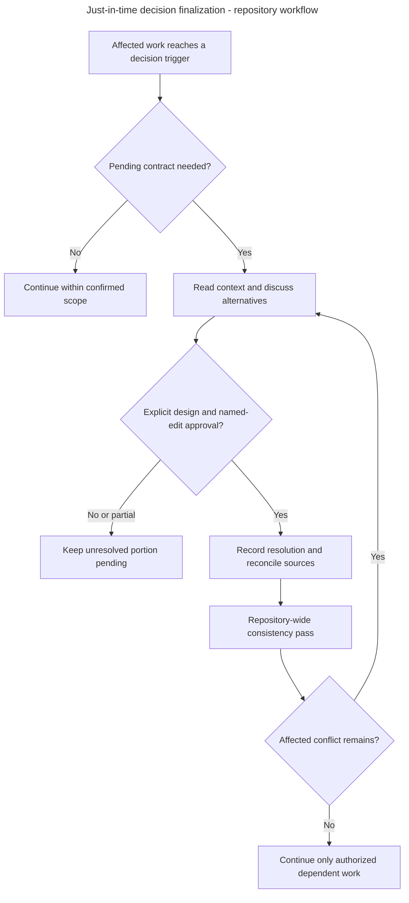

# Architecture Decisions

## Introduce or change a decision

1. Check the [decision index](../../adr/README.md) and the relevant guide. Find out whether the question is already decided, still proposed, or an implementation detail within an accepted choice.
2. For a new architectural choice, copy the [ADR template](../../adr/template.md), allocate the next unused ID, and give it a specific title. Explain the problem and the actual options in language a new contributor can follow.
3. Record the status and the known decision date. If the original decision date was not recorded, use the ADR's writing date in the Date field and say in Context that the original date is unknown. Do not invent a rejected alternative, a benchmark result, or a historical date.
4. Keep the decision focused. If two choices can change independently, consider separate ADRs. Length is a reason to review the scope, not a word limit. Move schemas, procedures, extensive examples, and teaching material into their owning references.
5. When an accepted choice changes, create a new ADR that explicitly supersedes the old one. Update the old record’s status and links so readers can follow the history. Do not rewrite the old rationale to make the new choice look inevitable.
6. Update the owning workflow/record references, index, affected human guidance and architecture introduction where needed together. Ordinary corrections and navigation improvements can update an existing ADR without pretending a new decision was made.

Keep assigned ADR IDs stable. Use the next unused ID in the index for a new choice. Reorganizing an explanation does not create a new architectural decision.

## Just-in-time architecture decisions

Alice is ready to implement application-key authorization. Its verifier split is accepted, but the exact revocation/checkpoint contract is still pending. This is the time to discuss that contract. An unrelated change to a human grant error message should not require settling background-job credential lifetime.

### Find the relevant pending question

Pending analyses live directly under the owning skill's `references/` directory as `decision-*.md`. Every file has a stable `PD-OWNER-NN` identifier, status, issue kind, example, accepted context, viable alternatives, non-binding recommendation, precise trigger, impact, open questions and sources. The [existing module map](../../../.agents/skills/inframeld-architecture/references/module-map.md#pending-decision-navigation) provides the complete navigation. Domain skill entry points link their own files directly. Do not load every decision or Architecture for a narrow task.

Keep accepted requirements, unresolved mechanisms and qualification gaps separate. A qualification gap means a claim still needs evidence. It does not reopen the selected policy or prohibit authorized tests of that policy. For a mixed entry, pause only work that must choose the unresolved contract. Continue independent work and evidence gathering within the developer's confirmed scope.

| Status | Meaning |
| --- | --- |
| `PENDING` | The stated choice or evidence remains unresolved. Recommendations are not authority. |
| `ACCEPTED` | The concrete choice received explicit approval and is recorded in the linked ADR or owning reference. Qualification remains separately stated. |
| `DEFERRED` | Discussion or delivery was deliberately postponed. Dependent code cannot assume an answer. |
| `SUPERSEDED` | A linked later resolution replaces this choice. Preserve the rationale and follow explicit supersession. |

A qualification-only entry may close as `ACCEPTED` only when the developer approves the documented qualification approach or recorded resolution. Say separately which checks passed, failed or remain unrun. A passing check by itself is not architectural approval, and accepted design is not successful qualification. Keep the stable ID and file path after resolution so old links continue to work. Allocate ADR numbers only when an actual ADR is written.

### Discuss, approve and reconcile

1. **Match the trigger.** Name the pending ID and explain why this work needs it now. A behavior-only explanation can describe an open question without forcing a design decision. Unrelated entries do not block development.
2. **Read current evidence.** Load the entry, owning reference/records, accepted ADRs and relevant inspected implementation. Follow neighboring decision links only under their stated conditions. Recheck assumptions rather than treating the original review as timeless evidence.
3. **Explain the choice.** Use a concrete example, then describe behavior, alternatives, practical trade-offs, recommendation and affected owners. State which requirements are already accepted. Design experiments can inform the discussion without accepting their mechanism.
4. **Check the proposed resolution.** Compare it with accepted decisions and cross-module contracts before approval. Identify affected other entries and incompatible assumptions. A conflict is a question for the developer, not permission to rewrite an accepted choice.
5. **Obtain explicit approval.** Present one concrete final design with the exact files/sections and intended documentation edits. Ask for design and those named edits together. Recommendations, silence, partial approval and approval of this process do not finalize an entry. Preserve unapproved portions as pending. Repository file-specific confirmation still applies.
6. **Record the result.** Use the existing [ADR template](../../adr/template.md) for a meaningful architectural choice. Record an ordinary implementation-contract resolution in its owning reference when it adds no independent architectural rationale. Record the known approval date/scope and link the stable pending ID. Changes to accepted architectural choices use explicit supersession. Do not create an ADR merely to claim qualification passed.
7. **Reconcile affected sources.** Update the entry's status and resolution link together with guides, records, skill/workflow references, navigation and affected diagrams. Keep one current explanation of the chosen contract. Preserve alternatives as historical rationale, distinguish implementation/qualification, and recheck affected sequence diagrams as well as structural views.
8. **Run the repository-wide consistency pass.** Search all repository skills, workflow references and development guides, ADRs, root/directory guidance and relevant source contracts for the ID, concepts, old wording, symbols and affected interfaces. Inspect each meaningful match and neighboring callers for contradictory rules, stale assumptions, incompatible inputs/results and broken references. Check cross-module lifecycle, authority, transaction and external-effect boundaries. Validate links and changed diagrams. A global search plus deep affected reads is required, not loading all skills before every small task. Report inspected scope and unresolved conflicts rather than claiming completeness from text matching alone.
9. **Resume only authorized work.** Dependent implementation waits for the approved resolution to be recorded and its affected consistency issues resolved or explicitly decided. Discuss an uncovered conflict instead of silently selecting a policy. Complete unrelated authorized work. Design/documentation approval grants no application-write permission.

Arrows show the documentation and approval sequence, not application states or runtime services. This process does not accept any pending product design. Qualification work follows the entry's stated claim gate, without treating missing evidence as a ban on gathering it.

A newly accepted target may intentionally differ from inspected implementation. Record that delivery or compatibility boundary explicitly. The consistency pass must distinguish this expected gap from contradictory guidance, without requiring unimplemented code to already match the target or granting permission to edit application files.

### Validate maintenance of this process

Keep all existing skill metadata and activation boundaries. Add precise conditional links rather than duplicating decision analysis. Validate frontmatter, identifiers, direct routes, anchors and source-backed facts. For substantial changes, use fresh read-only positive/negative requests and inspect actual loading traces. Include an affected Access task, an unrelated implemented grant task, a qualification-only task and a fictional approval/partial-approval/deferred scenario in temporary material. Report unavailable evaluations honestly. Add no permanent decision database, evaluation framework or enforcement tests.
